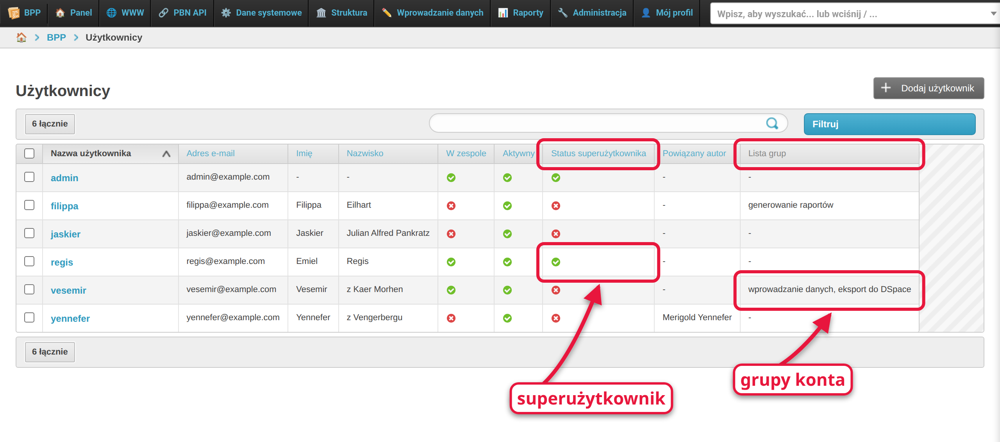
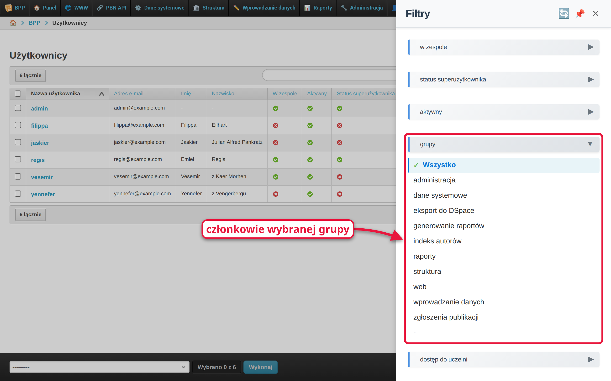

# Grupy uprawnień

Uprawnienia w module redagowania nadaje się, dopisując użytkownika do grup.
BPP tworzy grupy automatycznie (m.in. „wprowadzanie danych”, „indeks autorów”,
„dane systemowe”, „struktura”, „web”, „raporty”, „administracja”) i przy
każdej migracji bazy odtwarza ich listę uprawnień (`odtworz_grupy`). Ręczne
okrojenie uprawnień grupy w panelu nie przetrwa więc aktualizacji —
o dostępie decyduje to, **kto należy do grupy**.

## Grupy uprzywilejowane

Część grup pozwala na więcej niż redagowanie danych: na wstawienie
wykonywalnego HTML/JavaScript, który zobaczą inni użytkownicy, albo na
zmianę konfiguracji całego serwisu. Takie grupy należy traktować tak samo
jak konto administratora (superużytkownika).

| Grupa | Co może | Dlaczego to uprawnienie równoważne administracyjnemu |
|---|---|---|
| „administracja” | Edytować użytkowników i grupy (w tym przynależność do grup), formularze wyszukiwania, kolumny modułu redagowania, obsługujących zgłoszenia. | Może dopisać dowolne konto — także własne — do każdej grupy, w tym do grup uprzywilejowanych z tej tabeli. |
| „web” | Edytować szablony przechowywane w bazie (dbtemplates), artykuły na stronie głównej, witryny (`Site`) i favicony. | Szablony z bazy mają pierwszeństwo przed szablonami z dysku, więc można nadpisać **dowolny** szablon serwisu, także stronę logowania i panel administracyjny. Treść artykułów jest wyświetlana jako surowy HTML. W obu przypadkach można wstrzyknąć JavaScript widoczny dla wszystkich użytkowników, w tym superużytkowników. Zmiana domeny witryny wpływa na rozpoznawanie uczelni po nazwie hosta i na adresy bezwzględne generowane przez system. |
| „dane systemowe” | Edytować słowniki systemowe, w tym ustawienia formularzy (formdefaults) z polami „HTML przed” / „HTML po” (`html_before`, `html_after`). | Pola te są wstawiane do formularzy (m.in. raportów i importów) jako kod szablonu Django, bez filtrowania HTML — można w nich umieścić JavaScript wykonywany u każdego, kto otworzy formularz. |
| „raporty” | Edytować definicje raportów (flexible-reports): szablon raportu, tabele, kolumny, źródła danych. | Szablon raportu jest renderowany jako szablon Django bez filtrowania HTML. Zmiana szablonu istniejącego raportu trafia do wszystkich jego odbiorców — zależnie od ustawień raportu także do niezalogowanych. |

Grupy „wprowadzanie danych”, „indeks autorów” i „struktura” nie są na tej
liście: pola z HTML-em, które redagują (tytuły, streszczenia, „informacje”,
„szczegóły”, „uwagi”, biogram autora, tytuł strony głównej, opisy jednostek,
tekst deklaracji dostępności), są przy zapisie lub wyświetlaniu oczyszczane
z niedozwolonych znaczników. Konfigurację integracji uczelni (PBN, Clarivate,
ORCID, DSpace) wraz z danymi dostępowymi widzi i zmienia wyłącznie
superużytkownik.

## Wgląd w metryki jednostek (bez grupy) {#metryki-jednostek}

Zestawienie PDF [„Metryki jednostek”](../redaktor/metryki-jednostek.md)
zawiera imienne oceny pracowników. Poza grupą „wprowadzanie danych” (która
widzi wszystkie jednostki) dostęp do niego daje się **bez żadnej grupy**:

- **kierownik jednostki** widzi swoją jednostkę automatycznie — wystarczy,
  że jego konto jest powiązane z autorem, a autor ma w jednostce funkcję
  „kierownik” w bieżących datach,
- innym osobom administrator wskazuje jednostki w edycji użytkownika
  (**Administracja → Użytkownicy**):
  sekcja **„Metryki jednostek”**, pole **„Metryki jednostek — jednostki do
  wglądu”** (z podjednostkami).

To pole nie daje innych uprawnień. Szczegóły:
[Kto widzi metryki jednostek](../redaktor/metryki-jednostek.md#kto-widzi).

## Zalecenia

- **Nadawaj grupy uprzywilejowane tylko zaufanym osobom**, tak samo jak
  konto superużytkownika. Osobom, które mają wyłącznie redagować publikacje,
  wystarczy „wprowadzanie danych”.
- **Uwierzytelnianie wieloskładnikowe (MFA).** BPP nie ma własnego drugiego
  składnika logowania (TOTP, klucze sprzętowe). MFA można uzyskać przez
  zewnętrznego dostawcę tożsamości — logowanie przez Microsoft 365, OIDC
  albo [LDAP/ActiveDirectory](zaawansowane.md#konfiguracja-ldap-activedirectory)
  — jeżeli wymusza je ten dostawca. Logowanie loginem i hasłem BPP pozostaje
  przy tym dostępne, więc dla kont uprzywilejowanych warto korzystać
  wyłącznie z logowania przez dostawcę z MFA i stosować
  [politykę haseł](zaawansowane.md#polityka-haseł).
- **Okresowo przeglądaj członków grup** — patrz
  [Przegląd członków grup](#przegląd-członków-grup) niżej.
- **Historia zmian.**
    - Szablony z bazy (dbtemplates) mają historię wersji z porównaniem
      zmian (django-reversion) — przycisk „Historia” na stronie szablonu.
    - Każdy rekord edytowany w module redagowania (publikacje z autorami,
      autorzy, struktura, słowniki, użytkownicy, grupy, ustawienia) ma
      historię wersji z porównaniem dwóch wersji i przywracaniem — patrz
      [Historia zmian publikacji](../redaktor/wydawnictwa.md#historia-zmian).
      Bez historii są tylko logi, wyniki zadań, sesje importów i kopie
      danych z PBN.
    - Przy każdej wersji zapisuje się **źródło zmiany**: moduł redagowania,
      strona, import lub narzędzie, API / MCP (z aplikacją OAuth) albo
      system. Pełna lista zmian z filtrami po źródle i aplikacji:
      **Administracja → Historia zmian (rewizje)**. Historia jest trzymana
      bez limitu czasu.
    - Hasła, tokeny PBN i sekrety aplikacji OAuth **nie są** zapisywane
      w wersjach; przywrócenie wersji użytkownika nie zmienia jego hasła.
    - W instalacji produkcyjnej dziennik django-easy-audit rejestruje
      zmiany rekordów uczelni i jednostek.
    - Dla pozostałych obiektów (artykuły, ustawienia formularzy, raporty,
      użytkownicy i grupy) dostępny jest standardowy dziennik panelu
      administracyjnego (przycisk „Historia”): kto i kiedy zmienił obiekt
      oraz które pola — **bez** poprzedniej treści. Jeżeli potrzebny jest
      pełny ślad zmian, rozważ dopisanie tych modeli do
      `DJANGO_EASY_AUDIT_REGISTERED_CLASSES`.
    - Rekordy utworzone poza formularzami panelu — przez importery (PBN,
      importer publikacji, import pracowników, importer autorów PBN,
      import patentów), przycisk „Toż” i niektóre polecenia `manage.py` —
      też mają wpis „dodano” w historii, z opisem, skąd pochodzą. Autorem
      wpisu jest osoba, która uruchomiła import.
    - Zmiany istniejących rekordów robione poza formularzami — scalanie
      autorów, przemapowania źródeł i prac autora (oraz ich cofnięcia),
      aktualizacje z importu pracowników, POLON-u i importu dyscyplin,
      ustawienia z porównania z CrossRef i modułu rozbieżności, powiązania
      z PBN — mają wpis „zmieniono” z opisem operacji. Logi
      przemapowań źródeł (menu **Wprowadzanie danych → „Przemapowania
      źródeł”** i **„Przemapowania źródeł PBN”**) może oglądać grupa
      „wprowadzanie danych”; są tylko do odczytu
      (zob. [Przemapowanie źródeł](../redaktor/przemapowanie-zrodel.md#log)). W modelach
      z historią wersji (m.in. autorzy, publikacje) taka zmiana zapisuje
      też wersję, więc można ją cofnąć przyciskiem „Historia”. Usunięcie duplikatu przy scalaniu zostawia wpis
      „usunięto”.
- **Konta `system-user-…`.** Gdy import uruchomiono poleceniem
  `manage.py` (bez zalogowanej osoby), wpisy historii są przypisywane
  kontu `system-user-<login>`, gdzie `<login>` to login systemowy, z którego
  uruchomiono polecenie (np. `system-user-biblio`). Konto powstaje
  automatycznie przy pierwszym takim rekordzie, jest nieaktywne i nie ma
  hasła — nie da się na nie zalogować. Nie usuwaj go: usunięcie skasuje
  powiązane wpisy historii.

## Przegląd członków grup

1. W module redagowania wybierz z górnego menu **Administracja →
   Użytkownicy**. Kolumna **Lista grup** pokazuje grupy każdego konta,
   a kolumna **Status superużytkownika** — konta z pełnymi uprawnieniami.

    

2. Kliknij **Filtruj** i rozwiń filtr **grupy**. Wybranie grupy pokazuje
   wszystkich jej członków; filtr **status superużytkownika** pokazuje konta
   z pełnymi uprawnieniami.

    
