# Import pracowników

Funkcja importu pracowników i jednostek pozwala zaktualizować w BPP listę
pracowników uczelni na podstawie pliku XLSX — np. eksportu z systemu
kadrowego (takiego jak [Egeria](https://egeria.comarch.pl)). Import:

- dopasowuje osoby z pliku do autorów w BPP, a brakujących może utworzyć,
- dopisuje autorom jednostki, tytuły i daty zatrudnienia,
- tworzy jednostki (oraz tytuły, stopnie służbowe, stanowiska), których
  jeszcze nie ma w bazie,
- proponuje zakończenie zatrudnienia osobom, których nie ma w pliku
  („odpięcia”).

Nic nie trafia do bazy od razu: najpierw plik jest analizowany „na sucho”,
a zmiany zapisujesz w dwóch krokach — najpierw strukturę (jednostki),
potem osoby.

## Kontrola dostępu

Dostęp do funkcji importu pracowników mają:

- członkowie grupy *wprowadzanie danych*,
- superużytkownicy.

Każdy użytkownik widzi na liście tylko importy, które sam utworzył.

## Jak uruchomić?

Po zalogowaniu wybierz z menu głównego **operacje ➡ import pracowników
i jednostek**.

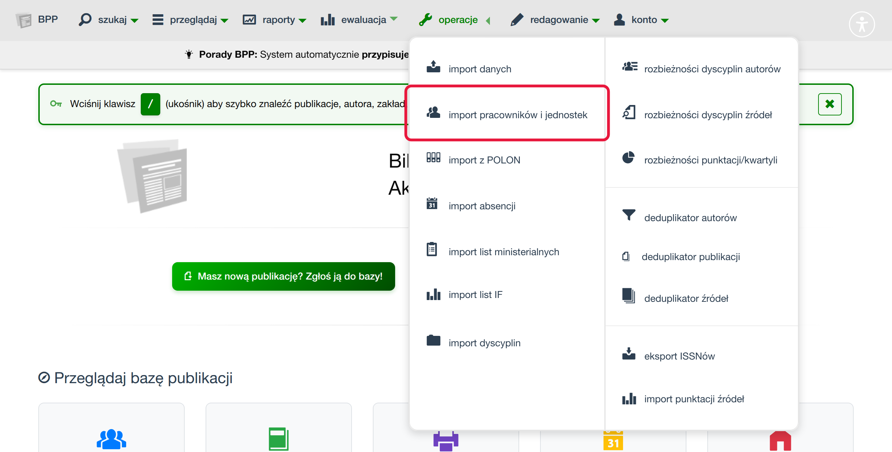

Otworzy się lista Twoich wcześniejszych importów z przyciskami **utwórz
nowy import** i **pobierz plik wzorcowy**. Import, który nie ma jeszcze
zmapowanych kolumn, ma link **dokończ mapowanie kolumn**, pozostałe —
**przegląd**.

## Plik importu

Przykładowy plik pobierzesz przyciskiem **pobierz plik wzorcowy** (na
liście importów i w formularzu nowego importu). Jest też w repozytorium
kodu źródłowego BPP — [plik wzorcowy na GitHub](https://github.com/iplweb/bpp/blob/dev/src/import_pracownikow/static/import_pracownikow/import_pracownikow_przyklad.xlsx).
Druga zakładka pliku wzorcowego („Opis kolumn”) opisuje znaczenie każdej
kolumny.

Wymagane kolumny to **Nazwisko**, **Imię** i **Nazwa jednostki**. Pozostałe
(m.in. Numer z systemu kadrowego, ORCID, Tytuł/Stopień, Stanowisko, Wydział,
Data zatrudnienia, Data końca zatrudnienia, Podstawowe miejsce pracy,
PBN UUID, BPP ID, Wymiar etatu) są opcjonalne. Nazwy kolumn nie muszą być
identyczne z wzorcem — przypisujesz je na ekranie mapowania.

!!! note "Jeden arkusz = jeden import"

    Plik może mieć tylko jeden arkusz z danymi. Skoroszyt z kilkoma
    arkuszami danych (np. dwie uczelnie) zostanie odrzucony.

## Krok po kroku

### 1. Nowy import

1. Kliknij **utwórz nowy import**.
2. W polu **Plik xls** wskaż plik.
3. Opcjonalnie podaj **Datę zmian personalnych** — zostanie użyta jako data
   rozpoczęcia pracy przy dopisywaniu autora do jednostki, gdy wiersz pliku
   nie podaje własnej daty zatrudnienia.
4. Kliknij **Utwórz import**.

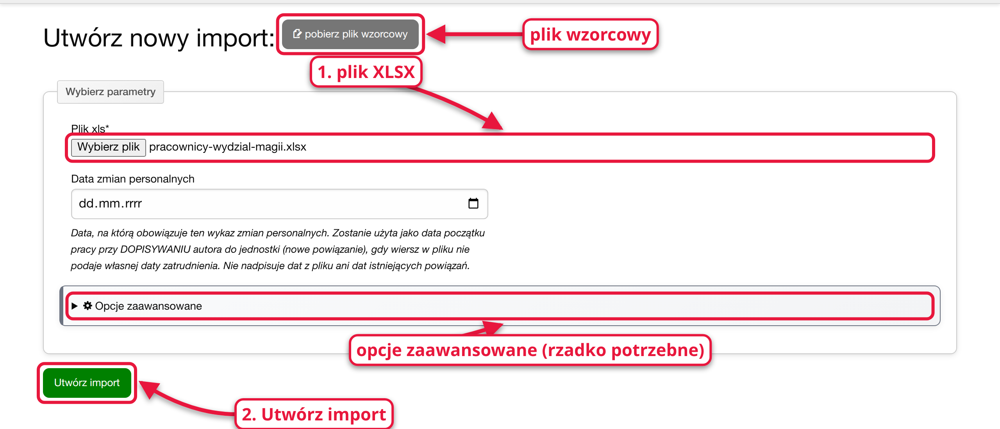

Szuflada **Opcje zaawansowane** zawiera dwie rzadko potrzebne opcje —
[przepięcie wszystkich prac](#przepinanie-prac-na-nowe-jednostki)
i [nadpisywanie dat zatrudnienia](#nadpisywanie-dat-zatrudnienia-wartościami-z-pliku).
Przy zaznaczaniu każdej z nich system prosi o potwierdzenie.

### 2. Mapowanie kolumn

Na ekranie **Zweryfikuj kolumny** widać próbkę danych z pliku, a pod nią —
dla każdej kolumny pliku — pole w BPP, na które ma trafić (albo „— pomiń —”).
System sam proponuje mapowanie na podstawie nazw kolumn; sprawdź je
i ewentualnie popraw.

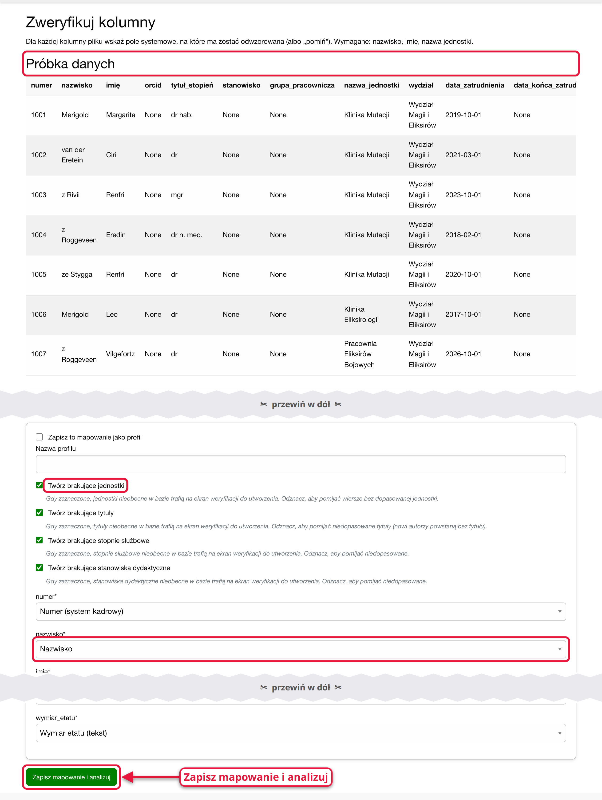

Na tym ekranie są też opcje:

- **Zapisz to mapowanie jako profil** (z **Nazwą profilu**) — przy kolejnym
  pliku o tych samych kolumnach mapowanie zostanie podpowiedziane
  automatycznie;
- **Twórz brakujące jednostki / tytuły / stopnie służbowe / stanowiska
  dydaktyczne** — domyślnie zaznaczone: brakujące pozycje trafią na ekran
  weryfikacji do utworzenia. Po odznaczeniu niedopasowane pozycje są
  pomijane (a wiersze bez dopasowanej jednostki — pominięte w całości).

Kliknij **Zapisz mapowanie i analizuj**. Analiza działa w tle; po jej
zakończeniu strona sama przejdzie do przeglądu importu.

### 3. Krok 1 — struktura (jednostki)

Przegląd importu pokazuje, co w pliku nie ma odpowiednika w bazie. Import
osób jest zablokowany, dopóki nie zapiszesz struktury.

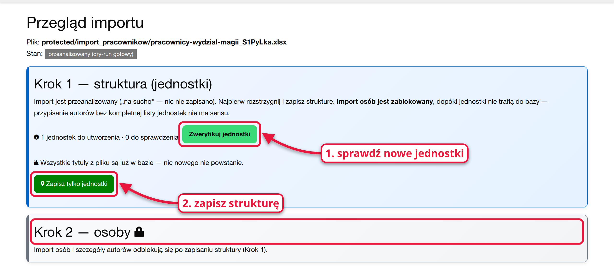

1. Kliknij **Zweryfikuj jednostki**. Dla każdej jednostki z pliku, która nie
   ma dokładnego odpowiednika w bazie, wybierz decyzję (np. **Utwórz nową**
   albo zmapowanie na istniejącą jednostkę) i wydział nadrzędny, potem
   kliknij **Zapisz decyzje**.

    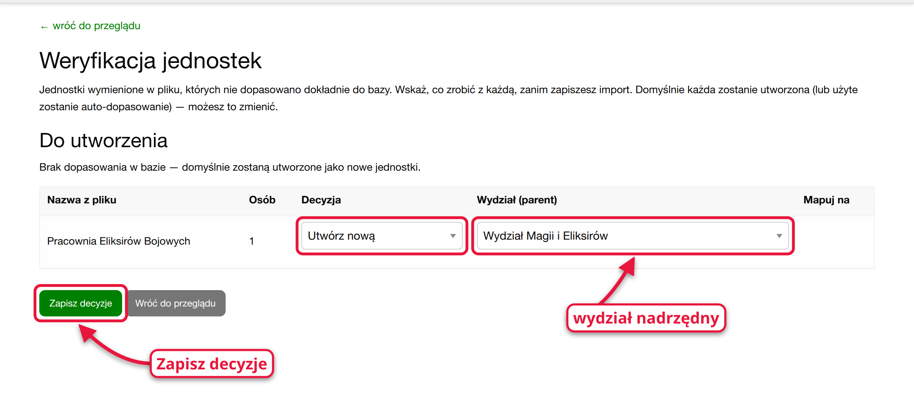

2. Jeśli w pliku są tytuły, stopnie służbowe lub stanowiska, których nie ma
   w bazie, przegląd pokaże przyciski **Zobacz tytuły** / **Zobacz stopnie** /
   **Zobacz stanowiska** — sprawdź je tak samo.
3. Kliknij **Zapisz tylko jednostki** albo **Zapisz jednostki + słowniki**
   (ten drugi przycisk tworzy od razu także brakujące tytuły, stopnie
   i stanowiska). Gdy nic nowego nie powstaje, przycisk nazywa się
   **Przejdź do kolejnego kroku**.

!!! info

    Jednostki z pliku są dopasowywane do bazy po nazwie. Jednostka o choćby
    minimalnie innej nazwie trafi na listę „do utworzenia” — sprawdź tę listę
    uważnie, żeby nie powstały duplikaty jednostek.

### 4. Krok 2 — osoby

Po zapisaniu struktury przegląd pokazuje dwa kafelki: **Ludzie z XLS**
(osoby z pliku) i **Ludzie spoza XLS** (powiązania obecne w bazie, których
nie ma w pliku).

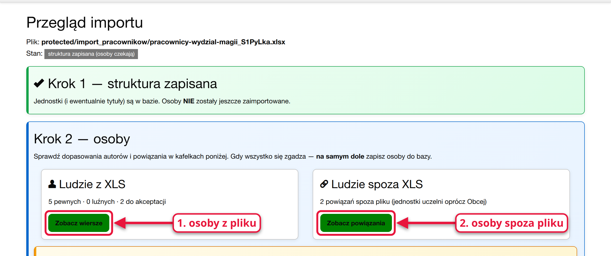

**Zobacz wiersze** otwiera listę osób z pliku z filtrami i porównaniem
danych z pliku z danymi w bazie. Kolumna **Pewność** mówi, jak osoba została
dopasowana:

- **twardy match** — jednoznacznie, po identyfikatorze (BPP ID, ORCID,
  PBN UUID, numer z systemu kadrowego) albo po imieniu i nazwisku;
- **wielu kandydatów** — w bazie jest kilka osób o tym imieniu i nazwisku:
  wybierz właściwą z listy i kliknij **potwierdź** (albo **inny autor…**);
- **brak dopasowania** — osoby nie ma w bazie: zdecyduj **Pomiń — nie
  importuj**, **Utwórz nowego autora** albo **Dopasuj do istniejącego**.

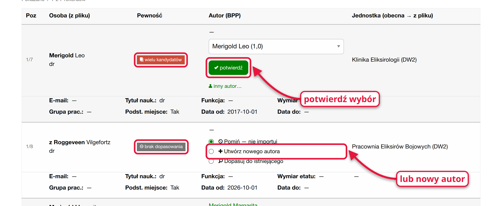

Wiersze bez rozstrzygniętego dopasowania zostaną pominięte przy zapisie —
przegląd ostrzega o ich liczbie.

!!! tip "Jednoznaczne dopasowanie"

    Jeśli w bazie są osoby o tym samym imieniu i nazwisku, podaj w pliku
    identyfikator — kolumnę **BPP ID**, **ORCID** albo **PBN UUID**. Takie
    wiersze dopasują się bez ręcznego wyboru.

### 5. Odpinanie nieaktualnych miejsc pracy {#odpinanie-nieaktualnych-miejsc-pracy}

**Zobacz powiązania** w kafelku **Ludzie spoza XLS** otwiera listę powiązań
Autor+Jednostka, które są w bazie, a nie ma ich w pliku. Domyślnie żadne nie
jest zaznaczone — zaznacz **odepnij** przy osobach, które faktycznie już
u Was nie pracują, albo użyj **Zaznacz do odpięcia (wszystkie z bieżącego
wyboru)** (zaznacza wszystkie wiersze widoczne po wyszukiwaniu).

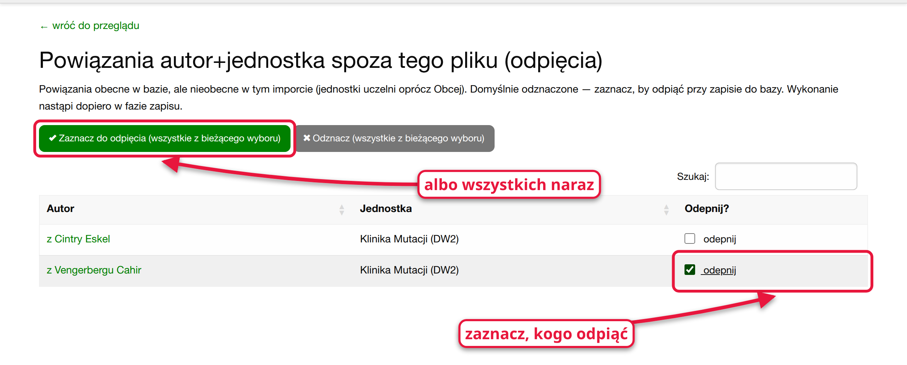

Odpięcie polega na wpisaniu w powiązaniu Autor+Jednostka daty zakończenia
pracy (dzień poprzedzający zapis) i zdjęciu oznaczenia „podstawowe miejsce
pracy”. Wykonuje się dopiero przy zapisie osób. Powiązania, które mają już
ustawioną datę zakończenia, nie są zmieniane.

Na liście znajdą się wyłącznie powiązania, które:

- nie wystąpiły w pliku importu,
- są aktywne (bez daty zakończenia pracy w przeszłości),
- dotyczą jednostki z [polem Zarządzaj automatycznie](../redaktor/jednostki.md#pole-zarządzaj-automatycznie)
  ustawionym na `TAK`,
- nie dotyczą [obcej jednostki](../redaktor/uczelnia.md#obca-jednostka).

!!! warning

    Jeśli importujesz plik z danymi tylko kilku osób albo jednego wydziału,
    lista „spoza pliku” obejmie praktycznie całą resztę uczelni. Nie zaznaczaj
    wtedy odpięć hurtem — inaczej zakończysz zatrudnienie osobom, które nadal
    pracują.

!!! note

    Odpinanie jest szczególnie przydatne, jeżeli chcemy mieć aktualne
    informacje w polu — por. [Pole *Aktualne miejsce pracy* dla autora](../redaktor/autorzy.md#pole-aktualne-miejsce-pracy-dla-autora).

### 6. Zapis osób do bazy

Wróć do przeglądu (**wróć do przeglądu**) i przewiń na sam dół. Zaznacz
**Rozumiem, że to zapisze zmiany do bazy danych.** i kliknij **Zapisz osoby
do bazy**.

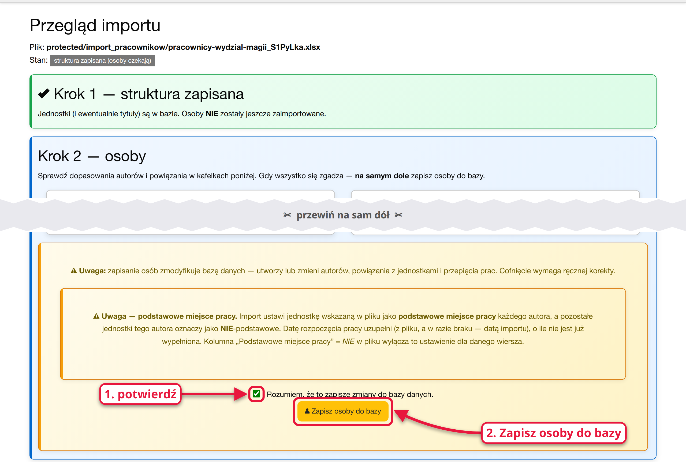

Import ustawi jednostkę z pliku jako **podstawowe miejsce pracy** każdego
autora (pozostałe jego jednostki dostaną „NIE-podstawowe”). Wartość `NIE`
w kolumnie „Podstawowe miejsce pracy” wyłącza to dla danego wiersza.

Po zakończeniu zapisu zobaczysz podsumowanie: liczbę zintegrowanych wierszy,
odpięć i utworzonych autorów.

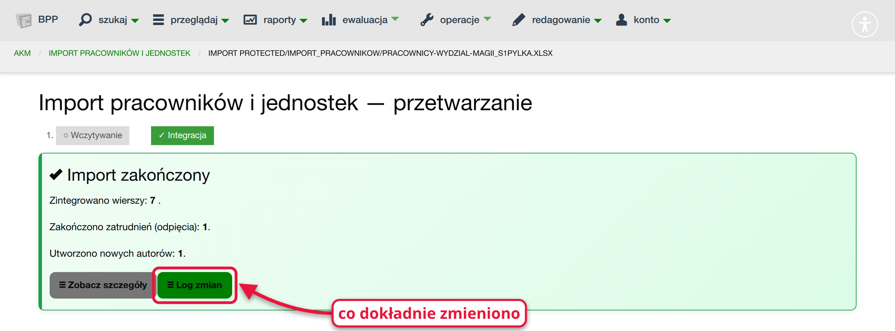

### 7. Log zmian

**Log zmian** pokazuje, co import faktycznie zmienił: zakończone zatrudnienia
(odpięcia) oraz — dla każdej osoby — zmiany danych autora i powiązań
z jednostkami, utworzone rekordy i przepięcia prac. Wiersze bez zmian nie są
pokazywane.

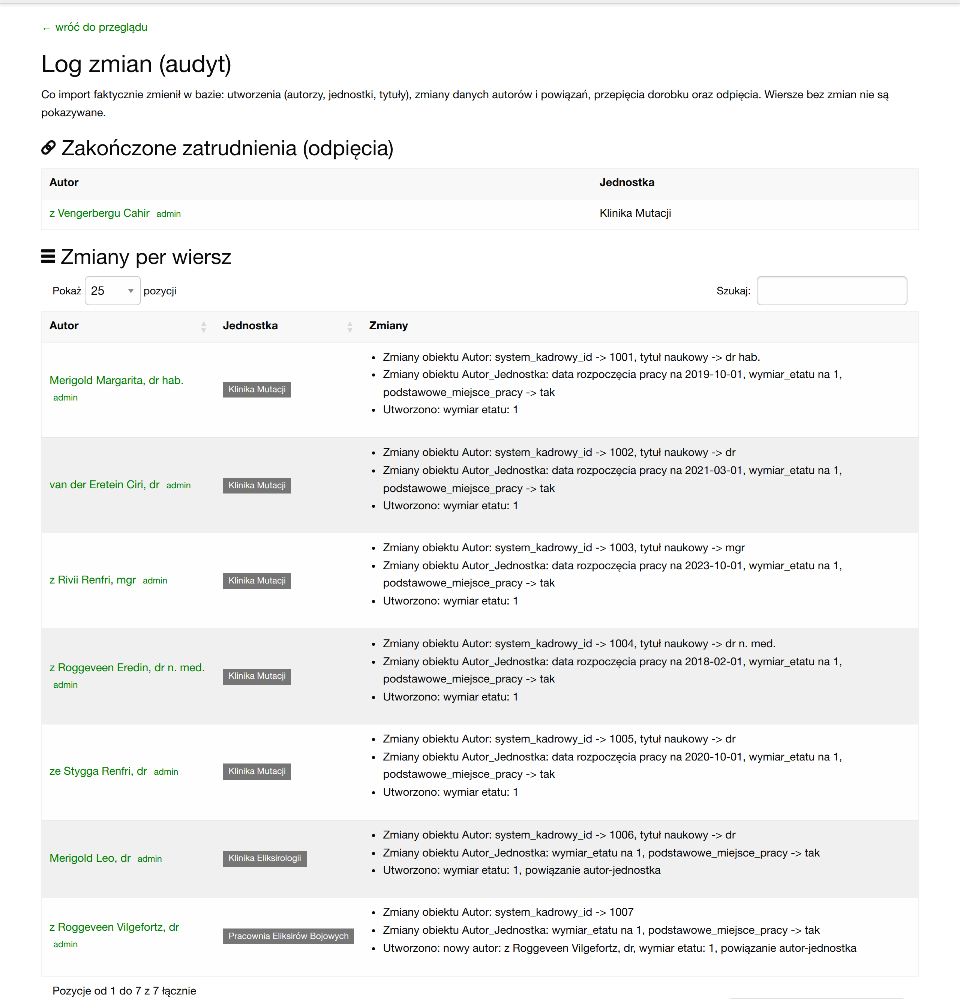

## Nadpisywanie dat zatrudnienia wartościami z pliku

Domyślnie import **nigdy nie nadpisuje** istniejących dat zatrudnienia —
wypełnia tylko puste („data od”/„data do” bez wartości w bazie), a
różnice pokazuje wyłącznie w podglądzie. Jeśli daty w bazie są błędne
(np. poprzedni import pliku bez dat ostemplował wszystkich datą importu),
zaznacz w szufladzie „Opcje zaawansowane” opcję **Nadpisuj daty
zatrudnienia (od/do) wartościami z pliku**:

- nadpisywane są tylko daty osób obecnych w pliku, tam gdzie plik niesie
  datę różną od bazy;
- puste komórki pliku niczego nie kasują;
- przy zaznaczaniu opcji system prosi o potwierdzenie ryzyka (bez liczby
  wierszy — ta jeszcze nie jest znana), a dopiero przed końcowym zapisem
  pokazuje liczbę wierszy, których daty zostaną nadpisane;
- nadpisanie, które spowodowałoby nałożenie się dwóch okresów
  zatrudnienia w tej samej jednostce, jest odrzucane per-wiersz z
  czytelnym błędem.

## Przepinanie prac na nowe jednostki

Gdy osoba z pliku ma w bazie inną aktualną jednostkę niż w pliku, na liście
osób przy jej wierszu pojawia się opcja przepięcia jej prac (afiliacji
w publikacjach) ze starej jednostki na nową. Domyślnie prace **nie** są
przepinane.

Opcja **Zaznacz wszystkie prace do przepięcia na nowe jednostki**
w szufladzie „Opcje zaawansowane” zaznacza przepięcie od razu dla wszystkich
takich wierszy (można je potem odznaczać pojedynczo). Używaj jej tylko przy
imporcie do świeżej bazy — w bazie z wieloletnim dorobkiem przepięłaby
historyczne afiliacje.

## Przechowywanie plików

Wgrany plik XLSX jest automatycznie usuwany z serwera po 90 dniach (wartość
domyślna). Historia importu — przegląd, wiersze i log zmian — zostaje.
