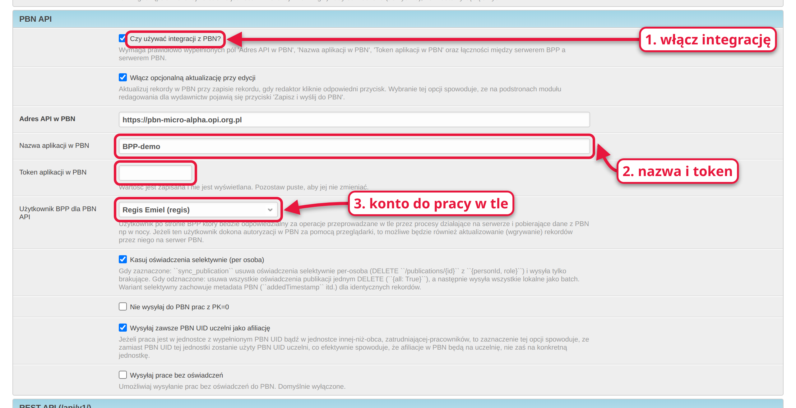
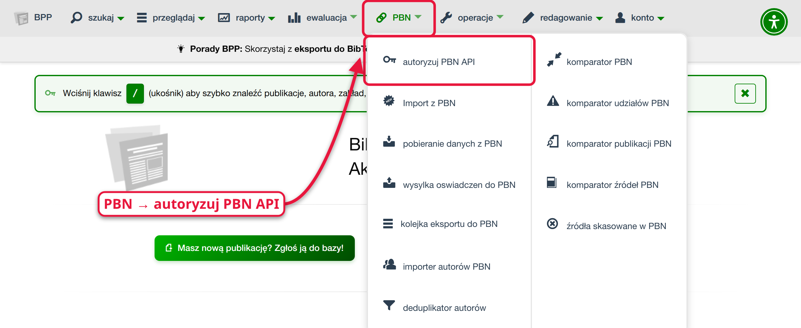

# Konfiguracja integracji z serwisami PBN

System BPP oferuje integrację z Polską Bibliografią Naukową (PBN), umożliwiając automatyczne
wysyłanie publikacji do PBN oraz pobieranie danych ze źródeł PBN. Niniejsza dokumentacja
przedstawia sposób konfiguracji tej integracji przez panel administracyjny.

Ta strona opisuje formularz krok po kroku. Zwięzłą listę czynności po
stronie PBN (rejestracja aplikacji, adres zwrotny), warunki, jakie musi
spełniać rekord wysyłany do PBN, oraz polecenia do wgrywania opłat znajdziesz
na stronie [Integracja z PBN API](integracja-pbn.md).

## Wymagania wstępne

Przed rozpoczęciem konfiguracji należy:

1.  Posiadać konto w systemie PBN z uprawnieniami Importer Publikacji.
2.  Założyć aplikację w systemie PBN - z konta z poziomem uprawnień Menedżer Aplikacji - i otrzymać dane dostępowe:
    - **Identyfikator aplikacji** (App ID)
    - **Token aplikacji** (App Token)
3.  Mieć uprawnienia administratora w systemie BPP aby skonfigurować dostęp do PBN w systemie BPP

## Dostęp do konfiguracji

Ustawienia PBN widzi i zmienia wyłącznie **superużytkownik** — innym
redaktorom ta sekcja formularza w ogóle się nie wyświetla.

1.  Zaloguj się do modułu redagowania jako superużytkownik.
2.  Z górnego menu wybierz **Struktura** → **Uczelnia** i otwórz swoją uczelnię.
3.  Przewiń do sekcji **PBN API**.

## Konfiguracja parametrów PBN

Pola sekcji **PBN API** (w kolejności, w jakiej występują w formularzu):

**Czy używać integracji z PBN?**
- Główny przełącznik. Wymaga wypełnionych pól „Adres API w PBN”, „Nazwa
  aplikacji w PBN”, „Token aplikacji w PBN” oraz łączności między serwerem
  BPP a serwerem PBN. Dopiero po jego włączeniu na stronie głównej pojawia
  się menu **PBN**.

**Włącz opcjonalną aktualizację przy edycji**
- Na stronach edycji wydawnictw w module redagowania pojawiają się przyciski
  **„Zapisz i wyślij do PBN”**. Można je zaznaczyć tylko razem z integracją
  z PBN.

**Adres API w PBN**
- **Domyślna wartość:** `https://pbn-micro-alpha.opi.org.pl` (serwer testowy PBN).
- W instalacji produkcyjnej należy ustawić adres produkcyjny PBN
  (`https://pbn.nauka.gov.pl/`).

**Nazwa aplikacji w PBN**
- Identyfikator aplikacji nadany przy jej rejestracji w PBN (maks. 128 znaków).

**Token aplikacji w PBN**
- Token bezpieczeństwa aplikacji otrzymany z PBN (maks. 128 znaków).
- Zapisany token **nie jest wyświetlany** — pole jest puste, a pod nim widać
  komunikat „Wartość jest zapisana i nie jest wyświetlana. Pozostaw puste, aby
  jej nie zmieniać”. Wpisz token tylko wtedy, gdy chcesz go zmienić.

**Użytkownik BPP dla PBN API**
- Konto BPP, w imieniu którego działają operacje wykonywane w tle (np. nocne
  pobieranie danych z PBN). Ten użytkownik musi raz wykonać autoryzację w PBN
  (patrz niżej); dopiero wtedy w tle możliwe jest także wysyłanie rekordów.

**Kasuj oświadczenia selektywnie (per osoba)**
- **Domyślnie:** zaznaczone.
- Gdy zaznaczone, przy aktualizacji publikacji w PBN usuwane są tylko
  oświadczenia, które się zmieniły, i dosyłane brakujące — pozostałe
  zostają nietknięte. Gdy odznaczone, przed wysyłką usuwane są **wszystkie**
  oświadczenia publikacji w PBN i wysyłane od nowa.

**Nie wysyłaj do PBN prac z PK=0**
- **Domyślnie:** nie zaznaczone. Blokuje wysyłanie do PBN publikacji bez
  punktów MNiSW.

**Wysyłaj zawsze PBN UID uczelni jako afiliację**
- **Domyślnie:** zaznaczone.
- Gdy zaznaczone, wszystkie publikacje są afiliowane do uczelni, a nie do
  konkretnych jednostek organizacyjnych. Zachowanie to jest obecnie
  domyślne — pole używane było w czasach, gdy publikacja mogła być afiliowana
  na konkretną jednostkę uczelni/instytucji w PBN (na Klinikę, Dział,
  Katedrę itp.).

**Wysyłaj prace bez oświadczeń**
- **Domyślnie:** nie zaznaczone.
- Umożliwia wysyłanie do PBN publikacji bez oświadczeń dyscyplinowych. Takie
  publikacje trafiają do repozytorium PBN zamiast do systemu ewaluacyjnego
  i nie zawierają informacji o dyscyplinach naukowych autorów.
- Dotyczy prac, w których **nikt** nie ma przypiętej dyscypliny. Praca,
  w której autor ma przypiętą dyscyplinę, ale nie ma ani odpowiednika
  w PBN, ani ORCID, nie jest wysyłana niezależnie od tego ustawienia —
  decyduje o niej ustawienie poniżej.

**Wysyłaj prace, gdy autor nie ma identyfikatora w PBN**
- **Domyślnie:** nie zaznaczone.
- Dotyczy prac, w których autor ma przypiętą dyscyplinę i afiliuje, ale
  nie ma **ani** odpowiednika w PBN, **ani** ORCID — PBN nie ma jak
  przypisać jego oświadczenia do osoby.
- Nie zaznaczone: taka praca **nie jest wysyłana**, dopóki ktoś nie
  uzupełni danych autora (redaktor widzi listę autorów do poprawienia).
- Zaznaczone: praca **jest wysyłana**, ale bez oświadczeń tych autorów. Przy
  każdej takiej wysyłce pojawia się żółte ostrzeżenie „oświadczenia … w PBN
  są NIEPEŁNE” z liczbami (np. z 10 autorów z przypiętą dyscypliną do PBN
  trafiło 5 oświadczeń) i listą pominiętych autorów. Lista autorów pracy
  w PBN jest pełna — brakuje tylko oświadczeń.
- Włączaj świadomie, np. na czas uzupełniania odpowiedników w PBN; skalę
  pokazuje polecenie `pbn_oswiadczenia_bez_identyfikatora`. Szczegóły:
  [Autor bez odpowiednika w PBN i bez ORCID](../redaktor/pbn-wysylka-i-synchronizacja.md#autor-bez-identyfikatora).

Poza tą sekcją, w pierwszej (bez nagłówka) części formularza uczelni, jest
pole **Odpowiednik w PBN** — instytucja w bazie PBN odpowiadająca Twojej
uczelni. Wybierasz ją z listy instytucji pobranych z PBN, więc można je
uzupełnić dopiero po pierwszym pobraniu danych z PBN.

## Zapisywanie konfiguracji

1.  Sprawdź poprawność wprowadzonych danych.
2.  Kliknij **Zapisz** u dołu formularza.
3.  Przy włączonej integracji system od razu próbuje pobrać przykładowe dane
    z PBN. Jeżeli to się nie uda, zobaczysz ostrzeżenie z kodem błędu —
    konfiguracja i tak zostaje zapisana. Brak nazwy aplikacji lub tokena
    zgłaszany jest osobnym komunikatem „konfiguracja jest niekompletna”.

## Autoryzacja w systemie PBN

Po skonfigurowaniu podstawowych parametrów każdy użytkownik, który ma
wysyłać dane do PBN (w tym **Użytkownik BPP dla PBN API**), wykonuje
autoryzację:

1.  Przejdź do głównej strony systemu BPP.
2.  Z górnego menu wybierz **PBN** → **autoryzuj PBN API**.
3.  System przekieruje Cię do strony logowania PBN.
4.  Zaloguj się swoimi danymi dostępowymi PBN.
5.  Potwierdź udzielenie uprawnień aplikacji BPP.
6.  Zostaniesz automatycznie przekierowany z powrotem do BPP.

Menu **PBN** widzą superużytkownicy i członkowie grupy „wprowadzanie
danych”, i tylko wtedy, gdy integracja z PBN jest włączona.

Po pomyślnej autoryzacji system będzie mógł komunikować się z PBN w Twoim imieniu.

## Weryfikacja konfiguracji

Aby sprawdzić czy konfiguracja działa prawidłowo:

1.  W module redagowania przejdź do **PBN API** → **Instytucje**.
2.  Jeśli lista nie jest pusta, oznacza to, że komunikacja z PBN działa.
3.  Sprawdź, czy w polu **Odpowiednik w PBN** w ustawieniach uczelni jest
    wybrana właściwa instytucja.

## Import danych z PBN

Po skonfigurowaniu integracji zaleca się pobranie danych z PBN:

1.  Z górnego menu wybierz **PBN** → **Import z PBN**.
2.  Wybierz zakres danych do importu i uruchom go — import działa w tle
    i może potrwać od kilku minut do kilku godzin.

## Typowe problemy i rozwiązania

**Problem:** Komunikat "Brak nazwy aplikacji dla API PBN"
- **Rozwiązanie:** Wypełnij pole "Nazwa aplikacji w PBN" w ustawieniach uczelni

**Problem:** Komunikat "Brak tokena aplikacji dla API PBN"
- **Rozwiązanie:** Wypełnij pole "Token aplikacji w PBN" w ustawieniach uczelni

**Problem:** PBN odrzuca token aplikacji (ostrzeżenie z kodem błędu po zapisaniu formularza)
- **Rozwiązanie:** Sprawdź poprawność skopiowanego tokena w PBN, upewnij się że nie ma dodatkowych spacji

**Problem:** Komunikat "Najpierw wykonaj autoryzację w PBN API"
- **Rozwiązanie:** Wykonaj proces autoryzacji opisany w sekcji "Autoryzacja w systemie PBN" (menu **PBN** → **autoryzuj PBN API**)

**Problem:** Brak możliwości wysyłania publikacji do PBN
- **Rozwiązanie:** Upewnij się, że pole "Odpowiednik w PBN" jest wypełnione i że wykonano autoryzację użytkownika

## Operacje na publikacjach

Po skonfigurowaniu integracji możesz:

**Wysyłać pojedyncze publikacje do PBN:**
1.  Otwórz publikację w panelu administracyjnym
2.  Użyj przycisku **Zapisz i wyślij do PBN** (widoczny, gdy zaznaczono
    „Włącz opcjonalną aktualizację przy edycji”)
3.  System automatycznie wyśle publikację i pobierze z powrotem dane wraz z PBN UID

**Importować dane publikacji z PBN:**
- System może automatycznie pobierać informacje o publikacjach już istniejących w PBN
- Możliwe jest też pobieranie abstraktów i innych metadanych

**Zarządzać oświadczeniami dyscyplin:**
- System automatycznie wysyła oświadczenia dotyczące dyscyplin naukowych autorów
- Możliwa jest również wysyłka samych oświadczeń bez całej publikacji

## Bezpieczeństwo danych

**Ważne informacje dotyczące bezpieczeństwa:**

- Token aplikacji PBN jest informacją poufną - nie udostępniaj go osobom trzecim
- System automatycznie szyfruje i zabezpiecza dane dostępowe
- Wszystkie operacje z PBN są logowane w systemie
- W przypadku podejrzenia naruszenia bezpieczeństwa natychmiast zmień token w systemie PBN

**Zalecenia:**

- Regularnie sprawdzaj logi operacji PBN w panelu administracyjnym
- Monitoruj powiadomienia systemowe dotyczące integracji z PBN
- W razie problemów skontaktuj się z administratorem systemu

## Wsparcie techniczne

W przypadku problemów z konfiguracją integracji PBN:

1.  Skonsultuj się z administratorem swojego systemu BPP
2.  W przypadku problemów po stronie PBN skontaktuj się z pomocą techniczną PBN (Helpdesk)
3.  Dla błędów systemowych BPP zgłoś problem do zespołu rozwoju systemu

## Dodatkowe zasoby

- Dokumentacja użytkownika PBN dostępna na stronie: <https://pbn.nauka.gov.pl>
- Pomoc techniczna PBN: kontakt dostępny przez stronę PBN
