# Konfigurator wyglądu

Konfigurator wyglądu pozwala ustawić wygląd i kolorystykę stron BPP:
kolory, czcionki, menu, przyciski, stopkę, grafikę w tle i ikonę strony.
Każdą zmianę od razu widać na podglądzie prawdziwych stron tej bazy —
w wersji jasnej i ciemnej, na komputerze, telefonie i tablecie. Gdy wygląd
odpowiada, przycisk **Zastosuj dla wszystkich** włącza go dla wszystkich
odwiedzających, bez udziału IPLweb i bez aktualizacji systemu.

## Gdzie go znaleźć i kto ma dostęp

Konfigurator jest pod adresem `/bpp/konfigurator-wygladu/`. Prowadzą do
niego trzy drogi:

- na stronie BPP: menu **redagowanie** → **Konfigurator wyglądu**,

    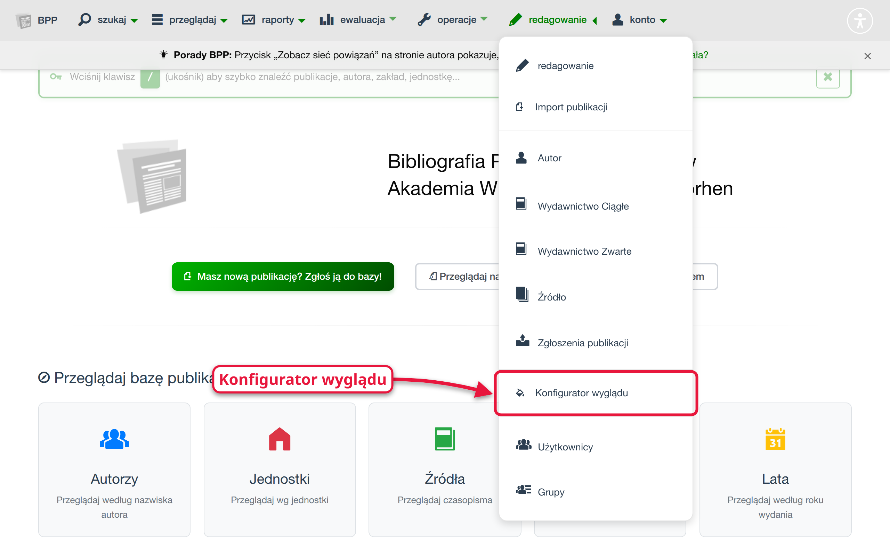

- w module redagowania: zakładka **WWW** → **Konfigurator wyglądu**,

    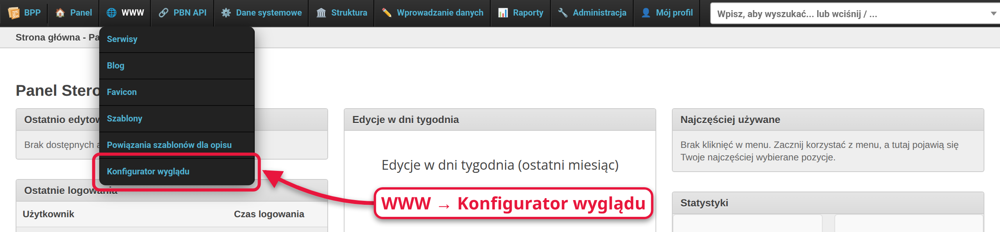

- w module redagowania: **Struktura** → **Uczelnia** → pole **Motyw
  kolorystyczny** — pod listą motywów jest link do konfiguratora.

    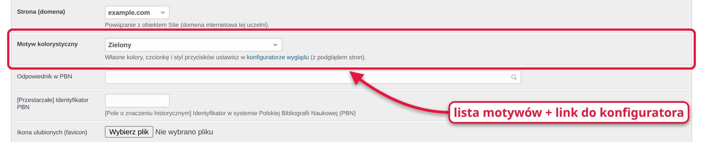

Kto ma dostęp:

| Kto | Co może |
|-----|---------|
| superużytkownik | wszystko, także **Zastosuj dla wszystkich** |
| obsługa (dostęp do modułu redagowania) w grupie **web** albo **administracja** | oglądać podglądy, próbować ustawień, przymierzać motyw, zapisywać motywy (**Zapisz jako…**, **Zapisz do zastosowania później**) |
| pozostali | nie widzą linków; adres konfiguratora zwraca „brak dostępu” |

Osoba z grupy „web” może więc przygotować motyw i go zapisać, a
superużytkownik — zastosować. Grupy nadaje się w **Administracja →
Użytkownicy** (patrz [Grupy uprawnień](grupy-uprawnien.md)).

## Jak wygląda konfigurator

Po lewej jest panel ustawień, po prawej podglądy stron.

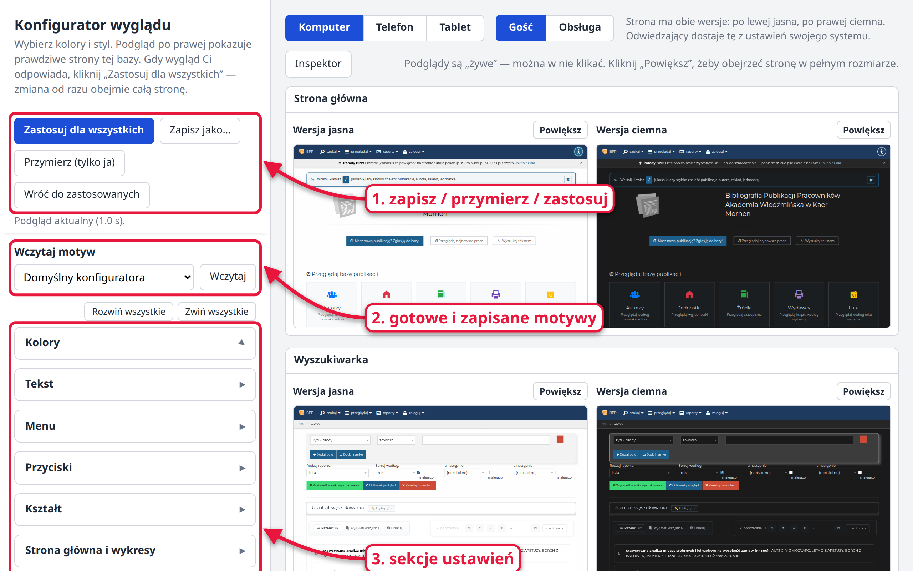

1. **Przyciski akcji** — przyklejone na górze panelu, widoczne także przy
   przewijaniu (opis w części [Zapisywanie, przymiarka i
   zastosowanie](#zapisywanie-przymiarka-i-zastosowanie)). Pod nimi pasek
   stanu: „Buduję podgląd…”, „Podgląd aktualny (1.0 s).” albo komunikat
   o błędzie.
2. **Wczytaj motyw** — lista punktów wyjścia: **Moje motywy** (zapisane
   w tej bazie) i **Gotowe motywy**. Wybierz pozycję i kliknij
   **Wczytaj**.
3. **Sekcje ustawień** — zwijane grupy opcji. **Rozwiń wszystkie** /
   **Zwiń wszystkie** otwiera albo zamyka wszystkie naraz.

Ustawienia, których jeszcze nie zastosowano, przeglądarka pamięta także po
zamknięciu karty — można wrócić do pracy później.

### Podglądy

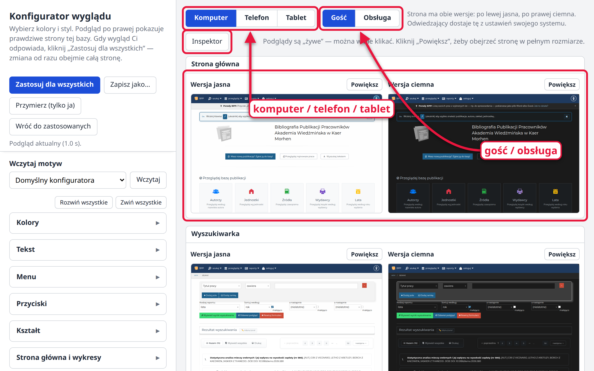

- **Komputer / Telefon / Tablet** — rodzaj ekranu. Na komputerze widać
  stronę główną, wyszukiwarkę, listę autorów, stronę autora, publikacji,
  jednostki, raporty oraz stronę przykładową ze wszystkimi rodzajami
  komunikatów, przycisków i pól formularza. Na telefonie — stronę główną,
  autora i publikację; na tablecie — widoki pionowe i poziome.
- **Gość / Obsługa** — strona tak, jak widzi ją niezalogowany odwiedzający,
  albo tak, jak widzi ją zalogowana obsługa (z przyciskami edycji).
- **Wersja jasna i ciemna obok siebie** — przy trybie kolorów
  „Automatyczny” każdy podgląd jest pokazany dwa razy: po lewej wersja
  jasna, po prawej ciemna. Przy trybie tylko jasnym albo tylko ciemnym
  przycisk **Dodaj drugą wersję (jasna + ciemna)** przełącza na tryb
  automatyczny.
- **Powiększ** — otwiera stronę w pełnym rozmiarze. Podglądy są „żywe”:
  można w nie klikać i przechodzić między stronami.
- **Inspektor** — opisany niżej.

Podgląd przebudowuje się po każdej zmianie, zwykle w ciągu 1–2 sekund.

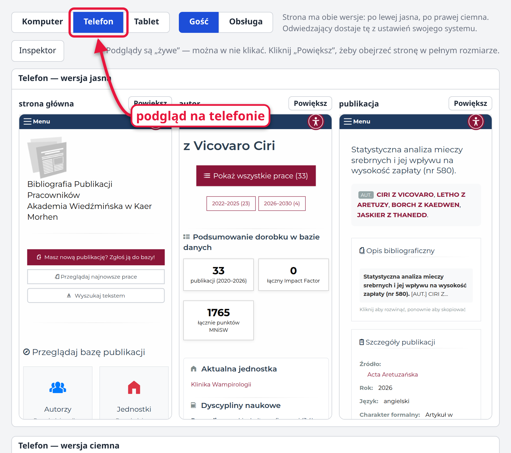

### Inspektor: co ustawia ten element?

Kliknij **Inspektor**, a potem dowolny element na podglądzie (np. pasek
menu, przycisk, stopkę). Konfigurator rozwinie właściwe sekcje i podświetli
opcje, które ten element ustawiają, a pasek stanu je wymieni („Ten element
ustawiają: …”). Gdy elementu nie da się zmienić konfiguratorem, pojawi się
„Tego elementu konfigurator nie zmienia.”. Ponowne kliknięcie
**Inspektor** wyłącza ten tryb.

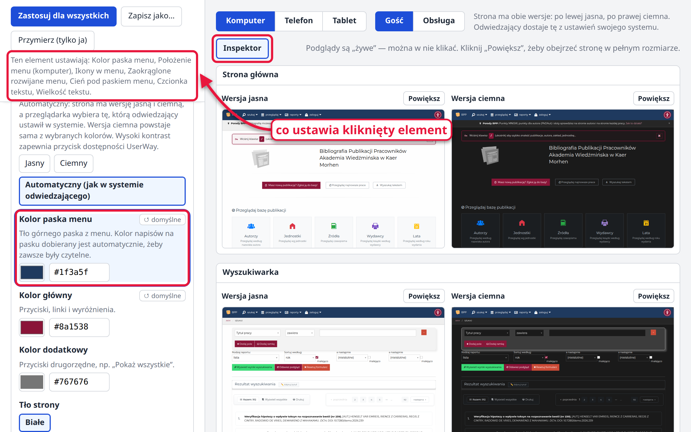

### Powrót do wartości domyślnej

Przy każdej opcji, która różni się od wartości domyślnej, pojawia się
przycisk **↺ domyślne**. Przywraca tylko tę jedną opcję.

## Co można ustawić

### Kolory

| Ustawienie | Opis |
|------------|------|
| Tryb kolorów | **Jasny**, **Ciemny** albo **Automatyczny (jak w systemie odwiedzającego)** — patrz [Tryb jasny i ciemny](#tryb-jasny-i-ciemny) |
| Kolor paska menu | tło górnego paska; kolor napisów na pasku dobiera się sam |
| Kolor główny | przyciski, linki i wyróżnienia |
| Kolor dodatkowy | przyciski drugorzędne, np. „Pokaż wszystkie” |
| Tło strony | **Białe**, **Jasnoszare** (białe karty na szarym tle) albo **Własny kolor** (białe karty na kolorowym tle — pojawia się pole **Kolor tła strony**; wybierz jasny odcień) |
| Tło treści | **Pełne**, **Półprzezroczyste** albo **Przezroczyste** — dwa ostatnie odsłaniają tło strony i grafikę w tle; menu, okienka i pola formularzy zawsze zostają pełne |

Kolor wpisuje się w polu tekstowym jako kod (np. `#1f3a5f`) albo wybiera
próbnikiem po lewej stronie pola.

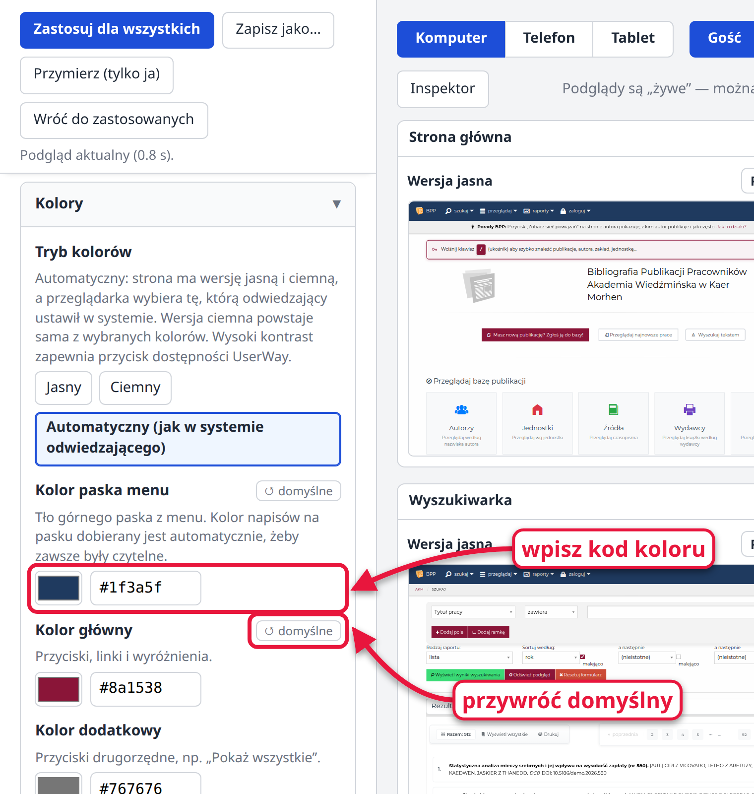

### Tekst

| Ustawienie | Opis |
|------------|------|
| Czcionka tekstu | czcionka całej strony |
| Czcionka nagłówków | osobna czcionka nagłówków albo „Taka sama jak tekst” |
| Nazwa czcionki z Google Fonts | pojawia się po wybraniu „Inna z Google Fonts (wpisz nazwę niżej)” |
| Skąd pobierać czcionki z internetu | **Bunny Fonts (zalecane)** albo **Google Fonts** — pojawia się tylko przy czcionce z internetu |
| Wielkość tekstu | **Standardowa** albo **Większa** |
| Nagłówki | **Zwykłe** albo **Pogrubione** |

Czcionki:

- **Lokalne** — systemowa (Helvetica, Arial), Inter, Lato, Open Sans,
  Roboto, Source Sans Pro. Są zapisane na serwerze BPP i nie wymagają
  łączenia się z zewnętrznymi serwisami.
- **Z internetu** (na liście z dopiskiem „z internetu”) — ok. 30
  popularnych czcionek z polskimi znakami, np. Montserrat, Poppins, IBM Plex
  Sans, Lora, Merriweather, Playfair Display, Roboto Slab, EB Garamond.
- **Dowolna z Google Fonts** — wybierz „Inna z Google Fonts (wpisz nazwę
  niżej)” i wpisz nazwę dokładnie tak, jak na fonts.google.com (np.
  „Lexend”, „Red Hat Display”). Sprawdź na podglądzie polskie znaki: nie
  każda czcionka je ma.

Czcionki z internetu są domyślnie pobierane z **Bunny Fonts** —
europejskiej kopii Google Fonts, która nie zbiera danych odwiedzających.
To zalecany wybór ze względu na RODO.

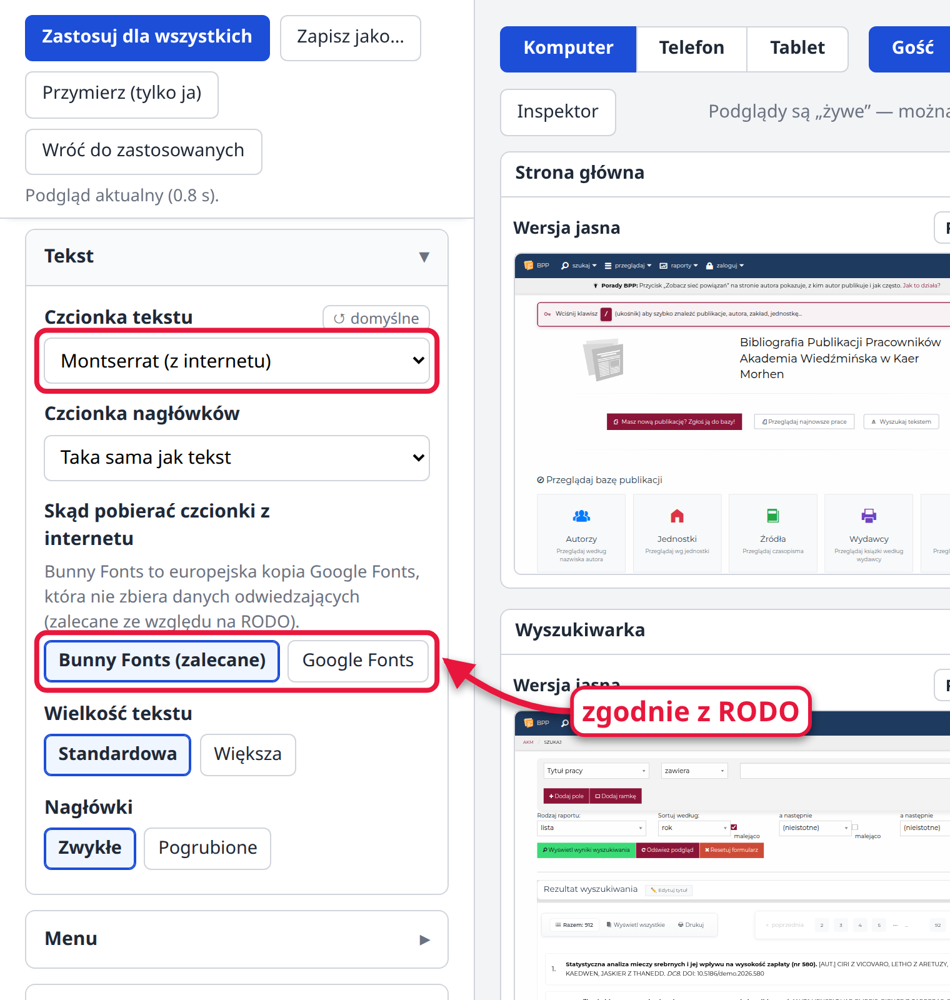

### Menu

| Ustawienie | Opis |
|------------|------|
| Ikony w menu | małe ikonki obok pozycji menu (tak/nie) |
| Zaokrąglone rozwijane menu | tak/nie |
| Cień pod paskiem menu | brak, delikatny, wyraźny, mocny |
| Logo BPP na pasku menu | szare (kolorowe po najechaniu; na ciemnym pasku zawsze kolorowe), zawsze pomarańczowe, w kolorze napisów paska, ukryte |
| Napis obok logo | „BPP”, własny skrót (do 20 znaków) albo bez napisu |
| Położenie menu (komputer) | pozycje paska przy lewej krawędzi albo wyśrodkowane |
| Ikona menu na telefonie | trzy paski, dwa paski, trzy paski różnej długości, trzy kropki |
| Po otwarciu menu na telefonie | ikona zmienia się w „X” albo zostaje bez zmian |
| Napis przy ikonie menu | „Menu”, własny napis (do 20 znaków) albo bez napisu |
| Logo uczelni na pasku menu | małe logo przed napisem, zmniejszane do wysokości paska; żeby pokazać je **zamiast** logo BPP, ustaw „Logo BPP na pasku menu: Ukryte” |

### Przyciski

| Ustawienie | Opis |
|------------|------|
| Styl przycisków | pełne płaskie, z obrysem (wypełniają się po najechaniu), pełne z cieniem |
| Kolory przycisków | **Różne kolory** (zależnie od rodzaju przycisku) albo **Wszystkie w kolorze głównym** |
| Przyciski potwierdzenia, ostrzegawcze, usuwania | osobne kolory — tylko przy „Różne kolory” |

Przyciski usuwania i operacji nieodwracalnych zawsze zostają czerwone.

### Kształt

**Rogi przycisków, pól i kart**: kanciaste, lekko zaokrąglone, mocno
zaokrąglone albo przyciski okrągłe („pigułki”).

### Strona główna i wykresy

| Ustawienie | Opis |
|------------|------|
| Kolor wykresów | słupki i linie wykresów „w latach” na stronach autorów, jednostek i źródeł; domyślnie taki sam jak kolor główny |
| Kafle „Przeglądaj bazę publikacji” | jasne z kolorowymi ikonami, jasne z ikonami w kolorze głównym, przezroczyste z obrysem, wypełnione kolorem głównym |

### Okruszki i stopka

| Ustawienie | Opis |
|------------|------|
| Pasek ścieżki (okruszki) pod menu | jasnoszary, w kolorze paska menu albo własny kolor |
| Stopka | jasnoszara, w kolorze paska menu, własny kolor albo **ukryta** |

Kolor tekstu i linków na pasku ścieżki i w stopce dobiera się sam.

### Komunikaty

Kolory komunikatów u góry strony: **Informacja**, **Sukces**,
**Ostrzeżenie**, **Błąd**. Jasne tło i czytelny tekst wyliczają się
z wybranego koloru.

### Grafika w tle

Obrazek PNG, JPG, WebP, GIF albo SVG, do 10 MB i do 10 000 px na bok. Duże
zdjęcia konfigurator sam zmniejsza (do 1200 px). Po wgraniu obrazka
pojawiają się opcje:

- **Położenie** — jeden z rogów, góra lub dół (środek), środek ekranu,
  powtarzany (kafelki) albo cały ekran,
- **Wielkość** — mały, średni, duży (nie dotyczy „Cały ekran”),
- **Widoczność** — pełna, wyraźna, słaba, ledwo widoczna.

Najlepiej sprawdzają się ornamenty i logo z przezroczystym tłem, w rogu,
z widocznością „słaba” albo „ledwo widoczna”, żeby nie przeszkadzały
w czytaniu. Grafika nie jest drukowana. Żeby była widoczna także pod
treścią, ustaw w sekcji „Kolory” **Tło treści: Półprzezroczyste**.

### Przycisk dostępności (UserWay)

Kolor okrągłego przycisku z ludzikiem, który otwiera ustawienia dostępności
(domyślnie taki sam jak kolor główny), i jego cień.

### Ikona strony (favicon)

Ikonka na karcie przeglądarki i w zakładkach: PNG (najlepiej kwadrat, co
najmniej 64×64 px) albo ICO, do 1 MB. Konfigurator pokazuje ją na makiecie
karty przeglądarki; **Cofnij zmianę ikony** wraca do poprzedniej. Nowa ikona
zapisuje się razem z **Zastosuj dla wszystkich**.

## Czytelność jest pilnowana automatycznie

- Kolor napisów na pasku menu i na przyciskach dobiera się sam: biały albo
  czarny, zależnie od tego, który jest lepiej widoczny.
- Za jasny kolor główny (biały napis na przycisku byłby słabo widoczny)
  jest oznaczony jako błąd, z podanym kontrastem. Konfigurator od razu
  proponuje najbliższy ciemniejszy odcień, który spełnia wymagania
  dostępności (WCAG AA, kontrast 4,5:1) — wystarczy kliknąć **Użyj
  czytelnego odcienia**.
- Ustawień z błędami czytelności nie da się przymierzyć, zapisać ani
  zastosować — konfigurator rozwinie sekcje z zaznaczonymi polami.

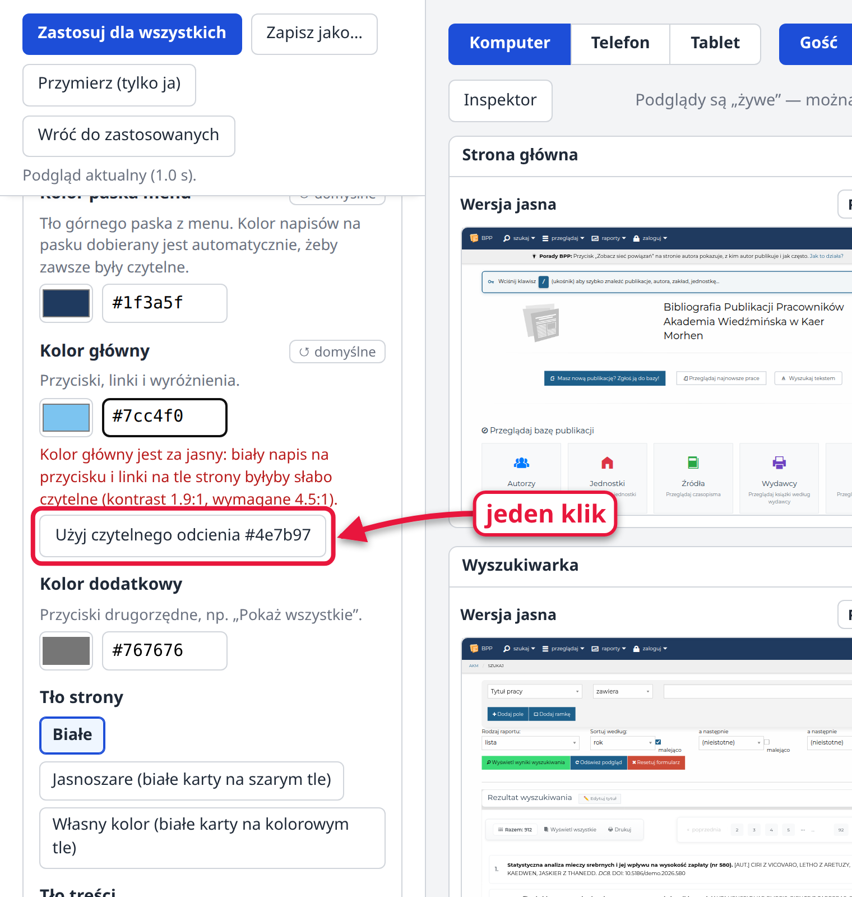

## Gotowe motywy

Lista **Wczytaj motyw** → **Gotowe motywy** to punkty wyjścia, które potem
można dowolnie zmieniać:

- **Domyślny konfiguratora**,
- odpowiedniki dotychczasowych motywów BPP: niebieski, zielony,
  pomarańczowy, bursztynowo-granatowy (VIZJA), pomarańczowo-granatowy
  (MWSL), czerwono-błękitny,
- gotowe style: klasyczny akademicki, nowoczesny minimalistyczny, nocny,
  medyczny (turkusy), techniczny, humanistyczny ciepły, wysoki kontrast,
  pastelowy, uczelniany granatowo-złoty, przyrodniczy, redakcyjny,
  energiczny.

Część dotychczasowych motywów ma kolor główny za jasny dla wymogów
dostępności; po wczytaniu konfigurator zaznaczy to od razu i zaproponuje
czytelny odcień.

## Zapisywanie, przymiarka i zastosowanie

| Przycisk | Co robi | Kto |
|----------|---------|-----|
| **Zastosuj dla wszystkich** | zapisuje ustawienia i włącza je na stronie dla wszystkich odwiedzających | superużytkownik |
| **Zapisz jako…** | zapisuje motyw w tej bazie pod podaną nazwą; strona się nie zmienia. Motyw pojawia się na liście **Wczytaj motyw** → **Moje motywy** (z datą i autorem). Ta sama nazwa nadpisuje wcześniejszy zapis; przycisk **Usuń** obok listy usuwa wybrany zapisany motyw | każdy z dostępem |
| **Przymierz (tylko ja)** | otwiera stronę w nowej karcie z motywem widocznym **tylko dla Ciebie** | każdy z dostępem |
| **Zapisz do zastosowania później** | zapisuje ustawienia jako motyw czekający na zastosowanie; konfigurator wczyta je przy następnym otwarciu, a na górze panelu pojawi się informacja „Jest zapisany, jeszcze niezastosowany motyw” | widoczny zamiast „Zastosuj dla wszystkich”, gdy nie masz prawa stosowania motywu albo kompilator motywów jest chwilowo niedostępny |
| **Wróć do zastosowanych** | wczytuje do edytora ustawienia, które są teraz na stronie (porzuca niezastosowane zmiany) | każdy z dostępem |

Gdy kompilator motywów jest chwilowo niedostępny, konfigurator wyświetla
ostrzeżenie, a przycisków **Zastosuj dla wszystkich** i **Przymierz (tylko
ja)** nie ma — motyw można wtedy zapisać i zastosować później.

### Przymiarka na całej stronie

**Przymierz (tylko ja)** włącza ustawienia z edytora na wszystkich stronach
BPP — ale tylko w Twojej sesji. Odwiedzający dalej widzą obecny wygląd. Na
górze każdej strony jest pasek „Przymierzasz motyw” z linkiem **Wróć do
konfiguratora** i przyciskiem **Zakończ przymiarkę**. Przymiarka kończy się
sama po dobie. Moduł redagowania nie jest objęty motywem.

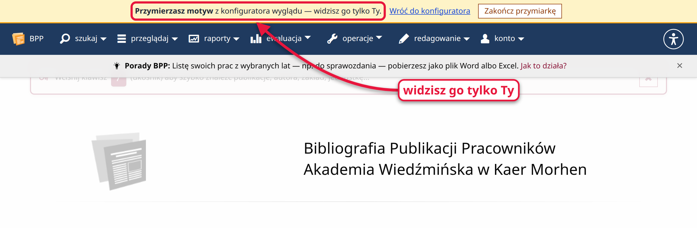

### Zastosowanie

**Zastosuj dla wszystkich** prosi o potwierdzenie, buduje motyw na serwerze
(kilka sekund) i przełącza uczelnię na motyw „Własny (z konfiguratora
wyglądu)”. Zmianę widzą od razu wszyscy odwiedzający.

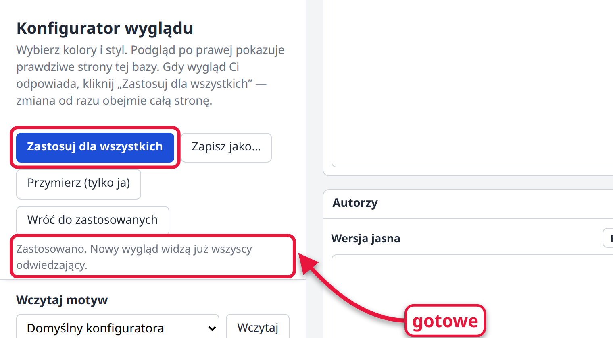

Po każdym zastosowaniu przebudowywana jest także statyczna strona błędu,
którą serwer pokazuje, gdy BPP chwilowo nie działa — odwiedzający widzą
wtedy również wygląd uczelni.

Żeby wrócić do jednego z wbudowanych motywów, wybierz go w module
redagowania: **Uczelnia** → **Motyw kolorystyczny**. Własny motyw zostaje na
tej liście jako „Własny (z konfiguratora wyglądu)” i można do niego wrócić
w każdej chwili.

!!! note "Po aktualizacji BPP"
    Przy aktualizacji BPP motyw przebudowuje się sam z zapisanych ustawień,
    więc obejmuje także nowe strony i elementy. Gdyby to się nie udało,
    konfigurator wyświetli przypomnienie („Motyw zbudowano w wersji BPP …”)
    — wystarczy wtedy kliknąć **Zastosuj dla wszystkich** jeszcze raz.

## Historia i cofanie zmian

Sekcja **Historia i cofanie zmian** pokazuje 10 ostatnich zastosowanych
motywów: kiedy, kto, próbki koloru paska i koloru głównego oraz tryb
kolorów. Wersja, która jest teraz na stronie, ma dopisek „(na stronie
teraz)”.

- **Wczytaj** przy wybranej wersji wstawia ją do edytora. Żeby przywrócić ją
  na stronie, kliknij **Zastosuj dla wszystkich**.
- Jeśli uczelnia przed konfiguratorem miała jeden z wbudowanych motywów BPP
  (np. zielony), jest też przycisk **Wróć do motywu sprzed konfiguratora:
  …** — działa od razu, bez budowania motywu. Ustawienia z konfiguratora
  zostają w historii.

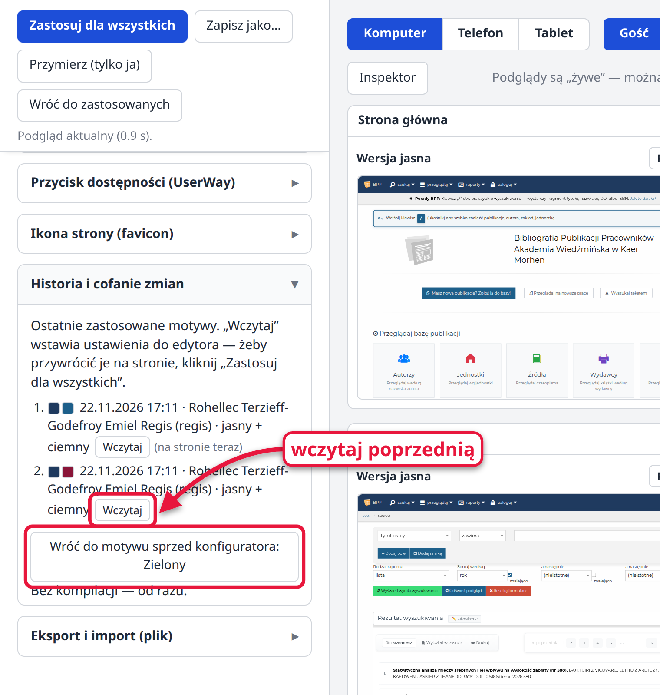

## Tryb jasny i ciemny

Domyślnie strona ma **wersję jasną i ciemną**: przeglądarka sama wybiera tę,
którą odwiedzający ustawił w systemie (tryb „Automatyczny”). Wersja ciemna
**powstaje automatycznie** z ustawień wersji jasnej: jasne tła zamieniają
się w ciemne (z zachowaniem odcienia), ciemny tekst w jasny, a kolory
przycisków, paska menu i wykresów zostają. Nie ma osobnych ustawień dla
wersji ciemnej. Wysoki kontrast zapewnia przycisk dostępności UserWay.

W trybie „Automatyczny” na pasku menu pojawia się przełącznik ze słońcem
i księżycem (☀ | ☾) — na komputerze po prawej stronie paska, na telefonie
na pasku obok ikony menu (widoczny bez otwierania menu). Podświetlona
połowa pokazuje wersję widoczną teraz. Kliknięcie drugiej połowy wybiera tę
wersję na stałe, niezależnie od ustawień systemu (podświetlenie dostaje
wtedy obwódkę); ponowne kliknięcie wybranej połowy wraca do ustawień
systemu. Wybór pamięta przeglądarka (bez logowania). Ten sam
przełącznik ma wbudowany motyw „Niebieski (jasny lub ciemny wg ustawień
systemu)”. Przy motywach tylko jasnych albo tylko ciemnych (np. „Niebieski
ciemny”) przełącznika nie ma.

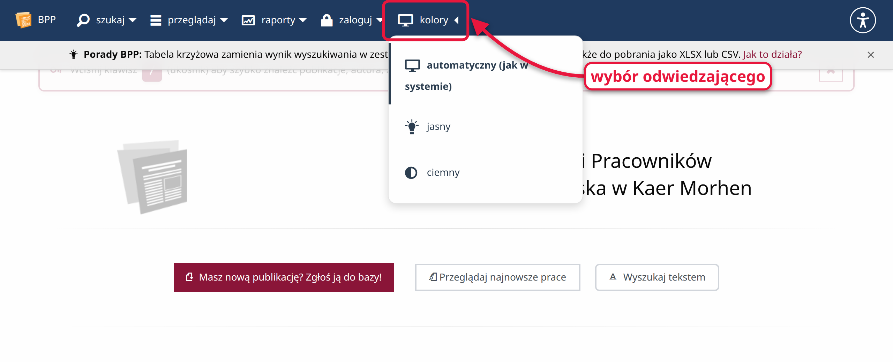

## Eksport i import (plik)

Sekcja **Eksport i import (plik)** zapisuje bieżące ustawienia jako plik
`.json` (do katalogu pobranych plików przeglądarki), wczytuje je z powrotem
albo kopiuje do schowka — np. żeby przenieść motyw do innej bazy BPP albo
wysłać go do IPLweb. Opis i nazwa pliku są opcjonalne. Do zapisania motywu
w tej samej bazie wygodniej użyć **Zapisz jako…**. Z takiego pliku IPLweb
może też przygotować motyw wbudowany w system (opis dla programistów:
[Budowanie CSS](../deweloper/budowanie-css.md#motywy-z-konfiguracji)).

## Przykłady krok po kroku

### Granatowy pasek, kolor uczelni, czcionka z internetu, tryb automatyczny

1. Otwórz konfigurator (menu **redagowanie** → **Konfigurator wyglądu**).
2. **Wczytaj motyw** → **Domyślny konfiguratora** → **Wczytaj** — czysty
   punkt wyjścia.
3. Sekcja **Kolory**:
    - **Tryb kolorów**: **Automatyczny (jak w systemie odwiedzającego)**,
    - **Kolor paska menu**: wpisz `#1f3a5f` (granat),
    - **Kolor główny**: wpisz kolor z księgi znaku uczelni, np. `#8a1538`.
      Jeśli pojawi się komunikat o za słabym kontraście, kliknij **Użyj
      czytelnego odcienia**.
4. Sekcja **Tekst**: **Czcionka tekstu** → **Montserrat (z internetu)**;
   **Skąd pobierać czcionki z internetu** zostaw na **Bunny Fonts
   (zalecane)**.
5. Sprawdź podglądy: wersję jasną i ciemną, potem zakładkę **Telefon**.
6. Kliknij **Zastosuj dla wszystkich** i potwierdź.

### Najpierw przymierzyć, potem zastosować

1. Ustaw wygląd w konfiguratorze.
2. Kliknij **Przymierz (tylko ja)** — w nowej karcie otworzy się strona
   z Twoim motywem. Przejdź po kilku stronach (autor, publikacja,
   wyszukiwarka, raporty); odwiedzający nadal widzą stary wygląd.
3. Wróć do konfiguratora linkiem **Wróć do konfiguratora** na żółtym pasku,
   popraw, co trzeba, i w razie potrzeby przymierz jeszcze raz.
4. Gdy wszystko pasuje, kliknij **Zastosuj dla wszystkich**, a na karcie
   z przymiarką — **Zakończ przymiarkę**.

Jeśli nie jesteś superużytkownikiem: zamiast kroku 4 kliknij **Zapisz do
zastosowania później** (albo **Zapisz jako…** pod własną nazwą) i poproś
superużytkownika o zastosowanie motywu.

### Cofnąć zmianę z historii

1. Otwórz konfigurator i rozwiń sekcję **Historia i cofanie zmian**.
2. Przy wersji, do której chcesz wrócić (data i próbki kolorów pomagają ją
   znaleźć), kliknij **Wczytaj** — ustawienia trafią do edytora, podglądy
   się odświeżą.
3. Kliknij **Zastosuj dla wszystkich**.

Żeby wrócić do wbudowanego motywu sprzed konfiguratora, kliknij **Wróć do
motywu sprzed konfiguratora: …** — wtedy punkt 3 nie jest potrzebny.
