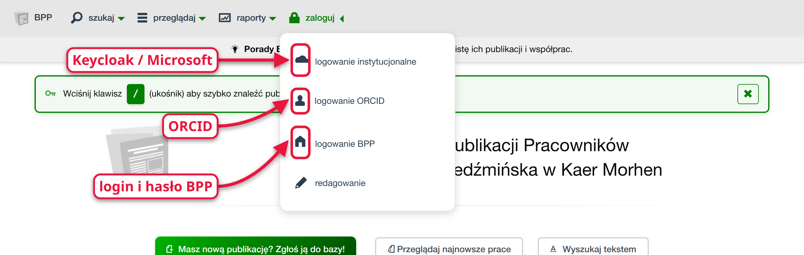
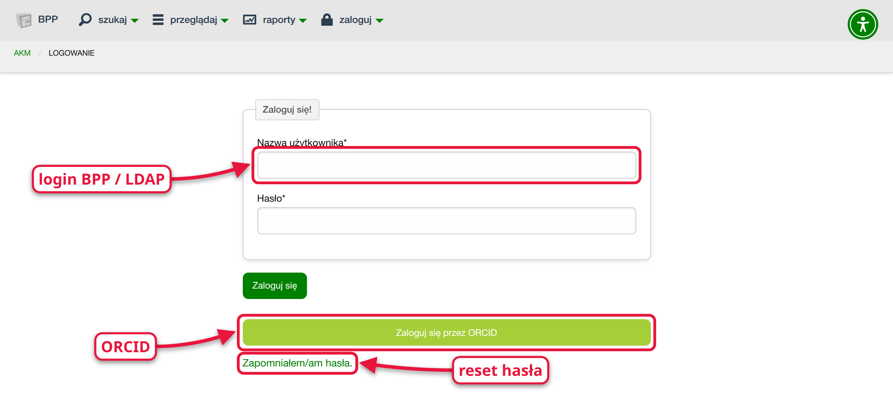
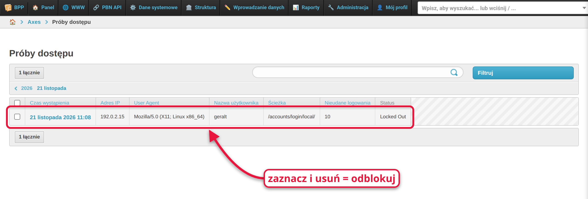
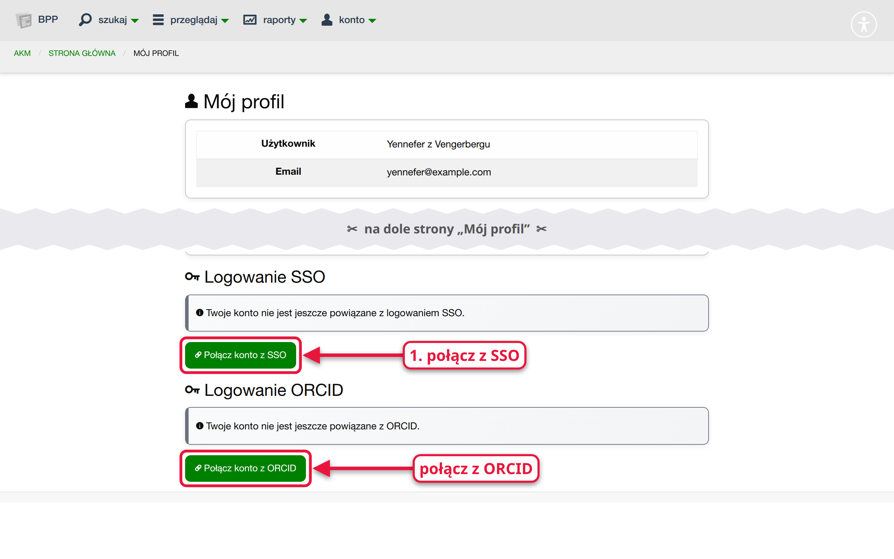
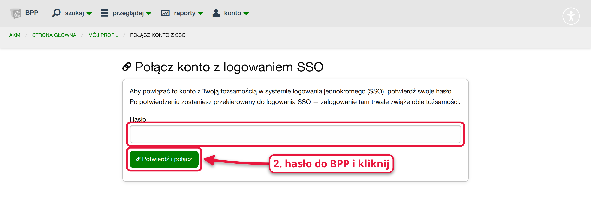
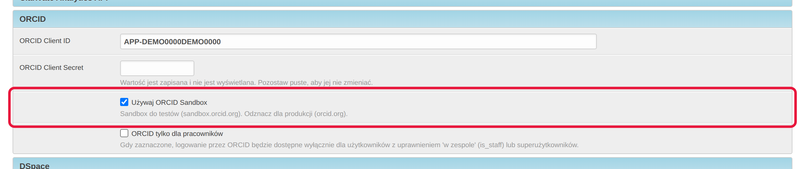

# Metody logowania do systemu

BPP pozwala logować się na kilka sposobów. Ta strona opisuje każdy z nich:
co widzi użytkownik, co ustawia administrator, jak system dopasowuje osobę
do konta i co zwykle idzie nie tak.

| Metoda | Gdzie się włącza | Kto zakłada konto |
|---|---|---|
| [Login i hasło BPP](#login-i-haslo-bpp) | zawsze dostępne | redaktor/administrator |
| [LDAP / Active Directory](#ldap-active-directory) | zmienne `AUTH_LDAP_*` | BPP, przy pierwszym logowaniu |
| [Keycloak i inne serwery OpenID Connect (SSO)](#keycloak-openid-connect) | zmienne `DJANGO_BPP_OIDC_*` | BPP, przy pierwszym logowaniu |
| [Microsoft 365 / Entra ID](#microsoft-365-entra-id) | zmienne `MICROSOFT_AUTH_*` | BPP, przy pierwszym logowaniu |
| [ORCID](#orcid) | rekord uczelni, sekcja „ORCID” | nikt — ORCID loguje tylko do już istniejącego konta |

Zmienne środowiskowe wpisuje się w pliku `.env` konfiguracji serwera (przy
instalacji z [bpp-deploy](https://iplweb.github.io/bpp-deploy/) — w pliku
`.env` w katalogu konfiguracji). BPP czyta je **przy starcie**, więc po
zmianie trzeba zrestartować kontenery aplikacji.

BPP nie ma własnego drugiego składnika logowania (TOTP, klucze sprzętowe)
ani obsługi SAML. Uwierzytelnianie wieloskładnikowe można uzyskać przez
dostawcę tożsamości (Keycloak, Microsoft), jeżeli on je wymusza — patrz
[zalecenia w opisie grup uprawnień](grupy-uprawnien.md#zalecenia).

## Co widzi użytkownik

Menu **„zaloguj”** w górnej belce zależy od tego, co jest włączone.



- **Bez logowania instytucjonalnego** menu ma pozycje **„logowanie”**
  (formularz BPP), **„logowanie ORCID”** (tylko gdy ORCID jest
  skonfigurowany) i **„redagowanie”**.
- **Z logowaniem instytucjonalnym** (Keycloak albo Microsoft) pozycja
  **„logowanie instytucjonalne”** prowadzi do dostawcy tożsamości, a formularz
  BPP przenosi się pod **„logowanie BPP”**. Gdy włączone są oba — Keycloak
  i Microsoft — „logowanie instytucjonalne” prowadzi do Keycloaka.
- **„redagowanie”** to formularz logowania modułu redagowania. Przyjmuje te
  same konta, ale wpuszcza tylko konta z uprawnieniem „w zespole”
  (`is_staff`).

LDAP nie dodaje żadnej pozycji: użytkownik loguje się w zwykłym formularzu
BPP swoim loginem i hasłem z katalogu.

## Login i hasło BPP {#login-i-haslo-bpp}

**Użytkownik** wpisuje nazwę użytkownika i hasło. Pod formularzem jest
odnośnik **„Zapomniałem/am hasła.”** (reset hasła przez e-mail) i — gdy
ORCID jest skonfigurowany — przycisk **„Zaloguj się przez ORCID”**.



**Administrator:**

1. Zakłada konto w module redagowania (**Administracja ➡ Użytkownicy**)
   i wpisuje w nim adres e-mail — bez adresu użytkownik nie zresetuje hasła.
2. Ustawia politykę haseł zmiennymi `DJANGO_BPP_PASSWORD_*` — patrz
   [Polityka haseł](zaawansowane.md#polityka-haseł).
3. Opcjonalnie zmienia czas automatycznego wylogowania bezczynnej sesji:
   `DJANGO_BPP_SESSION_SECURITY_WARN_AFTER` (domyślnie 540 s — ostrzeżenie)
   i `DJANGO_BPP_SESSION_SECURITY_EXPIRE_AFTER` (domyślnie 600 s —
   wylogowanie).

!!! note "Reset hasła przy logowaniu przez Microsoft"
    Gdy włączone jest logowanie przez Microsoft, odnośnika „Zapomniałem/am
    hasła.” nie ma na stronie logowania. Hasło do konta Microsoft zmienia
    się u Microsoftu.

### Blokada po nieudanych próbach {#blokada}

Po **10 nieudanych próbach** dla tej samej pary *(nazwa użytkownika, adres
IP)* logowanie jest blokowane na **godzinę od ostatniej próby** (każda próba
w trakcie blokady liczy godzinę od nowa). Użytkownik widzi stronę „Konto
tymczasowo zablokowane”. Blokada dotyczy pary login + IP, więc z innej sieci
ta sama osoba zaloguje się normalnie, a złośliwe zgadywanie hasła nie
zablokuje konta ofiary na stałe.

Żeby zdjąć blokadę od razu:

1. Zaloguj się do modułu redagowania jako superużytkownik.
2. Otwórz adres `/admin/axes/accessattempt/` (lista **„Próby dostępu”**).
3. Zaznacz wiersz z nazwą użytkownika i adresem IP, wybierz akcję usuwania
   i potwierdź.



Z wiersza poleceń to samo robi `python src/manage.py axes_reset_username
<login>`.

## LDAP / Active Directory {#ldap-active-directory}

**Użytkownik** wpisuje w zwykłym formularzu BPP login i hasło z katalogu
uczelni. Przy pierwszym udanym logowaniu BPP zakłada mu konto; imię,
nazwisko i e-mail są przepisywane z katalogu (atrybuty `givenName`, `sn`,
`mail`) przy **każdym** logowaniu.

**Administrator** ustawia zmienne:

| Zmienna | Znaczenie | Przykład |
|---|---|---|
| `AUTH_LDAP_SERVER_URI` | adres serwera; jej ustawienie włącza LDAP | `ldaps://ldap.example.org` |
| `AUTH_LDAP_BIND_DN` | konto techniczne do przeszukiwania katalogu | `CN=bpp-ldap,OU=Uslugi,DC=uczelnia,DC=example,DC=org` |
| `AUTH_LDAP_BIND_PASSWORD` | hasło konta technicznego | — |
| `AUTH_LDAP_USER_SEARCH` | gałąź, w której szukać użytkowników | `OU=Pracownicy,DC=uczelnia,DC=example,DC=org` |
| `AUTH_LDAP_USER_SEARCH_QUERY` | filtr wyszukiwania; `%(user)s` = wpisany login | `sAMAccountName=%(user)s` albo `userPrincipalName=%(user)s@uczelnia.example.org` |
| `AUTH_LDAP_GROUP_SEARCH` | gałąź z grupami (`groupOfNames`) | `OU=Grupy,DC=uczelnia,DC=example,DC=org` |

Domyślna wartość `AUTH_LDAP_USER_SEARCH_QUERY` to
`userPrincipalName=%(user)s@auth.local` — trzeba ją zmienić na domenę
uczelni. Obraz Docker BPP zawiera potrzebną bibliotekę; przy instalacji
z pakietu potrzebny jest dodatek `bpp-iplweb[ldap]`.

**Dopasowanie konta:** po nazwie użytkownika. Konto BPP o tej samej nazwie
co login z katalogu zostaje przejęte przez LDAP. Gdy katalog odrzuci login
lub hasło, BPP próbuje jeszcze zwykłego hasła BPP — konta lokalne działają
dalej.

**Typowe problemy:**

- **Konto z LDAP traci dostęp do redagowania.** Przy każdym logowaniu przez
  LDAP BPP zdejmuje z konta uprawnienia „w zespole” i superużytkownika.
  Redaktorzy powinni mieć osobne konta lokalne, o nazwach **innych** niż ich
  loginy w katalogu — inaczej zalogowanie hasłem z katalogu odbierze im
  dostęp do modułu redagowania.
- **Nie da się połączyć LDAP z Microsoftem.** Gdy ustawione są jednocześnie
  `AUTH_LDAP_SERVER_URI` i `MICROSOFT_AUTH_CLIENT_ID`, aplikacja nie
  wystartuje.
- **Zmiany w katalogu widać z opóźnieniem** — BPP pamięta wyniki zapytań do
  katalogu przez godzinę.
- **Hasła nie zmienia się w BPP**, tylko w katalogu uczelni.

## Keycloak i inne serwery OpenID Connect (SSO) {#keycloak-openid-connect}

**Użytkownik** wybiera **zaloguj ➡ logowanie instytucjonalne**, loguje się
na stronie uczelnianego serwera logowania i wraca do BPP zalogowany.
Wylogowanie z BPP wylogowuje też z serwera logowania. Hasło zmienia się
w panelu konta serwera logowania — BPP kieruje tam z „zmień hasło”.

**Administrator:**

1. W Keycloaku zakłada klienta typu *confidential* (OpenID Connect,
   standard flow) i rejestruje adres zwrotny
   `https://<adres BPP>/oidc/callback/`. Klient musi wydawać zakresy
   `openid email profile`.
2. Wpisuje do `.env` trzy zmienne (wszystkie trzy są wymagane):

    ```bash
    DJANGO_BPP_OIDC_CLIENT_ID=bpp
    DJANGO_BPP_OIDC_CLIENT_SECRET=<sekret klienta z Keycloaka>
    DJANGO_BPP_OIDC_ISSUER=https://sso.example.org/realms/uczelnia
    ```

3. Restartuje aplikację. Pozycja „logowanie instytucjonalne” pojawia się
   w menu.

Opcjonalne zmienne:

| Zmienna | Domyślnie | Znaczenie |
|---|---|---|
| `DJANGO_BPP_OIDC_EMAIL_CLAIMS` | `mail,email,e-mail,e_mail` | z których pól tokenu brać adres e-mail (pierwsze niepuste wygrywa) |
| `DJANGO_BPP_OIDC_USERNAME_CLAIMS` | `preferred_username,email,sub` | z których pól tokenu brać nazwę nowego konta |
| `DJANGO_BPP_OIDC_REQUIRE_EMAIL_VERIFIED` | `true` | zakładaj nowe konto tylko dla zaufanego adresu e-mail (niżej) |
| `DJANGO_BPP_OIDC_TRUSTED_EMAIL_DOMAINS` | (puste) | domeny uczelni rozdzielone przecinkami, np. `uczelnia.example.org,student.uczelnia.example.org` |
| `DJANGO_BPP_OIDC_GRACE_BIND` | `false` | jednorazowe powiązanie istniejących kont po adresie e-mail (niżej) |
| `DJANGO_BPP_OIDC_GRACE_BIND_PRIVILEGED` | `false` | to samo także dla kont redaktorów i administratorów (niżej) |

**Kilka uczelni na jednym serwerze.** Każdą zmienną można zapisać ze
skrótem uczelni: `DJANGO_BPP_OIDC_<SKRÓT>_CLIENT_ID`,
`DJANGO_BPP_OIDC_<SKRÓT>_ISSUER` itd. (skrót wielkimi literami i cyframi,
np. `DJANGO_BPP_OIDC_AKM_ISSUER`). Wariant ze skrótem ma pierwszeństwo przed
wariantem bez skrótu. Skrót musi być taki sam jak pole „Skrót” w rekordzie
uczelni — wtedy przycisk SSO pojawia się tylko na domenie tej uczelni,
a nowe konta są do niej przypisywane. Jeden proces BPP obsługuje **jeden**
serwer logowania: gdy w `.env` są zestawy dla dwóch różnych skrótów, BPP
nie wybierze żadnego z nich.

### Jak BPP dopasowuje osobę do konta

- Osoba z serwera logowania jest rozpoznawana po parze **(adres serwera
  logowania, identyfikator osoby `sub`)**, a **nie po adresie e-mail**.
  Dopasowanie po e-mailu pozwalałoby przejąć cudze konto: wystarczyłoby
  wpisać sobie w katalogu cudzy adres.
- Pierwsze logowanie osoby, której nikt jeszcze nie powiązał:
    - jeśli w BPP **nie ma** konta z jej adresem e-mail, BPP zakłada nowe,
      zwykłe konto (bez dostępu do redagowania, bez hasła lokalnego),
      przypisuje je do uczelni i — gdy adres jest zaufany — próbuje powiązać
      z rekordem autora,
    - jeśli konto z tym adresem **już jest** (np. założone przed
      wdrożeniem SSO), BPP **odmawia** i nie zakłada drugiego konta. Takie
      konto trzeba najpierw powiązać — patrz niżej.
- **Zaufany adres e-mail** to adres z domeny wpisanej
  w `DJANGO_BPP_OIDC_TRUSTED_EMAIL_DOMAINS` (dopasowanie dokładne,
  subdomeny trzeba wypisać osobno) albo adres potwierdzony przez serwer
  logowania (`email_verified`), zgodny z polem `email`. W katalogach opartych
  na LDAP adres uczelniany bywa w polu `mail`, a w `email` jest adres
  prywatny — wtedy samo `email_verified` nie wystarczy i trzeba wpisać listę
  domen.

### Powiązanie kont założonych przed wdrożeniem SSO {#powiazanie-sso}

**Sposób 1 — użytkownik sam, w profilu.** Działa dla kont, które mają hasło
BPP.

1. Użytkownik loguje się przez **zaloguj ➡ logowanie BPP** i otwiera
   **konto ➡ mój profil**. Na dole strony, w sekcji **„Logowanie SSO”**,
   klika **„Połącz konto z SSO”**.

    

2. Wpisuje swoje hasło BPP i klika **„Potwierdź i połącz”**.

    

3. Loguje się na serwerze logowania. Od tej pory „logowanie instytucjonalne”
   prowadzi do tego konta. W profilu powiązanie widać w tabeli, z przyciskiem
   **„Odłącz”**.

Konto **bez hasła BPP** nie może tego zrobić („Nieprawidłowe hasło lub konto
bez hasła lokalnego.”). Administrator może takiemu użytkownikowi ustawić
hasło (albo użytkownik — przez „Zapomniałem/am hasła.”), albo użyć sposobu 2.

**Sposób 2 — automatycznie, po adresie e-mail (grace-bind).** Dla
instalacji, gdzie konta logują się wyłącznie przez SSO:

```bash
DJANGO_BPP_OIDC_GRACE_BIND=true
DJANGO_BPP_OIDC_TRUSTED_EMAIL_DOMAINS=uczelnia.example.org
```

Przy pierwszym logowaniu przez SSO BPP wiąże osobę z istniejącym kontem
o tym samym adresie e-mail, ale tylko gdy adres jest zaufany, takie konto
jest **dokładnie jedno** i jest aktywne, a dodatkowo konto:

- nie ma dostępu do redagowania ani superużytkownika,
- nie ma hasła BPP, grup, indywidualnych uprawnień ani tokenu PBN,
- nie jest jeszcze powiązane z żadnym serwerem logowania.

Konta redaktorów i administratorów obejmuje dopiero
`DJANGO_BPP_OIDC_GRACE_BIND_PRIVILEGED=true` — i wyłącznie dla adresów
z domen z `DJANGO_BPP_OIDC_TRUSTED_EMAIL_DOMAINS`. **Bez listy domen ta
zmienna nic nie robi** (celowo: lista domen jest wtedy jedynym
zabezpieczeniem kont z uprawnieniami, a działa tylko, jeśli użytkownicy nie
mogą sami zmieniać sobie adresu w katalogu uczelni).

Po powiązaniu wszystkich kont grace-bind można wyłączyć.

### Typowe problemy

- **„Logowanie przez Keycloak przechodzi, ale użytkownik zostaje
  niezalogowany.”** Serwer logowania przyjmuje hasło, przeglądarka wraca do
  BPP na stronę główną, ale bez zalogowania i bez komunikatu. W logu
  aplikacji jest wtedy wpis `OIDC: konto z tym adresem już istnieje — połącz
  je z SSO przez profil`. To konto sprzed SSO, jeszcze niepowiązane — patrz
  [Powiązanie kont](#powiazanie-sso). **Nie** usuwaj e-maila z istniejącego
  konta, żeby „obejść” kolizję: BPP założy wtedy drugie, puste konto,
  a prawdziwe (z uprawnieniami, tokenem PBN i powiązanym autorem) zostanie
  osierocone.
- **To samo, ale w logu `e-mail niezweryfikowany`** — adres nie jest
  zaufany. Wpisz domeny uczelni w `DJANGO_BPP_OIDC_TRUSTED_EMAIL_DOMAINS`
  albo sprawdź, czy serwer logowania wysyła `email_verified`.
- **W logu `nie znaleziono adresu e-mail w claimach`** — serwer logowania
  nie wysyła adresu. Dodaj go do zakresu `email` klienta albo wskaż właściwe
  pole w `DJANGO_BPP_OIDC_EMAIL_CLAIMS`.
- **W logu `iss=… != oczekiwany …` albo `aud=… nie zawiera client_id`** —
  `DJANGO_BPP_OIDC_ISSUER` lub `DJANGO_BPP_OIDC_CLIENT_ID` nie zgadza się
  z ustawieniami klienta w Keycloaku.
- **Brak pozycji „logowanie instytucjonalne”** — brakuje jednej z trzech
  wymaganych zmiennych, aplikacja nie została zrestartowana albo (przy kilku
  uczelniach) skrót w nazwie zmiennej nie zgadza się ze skrótem uczelni.
- Do diagnozy, jakie pola wysyła serwer logowania, służy logowanie na
  poziomie DEBUG (BPP wypisuje wtedy nazwy pól bez ich wartości).

## Microsoft 365 / Entra ID {#microsoft-365-entra-id}

**Użytkownik** wybiera **zaloguj ➡ logowanie instytucjonalne** i loguje się
kontem Microsoft uczelni.

**Administrator:**

1. W Entra ID rejestruje aplikację z adresem zwrotnym
   `https://<adres BPP>/microsoft/auth-callback/` i tworzy dla niej sekret.
2. Wpisuje do `.env`:

    | Zmienna | Znaczenie |
    |---|---|
    | `MICROSOFT_AUTH_CLIENT_ID` | identyfikator aplikacji; jej ustawienie włącza logowanie |
    | `MICROSOFT_AUTH_CLIENT_SECRET` | sekret aplikacji |
    | `MICROSOFT_AUTH_TENANT_ID` | identyfikator (GUID) lub domena katalogu uczelni — **zalecane** |
    | `MICROSOFT_AUTH_LINK_BY_EMAIL` | `true` = wiąż także konta z uprawnieniami lub hasłem BPP po adresie e-mail (domyślnie `false`) |
    | `MICROSOFT_AUTH_MULTI_TENANT_ALLOW_LINKING` | `true` = bez `TENANT_ID` zakładaj i wiąż konta po e-mailu (domyślnie `false`) |
    | `MICROSOFT_AUTH_EXTRA_SCOPES` | dodatkowe zakresy uprawnień (zwykle puste) |

3. Restartuje aplikację.

**Dopasowanie konta:**

- Konto Microsoft już powiązane z kontem BPP loguje się od razu.
- Nowe konto Microsoft BPP dopasowuje po adresie e-mail: gdy nie ma konta
  z tym adresem — zakłada nowe; gdy jest jedno — wiąże je, **ale nie**
  wtedy, gdy to konto ma dostęp do redagowania, uprawnienia
  superużytkownika albo hasło BPP (chyba że `MICROSOFT_AUTH_LINK_BY_EMAIL=true`);
  gdy kont z tym adresem jest kilka albo token nie ma adresu — odmawia.
- Bez `MICROSOFT_AUTH_TENANT_ID` (tryb wielokatalogowy) logują się
  **wyłącznie** konta już powiązane. BPP ostrzega wtedy superużytkownika
  po zalogowaniu i w kontroli konfiguracji (`bpp.W201`).

**Typowe problemy:**

- Komunikat **„Konto Microsoft nie jest powiązane z kontem w BPP —
  skontaktuj się z administratorem.”** — konto ma uprawnienia lub hasło BPP,
  adres pasuje do kilku kont albo brakuje `MICROSOFT_AUTH_TENANT_ID`.
- Logowanie Microsoft nie działa razem z LDAP — patrz
  [LDAP](#ldap-active-directory).
- Formularz BPP jest wtedy pod **zaloguj ➡ logowanie BPP** (dla kont
  lokalnych, np. awaryjnego konta administratora).

## ORCID {#orcid}

**Użytkownik** klika **zaloguj ➡ logowanie ORCID** (albo **„Zaloguj się
przez ORCID”** pod formularzem BPP) i loguje się na stronie ORCID. ORCID
**nie zakłada kont** — loguje tylko do konta BPP, które użytkownik wcześniej
sam z nim powiązał.

**Administrator:**

1. Rejestruje aplikację w narzędziach deweloperskich ORCID (*Developer
   Tools*) z adresem zwrotnym `https://<adres BPP>/orcid/callback/`.
2. W module redagowania otwiera **Struktura ➡ Uczelnia**, rozwija sekcję
   **„ORCID”** i wpisuje **„ORCID Client ID”** oraz **„ORCID Client
   Secret”** (sekret po zapisaniu nie jest wyświetlany; puste pole przy
   kolejnym zapisie go nie zmienia).
3. Odznacza **„Używaj ORCID Sandbox”** — pole jest domyślnie zaznaczone
   i kieruje do testowego serwera `sandbox.orcid.org`.
4. Opcjonalnie zaznacza **„ORCID tylko dla pracowników”** — logować przez
   ORCID mogą wtedy tylko konta z dostępem do redagowania.
5. Zapisuje rekord. Pozycje ORCID pojawiają się w menu logowania.



**Dopasowanie konta:** wyłącznie po powiązaniu zrobionym przez użytkownika
w **konto ➡ mój profil ➡ „Połącz konto z ORCID”** (wymaga hasła BPP, tak
jak przy SSO). BPP **nie** dopasowuje po identyfikatorze ORCID zapisanym
w rekordzie autora ani po adresie e-mail — te pola mogą zmieniać redaktorzy,
więc dawałyby drogę do przejęcia konta.

**Typowe problemy:**

- **„Nie znaleziono konta powiązanego z ORCID …”** — użytkownik nie
  powiązał jeszcze ORCID w profilu. Ten sam komunikat pojawia się, gdy
  włączone jest „ORCID tylko dla pracowników”, a konto nie ma dostępu do
  redagowania.
- **Powiązania przestały działać po przełączeniu „Używaj ORCID Sandbox”.**
  Serwer testowy i produkcyjny to osobne środowiska — powiązanie zrobione
  w jednym nie działa w drugim. Użytkownicy muszą powiązać ORCID ponownie.
- **Konta bez hasła BPP** (logujące się tylko przez LDAP, SSO lub
  Microsoft) nie mogą powiązać ORCID.

## Zobacz też

- [Nie mogę się zalogować](../uzytkownik/logowanie.md) — strona dla
  użytkowników
- [Polityka haseł](zaawansowane.md#polityka-haseł)
- [Grupy uprawnień](grupy-uprawnien.md)
