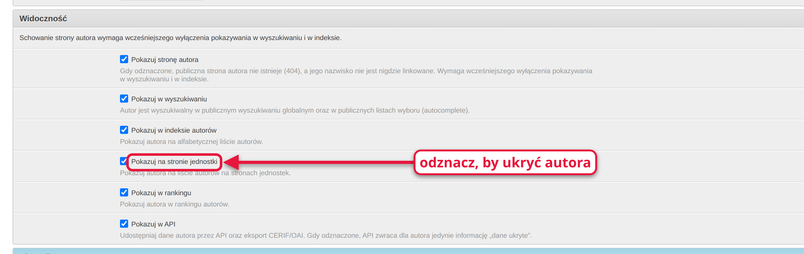
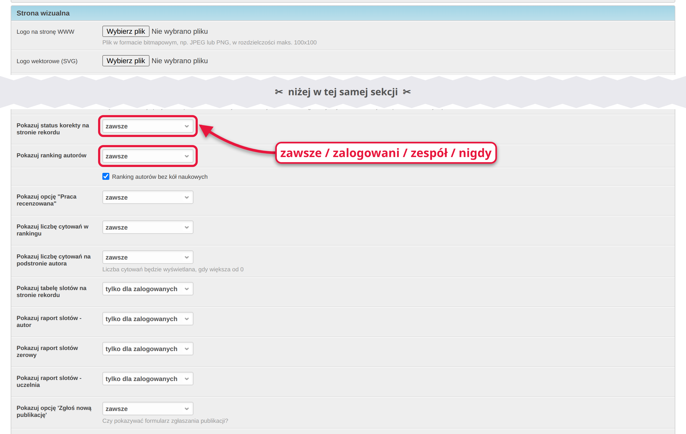
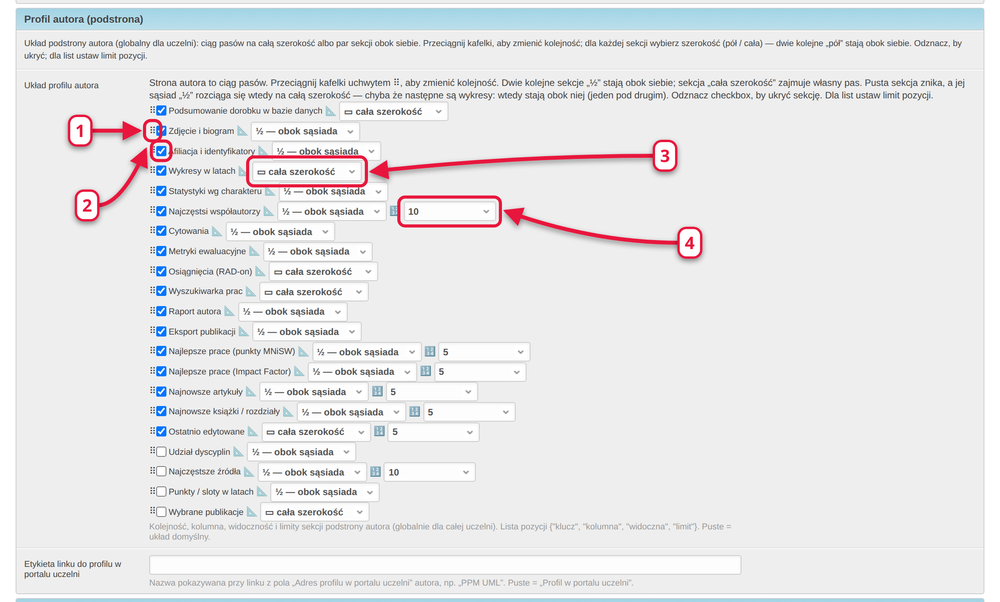
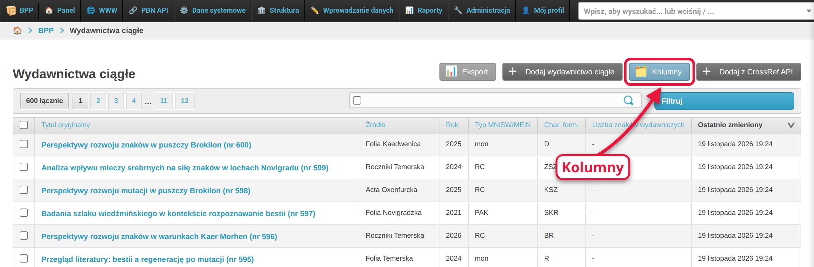
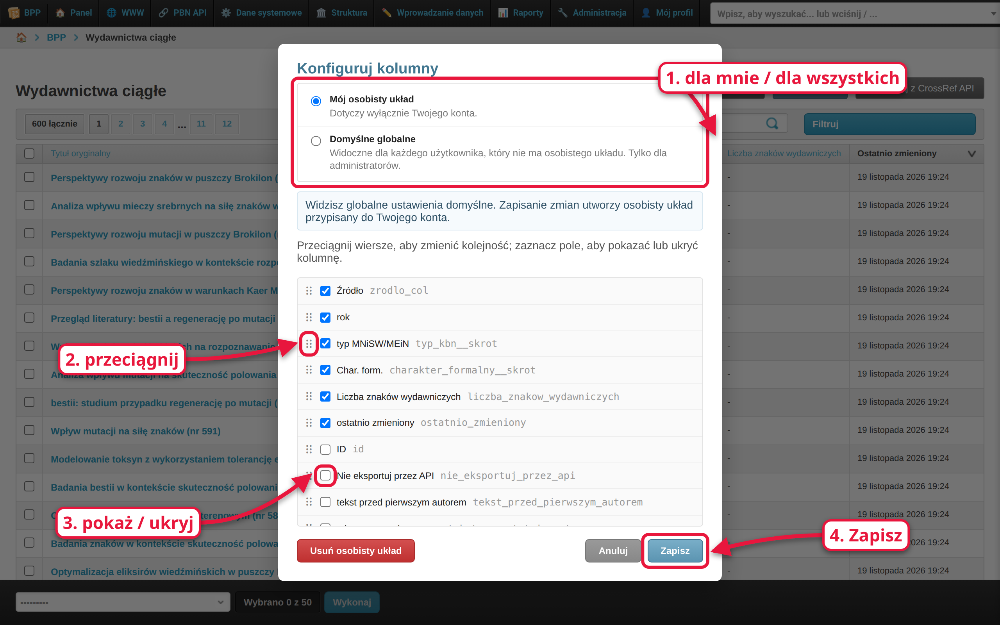
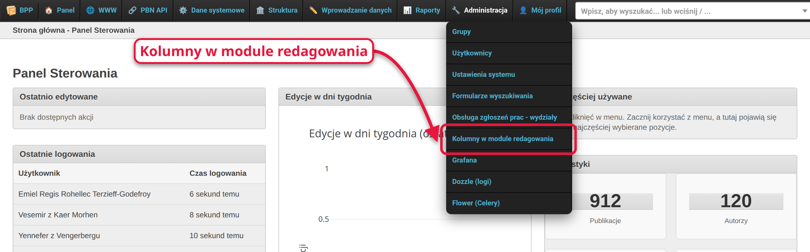

# Instrukcja dla administratora

Co pokazuje strona startowa modułu redagowania („Panel Sterowania”) i jakie dane o kliknięciach w menu oraz logowaniach przy tym zapisuje, opisuje strona [Pulpit administratora](panel-administracyjny.md).

## Konfiguracja sposobu prezentacji danych dla użytkowników niezalogowanych

### Ustawienia globalne - rekord uczelni

- po zainstalowaniu systemu, gdy baza danych jest pusta, potrzebujesz
  utworzyć obiekt „Uczelnia” za pomocą funkcji Redagowanie ➡ Struktura ➡ Uczelnia
  (jak do niego dojść — patrz [Edycja danych uczelni](../redaktor/uczelnia.md)),
- w tym rekordzie ustawisz ikonę favicon (pole „Ikona ulubionych (favicon)”,
  czyli zmniejszoną ikonę strony wyświetlaną w pasku adresu przeglądarki oraz
  na urządzeniach przenośnych), a w sekcji „Strona wizualna” — logo uczelni
  („Logo na stronę WWW”, „Logo wektorowe (SVG)”),
- w sekcji „Opcje edycji” ustawisz domyślną wartość pola „Afiliuje” dla
  powiązań autorów z pracami (wydawnictwo ciągłe, zwarte, patent).

Sposoby logowania (konta BPP, LDAP/Active Directory, Keycloak, Microsoft,
ORCID) i ich konfigurację opisuje strona [Metody logowania](metody-logowania.md).

#### Kolejność i zakres wyświetlanych wydziałów

- wydziały to jednostki najwyższego poziomu w strukturze uczelni. Ich listę
  otworzysz funkcją Redagowanie ➡ Struktura ➡ Wydziały; szczegóły wydziału
  zobaczysz, klikając jego nazwę,
- wydział (jak każda jednostka) może być wyświetlany lub nie — decyduje o tym
  pole „Widoczna” w formularzu jednostki,
- kolejność wydziałów i jednostek ustala opcja „Sortuj jednostki
  alfabetycznie” w sekcji „Strona wizualna” rekordu uczelni. Gdy jest
  odznaczona, obowiązuje kolejność ustalona ręcznie — jednostki na liście
  Redagowanie ➡ Struktura ➡ Jednostki przestawia się, przeciągając je
  myszą,
- pozostałe części serwisu dla użytkowników niezalogowanych wyświetlają
  dane w formacie kolumnowym, posortowane alfabetycznie.

#### Kafel „Wydziały” zamiast „Jednostki” na stronie głównej

Na stronie głównej, w sekcji „Przeglądaj bazę publikacji”, domyślnie jest
kafel **„Jednostki”**, prowadzący do indeksu wszystkich jednostek uczelni
(wydziałów, katedr, zakładów itd.). Uczelnia z wydziałami może zamiast niego
pokazać kafel **„Wydziały”**:

1. otwórz Redagowanie ➡ Struktura ➡ Uczelnia i kliknij swoją uczelnię,
2. w sekcji „Strona wizualna” zaznacz pole **„Kafel „Wydziały” zamiast
   „Jednostki” na stronie głównej”**,
3. zapisz rekord.

Kafel prowadzi do indeksu wydziałów (adres `/bpp/wydzialy/`) — listy
widocznych jednostek najwyższego poziomu **tej** uczelni; w instalacji
z kilkoma uczelniami każda widzi tylko swoje wydziały. Nazwa kafla to
nazwa wydziału w liczbie mnogiej, zgodna z nazewnictwem ustawionym
w systemie (np. „Instytuty”, jeśli wydział nazywa się u Was „instytut”).
Pozostałe kafle, menu „przeglądaj” i indeks jednostek (`/bpp/jednostki/`)
się nie zmieniają. Opcja jest domyślnie wyłączona.

#### Ukrywanie autorów na stronach jednostek

Aby ukryć autora na liście autorów na stronie jednostki (np. doktoranta albo
osobę, która nie jest pracownikiem danej jednostki):

1. otwórz autora: Redagowanie ➡ Wprowadzanie danych ➡ Autorzy, wyszukaj go
   i kliknij,
2. w sekcji **„Widoczność”** odznacz pole **„Pokazuj na stronie jednostki”**,
3. zapisz rekord.



Pole „Pokazuj na stronie jednostki” obejmuje wszystkie listy autorów na
stronie jednostki (obecni i byli pracownicy, autorzy publikacji) oraz
kierownika wyświetlanego w nagłówku strony.

W tej samej sekcji ukryjesz autora także w rankingu, w indeksie autorów,
w wyszukiwaniu i w API, a nawet całą jego stronę. Pole „Pokazuj
w wyszukiwaniu” dotyczy wyszukiwarki w górnym pasku strony oraz podpowiedzi
w polu „Nazwisko i imię” w formularzu Wyszukaj. Celowo NIE dotyczy raportów
(raport slotów, raporty autora) ani formularza „Zgłoś nową publikację” —
tam ukrytego autora nadal można wybrać, żeby mógł zgłosić własną pracę albo
zostać wskazany przez współautora. Redakcja (użytkownicy z uprawnieniami do
wprowadzania danych) zawsze widzi wszystkich autorów.

Ukrycie autora jest widoczne na stronach publicznych od razu po zapisaniu
rekordu — także wtedy, gdy kilku autorów ukrywasz naraz akcją „Ukryj
wybranych autorów na stronach jednostek i w rankingu” na liście autorów.
To samo dotyczy akcji zmiany statusu korekty na listach publikacji.

##### Ukrywanie autorów naraz (akcje na liście autorów)

Na liście autorów (Redagowanie ➡ Wprowadzanie danych ➡ Autorzy) zaznacz
autorów i wybierz akcję z listy „Akcja”:

- **„Ukryj wybranych autorów na stronach jednostek i w rankingu”** /
  **„Pokaż wybranych autorów na stronach jednostek i w rankingu”** —
  zmieniają tylko pola „Pokazuj na stronie jednostki” i „Pokazuj
  w rankingu”; pozostałe ustawienia widoczności zostają bez zmian,
- **„Ukryj wybranych autorów wszędzie (strony jednostek, ranking,
  wyszukiwanie, indeks, API, strona autora)”** — odznacza wszystkie pola
  sekcji „Widoczność”: „Pokazuj na stronie jednostki”, „Pokazuj
  w rankingu”, „Pokazuj w wyszukiwaniu”, „Pokazuj w indeksie autorów”,
  „Pokazuj w API” i „Pokazuj stronę autora”. Autor znika ze wszystkich
  publicznych miejsc, a jego strona przestaje istnieć,
- **„Pokaż wybranych autorów wszędzie (…)”** — zaznacza z powrotem
  wszystkie te pola.

Wszystkie cztery akcje są dostępne dla użytkowników, którzy mogą edytować
autorów. Każda zmiana trafia do „Historii” autora (przycisk „Historia” na
stronie edycji autora) z wpisem „Ukryto na stronach jednostek i w rankingu
(akcja masowa)”, „Pokazano na stronach jednostek i w rankingu (akcja
masowa)”, „Ukryto wszędzie (akcja masowa)” albo „Pokazano wszędzie (akcja
masowa)”, więc w razie pomyłki można przywrócić poprzedni stan
pojedynczego autora. Wpis dostają tylko autorzy, u których coś się
faktycznie zmieniło. Pole „Pokazuj sieć powiązań” nie jest przez te akcje
zmieniane — sieć powiązań autora ze schowaną stroną i tak nie jest
pokazywana.

Jedną akcją można zmienić najwyżej 2000 autorów — przy większym
zaznaczeniu akcja niczego nie zmienia i prosi o zawężenie listy filtrami.

##### Zmiana statusu korekty wielu publikacji naraz

Na listach wydawnictw ciągłych, wydawnictw zwartych i prac doktorskich
akcje **„Ustaw status korekty: przed korektą”**, **„Ustaw status
korekty: w trakcie korekty”** i **„Ustaw status korekty: po korekcie”**
zmieniają status wszystkich zaznaczonych rekordów. Każdy zmieniony rekord
dostaje w swojej „Historii” wpis, np. „Ustawiono status korekty: po
korekcie (akcja masowa)” — z nazwą użytkownika i datą. Publikacje mają
zapisywane wersje, więc z „Historii” każdego rekordu można wrócić do stanu
sprzed akcji (każdy rekord ma własną wersję — przywrócenie jednego nie
zmienia pozostałych). Akcje wymagają uprawnienia do edycji publikacji;
jedną akcją można zmienić najwyżej 5000 rekordów (przy większej liczbie
zawęź listę filtrami, np. po roku i statusie).

Ustawienia widoczności są zapisane na autorze, a nie na jego powiązaniu
z uczelnią. W instalacji z kilkoma uczelniami ukrycie autora (zarówno
w formularzu, jak i akcjami na liście) działa więc na stronach WSZYSTKICH
uczelni, w których autor występuje.

#### Ukrywanie lub wyświetlanie raportów na stronie głównej

Celem konfiguracji sposobu wyświetlania strony głównej jak i innych elementów
serwisu, skorzystaj z opcji Redagowanie ➡ Struktura ➡ Uczelnia, a następnie w sekcji
„Strona wizualna” wyedytuj ustawienia dotyczące pokazywania różnych opcji
(ranking autorów, raporty slotów, status korekty i tabela slotów na stronie
rekordu, liczba cytowań, opcja „Zgłoś nową publikację”). Część ustawień to
pola wyboru „pokazuj / nie pokazuj”, a część pozwala wybrać, komu dany
element jest widoczny: **zawsze**, **tylko dla zalogowanych**, **tylko dla
zespołu** albo **nigdy**.



#### Ukrywanie lub wyświetlanie formularzy wyszukiwania

Gdy stworzysz formularz wyszukiwania w opcji Wyszukaj, możesz go zapisać. W ten
sposób formularz będzie dostępny w późniejszym czasie. Podczas zapisywania formularza
(opcja ta dostępna jest jedynie dla zalogowanych użytkowników) masz możliwość
określenia, czy chcesz, aby ten formularz widoczny był również dla innych
osób.

Jeżeli chcesz później schować lub pokazać takie formularze, skorzystaj z opcji
Redagowanie ➡ Administracja ➡ Formularze wyszukiwania. Kliknij nazwę takiego
formularza, następnie zaznacz lub odznacz opcję „Publiczny” i zapisz rekord.

#### Układ podstrony autora (profil autora) {#układ-podstrony-autora-profil-autora}

W rekordzie uczelni (Redagowanie ➡ Struktura ➡ Uczelnia, edycja rekordu) znajduje
się zwijana sekcja **„Profil autora (podstrona)"**. Zawiera ona **kafelkowy
edytor układu** publicznych podstron autorów (patrz
[opis strony autora w instrukcji użytkownika](../uzytkownik/przegladanie-i-wyszukiwanie.md#strona-autora)).
Ustawienie jest **globalne dla całej uczelni** — obowiązuje na podstronach
wszystkich autorów.

Podstrona autora to ciąg **pasów**: sekcja na całą szerokość albo dwie
sekcje obok siebie. Edytor to jedna lista kafelków w kolejności, w jakiej
sekcje pojawią się na stronie:

1. **przeciągnij** kafelek uchwytem ⠿ (ang. *drag and drop*), aby zmienić
   kolejność,
2. **odznacz pole wyboru** przy nazwie sekcji, aby ją ukryć,
3. przy każdym kafelku wybierz **szerokość**: „½ — obok sąsiada” albo
   „cała szerokość” — **dwie kolejne sekcje „½” stają obok siebie**, a sekcja
   „cała szerokość” zajmuje własny pas,
4. dla sekcji listowych ustaw **limit** liczby pozycji (5, 10, 20, 30 lub 50;
   domyślnie listy prac mają 5 pozycji, współautorzy — 10).

Na koniec zapisz rekord uczelni.



Strona sama dba o to, by nie powstawały puste miejsca:

- sekcja bez danych (np. autor bez zdjęcia i biogramu, bez cytowań) **nie
  pokazuje się**, a sekcja „½”, która straciła przez to parę, zajmuje cały pas,
- **wykresy w latach** są wyjątkiem: domyślnie zajmują cały pas (trzy obok
  siebie), ale gdy tuż przed nimi została samotna sekcja „½”, stają obok niej
  (jeden pod drugim, w niższej wersji).

!!! tip
    **Pusty układ oznacza układ domyślny** — system pokaże rozsądny,
    wbudowany zestaw sekcji: podsumowanie dorobku, zdjęcie z biogramem obok
    afiliacji i identyfikatorów, wykresy, statystyki obok współautorów,
    osiągnięcia z RAD-on, wyszukiwarkę prac, raport obok eksportu i listy
    prac parami. Nie trzeba niczego konfigurować, jeśli taki układ wystarcza.

Dostępne sekcje to m.in.: podsumowanie dorobku, zdjęcie i biogram,
afiliacja i identyfikatory, wykresy w latach, statystyki wg charakteru
formalnego, najczęstsi współautorzy, cytowania, metryki ewaluacyjne,
osiągnięcia (RAD-on), wyszukiwarka prac, raport autora, eksport publikacji,
najlepsze prace (wg punktacji oraz wg Impact Factor), najnowsze artykuły,
najnowsze książki i rozdziały, ostatnio edytowane, a także domyślnie
wyłączone: udział dyscyplin, najczęstsze źródła, punkty/sloty w latach
i wyróżnione publikacje.

!!! note "Instalacja z kilkoma uczelniami: profil pokazuje pełny dorobek"
    Gdy w jednej instalacji BPP działa kilka uczelni (każda pod własnym
    adresem), część stron publicznych — m.in. przeglądanie, OAI-PMH i API —
    pokazuje tylko prace przypisane do uczelni, pod której
    adresem się je ogląda. **Podstrona autora i eksport jego publikacji
    (BibTeX, RIS) są celowym wyjątkiem:** pokazują **pełny dorobek autora**,
    także prace afiliowane wyłącznie w innej uczelni tej samej instalacji.

    Powód: podstrona autora opisuje osobę, a nie uczelnię — autor
    pracujący w dwóch uczelniach (albo zmieniający miejsce pracy) ma
    widzieć i eksportować cały swój dorobek pod jednym adresem, a liczby
    w podsumowaniu, wykresach i eksporcie są spójne niezależnie od tego,
    przez którą uczelnię wszedł oglądający.

    Prace o statusach korekty ukrytych przez uczelnię nadal nie są
    pokazywane (ani na podstronie, ani w eksporcie). W instalacji z jedną
    uczelnią ta uwaga nie ma znaczenia.

W tej samej sekcji ustawisz **etykietę linku do profilu w portalu uczelni**
(pole „Etykieta linku do profilu w portalu uczelni”, np. nazwa portalu
pracowników Twojej uczelni). Pokazuje się ona przy linku z pola „Adres profilu w portalu
uczelni" w rekordzie autora; gdy jest pusta, link opisany jest jako „Profil
w portalu uczelni".
## Ukrywanie nieużywanych pozycji słowników

Słowniki takie jak **Języki**, **Charaktery formalne**, **Typy KBN**
i **Charakter PBN** (menu „Dane systemowe”) mają często setki
pozycji, z których uczelnia używa kilkunastu — reszta tylko wydłuża listy
wyboru przy wprowadzaniu rekordów.

Na liście każdego z tych słowników jest filtr **„używane w rekordach”**
(wartości „używane” / „nieużywane”). Pozycja jest „używana”, gdy wskazuje
na nią cokolwiek w bazie: publikacja (także przez pole „Język
alternatywny” czy „Język oryginalny”), patent, praca dyplomowa, rekord
w koszu, konfiguracja itp. Podrzędne pozycje w drzewie charakterów
formalnych nie czynią nadrzędnej „używaną”.

Te same informacje widać od razu w kolumnie **„Używane”** (można po niej
sortować). Słownik języków ma dodatkowo kolumnę **„Liczba publikacji”** —
ile wydawnictw ciągłych, zwartych, prac doktorskich i habilitacyjnych
wskazuje na język polem „Język”, „Język alternatywny” lub „Język
oryginalny” (także rekordy w koszu). Kliknij nagłówek, żeby posortować
języki od najczęściej albo najrzadziej używanych. Język może mieć
0 publikacji i nadal być „używany” — np. jako język źródła, streszczenia
albo dodatkowego tytułu.

Na tych listach są cztery akcje:

- **„Ukryj wszystkie nieużywane (bez zaznaczania)…”** — najprostsza droga:
  wybierz ją z listy akcji i kliknij „Wykonaj”, nie zaznaczając żadnego
  wiersza. System pokaże **podgląd**: listę pozycji, które zostaną ukryte
  (żaden rekord na nie nie wskazuje), oraz tych, które pozostaną widoczne,
  bo są używane. Nic się nie zmienia, dopóki nie klikniesz „Tak, ukryj”.
  Zatwierdzenie dotyczy dokładnie listy z podglądu: pozycja dodana do
  słownika w międzyczasie nie zostanie ukryta, a pozycja, która po
  wyświetleniu podglądu zaczęła być używana, zostanie pominięta (komunikat
  poda, ile takich było).
- **„Ukryj nieużywane spośród zaznaczonych…”** — to samo, ale tylko dla
  zaznaczonych wierszy; także z podglądem i potwierdzeniem. Można
  bezpiecznie zaznaczyć całą listę — używane pozycje zostaną pominięte.
- **„Ukryj zaznaczone”** — chowa wszystkie zaznaczone, także używane (bez
  podglądu). Jeśli wśród nich są używane, komunikat to zaznaczy.
- **„Pokaż zaznaczone”** — z powrotem pokazuje zaznaczone pozycje na
  listach wyboru. Tak cofa się każde ukrycie: wybierz filtr „Widoczny:
  Nie” (języki) albo „Ukryj na listach wyboru: Tak” (pozostałe słowniki),
  zaznacz pozycje i uruchom tę akcję.

Ukrycie odznacza „Widoczny” (języki) albo zaznacza „Ukryj na listach
wyboru” (pozostałe słowniki). Ukryta pozycja znika z list wyboru przy
wprowadzaniu i redagowaniu rekordów, ale zostaje w bazie i **nie psuje
istniejących rekordów**: rekord, który już ma ukryty język (albo ukryty typ
MNiSW), nadal pokazuje go w formularzu i daje się zapisać bez zmiany tej
wartości. Ukryta pozycja jest wtedy na liście wyboru tylko w tym jednym
rekordzie; innej ukrytej pozycji wybrać się w nim nie da. Dotyczy to pól
„Język”, „Język alternatywny”, „Język oryginalny”, „Typ MNiSW/MEiN”
i „Charakter formalny” w wydawnictwach ciągłych i zwartych, pracach
doktorskich i habilitacyjnych, a także języka streszczenia, dodatkowego
tytułu i języka źródła.

Każda zmiana trafia do „Historii” pozycji (przycisk „Historia”
w formularzu słownika) z wpisem „Ukryto nieużywaną pozycję słownika (akcja
masowa)”, „Ukryto pozycję słownika (akcja masowa)” albo „Pokazano pozycję
słownika (akcja masowa)” — z nazwą użytkownika i datą. Słowniki nie mają
zapisywanych wersji, więc pomyłkę cofa się akcją „Pokaż zaznaczone”, nie
przyciskiem przywracania. Akcje wymagają uprawnienia do edycji danego
słownika.

Administrator serwera może ukryć nieużywane języki także z wiersza poleceń:
`manage.py ukryj_nieuzywane_jezyki` (z `--dry-run` tylko wypisuje, co
zostałoby ukryte). Polecenie stosuje tę samą definicję „nieużywanego”
języka co akcja w panelu.

## Kody języków a pobieranie danych z CrossRef

Gdy BPP pobiera opis publikacji z CrossRef (formularz „Dodaj z CrossRef
API”, importer publikacji), język pracy przychodzi jako kod dwuliterowy
(ISO 639-1), np. `en`, `de`, `uk`. BPP szuka go w słowniku **Dane systemowe
→ Języki** kolejno w:

1. polu **„Skrót nazwy języka wg API CrossRef”** — dowolny poprawny kod
   języka małymi literami, np. `de` (dawniej dało się tu wybrać tylko `en`,
   `es` albo `pl`). Kod musi być unikalny w słowniku;
2. polu **„Kod języka wg BCP 47”** — np. `pl`, `en`, `en-GB`. Region jest
   pomijany, więc `en-GB` pasuje do `en`;
3. języku PBN powiązanym z językiem BPP (kolumna „Pbn uid”) — jego kodzie
   dwu- lub trzyliterowym. Dzięki temu język dociągnięty z PBN działa od
   razu, zanim ktokolwiek uzupełni mu kody.

Języki **widoczne mają pierwszeństwo** przed ukrytymi, niezależnie od pola.
Jeśli kod pasuje wyłącznie do języka ukrytego, pole „Język” nowego rekordu
zostaje puste (ukrytego języka nie ma na liście wyboru), a system mówi
dlaczego: „Źródło podaje język „…”, ale jest on ukryty na listach wyboru…”
— w formularzu „Dodaj z CrossRef API” jako komunikat u góry strony,
w importerze publikacji pod polem „Język” w kroku weryfikacji. Wystarczy
pokazać ten język akcją „Pokaż zaznaczone” albo wybrać inny.

### Skąd biorą się kody

Języki założone w BPP na podstawie PBN mają skrót trzyliterowy (ISO 639-2,
np. `ukr`, `ces`) i taki sam kod trafił automatycznie do pola „Kod języka
wg BCP 47”. Przy aktualizacji BPP kody zostały uzupełnione jednorazowo;
to samo można w każdej chwili powtórzyć akcją **„Uzupełnij kody CrossRef
z PBN (bez zaznaczania)…”** na liście języków — np. po dociągnięciu nowych
języków z PBN. Akcja najpierw pokazuje **podgląd** (język, stary → nowy
kod), a zapisuje dopiero po kliknięciu „Tak, uzupełnij kody”. Zasady:

- kod dwuliterowy pochodzi z powiązanego języka PBN, a gdy go brak —
  z polskiej nazwy języka („węgierski” → `hu`);
- **„Kod języka wg BCP 47”** jest zmieniany tylko wtedy, gdy jest pusty
  albo trzyliterowy i taki sam jak skrót języka (czyli wpisał go automat).
  Kodów wpisanych ręcznie (np. `pt-BR`) akcja nie rusza;
- **„Skrót nazwy języka wg API CrossRef”** jest wypełniany tylko, gdy jest
  pusty. Jeżeli ten sam kod pasuje do kilku języków (np. dwa wpisy
  „czeski”), dostaje go jedyny używany w publikacjach, a gdy to nie
  rozstrzyga — jedyny widoczny. Gdy nadal nie wiadomo, skrót nie jest
  nadawany nikomu (podgląd wymienia takie języki w sekcji o kolizjach),
  a dopasowanie idzie po kodzie BCP 47;
- każda zmiana trafia do „Historii” języka.

Zmiana kodu BCP 47 z trzyliterowego na dwuliterowy (np. `ukr` → `uk`) jest
widoczna także poza importem: ten kod trafia do atrybutu `lang` przy
tytułach obcojęzycznych na stronach publicznych oraz do `xml:lang`
w eksporcie CERIF/OpenAIRE. Kod dwuliterowy jest tam poprawną (zalecaną
przez BCP 47) postacią.

Filtr **„dwuliterowy kod dla CrossRef: jest / brak”** na liście języków
pokazuje, których języków nie da się dopasować do CrossRef. Wiele języków
nie ma kodu dwuliterowego w ogóle (ISO 639-1 obejmuje ok. 180 języków) —
dla nich „brak” jest stanem poprawnym; filtr warto łączyć z filtrem
„używane w rekordach”.

## Sposób kalkulacji dyscyplin

1.  Dyscyplina i subdyscyplina naukowa przypisana autorowi na dany rok zawiera się w rekordzie `Autor_Dyscyplina`.
2.  Dyscyplina naukowa którą autor deklaruje dla danej publikacji jest określana przez bibliotekarza
    każdorazowo dla powiązania autora do rekordu.
3.  Zachowanie systemu podczas zmiany przypisań dyscyplin na dany rok opisuje niniejsza instrukcja
    w części [Zachowanie procedur utrzymujących integrację danych (triggerów) dla przypisań autora do dyscypliny](#zachowanie-procedur-utrzymujących-integrację-danych-triggerów-dla-przypisań-autora-do-dyscypliny).
4.  Od wersji oprogramowania `1.0.30-dev3` system nie domniemuje automatycznie dyscypliny
    dla danego przypisania autora do rekordu w przypadku braku takiej informacji. Innymi słowy,
    **pole "Dyscyplina" przy powiązaniu autora z rekordem musi być wypełnione**. Jeżeli jest puste,
    system nie bierze takiego autora pod uwagę przy kalkulacji dyscypliny. Zatem:
5.  Dyscyplina dla danego autora przy przypisaniu do rekordu istniejącego musi być explicte wpisana.
6.  Dyscyplina naukowa dla nowych rekordów: system podczas wpisywania nowego rekordu, po wybraniu
    imienia i nazwiska autora przy powiązaniu autora do rekordu będzie starał się podpowiedzieć dyscyplinę
    dla danego roku - w sytuacji, gdy autor ma wpisaną jedną.
7.  W sytuacji gdy autor ma wpisane dwie dyscypliny dla danego roku, system nie podpowiada dyscypliny,
    pozostawiając to do decyzji bibliotekarza.

## Zachowanie procedur utrzymujących integrację danych (triggerów) dla przypisań autora do dyscypliny

### Założenia

1.  przypisanie autora do dyscypliny (rekord `Autor_Dyscyplina`) na dany rok musi mieć główną dyscyplinę;
2.  pole subdyscyplina może być puste,
3.  procenty udziału dyscypliny i subdyscypliny, zsumowane, nie mogą przekroczyć 100%

### Zachowanie

1.  **dopisanie dyscypliny** (utworzenie rekordu `Autor_Dyscyplina`) na dany rok **nie powoduje** żadnych
    zmian w rekordach powiązanych; jeżeli autor miał jakieś przypisania do rekordów, pole "Dyscyplina"
    pozostaje w nich puste tzn ma nadal

    Rekordy te można będzie za pomocą zapytania bazodanowego przypisać do zadanych dyscyplin,
    jeżeli taka jest wola i decyzja redaktora / osób odpowiedzialnych za merytoryczną zawartość bazy
    danych.

2.  **zmiana dyscypliny lub subdyscypliny** na **inną** powoduje zmianę dyscypliny przypisanej dla
    powiązań autor + rekord dla danego roku, dla danego autora - we wszystkich rekordach, które
    mają „starą” dyscyplinę lub subdyscyplinę - na nową

3.  **zmiana subdyscypliny** na **pustą** powoduje zmianę dyscypliny przypisanej dla
    powiązań autor + rekord dla danego roku, dla danego autora - we wszystkich rekordach, które
    mają „starą” subdyscyplinę - na pustą.

4.  **usunięcie przypisania** autora do dyscypliny (rekord `Autor_Dyscyplina`) powoduje ustawienie
    wartości pustej (`NULL`) dla danego roku, dla danego autora - we wszystkich rekordach, do
    których przypisany jest dany autor.

## Pola "... ogólny" ("typ ogólny", "charakter ogólny" itp)

W kilku miejscach systemu możemy natknąć się na pola nazwane w sposób
"... ogólny", "... dla eksportu", "... dla slotów" itp.

Przykładowo,
charakter formalny dla rekordów (Redagowanie➡Dane systemowe➡Charaktery formalne)
ma takie pola w chwili pisania tej dokumentacji:

- charakter PBN
- charakter dla slotów
- rodzaj dla PBN
- nazwa w PRIMO

Podobnie typ odpowiedzialności autora, czyli rekord określający czy osoba
przypisana do rekordu jest jego autorem czy np. redaktorem bądź tłumaczem
(Redagowanie➡Dane systemowe➡Typy odpowiedzialności) posiada:

- ogólny typ odpowiedzialności

Tego typu pola wydają się w pewnym sensie dublować informacje zawarte już w innych
polach rekordu.

Przykładowo typ odpowiedzialności "autor korespondencyjny" może mieć
pozornie zdublowaną informację "autor" jako typ ogólny. Podobnie, charakter formalny
"książka w języku polskim" może mieć pozornie zdublowaną informację "charkater dla slotów"
równe "książka".

Tego typu zapis danych jest jednak jak najbardziej celową i świadomą decyzją ze strony autorów
oprogramowania BPP.

Dzięki temu możemy sobie pozwolić na dowolnie zapisaną
nazwę danego charakteru formalnego bądź odpowiedzialności autora. W ten sposób
nie musimy np zmieniać informacji historycznej w systemie, bądź dokładać sobie
pracy w razie importu danych z zewnętrznych źródeł. Nazwa charakteru bądź typu odpowiedzialności
może byc w takim układzie dowolna.

System jednak potrzebuje wiedzieć dokładnie na potrzeby obliczeń, raportów i eksportu
danych, czy np. tekstowe określenie "autor korespondencyjny" czy "redaktor korespondencyjny wydania polskiego"
to autor, tłumacz czy redaktor - i właśnie dla takiego celu stworzone zostały pola
"... ogólne". Pola z charakterem "ogólnym" danego rekordu zawiera kilka rodzajów typów, odgórnie
zdefiniowanych w kodzie programu, które to potem w tym kodzie są wykorzystywane - na
potrzeby procedur liczących, raportujących, eksportujących dane itp.

## Konfiguracja rodzaju i kolejności wyświetlanych kolumn w module redagowania

Na listach w module redagowania (np. Wprowadzanie danych ➡ Wydawnictwa ciągłe,
Wydawnictwa zwarte, Autorzy) można wybrać, które kolumny są widoczne i w jakiej
kolejności. Służy do tego przycisk **„Kolumny”** w prawym górnym rogu listy:



Otworzy się okno „Konfiguruj kolumny”:

1. Wybierz, czego dotyczy zmiana: **„Mój osobisty układ”** (tylko Twoje
   konto) albo **„Domyślne globalne”** (układ dla wszystkich użytkowników,
   którzy nie mają osobistego układu). Wybór układu globalnego widzi tylko
   superużytkownik — pozostali użytkownicy zawsze zapisują układ osobisty.
2. Przeciągnij wiersz za uchwyt ⠿ po lewej stronie, aby zmienić kolejność
   kolumn (ang. *drag and drop*).
3. Zaznacz lub odznacz pole wyboru, aby pokazać lub ukryć kolumnę.
4. Kliknij **„Zapisz”**.



Gdy masz osobisty układ, przy przycisku „Kolumny” widać gwiazdkę ★.
Przycisk **„Usuń osobisty układ”** w tym samym oknie przywraca układ
globalny.

Zapisane układy (globalne i osobiste) superużytkownik przejrzy w opcji
Redagowanie ➡ Administracja ➡ Kolumny w module redagowania:



!!! note

    Niektóre kolumny w kodzie programu ustawione są jako *zawsze* *widoczne* i nie będą
    dostępne do edycji. Nie będzie można zmienić ich kolejności ani ich schować.


!!! note

    Im więcej kolumn wybranych, tym więcej danych musi przetworzyć system. Im mniej
    - tym tabele będą wyświetlały się szybciej.


## Uzupełnianie pustych dat oświadczeń PBN w rekordach publikacji

W systemie BPP może wystąpić sytuacja, gdy rekordy powiązań autorów z publikacjami
(Wydawnictwo_Ciagle_Autor, Wydawnictwo_Zwarte_Autor) nie mają wypełnionych dat oświadczeń
potrzebnych do prawidłowej integracji z PBN. System udostępnia procedury do automatycznego
wypełnienia tych dat oraz wysłania oświadczeń do PBN.

#### Procedura uzupełniania dat oświadczeń

1.  **Wypełnienie pustych dat oświadczeń**

    Pierwszym krokiem jest uruchomienie procedury, która automatycznie ustawi daty oświadczeń
    na podstawie daty utworzenia rekordu publikacji:

    ``` bash
    python src/manage.py ustaw_daty_oswiadczenia_pbn
    ```

    Ta procedura:

    - Wyszukuje wszystkie rekordy powiązań autor-publikacja z pustymi datami oświadczeń
    - Uwzględnia tylko publikacje z rokiem wydania >= 2022
    - Ustawia datę oświadczenia na datę utworzenia nadrzędnego rekordu publikacji
    - Aktualizuje rekordy w tabelach `Wydawnictwo_Ciagle_Autor` i `Wydawnictwo_Zwarte_Autor`

    !!! note

        Przed właściwym uruchomieniem procedury zaleca się wykonanie testu za pomocą opcji `--dry-run`,
        aby sprawdzić, które rekordy zostaną zaktualizowane:

        ``` bash
        python src/manage.py ustaw_daty_oswiadczenia_pbn --dry-run
        ```


2.  **Autoryzacja w systemie PBN**

    Przed wysyłaniem oświadczeń należy się upewnić, że system jest autoryzowany w PBN.
    W przypadku braku autoryzacji należy wykonać procedurę logowania opisaną w dokumentacji
    konfiguracji PBN.

3.  **Aktualizacja danych lokalnych przed pierwszym importem**

    Przed pierwszym wysłaniem oświadczeń do PBN należy upewnić się, że dane lokalne publikacji
    są aktualne i zsynchronizowane z systemem PBN. W tym celu należy pobrać publikacje z profilu
    instytucji za pomocą API v2:

    ``` bash
    python src/manage.py pbn_pobierz_publikacje_z_instytucji_v2
    ```

    Ta procedura:

    - Pobiera wszystkie publikacje z profilu instytucji w systemie PBN
    - Synchronizuje dane lokalne z danymi w PBN
    - Zapewnia spójność przed wysyłką oświadczeń

4.  **Wysyłanie oświadczeń do PBN**

    Po uzupełnieniu dat oświadczeń można przystąpić do ich wysłania do systemu PBN:

    ``` bash
    python src/manage.py pbn_wyslij_oswiadczenia_instytucji --year 2023
    ```

    Opcje dostępne przy wysyłaniu oświadczeń:

    - `--year <rok>` - wysyła oświadczenia dla wszystkich publikacji z określonego roku
    - `--dry-run` - tryb testowy, pokazuje co zostałoby wysłane bez faktycznej wysyłki
    - `<model>:<id>` - wysyła oświadczenie dla konkretnej publikacji (np. `wydawnictwo_ciagle:123`)

    !!! warning

        Podczas wysyłania publikacji do PBN, jeżeli w API v2 PBN znajdą się publikacje,
        których nie ma w lokalnej bazie danych, zostaną one automatycznie pobrane,
        a ich nazwy wypisane na standardowym wyjściu programu.


#### Przykład kompletnej procedury

``` bash
# 1. Test uzupełniania dat (opcjonalnie)
python src/manage.py ustaw_daty_oswiadczenia_pbn --dry-run

# 2. Uzupełnienie dat oświadczeń
python src/manage.py ustaw_daty_oswiadczenia_pbn

# 3. Aktualizacja danych lokalnych (przed pierwszym importem)
python src/manage.py pbn_pobierz_publikacje_z_instytucji_v2

# 4. Wysłanie oświadczeń dla publikacji z 2023 roku
python src/manage.py pbn_wyslij_oswiadczenia_instytucji --year 2023
```

!!! note

    Wszystkie powyższe operacje wymagają prawidłowej konfiguracji integracji z PBN
    oraz autoryzacji użytkownika w systemie PBN. Szczegóły konfiguracji znajdują
    się w dokumentacji [konfiguracja PBN](konfiguracja-pbn.md).


## Konfiguracja mapowania charakterów CrossRef API na charaktery formalne BPP

System BPP umożliwia integrację z CrossRef API do pobierania danych publikacji.
Aby prawidłowo zaimportować dane z CrossRef, konieczne jest skonfigurowanie mapowania
między charakterami formalnej publikacji używanymi przez CrossRef API a charakterami
formalnymi zdefiniowanymi w systemie BPP.

### Dostępne charaktery CrossRef API

System CrossRef API wykorzystuje następujące typy charakterów publikacji:

- `journal-article` - artykuły w czasopismach
- `proceedings-article` - artykuły w materiałach konferencyjnych
- `book` - książki
- `book-chapter` - rozdziały w książkach
- `edited-book` - książki redagowane
- `proceedings` - materiały konferencyjne
- `monograph` - monografie
- `reference-book` - książki referencyjne/podręczniki
- `book-series` - serie książkowe
- `book-set` - zestawy książek
- `book-section` - sekcje książek
- `book-part` - części książek
- `dissertation` - dysertacje/prace doktorskie
- `posted-content` - treści opublikowane online (preprints, itp.)
- `peer-review` - recenzje
- `other` - inne typy publikacji

### Konfiguracja mapowania w module Redagowania

Aby skonfigurować mapowanie charakterów CrossRef na charaktery formalne BPP:

1.  **Wejście do modułu administracyjnego**

    Zaloguj się jako administrator i przejdź do modułu Redagowania pod adresem `/admin/`

2.  **Przejście do konfiguracji mapowania**

    W sekcji "Dane systemowe" znajdź i kliknij opcję **"Crossref Mapper"**

3.  **Przeglądanie istniejących mapowań**

    Wyświetli się lista wszystkich dostępnych charakterów CrossRef API wraz z ich
    aktualnymi mapowaniami na charaktery formalne BPP:

4.  **Konfiguracja mapowania**

    Dla każdego charakteru CrossRef:

    1)  Kliknij na rekord, który chcesz skonfigurować
    2)  W polu "Charakter formalny bpp" wybierz odpowiedni charakter z listy rozwijanej
    3)  Zapisz zmiany przyciskiem "Zapisz"

### Ważne zasady mapowania

!!! warning

    **Jeden rodzaj CrossRef może mieć tylko jedno mapowanie na charakter formalny systemu BPP.**
    System nie pozwoli na przypisanie tego samego charakteru CrossRef do dwóch różnych
    charakterów formalnych BPP.


!!! note

    - Mapowanie jest opcjonalne - charaktery CrossRef mogą pozostać bez przypisania
    - Rekordy bez mapowania będą wyświetlane jako "\[brak zamapowania\]"
    - Zmiana mapowania wpłynie na wszystkie przyszłe importy z CrossRef API


### Przykłady typowych mapowań

Poniżej przedstawiono sugerowane mapowania dla typowych charakterów:

- `journal-article` → "Artykuł w czasopiśmie"
- `book` → "Książka"
- `book-chapter` → "Rozdział w książce"
- `edited-book` → "Książka redagowana"
- `proceedings-article` → "Artykuł w materiałach konferencyjnych"
- `proceedings` → "Materiały konferencyjne"

!!! note

    Dokładne nazwy charakterów formalnych mogą się różnić w zależności od konfiguracji
    danej instancji systemu BPP. Należy dopasować mapowanie do charakterów formalnych
    zdefiniowanych w danej uczelni.


### Weryfikacja poprawności mapowania

Po skonfigurowaniu mapowań zaleca się przeprowadzenie testowego importu -
wykonaj próbny import publikacji z CrossRef API aby sprawdzić, czy
charaktery są poprawnie przypisywane
