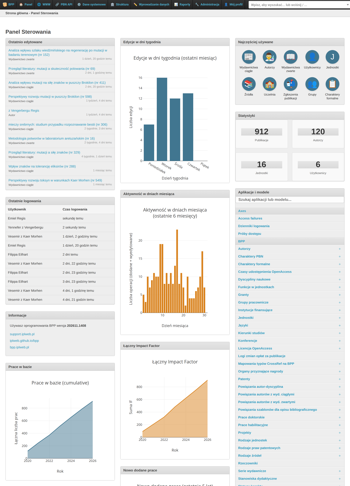
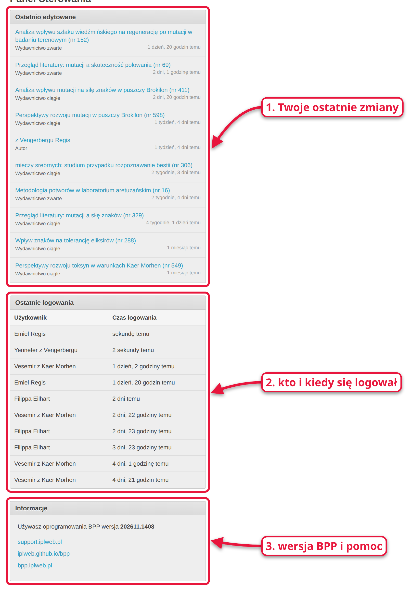
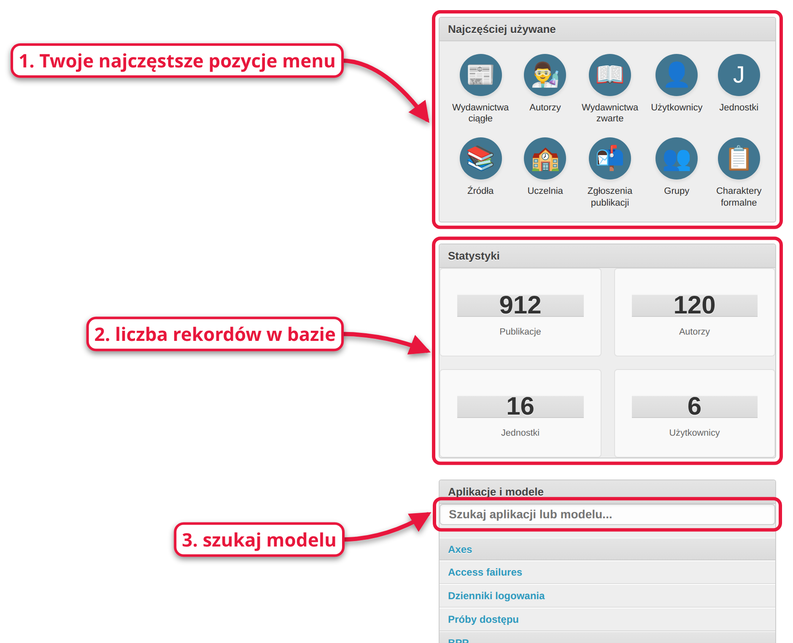
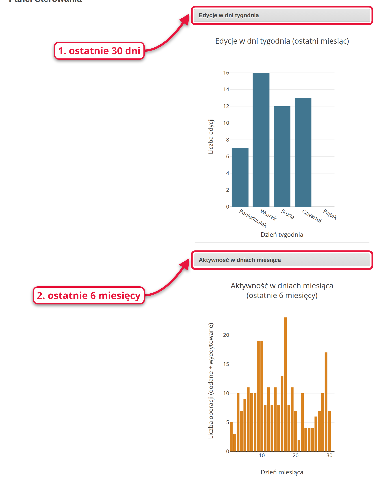
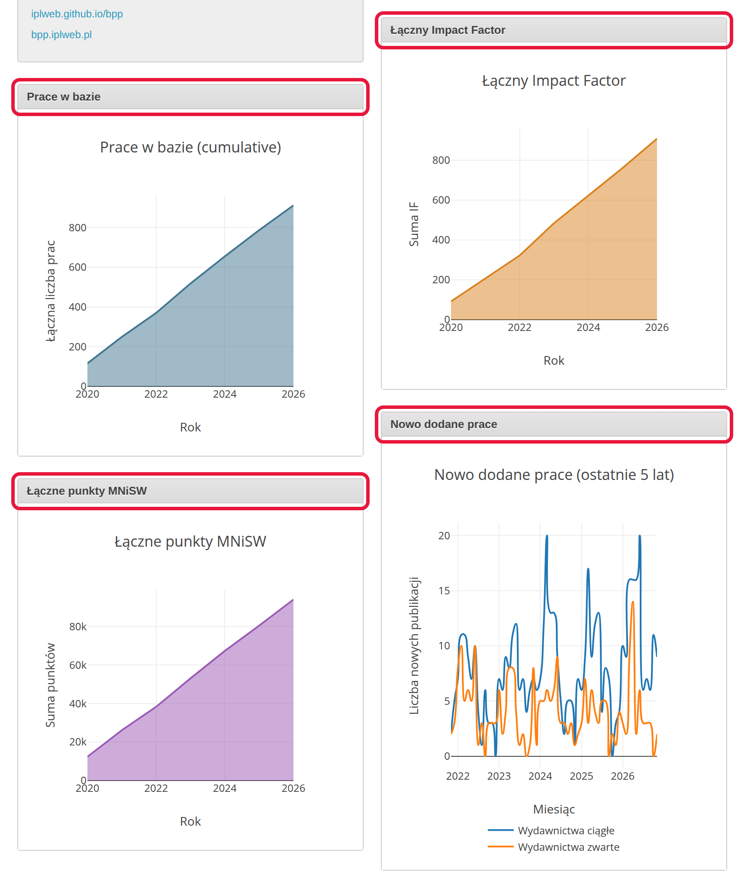
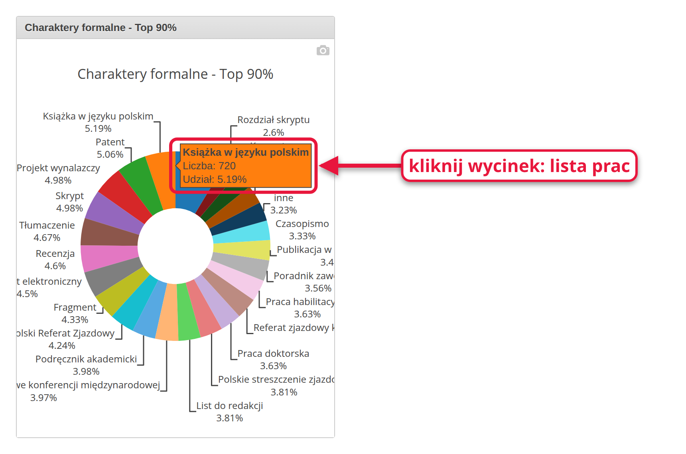
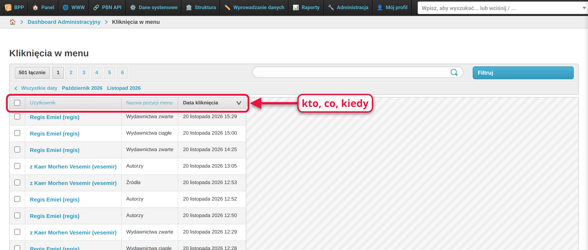
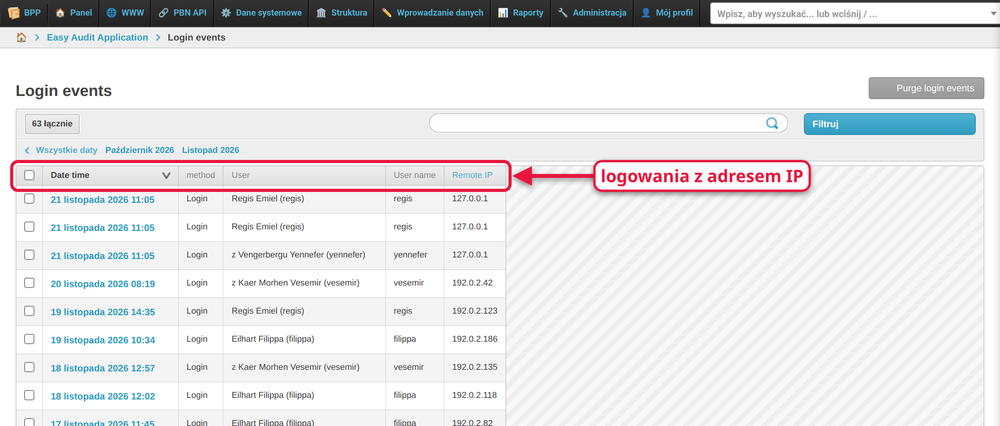

# Pulpit administratora (statystyki systemu)

Po wejściu do modułu redagowania BPP otwiera się strona **„Panel
Sterowania”**. To pulpit: kilka ramek z Twoją ostatnią pracą, listą
logowań, licznikami rekordów i wykresami, które pokazują, jak rośnie baza
i jak pracuje redakcja. Ta strona opisuje każdą ramkę, mówi, skąd biorą się
liczby, i — co ważne dla administratora — jakie dane o użytkownikach system
przy tym zapisuje i jak długo je trzyma.

## Kto widzi pulpit

Pulpit widzi każda osoba, która ma dostęp do modułu redagowania (konto
z uprawnieniem „w zespole”, czyli redaktorzy i administratorzy). Część ramek
jest **osobista**, część pokazuje **całą bazę**:

| Ramka | Co pokazuje |
|---|---|
| Ostatnio edytowane | tylko Twoje zmiany |
| Ostatnie logowania | superużytkownik: logowania wszystkich; pozostali: tylko własne |
| Najczęściej używane | tylko Twoje kliknięcia w menu |
| Statystyki, wszystkie wykresy | cała baza, tak samo dla każdego |
| Aplikacje i modele | tylko to, do czego masz uprawnienia |

## Jak otworzyć pulpit

1. Zaloguj się i przejdź do modułu redagowania (na stronie publicznej menu
   **„Redagowanie”**).
2. Pulpit otwiera się sam. Z każdego innego miejsca modułu wrócisz do niego,
   klikając **„Panel”** na górnym pasku menu.

Wykresy wczytują się dopiero wtedy, gdy przewiniesz do nich stronę —
w tym czasie w ich miejscu widać szary napis „Ładowanie wykresu…”. Pod
ramkami po prawej ciągnie się długa lista „Aplikacje i modele”.

## Lewa kolumna: Twoja praca i logowania

1. **Ostatnio edytowane** — dziesięć ostatnich rekordów, które *Ty*
   dodałeś, zmieniłeś lub usunąłeś w module redagowania. Pod tytułem widać
   rodzaj rekordu (np. „Wydawnictwo ciągłe”, „Autor”) i to, jak dawno to
   było. Kliknięcie tytułu otwiera rekord (usuniętych nie da się otworzyć).
2. **Ostatnie logowania** — dziesięć ostatnich udanych logowań: kto i jak
   dawno. Superużytkownik widzi logowania wszystkich kont, pozostali tylko
   swoje. Ramka odświeża się sama co 30 sekund, gdy karta przeglądarki jest
   widoczna.
3. **Informacje** — numer zainstalowanej wersji BPP (podawaj go, zgłaszając
   problem) i odnośniki do pomocy technicznej oraz dokumentacji.

## Prawa kolumna: skróty i liczniki

1. **Najczęściej używane** — do piętnastu pozycji górnego menu, które
   najczęściej klikasz, każda jako ikona ze skrótem. Kliknięcie ikony
   otwiera tę samą stronę co pozycja menu. Nowe konto widzi tu komunikat
   „Brak kliknięć w menu…”, dopóki nie zacznie korzystać z menu. Skąd
   system to wie — patrz [Jakie dane zbiera pulpit](#jakie-dane-zbiera-pulpit).
2. **Statystyki** — cztery liczniki liczone przy każdym otwarciu strony:
    - **Publikacje** — wydawnictwa ciągłe i zwarte razem (prace doktorskie,
      habilitacyjne i patenty nie są tu liczone),
    - **Autorzy**, **Jednostki** — wszystkie rekordy, także ukryte,
    - **Użytkownicy** — aktywne konta.
3. **Aplikacje i modele** — pełna lista tabel modułu redagowania. Wpisz
   kilka liter w pole **„Szukaj aplikacji lub modelu...”**, a lista zawęzi
   się do pasujących pozycji. Znak „+” obok nazwy dodaje nowy rekord.

## Środkowa kolumna: aktywność redakcji

Oba wykresy liczą wpisy w historii zmian modułu redagowania — każde
dodanie, zmianę i usunięcie dowolnego rekordu, przez **wszystkich**
użytkowników.

1. **Edycje w dni tygodnia** — ostatnie 30 dni, rozbite na dni od
   poniedziałku do piątku (zmian z soboty i niedzieli wykres nie pokazuje).
2. **Aktywność w dniach miesiąca** — ostatnie mniej więcej pół roku,
   rozbite na dni miesiąca od 1 do 31. Słupek „15” to suma zmian ze
   wszystkich piętnastych dni tego okresu. Wykres pokazuje, czy praca
   spiętrza się np. przed końcem miesiąca.

## Wykresy dorobku

| Wykres | Co pokazuje |
|---|---|
| **Prace w bazie** | ile wydawnictw ciągłych i zwartych (razem) ma rok wydania nie późniejszy niż dany rok, licząc od 1980 — krzywa narastająca |
| **Łączny Impact Factor** | narastająca suma pola „impact factor” prac od 2010 roku, według roku wydania |
| **Łączne punkty MNiSW** | narastająca suma pola „punkty MNiSW” od 2010 roku, według roku wydania |
| **Nowo dodane prace** | ile rekordów **wpisano do BPP** w każdym miesiącu ostatnich pięciu lat, osobno dla wydawnictw ciągłych i zwartych |

Pierwsze trzy wykresy zależą od **roku wydania** pracy, czwarty — od daty
**wpisania rekordu** do systemu. Dlatego praca z 2021 roku dopisana
w tym miesiącu podnosi krzywe „Prace w bazie” w 2021 roku, a na wykresie
„Nowo dodane prace” pojawia się w bieżącym miesiącu.

## Charaktery formalne

Trzy wykresy kołowe pokazują, jakie rodzaje prac (charaktery formalne)
są w bazie:

- **Top 90%** — najliczniejsze charaktery, które razem dają 90% prac;
  reszta jest zebrana w wycinku **„Inne”**,
- **Pozostałe 10%** — rozbicie tej reszty w ten sam sposób,
- **Ostatni 1%** — najrzadsze charaktery.

Najedź myszą na wycinek, aby zobaczyć nazwę, liczbę prac i udział. **Kliknij
wycinek**, a otworzy się lista prac o tym charakterze w module redagowania
(patenty, prace doktorskie i habilitacyjne mają własne listy). Wycinek
„Inne” nie jest klikalny. Na wąskim wykresie długie nazwy bywają obcięte —
pełną nazwę pokazuje podpowiedź.

## Jak często odświeżają się dane

- **Wykresy** są przeliczane najwyżej **raz na dobę** — system zapamiętuje
  wynik na 24 godziny, żeby otwieranie pulpitu nie obciążało bazy. Praca
  dopisana dziś pojawi się na wykresach najpóźniej jutro.
- **Statystyki**, **Ostatnio edytowane** i **Najczęściej używane** są
  liczone przy każdym otwarciu strony.
- **Ostatnie logowania** — przy otwarciu strony i potem co 30 sekund.

## Jakie dane zbiera pulpit

Dwie ramki pulpitu korzystają z danych o użytkownikach. Administrator
powinien wiedzieć, co dokładnie system zapisuje, gdzie to obejrzeć i jak
długo te dane są przechowywane — np. na potrzeby rejestru czynności
przetwarzania (RODO).

### Kliknięcia w menu

Gdy osoba z dostępem do modułu redagowania kliknie pozycję górnego menu,
system zapisuje **kto kliknął, nazwę i adres pozycji oraz datę i godzinę**.
Nic więcej — ani adresu IP, ani tego, co potem robiła na stronie. Z tych
wpisów powstaje ramka „Najczęściej używane”, w której każdy widzi wyłącznie
swoje kliknięcia.

- **Gdzie je obejrzeć:** Panel Sterowania → „Aplikacje i modele” →
  **Dashboard Administracyjny → Kliknięcia w menu** (wpisz „klik” w pole
  wyszukiwania). Lista jest tylko do odczytu; superużytkownik może
  zaznaczone wpisy usunąć.
- **Jak długo:** bez limitu czasu, ale najwyżej **1000 ostatnich kliknięć
  na konto** — przy każdym nowym kliknięciu najstarsze ponad tę liczbę są
  kasowane. Usunięcie konta usuwa też jego kliknięcia.

### Logowania

Każde logowanie, wylogowanie i nieudana próba logowania trafia do dziennika
logowań: **data i godzina, rodzaj zdarzenia, konto, wpisany login i adres
IP**. Ramka „Ostatnie logowania” pokazuje z niego tylko udane logowania.

- **Gdzie je obejrzeć:** „Aplikacje i modele” → **Easy Audit Application →
  Login events** (ten ekran ma angielskie nazwy kolumn). Przycisk „Purge
  login events” kasuje **cały** dziennik — używaj go świadomie.
- **Jak długo:** wpisy starsze niż **24 miesiące** są usuwane
  automatycznie, raz w miesiącu (1. dnia, w nocy). Osobna lista nieudanych
  prób logowania używana do blokowania kont („Axes → Próby dostępu”) jest
  czyszczona po **90 dniach**. Oba porządki wykonuje harmonogram zadań
  w tle, który działa w standardowej instalacji.

## Komunikat o kolejce przeliczeń

To nie jest ramka pulpitu, ale też mówi o stanie systemu. Po zmianach
w rekordach BPP przelicza w tle dane pochodne (np. punkty i sloty). Na
stronach, które czekają na te przeliczenia — **Ewaluacja → snapshoty
odpięć** oraz ekrany postępu w **optymalizacji ewaluacji** — co kilka
sekund odświeża się komunikat:

- **„Przeliczenia wymaga jeszcze: N rekordów.”** — system wciąż liczy;
  poczekaj, aż liczba spadnie do zera, zanim zaczniesz oceniać wyniki,
- **„Kolejka rekordów do przeliczenia jest pusta.”** — wszystko jest
  aktualne.

Jeśli liczba przez długi czas nie maleje, zgłoś to pomocy technicznej —
zwykle oznacza to, że nie działa proces liczący w tle.

## Przykłady

**Czy redakcja pracuje równomiernie?** Spójrz na „Edycje w dni tygodnia”.
Jeśli piątek jest pusty, a poniedziałek bardzo wysoki, część zmian
najpewniej czeka przez weekend. „Aktywność w dniach miesiąca” pokaże z kolei,
czy praca nie spiętrza się tuż przed terminami sprawozdawczymi.

**Ile prac wpisano w ostatnim kwartale?** Najedź myszą na ostatnie trzy
miesiące wykresu „Nowo dodane prace” — podpowiedź pokaże liczbę nowych
rekordów osobno dla wydawnictw ciągłych i zwartych. Pamiętaj, że wykres
odświeża się raz na dobę.

**Pracownik pyta, co system o nim zapisuje.** Otwórz „Kliknięcia
w menu” i „Login events”, wpisz jego login w pole wyszukiwania na każdej
z list. Zobaczysz komplet zapisanych o nim wpisów: kliknięcia (bez adresu
IP, najwyżej 1000 ostatnich) i logowania z adresami IP (najwyżej z ostatnich
24 miesięcy). Na jego prośbę superużytkownik może zaznaczyć jego kliknięcia
na liście i je usunąć.
