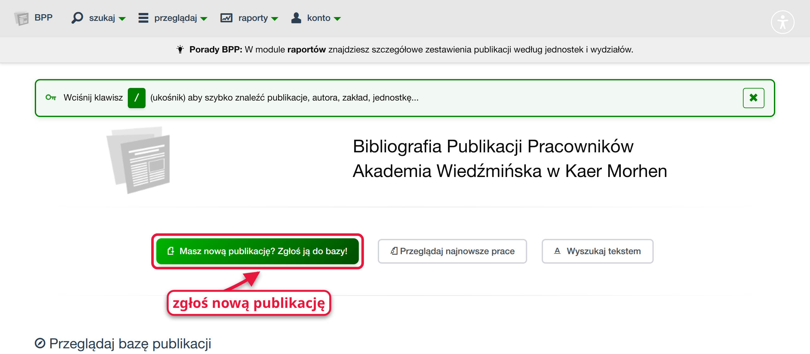
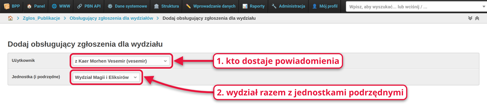
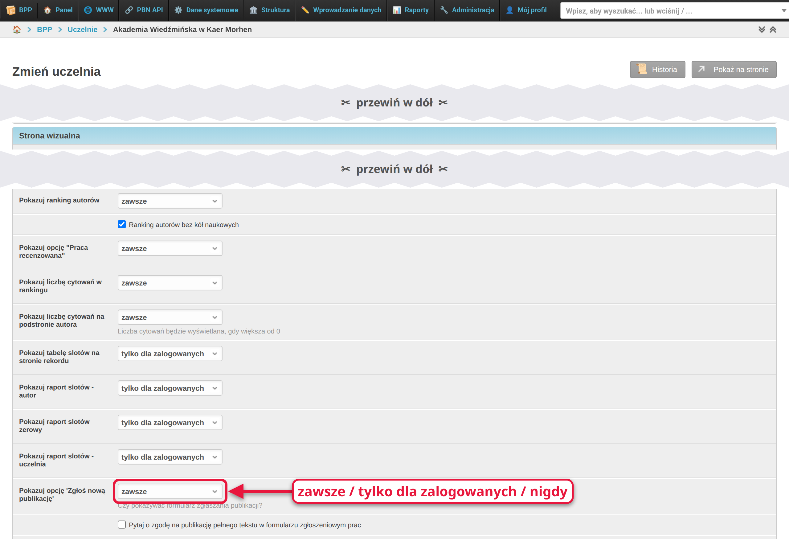
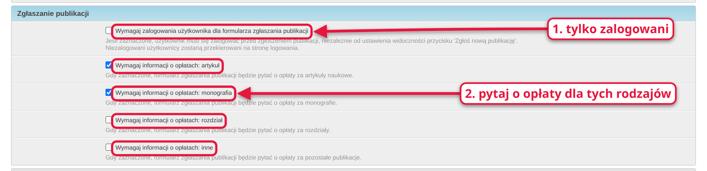

# Zgłaszanie publikacji

## Proces

!!! note

    Jednym z założeń systemu BPP jest najwyższa jakość danych przechowywanych w bazie. Pracownicy
    naukowi instytucji mogą zgłaszać swoje publikacje, jednak nie jest to proces jednoznaczny z dopisaniem
    pracy do bazy. Zgłoszenia publikacji mogą być przeglądane i weryfikowane przez bibliotekarzy i w następnej
    kolejności mogą do bazy zostać dopisane. Bez założenia loginu i przypisania uprawnień pracownik naukowy
    nie jest w stanie dopisywać żadnych rekordów do bazy.

Moduł "zgłoś publikację" umożliwia zgłaszanie publikacji użytkownikom nie mającym loginu do systemu, np
pracownikom naukowym uczelni.

Formularz ma kilka kroków: **Rodzaj** (artykuł, książka / monografia,
rozdział, inne), **Dostęp** (otwarty — zgłaszający poda link albo DOI;
ograniczony — dołączy plik PDF), **Dane** (tytuł, rok, link lub DOI,
e-mail), **Autorzy** (autor, jednostka, dyscyplina) i — zależnie od rodzaju
pracy i ustawień uczelni — **Płatności**. Aktualne zrzuty ekranu i opis
krok po kroku: [Jak zgłosić nową publikację](../uzytkownik/zgloszenie-publikacji.md).

Jak redaktor obsługuje zgłoszenia (lista, import, zwrot do autora, usuwanie):
[Obsługa zgłoszeń publikacji](../redaktor/obsluga-zgloszen.md).

## Uprawnienia

Listę zgłoszeń widzą osoby z grupy **„zgłoszenia publikacji”** (i superużytkownicy).
Do dopisywania prac na podstawie zgłoszeń (importer, ręczne dodanie rekordu) potrzebna jest
dodatkowo grupa **„wprowadzanie danych”**. Grupy nadajemy w Redagowanie -> Administracja -> Użytkownicy.

## Powiadamianie redaktorów

Po wysłaniu zgłoszenia (i po każdej poprawce zwróconego zgłoszenia) system wysyła e-mail
z linkiem do zgłoszenia. Kto go otrzymuje?

1. Jeżeli do wydziału, którego dotyczy zgłoszenie, przypisano osoby w Redagowanie ->
   Administracja -> **Obsługa zgłoszeń prac - wydziały** — tylko te osoby.
2. W przeciwnym razie (także wtedy, gdy żadna z przypisanych osób nie ma adresu e-mail) —
   wszystkie osoby z grupy **„zgłoszenia publikacji”**.
3. Jeżeli w grupie „zgłoszenia publikacji” nie ma nikogo z adresem e-mail — wszystkie osoby
   z grupy **„wprowadzanie danych”**.

Powiadomienia trafiają tylko do osób, które mają wpisany adres e-mail.

Aby przypisać osobę do wydziału:

1. Wejdź w Redagowanie -> Administracja -> **Obsługa zgłoszeń prac - wydziały** i kliknij
   „Dodaj”.
2. W polu **„Użytkownik”** wybierz osobę, która ma dostawać powiadomienia.
3. W polu **„Jednostka (i podrzędne)”** wybierz wydział — przypisanie obejmuje wydział razem
   z jego jednostkami podrzędnymi.
4. Kliknij „Zapisz”. Jedną osobę można przypisać do kilku wydziałów, a do jednego wydziału
   — kilka osób.

O wydziale decyduje pierwszy w kolejności autor zgłoszenia, którego jednostka skupia
pracowników uczelni — powiadamiane są osoby przypisane do wydziału, do którego należy jego
jednostka. Formularz zgłoszenia i tak wymaga przy każdym autorze jednostki uczelni, do której
można afiliować (nie przyjmie jednostki obcej ani samego wydziału), więc w praktyce decyduje
jednostka pierwszego autora.

## Zwracanie zgłoszenia

W przypadku, gdyby zgłoszenie wymagało poprawek, po wejściu w nie w module redagowania (Redagowanie -> Wprowadzanie danych
-> Zgłoszenia publikacji -> tytuł zgłoszenia) szukamy przycisku "Zwróć do autora", który znajduje się na belce nad
formularzem. Po kliknięciu możemy wpisać powód zwrócenia zgłoszenia. Autor otrzyma e-mail z powodem zwrócenia
zgłoszenia oraz z linkiem do edycji zgłoszenia. Gdy je zatwierdzi, redaktorzy otrzymają powiadomienie wg reguł jak wyżej.
Szczegóły: [Obsługa zgłoszeń publikacji](../redaktor/obsluga-zgloszen.md).

## Wyłączanie formularza i wymaganie zalogowania

W [edycji danych uczelni](../redaktor/uczelnia.md) opcja **„Pokazuj opcję 'Zgłoś nową publikację'”**
decyduje, komu pokazywać przycisk zgłaszania na stronie głównej: **„zawsze”**, **„tylko dla
zalogowanych”** albo **„nigdy”**. Opcja jest w sekcji **„Strona wizualna”**.

Ta opcja steruje tylko widocznością przycisku. Żeby **wymagać zalogowania** przed wypełnieniem
formularza (także gdy ktoś wejdzie na niego bezpośrednim linkiem), zaznacz w sekcji
**„Zgłaszanie publikacji”** (1 na zrzucie poniżej) pole **„Wymagaj zalogowania użytkownika dla formularza zgłaszania
publikacji”** — niezalogowani zostaną przekierowani na stronę logowania. Przy włączonej
integracji z [LDAP (ActiveDirectory)](zaawansowane.md#konfiguracja-ldap-activedirectory)
użytkownicy logują się kontem sieci intranet — nie trzeba każdemu zakładać loginu i hasła.

## Wymaganie wpisania informacji o opłatach za publikację

To, czy formularz pyta o opłaty, ustawiamy osobno dla każdego rodzaju pracy. W [edycji danych
uczelni](../redaktor/uczelnia.md), w sekcji **„Zgłaszanie publikacji”**, są pola
**„Wymagaj informacji o opłatach: artykuł”**, **„… monografia”**, **„… rozdział”**
i **„… inne”** (2 na zrzucie). Dla rodzajów bez zaznaczonego pola krok płatności jest
pomijany. Domyślnie formularz pyta o opłaty za artykuły i monografie.

