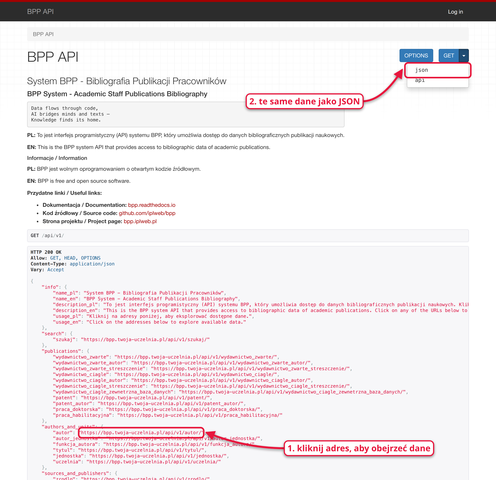
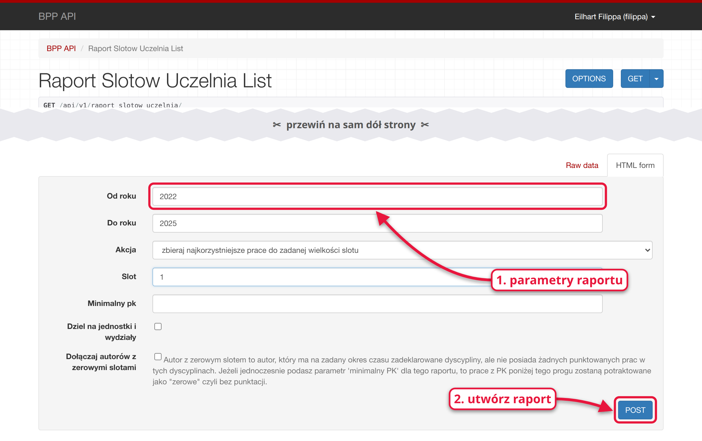
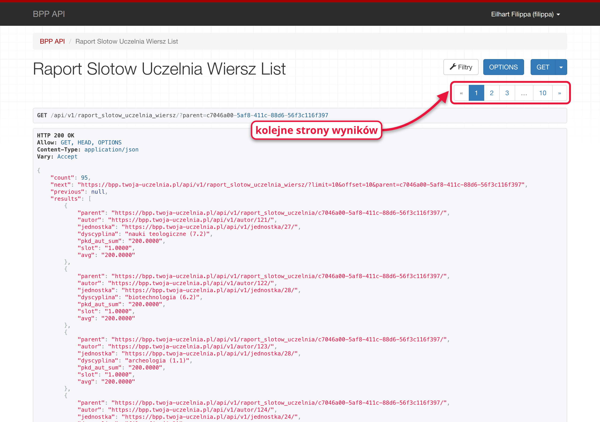

# API systemu BPP

System BPP oferuje API tylko do odczytu dla obiektów bazodanowych zawierających istotne
informacje, takie jak: wydawnictwa ciągłe, wydawnictwa zwarte, patenty, autorzy, jednostki
i inne.

API jest domyślnie dostępne dla użytkowników niezalogowanych. Administrator może wyłączyć
całe API lub jego części albo udostępnić je tylko zalogowanym — zobacz
[REST API (/api/v1/)](../administrator/rest-api.md).

Dla asystentów AI (Claude, ChatGPT i inne programy obsługujące MCP) zobacz
[Bibliografia w asystencie AI](../uzytkownik/asystent-ai.md).

API dostępne jest w formie „przyjaznej developerom”: po wejściu pod adres `/api/v1/`
w zwykłej przeglądarce WWW zobaczymy listę dostępnych zasobów, pogrupowanych tematycznie.
Klikając adres (1) przejdziemy do danych, a z menu przy przycisku **GET** (2) przełączymy
się na format JSON — czytelny nieco mniej dla człowieka, a bardziej dla komputera.



## API dla raportów slotu - uczelnia

BPP umożliwia tworzenie i pobieranie raportu slotów - uczelnia za pomocą API. Taka funkcja
wymaga jednak zalogowania jako użytkownik będący członkiem grupy „generowanie raportów”
(albo jako superużytkownik). Te adresy przyjmują wyłącznie logowanie loginem i hasłem
(HTTP Basic) — samo zalogowanie się na stronie BPP nie wystarczy.

1.  Aby utworzyć raport slotów - uczelnia przez API, należy wejść w przeglądarce na stronę:

    `/api/v1/raport_slotow_uczelnia/`

    Przeglądarka poprosi nas o zalogowanie się za pomocą loginu i hasła. Na samym dole
    strony zobaczymy formularz, który umożliwia utworzenie raportu przez API: wpisujemy
    parametry raportu (1) i klikamy **POST** (2).

    

2.  Aby utworzyć raport slotów - uczelnia przez API za pomocą polecenia `curl(1)`,
    możemy w systemowej powłoce napisać:

    ``` shell
    curl -X POST -u login:haslo -d od_roku=2022 -d do_roku=2025 -d slot=1 \
        https://adres.serwera/api/v1/raport_slotow_uczelnia/
    ```

    Parametry, których nie podamy, przyjmą wartości domyślne (takie same jak w formularzu).

3.  Zwrotnie otrzymamy kod JSON z danymi raportu:

    ``` json
    {
        "id": "https://adres.serwera/api/v1/raport_slotow_uczelnia/c9d4b477-4cc5-4922-a499-fce43fd37be1/",
        "created_on": "2025-02-21T23:25:36.864007+01:00",
        "started_on": null,
        "finished_on": null,
        "finished_successfully": false,
        "od_roku": 2022,
        "do_roku": 2025,
        "akcja": "slot",
        "slot": "1.0000",
        "minimalny_pk": "0.00",
        "dziel_na_jednostki_i_wydzialy": true,
        "pokazuj_zerowych": false
    }
    ```

    W powyższym przykładzie dana nas interesująca to numer ID raportu, czyli w tym przykładzie
    będzie to `c9d4b477-4cc5-4922-a499-fce43fd37be1`.

4.  Raport tworzony jest asynchronicznie. Dopóki pola `finished_successfully` oraz
    `finished_on` nie otrzymają wartości, raport nie jest jeszcze gotowy. Należy cyklicznie
    odświeżać dane raportu, np. co 5-10 sekund, aż pojawi się wartość w tych polach:

    ``` shell
    curl -u login:haslo https://adres.serwera/api/v1/raport_slotow_uczelnia/c9d4b477-4cc5-4922-a499-fce43fd37be1/
    ```

    !!! warning

        Utworzenie zbyt dużej liczby raportów naraz skutecznie zapcha kolejkę przetwarzania
        asynchronicznego i utrudni kolejnym użytkownikom korzystanie z serwera.

5.  Następnie możliwe będzie pobranie pojedynczych wierszy tego raportu. W przeglądarce
    wchodzimy na stronę:

    `/api/v1/raport_slotow_uczelnia_wiersz/?parent=c9d4b477-4cc5-4922-a499-fce43fd37be1`

    Będzie tam lista wierszy raportu, zawierająca informacje o autorze, jednostce,
    dyscyplinie, zebranym slocie i sumie PkD dla autora.

    

    Zapytanie o te wszystkie dane z pomocą polecenia `curl(1)` zwróci nam tekst w
    formacie JSON:

    ``` shell
    curl -u login:haslo "https://adres.serwera/api/v1/raport_slotow_uczelnia_wiersz/?parent=c9d4b477-4cc5-4922-a499-fce43fd37be1" | python -m json.tool
    ```

    **UWAGA**: tutaj na końcu adresu (po identyfikatorze raportu) nie dajemy ukośnika.

6.  Dane w formacie JSON są stronicowane, po 10 wpisów na stronę, aby nie przeciążać
    serwera. Warto zwrócić uwagę na pola `count`, `next` i `previous` w odpowiedzi
    (zobacz [Paginacja](#paginacja)).

## Pobieranie danych z systemu BPP przez JSON HTTP REST API

System BPP udostępnia szereg endpoint'ów REST API dla pobierania danych o publikacjach i powiązanych obiektach.
API do pobierania danych publikacji jest tylko do odczytu i (o ile administrator nie
zdecydował inaczej) nie wymaga logowania.

### Główne endpoint'y API

System udostępnia następujące główne endpoint'y dla pobierania danych publikacji:

- `/api/v1/wydawnictwo_ciagle/` - wydawnictwa ciągłe (artykuły w czasopismach)
- `/api/v1/wydawnictwo_zwarte/` - wydawnictwa zwarte (książki, rozdziały)
- `/api/v1/patent/` - patenty
- `/api/v1/praca_doktorska/` - prace doktorskie
- `/api/v1/praca_habilitacyjna/` - prace habilitacyjne

Dane pomocnicze dostępne są przez następujące endpoint'y:

- `/api/v1/autor/` - autorzy
- `/api/v1/jednostka/` - jednostki organizacyjne
- `/api/v1/uczelnia/` - uczelnie
- `/api/v1/wydawca/` - wydawcy
- `/api/v1/zrodlo/` - źródła publikacji
- `/api/v1/charakter_formalny/` - charaktery formalne

Pełną, aktualną listę adresów pokazuje strona `/api/v1/`. Jest tam też
`/api/v1/szukaj/` — wyszukiwanie pełnotekstowe po wszystkich publikacjach.

### Przykłady użycia CURL

1.  **Pobranie listy wydawnictw ciągłych:**

    ``` shell
    curl "https://adres.serwera/api/v1/wydawnictwo_ciagle/" | python -m json.tool
    ```

    To polecenie zwróci listę wydawnictw ciągłych w formacie JSON z paginacją.

2.  **Pobranie konkretnego wydawnictwa ciągłego:**

    ``` shell
    curl "https://adres.serwera/api/v1/wydawnictwo_ciagle/123/" | python -m json.tool
    ```

    Gdzie `123` to ID konkretnego wydawnictwa.

3.  **Filtrowanie wydawnictw po roku:**

    ``` shell
    curl "https://adres.serwera/api/v1/wydawnictwo_ciagle/?rok_min=2020&rok_max=2023" | python -m json.tool
    ```

    To polecenie zwróci wydawnictwa z lat 2020-2023.

4.  **Pobranie wydawnictw zmienionych w określonym okresie:**

    ``` shell
    curl "https://adres.serwera/api/v1/wydawnictwo_ciagle/?ostatnio_zmieniony_after=2023-01-01" | python -m json.tool
    ```

    To polecenie zwróci wydawnictwa zmienione od 1 stycznia 2023 roku.

5.  **Pobranie listy autorów:**

    ``` shell
    curl "https://adres.serwera/api/v1/autor/" | python -m json.tool
    ```

6.  **Pobranie konkretnego autora:**

    ``` shell
    curl "https://adres.serwera/api/v1/autor/456/" | python -m json.tool
    ```

    Gdzie `456` to ID konkretnego autora.

### Przykłady użycia w Postman

!!! note

    Postman to darmowe narzędzie do testowania API. Można je pobrać ze strony <https://www.postman.com/downloads/>


1.  **Konfiguracja podstawowa:**
    - Method: GET
    - URL: `https://adres.serwera/api/v1/wydawnictwo_ciagle/`
    - Headers: `Accept: application/json`
2.  **Pobieranie z filtrowaniem po roku:**
    - Method: GET
    - URL: `https://adres.serwera/api/v1/wydawnictwo_ciagle/`
    - Params:
      - `rok_min`: `2020`
      - `rok_max`: `2023`
3.  **Pobieranie z paginacją:**
    - Method: GET
    - URL: `https://adres.serwera/api/v1/wydawnictwo_ciagle/`
    - Params:
      - `offset`: `50`
      - `limit`: `50`
4.  **Pobieranie konkretnego rekordu:**
    - Method: GET
    - URL: `https://adres.serwera/api/v1/wydawnictwo_ciagle/123/`

### Format odpowiedzi

API zwraca dane w formacie JSON. Przykład odpowiedzi dla listy wydawnictw:

``` json
{
    "count": 1500,
    "next": "https://adres.serwera/api/v1/wydawnictwo_ciagle/?limit=10&offset=10",
    "previous": null,
    "results": [
        {
            "id": 123,
            "tytul_oryginalny": "Przykładowy tytuł artykułu",
            "rok": 2023,
            "charakter_formalny": "https://adres.serwera/api/v1/charakter_formalny/16/",
            "zrodlo": "https://adres.serwera/api/v1/zrodlo/30/",
            "autorzy_set": [
                "https://adres.serwera/api/v1/wydawnictwo_ciagle_autor/2676/",
                "https://adres.serwera/api/v1/wydawnictwo_ciagle_autor/2677/"
            ],
            "ostatnio_zmieniony": "2023-12-01T10:30:00+01:00"
        }
    ]
}
```

Przykład jest skrócony — rekord zawiera więcej pól. Powiązane obiekty (charakter formalny,
źródło, autorzy) podawane są jako adresy, pod którymi można pobrać ich dane.

### Parametry filtrowania

Większość endpoint'ów obsługuje następujące parametry filtrowania:

- `rok_min` - publikacje od podanego roku (włącznie)
- `rok_max` - publikacje do podanego roku (włącznie)
- `ostatnio_zmieniony_after` - rekordy zmienione od podanej daty (np. `2023-01-01`)
- `ostatnio_zmieniony_before` - rekordy zmienione do podanej daty
- `charakter_formalny` - filtrowanie po charakterze formalnym publikacji (numer ID
  charakteru formalnego)

Nieznane parametry są pomijane bez komunikatu o błędzie — jeśli wynik zawiera wszystkie
rekordy, sprawdź pisownię nazwy parametru. Filtry dostępne dla danego adresu pokazuje
przycisk **Filtry** na jego stronie w przeglądarce.

### Paginacja

Wszystkie listy są paginowane. Odpowiedzi zawierają:

- `count` - łączna liczba rekordów
- `next` - URL do następnej strony (jeśli istnieje)
- `previous` - URL do poprzedniej strony (jeśli istnieje)
- `results` - aktualne wyniki

Domyślnie zwracanych jest 10 rekordów na stronę. Liczbę rekordów zmienia parametr
`limit` (najwyżej 500 — większa wartość zostanie po cichu obniżona), a parametr `offset`
mówi, od którego rekordu zacząć, np. `?limit=100&offset=200`. Najprościej przechodzić
po kolejnych stronach, pobierając adres z pola `next`, aż będzie miało wartość `null`.

## API dla ostatnich publikacji autora

System BPP udostępnia specjalny endpoint umożliwiający pobranie listy ostatnich publikacji konkretnego autora.
Jest to przydatne dla autorów, którzy chcą wyświetlić swoją listę prac na własnej stronie internetowej.

!!! tip

    Najprostszy sposób wstawienia listy publikacji na stronę WWW, bez pisania kodu,
    opisuje strona [Widget publikacji na stronie WWW](../uzytkownik/widget-publikacji.md).

### Endpoint

Aby pobrać ostatnie publikacje autora, należy użyć następującego endpoint'u:

`/api/v1/recent_author_publications/{id}/`

Gdzie `{id}` to identyfikator autora w systemie BPP (liczba) albo jego skrót z adresu
strony autora, np. `Yennefer-Merigold`. Analogiczny adres dla jednostki to
`/api/v1/recent_unit_publications/{id}/`.

### Funkcjonalność

- Domyślnie zwraca 25 publikacji autora; liczbę zmienia parametr `limit` (najwyżej 100)
- Parametry `rok_od` i `rok_do` zawężają listę do podanych lat
- Publikacje są sortowane według roku, a w obrębie roku według daty ostatniej
  modyfikacji (od najnowszej)
- Dla każdej publikacji zwracany jest:
  - Identyfikator publikacji
  - Pełny opis bibliograficzny
  - Rok
  - Data ostatniej modyfikacji
  - URL do szczegółowej strony publikacji w systemie BPP
  - URL do danych publikacji w API
- Pole `profil_url` (adres strony autora) ma wartość `null`, gdy strona
  autora jest ukryta albo gdy autor jest
  [spoza uczelni](../uzytkownik/przegladanie-i-wyszukiwanie.md#autor-spoza-uczelni)
  — taki autor nie ma pełnego profilu

### Format odpowiedzi

``` json
{
    "autor_id": 123,
    "autor_nazwa": "Kowalski Jan",
    "profil_url": "https://bpp.uczelnia.pl/bpp/autor/Jan-Kowalski/",
    "count": 2,
    "publications": [
        {
            "id": "(1, 456)",
            "opis_bibliograficzny": "Kowalski J., Nowak A.: Przykładowy tytuł artykułu. Czasopismo Naukowe 2023, vol. 15, s. 123-145.",
            "rok": 2023,
            "ostatnio_zmieniony": "2023-12-15T14:30:00+01:00",
            "url": "https://bpp.uczelnia.pl/bpp/rekord/Przykladowy-tytul-artykulu-Kowalski-J-1-456/",
            "rekord_url": "https://bpp.uczelnia.pl/api/v1/wydawnictwo_ciagle/456/"
        },
        {
            "id": "(3, 457)",
            "opis_bibliograficzny": "Kowalski J.: Monografia naukowa. Wydawnictwo Uczelniane, Warszawa 2023, ISBN 978-83-1234-567-8.",
            "rok": 2023,
            "ostatnio_zmieniony": "2023-11-20T10:15:00+01:00",
            "url": "https://bpp.uczelnia.pl/bpp/rekord/Monografia-naukowa-Kowalski-J-3-457/",
            "rekord_url": "https://bpp.uczelnia.pl/api/v1/wydawnictwo_zwarte/457/"
        }
    ]
}
```

### Przykład użycia CURL

``` shell
curl "https://bpp.uczelnia.pl/api/v1/recent_author_publications/123/" | python -m json.tool
```

### Przykład integracji na stronie WWW autora

Poniżej znajduje się przykładowy kod JavaScript, który może być użyty na stronie internetowej autora
do automatycznego pobierania i wyświetlania listy jego publikacji:

``` html
<!DOCTYPE html>
<html lang="pl">
<head>
    <meta charset="UTF-8">
    <title>Moje publikacje</title>
    <style>
        .publikacje-container {
            max-width: 1200px;
            margin: 0 auto;
            padding: 20px;
            font-family: Arial, sans-serif;
        }
        .publikacja-item {
            margin-bottom: 20px;
            padding: 15px;
            border-left: 3px solid #0066cc;
            background-color: #f5f5f5;
        }
        .publikacja-opis {
            margin-bottom: 8px;
            line-height: 1.5;
        }
        .publikacja-link {
            color: #0066cc;
            text-decoration: none;
            font-size: 14px;
        }
        .publikacja-link:hover {
            text-decoration: underline;
        }
        .publikacja-data {
            color: #666;
            font-size: 12px;
            margin-top: 5px;
        }
        .loading {
            text-align: center;
            padding: 40px;
        }
        .error {
            color: #cc0000;
            padding: 20px;
            border: 1px solid #cc0000;
            background-color: #ffe6e6;
            border-radius: 4px;
        }
    </style>
</head>
<body>
    <div class="publikacje-container">
        <h2>Moje ostatnie publikacje</h2>
        <div id="publikacje-lista" class="loading">
            Ładowanie publikacji...
        </div>
    </div>

    <script>
        // Konfiguracja - zmień te wartości na właściwe dla swojego przypadku
        const BPP_URL = 'https://bpp.uczelnia.pl';  // Adres serwera BPP
        const AUTOR_ID = 123;  // Twój ID autora w systemie BPP

        // Funkcja do pobierania publikacji
        async function pobierzPublikacje() {
            const container = document.getElementById('publikacje-lista');

            try {
                // Pobierz dane z API
                const response = await fetch(`${BPP_URL}/api/v1/recent_author_publications/${AUTOR_ID}/`);

                if (!response.ok) {
                    throw new Error(`HTTP error! status: ${response.status}`);
                }

                const data = await response.json();

                // Wyczyść kontener
                container.innerHTML = '';
                container.classList.remove('loading');

                // Sprawdź czy są publikacje
                if (data.publications && data.publications.length > 0) {
                    // Utwórz HTML dla każdej publikacji
                    data.publications.forEach((pub, index) => {
                        const pubDiv = document.createElement('div');
                        pubDiv.className = 'publikacja-item';

                        // Formatuj datę
                        const dataObj = new Date(pub.ostatnio_zmieniony);
                        const dataFormatowana = dataObj.toLocaleDateString('pl-PL', {
                            year: 'numeric',
                            month: 'long',
                            day: 'numeric'
                        });

                        pubDiv.innerHTML = `
                            <div class="publikacja-opis">
                                ${index + 1}. ${pub.opis_bibliograficzny}
                            </div>
                            <a href="${pub.url}" target="_blank" class="publikacja-link">
                                Zobacz szczegóły →
                            </a>
                            <div class="publikacja-data">
                                Ostatnia aktualizacja: ${dataFormatowana}
                            </div>
                        `;

                        container.appendChild(pubDiv);
                    });

                    // Dodaj informację o liczbie publikacji
                    const info = document.createElement('p');
                    info.style.marginTop = '20px';
                    info.style.fontStyle = 'italic';
                    info.style.color = '#666';
                    info.textContent = `Wyświetlono ${data.count} ostatnich publikacji.`;
                    container.appendChild(info);
                } else {
                    container.innerHTML = '<p>Brak publikacji do wyświetlenia.</p>';
                }

            } catch (error) {
                // Obsługa błędów
                console.error('Błąd podczas pobierania publikacji:', error);
                container.innerHTML = `
                    <div class="error">
                        Nie udało się pobrać listy publikacji.
                        Spróbuj ponownie później lub skontaktuj się z administratorem.
                        <br><small>Szczegóły błędu: ${error.message}</small>
                    </div>
                `;
                container.classList.remove('loading');
            }
        }

        // Wywołaj funkcję po załadowaniu strony
        document.addEventListener('DOMContentLoaded', pobierzPublikacje);
    </script>
</body>
</html>
```

### Uwagi dotyczące CORS

CORS (Cross-Origin Resource Sharing) to mechanizm bezpieczeństwa przeglądarek internetowych, który kontroluje
dostęp do zasobów między różnymi domenami. Gdy strona internetowa próbuje pobrać dane z innej domeny
(np. strona autora z domeny `autor.pl` próbuje pobrać dane z `bpp.uczelnia.pl`), przeglądarka
sprawdza, czy serwer docelowy zezwala na takie połączenie.

System BPP domyślnie konfiguruje nagłówki CORS tak, aby umożliwić pobieranie danych API przez przeglądarki
internetowe z różnych lokalizacji. Oznacza to, że endpoint `/api/v1/recent_author_publications/` jest
standardowo dostępny dla zewnętrznych stron WWW.

Jednak ze względu na różne uwarunkowania konfiguracyjne (np. dodatkowe proxy, loadbalancery, specyficzne
ustawienia serwera WWW lub wymagania bezpieczeństwa instytucji), domyślna konfiguracja CORS może okazać się
niewystarczająca.

W przypadku wystąpienia błędów CORS (widocznych w konsoli przeglądarki jako błędy typu "CORS policy blocked"),
należy skontaktować się z administratorem systemu BPP w celu dostosowania konfiguracji do konkretnych potrzeb.
