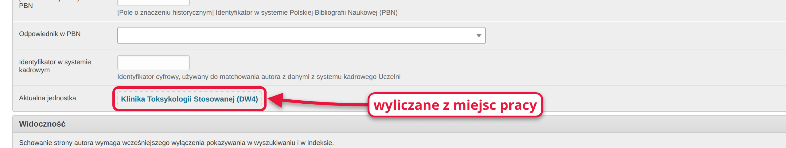
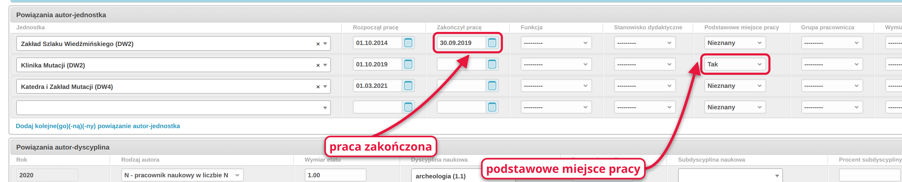

# Edycja danych autorów

## Pole *Aktualna jednostka* dla autora {#pole-aktualne-miejsce-pracy-dla-autora}

Pole *Aktualna jednostka* w formularzu autora (**Redagowanie ➡ Wprowadzanie
danych ➡ Autorzy**) jest tylko do odczytu — nie wpisuje się go ręcznie.
System wylicza je z miejsc pracy autora, wpisanych w tabeli
**„Powiązania autor-jednostka”** niżej w tym samym formularzu:

W przykładzie powyżej autorka zakończyła pracę w pierwszej jednostce, a z
dwóch bieżących miejsc pracy jedno ma ustawione *Podstawowe miejsce pracy*
na „Tak” — to ono staje się aktualną jednostką.

!!! note

    Pole *Aktualna jednostka* używane jest w raportach oraz do
    podpowiadania jednostki przy dopisywaniu autora do rekordu publikacji.

Algorytm ustalania aktualnej jednostki działa w sposób następujący:

1.  pod uwagę brane są tylko miejsca pracy, w których autor nie zakończył
    pracy (data zakończenia pracy jest pusta lub późniejsza niż dzisiejsza);
2.  pierwszeństwo ma miejsce pracy z atrybutem *Podstawowe miejsce pracy*
    ustawionym na „Tak”;
3.  w drugiej kolejności jednostka, która skupia pracowników uczelni, wygrywa
    z jednostką obcą (patrz [Obca jednostka](uczelnia.md#obca-jednostka));
4.  dalej decyduje najpóźniejsza data rozpoczęcia pracy, a potem najpóźniejsza
    data zakończenia pracy;
5.  gdy i to nie rozstrzyga (np. daty rozpoczęcia i zakończenia pracy są
    puste), system wybierze to powiązanie, które do systemu BPP zostało
    dopisane najpóźniej (jego numer ID jest największy).

!!! warning

    Dany autor może mieć tylko jedno powiązanie oznaczone jako *Podstawowe miejsce pracy*.

## Profil autora (zdjęcie, biogram, linki do profili)

Dane prezentowane na publicznej
[stronie autora](../uzytkownik/przegladanie-i-wyszukiwanie.md#strona-autora) —
**zdjęcie, biogram, linki do profili w innych serwisach** i **wyróżnione
publikacje** — można uzupełnić na dwa sposoby:

- **autor sam**, po zalogowaniu — patrz
  [Mój profil autora](../uzytkownik/moj-profil-autora.md),
- **redaktor** w module redagowania — opisane niżej. Przydatne, gdy autor nie
  edytuje swoich danych samodzielnie albo nie ma konta w BPP.

Obie drogi zapisują te same pola rekordu autora — zmiana zrobiona w jednym
miejscu jest od razu widoczna w drugim.

### Edycja w module redagowania

Otwórz rekord autora: **Redagowanie ➡ Wprowadzanie danych ➡ Autorzy**,
wyszukaj autora i kliknij go. Pola profilu są w zwijanych sekcjach
formularza (kliknij nagłówek sekcji, aby ją rozwinąć):

| Sekcja formularza | Pola |
|---|---|
| **Profil na podstronie autora** | zdjęcie, biogram, format biogramu (Markdown / HTML) |
| **Profile w serwisach zewnętrznych** | Web of Science (ResearcherID), Scopus (Author ID), Google Scholar, adres profilu w portalu uczelni |
| identyfikatory (górna część formularza) | ORCID, „ORCID w PBN” |
| **Wybrane publikacje autora** (tabela na dole) | wyróżnione prace i ich kolejność |

Zasady są takie same jak przy samodzielnej edycji:

- **zdjęcie** (do 5 MB) jest automatycznie kadrowane do kwadratu, skalowane
  i zapisywane w formacie WebP,
- **biogram** wpisuje się w Markdown albo HTML; przy wyświetlaniu usuwane są
  skrypty i niebezpieczne znaczniki,
- w polach **profili zewnętrznych** można wkleić cały adres profilu — system
  sam wyciągnie identyfikator.

!!! note "Dawne pole „Opis”"
    Pole „Opis” (z przełącznikiem „Pokazuj opis”) zostało usunięte —
    zastępuje je biogram. Jeśli autor miał wpisany opis, jego treść
    przeniesiono do pola **„Adnotacje”** (pole wewnętrzne, niewidoczne na
    stronie WWW). Treść, którą chcesz opublikować, przenieś do biogramu.

### Powiązanie konta użytkownika z autorem {#powiązanie-konta-użytkownika-z-autorem}

Autor może edytować swoją stronę tylko wtedy, gdy jego **konto w BPP jest
powiązane z rekordem autora**. Zwykle dzieje się to samo — przy wejściu na
stronę „Mój profil” system dopasowuje konto do autora po adresie e-mail,
a gdy to się nie uda, po imieniu i nazwisku (tylko przy jednoznacznym
dopasowaniu i tylko do autora niepowiązanego jeszcze z innym kontem).

Gdy dopasowanie automatyczne zawiedzie (np. inny e-mail w koncie niż
w rekordzie autora, albo dwóch autorów o tym samym nazwisku), powiązanie
ustawia się ręcznie: **Redagowanie ➡ Administracja ➡ Użytkownicy**, wybierz
konto, w sekcji **„Powiązanie z autorem”** wskaż autora i zapisz.

## Odpowiednik autora w PBN — przycisk „Pobierz z PBN” {#pobierz-z-pbn}

Pole **Odpowiednik w PBN** w formularzu autora wskazuje osobę z PBN, do
której trafiają oświadczenia autora. Gdy pole jest puste, obok niego jest
przycisk **„🔎 Pobierz z PBN”** (znika, gdy autor ma odpowiednik). Po
kliknięciu BPP ustala odpowiednik samo:

1. **Autor ma ORCID** (liczy się wartość z formularza, także jeszcze
   niezapisana) — BPP szuka osoby z tym ORCID w danych z PBN pobranych do
   BPP, a gdy jej tam nie ma, pyta serwer PBN i pobiera znalezioną osobę.
2. **Autor nie ma ORCID** albo ORCID niczego nie wskazał — BPP szuka po
   **imieniu i nazwisku** (z poprzednimi nazwiskami) oraz po **autorach
   prac**, które ten autor ma w BPP z ustawionym odpowiednikiem w PBN.

Wynik pojawia się pod przyciskiem:

- ✅ **wskazanie jednoznaczne** — zgodny ORCID albo imię i nazwisko
  potwierdzone przez publikacje — osoba jest od razu wstawiona w pole.
  **Zapisz autora**, żeby zachować odpowiednik;
- 👉 **kilku kandydatów albo wskazanie niepewne** (np. samo imię
  i nazwisko) — BPP pokazuje listę z przyciskami **„Wybierz”**. Na
  początku listy, z gwiazdką ⭐, są osoby z **profilu instytucji w PBN**
  (pracownicy uczelni znani PBN), dopiero po nich pozostałe osoby o tym
  nazwisku. Przy każdej widać, co za nią przemawia (zgodny ORCID, liczba
  wspólnych prac, ORCID zapisany w PBN);
- ⚠️ **„już przypisany do: …”** — ta osoba PBN jest odpowiednikiem innego
  autora w BPP. To zwykle zdublowany autor: zamiast wybierać, scal autorów
  (patrz [Duplikaty autorów i źródeł](duplikaty.md));
- ℹ️ **nie znaleziono** — PBN nie zna takiej osoby pod tym ORCID ani
  imieniem i nazwiskiem.

Samo imię i nazwisko nigdy nie wystarcza do wstawienia odpowiednika bez
pytania — osoby o tym samym nazwisku to częsty przypadek, a błędne
powiązanie skierowałoby oświadczenia do innej osoby.

### Wielu autorów naraz

Na liście autorów zaznacz osoby i wybierz akcję **„Pobierz odpowiedniki
z PBN (w tle)”**. Zadanie działa w tle i ustawia odpowiednik **tylko**
przy wskazaniach jednoznacznych (każde z wpisem w historii autora);
pozostałych autorów wymienia w raporcie z powodem: do ręcznego wyboru,
możliwy duplikat autora, nie znaleziono. Raport i postęp: odnośnik
w komunikacie po zleceniu albo **PBN Integrator → Pobieranie odpowiedników
z PBN**. Jednym zleceniem można objąć najwyżej 500 autorów bez
odpowiednika.

## Wyróżnione publikacje autora

Autor może wskazać i uszeregować **wyróżnione prace**, które pojawią się na
jego [stronie autora](../uzytkownik/przegladanie-i-wyszukiwanie.md#strona-autora)
— pod warunkiem, że uczelnia włączyła sekcję „Wybrane publikacje” w układzie
podstrony (patrz
[układ podstrony autora](../administrator/ogolna.md#układ-podstrony-autora-profil-autora)).

Najwygodniej edytuje ją sam autor — z wyszukiwarką własnych prac (patrz
[Mój profil autora](../uzytkownik/moj-profil-autora.md#wyróżnione-publikacje)).
Redaktor może to zrobić w tabeli **„Wybrane publikacje autora”** na dole
formularza autora, ale tam wskazuje się pracę technicznie — typem rekordu
(np. wydawnictwo ciągłe) i jego numerem ID — oraz kolejnością.

## Historia zmian autora i przywracanie poprzedniej wersji

Każda zmiana rekordu autora jest zapisywana jako **wersja** — zarówno edycja
w module redagowania, jak i samodzielna edycja profilu przez autora na stronie
(biogram, zdjęcie, linki do profili w serwisach zewnętrznych, wyróżnione
publikacje). Wersja obejmuje dane autora i jego wyróżnione publikacje.

Historię otwiera przycisk **„Historia”** w prawym górnym rogu formularza
autora. Przy każdej wersji widać **kto i kiedy** wprowadził zmianę oraz
**co zmieniono** (np. „Samodzielna edycja profilu przez stronę: Biogram,
Zdjęcie” albo „…: wyróżniono pracę »Tytuł«”). Kliknięcie daty pokazuje
autora w stanie z tej wersji (tylko do podglądu, bez edycji), a przycisk
**„♻️ Przywróć tę wersję”** na dole strony przywraca ten stan (samo
przywrócenie także trafia do historii, więc da się je cofnąć). Dwie wersje
można też **porównać**: zaznacz wersję starszą (lewe kółko) i nowszą (prawe kółko),
a potem kliknij „Porównaj zaznaczone wersje” — zobaczysz tylko pola, które
się zmieniły.

Uwagi:

- Pierwsza wersja autora, który nie był edytowany od włączenia wersjonowania,
  powstaje automatycznie tuż przed pierwszą zmianą (komentarz „Stan sprzed
  pierwszej zarejestrowanej zmiany”) — dzięki temu i tę zmianę można cofnąć.
- Zmiany sprzed włączenia wersjonowania widać pod spodem, w tabeli
  **„Wcześniejsza historia”** — tam jest tylko informacja kto i kiedy, bez
  możliwości przywrócenia.
- Przywrócenie wersji **nie cofa** miejsc pracy, dyscyplin ani absencji
  (zmiany w nich widać w historii, ale poprawia się je ręcznie w tabelach
  formularza) — przypisania dyscyplin wpływają na ewaluację, a miejsca pracy
  mogą należeć do innej uczelni. Aktualna jednostka jest po przywróceniu
  przeliczana z bieżących miejsc pracy. Nie zmieniają się też dane wyliczane
  (liczba udziałów dla autora za rok).
- Odzyskiwanie usuniętych autorów jest dostępne tylko dla superużytkownika.
