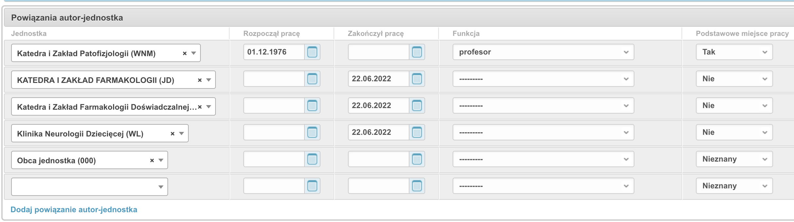

# Edycja danych autorów

## Pole *Aktualne miejsce pracy* dla autora

Wartość pola *Aktualne miejsce pracy* która widnieje w module redagowania
dla Autora jest wartością tylko-do-odczytu a jej wartość obliczana jest na podstawie
wpisów powiązań autora z jednostką:

!!! note

    Pole *Aktualne miejsce pracy* używane jest w raportach oraz do
    podpowiadania jednostki przy dopisywaniu autora do rekordu publikacji.

Algorytm ustalania aktualnego miejsca pracy działa w sposób następujący:

1.  jeżeli któreś z miejsc pracy ma atrybut *Podstawowe miejce pracy* ustawiony na "TAK" i data
    zakończenia pracy jest pusta lub większa od obecnej, to takie miejsce będzie wybrane jako aktualne
2.  jeżeli autor nie ma żadnego miejsca pracy ustawionego jako podstawowe, to system jako aktualne
    miejsce pracy wybierze to, w którym autor nie zakończył pracy (data zakończenia pracy jest pusta
    lub większa od obecnej) i gdzie autor rozpoczął pracę najpóźniej (data rozpoczęcia pracy jest
    najwyższa)
3.  jeżeli autor ma kilka miejsc pracy i w żadnym nie ma ustawionego atrybutu *Podstawowe miejsce pracy*
    oraz daty rozpoczęcia i zakończenia pracy są puste, system jako *Aktualne miejsce pracy* wybierze
    to powiązanie, które do systemu BPP zostało dopisane najpóźniej (jego numer ID jest największy)

!!! warning

    dany autor może mieć tylko jedno powiązanie oznaczone jako *Podstawowe miejsce pracy*.

## Profil autora (zdjęcie, biogram, linki do profili)

Dane prezentowane na publicznej
[stronie autora](../uzytkownik/przegladanie-i-wyszukiwanie.md#strona-autora) —
**zdjęcie, biogram, linki do profili w innych serwisach** i **wyróżnione
publikacje** — można uzupełnić na dwa sposoby:

- **autor sam**, po zalogowaniu — patrz
  [Mój profil autora](../uzytkownik/moj-profil-autora.md),
- **redaktor** w module redagowania — opisane niżej. Przydatne, gdy autor nie
  edytuje swoich danych samodzielnie albo nie ma konta w BPP.

Obie drogi zapisują te same pola rekordu autora — zmiana zrobiona w jednym
miejscu jest od razu widoczna w drugim.

### Edycja w module redagowania

Otwórz rekord autora: **Redagowanie ➡ Wprowadzanie danych ➡ Autorzy**,
wyszukaj autora i kliknij go. Pola profilu są w zwijanych sekcjach
formularza (kliknij nagłówek sekcji, aby ją rozwinąć):

| Sekcja formularza | Pola |
|---|---|
| **Profil na podstronie autora** | zdjęcie, biogram, format biogramu (Markdown / HTML) |
| **Profile w serwisach zewnętrznych** | Web of Science (ResearcherID), Scopus (Author ID), Google Scholar, adres profilu w portalu uczelni |
| identyfikatory (górna część formularza) | ORCID, „ORCID w PBN” |
| **Wybrane publikacje autora** (tabela na dole) | wyróżnione prace i ich kolejność |

Zasady są takie same jak przy samodzielnej edycji:

- **zdjęcie** (do 5 MB) jest automatycznie kadrowane do kwadratu, skalowane
  i zapisywane w formacie WebP,
- **biogram** wpisuje się w Markdown albo HTML; przy wyświetlaniu usuwane są
  skrypty i niebezpieczne znaczniki,
- w polach **profili zewnętrznych** można wkleić cały adres profilu — system
  sam wyciągnie identyfikator.

!!! note "Dawne pole „Opis”"
    Pole „Opis” (z przełącznikiem „Pokazuj opis”) zostało usunięte —
    zastępuje je biogram. Jeśli autor miał wpisany opis, jego treść
    przeniesiono do pola **„Adnotacje”** (pole wewnętrzne, niewidoczne na
    stronie WWW). Treść, którą chcesz opublikować, przenieś do biogramu.

### Powiązanie konta użytkownika z autorem {#powiązanie-konta-użytkownika-z-autorem}

Autor może edytować swoją stronę tylko wtedy, gdy jego **konto w BPP jest
powiązane z rekordem autora**. Zwykle dzieje się to samo — przy wejściu na
stronę „Mój profil” system dopasowuje konto do autora po adresie e-mail,
a gdy to się nie uda, po imieniu i nazwisku (tylko przy jednoznacznym
dopasowaniu i tylko do autora niepowiązanego jeszcze z innym kontem).

Gdy dopasowanie automatyczne zawiedzie (np. inny e-mail w koncie niż
w rekordzie autora, albo dwóch autorów o tym samym nazwisku), powiązanie
ustawia się ręcznie: **Redagowanie ➡ Administracja ➡ Użytkownicy**, wybierz
konto, w sekcji **„Powiązanie z autorem”** wskaż autora i zapisz.

## Wyróżnione publikacje autora

Autor może wskazać i uszeregować **wyróżnione prace**, które pojawią się na
jego [stronie autora](../uzytkownik/przegladanie-i-wyszukiwanie.md#strona-autora)
— pod warunkiem, że uczelnia włączyła sekcję „Wybrane publikacje” w układzie
podstrony (patrz
[układ podstrony autora](../administrator/ogolna.md#układ-podstrony-autora-profil-autora)).

Najwygodniej edytuje ją sam autor — z wyszukiwarką własnych prac (patrz
[Mój profil autora](../uzytkownik/moj-profil-autora.md#wyróżnione-publikacje)).
Redaktor może to zrobić w tabeli **„Wybrane publikacje autora”** na dole
formularza autora, ale tam wskazuje się pracę technicznie — typem rekordu
(np. wydawnictwo ciągłe) i jego numerem ID — oraz kolejnością.

## Historia zmian autora i przywracanie poprzedniej wersji

Każda zmiana rekordu autora jest zapisywana jako **wersja** — zarówno edycja
w module redagowania, jak i samodzielna edycja profilu przez autora na stronie
(biogram, zdjęcie, linki do profili w serwisach zewnętrznych, wyróżnione
publikacje). Wersja obejmuje dane autora i jego wyróżnione publikacje.

Historię otwiera przycisk **„Historia”** w prawym górnym rogu formularza
autora. Przy każdej wersji widać **kto i kiedy** wprowadził zmianę oraz
**co zmieniono** (np. „Samodzielna edycja profilu przez stronę: Biogram,
Zdjęcie” albo „…: wyróżniono pracę »Tytuł«”). Kliknięcie daty otwiera
formularz autora w stanie z tej wersji — **zapisanie go przywraca tę wersję**
(samo przywrócenie także trafia do historii, więc da się je cofnąć).

Uwagi:

- Pierwsza wersja autora, który nie był edytowany od włączenia wersjonowania,
  powstaje automatycznie tuż przed pierwszą zmianą (komentarz „Stan sprzed
  pierwszej zarejestrowanej zmiany”) — dzięki temu i tę zmianę można cofnąć.
- Zmiany sprzed włączenia wersjonowania widać pod spodem, w tabeli
  **„Wcześniejsza historia”** — tam jest tylko informacja kto i kiedy, bez
  możliwości przywrócenia.
- Przywrócenie wersji **nie cofa** miejsc pracy, dyscyplin ani absencji
  (zmiany w nich widać w historii, ale poprawia się je ręcznie w tabelach
  formularza) — przypisania dyscyplin wpływają na ewaluację, a miejsca pracy
  mogą należeć do innej uczelni. Aktualna jednostka jest po przywróceniu
  przeliczana z bieżących miejsc pracy. Nie zmieniają się też dane wyliczane
  (liczba udziałów dla autora za rok).
- Odzyskiwanie usuniętych autorów jest dostępne tylko dla superużytkownika.
