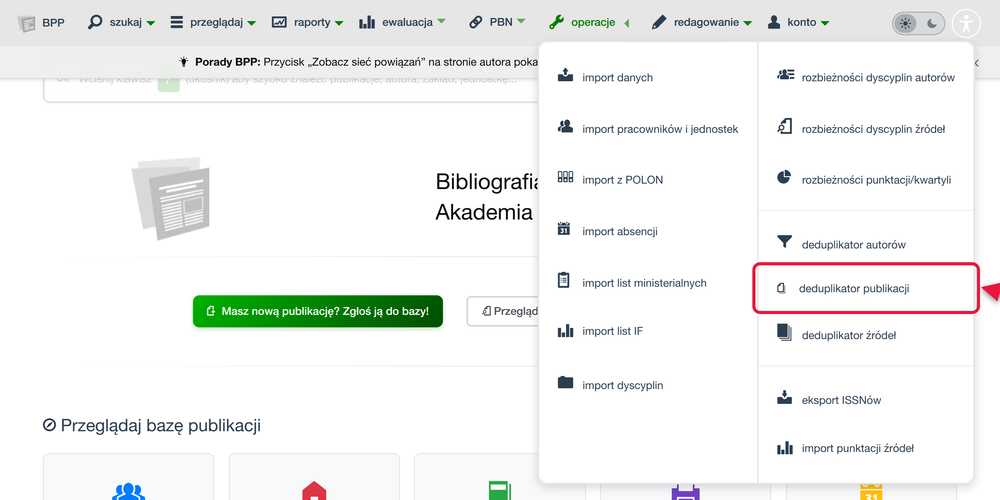
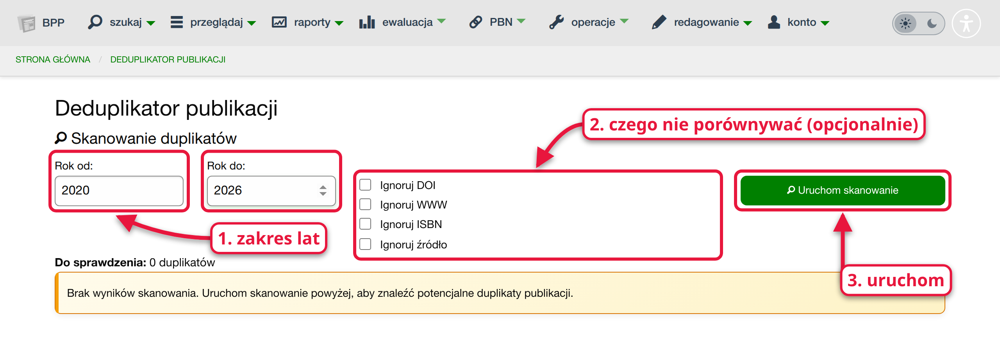
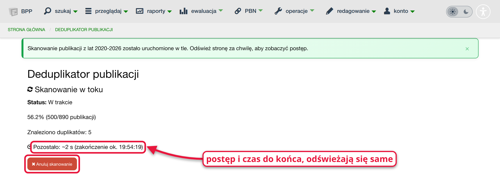
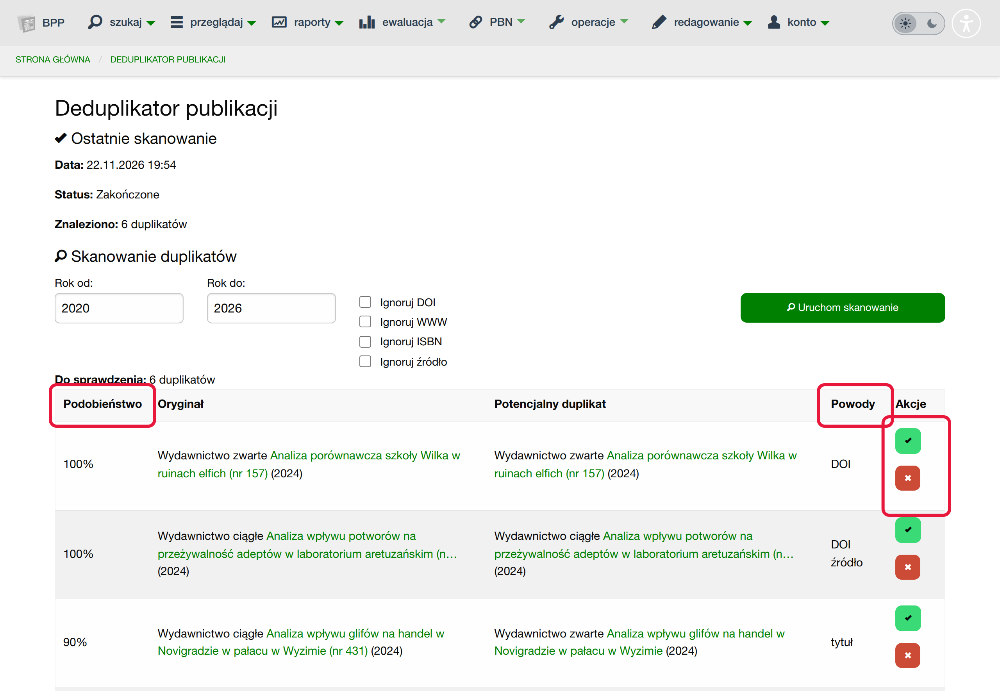
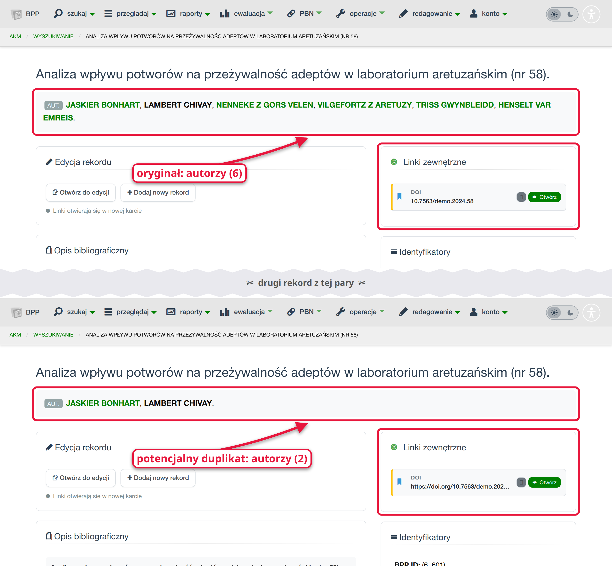
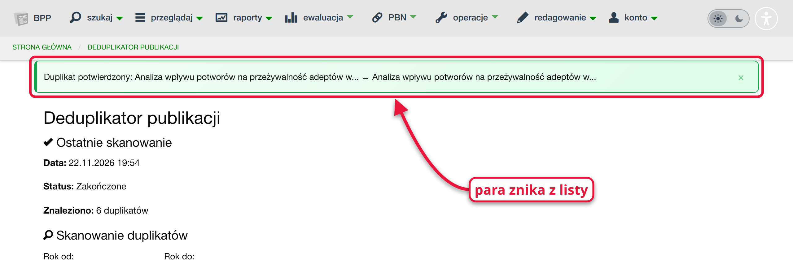

# Duplikaty publikacji (deduplikator)

Ta sama praca wpisana do BPP dwa razy — raz ręcznie, raz z importu; raz
jako artykuł, raz jako rozdział — liczy się w raportach podwójnie, a przy
eksporcie do PBN może trafić tam dwa razy. **Deduplikator publikacji**
przegląda prace z wybranych lat i wypisuje pary rekordów, które wyglądają
na tę samą publikację. Ty decydujesz, czy to naprawdę duplikat.

!!! warning "Deduplikator publikacji niczego nie scala"
    W odróżnieniu od [deduplikatora autorów i źródeł](duplikaty.md)
    to narzędzie **tylko wskazuje** podejrzane pary. Przyciski na liście
    zapisują Twoją decyzję i usuwają parę z listy, ale **nie zmieniają
    rekordów**. Zbędny rekord usuwasz sam, w module redagowania —
    patrz [krok 6](#krok-6).

## Zanim zaczniesz {#zanim-zaczniesz}

**Dostęp.** Potrzebne jest konto w grupie **„wprowadzanie danych”**
(albo konto superużytkownika). Bez tej grupy strona deduplikatora kończy
się błędem 403, a w menu nie ma pozycji **operacje**. Grupę nadaje
administrator BPP.

**Skanowanie działa w tle.** Przeszukiwanie prac wykonuje serwer
w tle — możesz w tym czasie zamknąć stronę. Jednocześnie może trwać tylko
jedno skanowanie w całym systemie.

## Krok 1. Otwórz deduplikator {#krok-1}

W górnym menu najedź na **operacje** i kliknij **deduplikator
publikacji**.

## Krok 2. Ustaw zakres i uruchom skanowanie {#krok-2}

Przy pierwszym wejściu strona pokazuje komunikat „Brak wyników
skanowania” i formularz **Skanowanie duplikatów**.

1. W polach **Rok od** i **Rok do** wpisz zakres lat prac do
   sprawdzenia (domyślnie 2022–2025). Prace z różnych lat **nigdy** nie są
   ze sobą parowane, więc zakres może być szeroki.
2. Opcjonalnie zaznacz, czego **nie** porównywać: **Ignoruj DOI**,
   **Ignoruj WWW**, **Ignoruj ISBN**, **Ignoruj źródło**. Przydaje się to,
   gdy dane pole jest u Was wypełnione niewiarygodnie (np. ten sam adres
   WWW wpisany przy wielu pracach). Wtedy BPP porównuje pozostałe pola
   i tytuły.
3. Kliknij **Uruchom skanowanie**.

Jeśli są już wyniki poprzedniego skanowania, przeglądarka najpierw zapyta: „Czy na
pewno chcesz uruchomić nowe skanowanie? Poprzednie wyniki zostaną
zastąpione.”. Zastąpiona zostaje lista par do sprawdzenia — pary
oznaczone jako „nie jest duplikatem” nie wrócą (patrz [krok 5](#krok-5)).
Formularz pamięta ustawienia ostatniego skanowania.

## Krok 3. Poczekaj na wynik {#krok-3}

Po uruchomieniu pojawia się komunikat „Skanowanie publikacji z lat …
zostało uruchomione w tle.” i panel **Skanowanie w toku**. Panel sam
odświeża co kilka sekund procent i liczbę sprawdzonych prac, liczbę
znalezionych par i szacowany czas do końca. Po zakończeniu strona
przeładuje się sama i pokaże listę.

Przycisk **Anuluj skanowanie** (z potwierdzeniem) przerywa skanowanie.
Lista wyników pokazuje zawsze **ostatnie zakończone** skanowanie, więc
po anulowaniu zostają wyniki poprzedniego.

W małej bazie skanowanie trwa kilka sekund, w dużej (dziesiątki tysięcy
prac) — od kilku do kilkudziesięciu minut.

## Krok 4. Przejrzyj listę par {#krok-4}

Nad listą panel **Ostatnie skanowanie** podaje datę, status i liczbę
znalezionych par, a wiersz **Do sprawdzenia** — ile par czeka jeszcze na
Twoją decyzję. Na stronie mieści się 25 par.

| Kolumna | Co znaczy |
|---|---|
| **Podobieństwo** | ocena podobieństwa pary w procentach (zgodny DOI daje 100%); lista jest ułożona od par najbardziej podobnych |
| **Oryginał** / **Potencjalny duplikat** | oba rekordy: rodzaj (**Wydawnictwo ciągłe** — artykuł, **Wydawnictwo zwarte** — książka lub rozdział), tytuł i rok. Kliknięcie tytułu otwiera stronę rekordu w nowej karcie |
| **Powody** | co się zgadza: **DOI**, **ISBN**, **WWW**, **źródło** albo sam **tytuł** |
| **Akcje** | Twoja decyzja — patrz [krok 5](#krok-5) |

„Oryginał” to tylko rekord, od którego BPP zaczął porównanie — **nie**
znaczy, że jest lepszy albo starszy. Który rekord zostawić, decydujesz
w [kroku 6](#krok-6).

### Co deduplikator uznaje za parę {#kryteria}

BPP porównuje każdą pracę z wybranych lat z artykułami oraz z książkami
i rozdziałami **z tego samego roku** — także z pracami tego samego rodzaju
(artykuł z artykułem, książka z książką) — i szuka kilku najbardziej
podobnych. Para trafia na listę, gdy:

- **DOI** jest ten sam (także zapisany inaczej, np. jako link
  `https://doi.org/…`), a tytuły są wyraźnie podobne,
- **ISBN** (lub e-ISBN) jest ten sam, a tytuły są wyraźnie podobne,
- **adres WWW** jest ten sam, a tytuły są niemal identyczne,
- prace mają to samo **źródło** i ten sam początek tytułu,
- **sam tytuł** jest bardzo podobny — podobieństwo co najmniej 80%
  (różnice w wielkości liter, interpunkcji, końcówce, jedno inne lub
  dodatkowe słowo w dłuższym tytule).

Do porównania po tytule tytuł musi być dość długi (co najmniej 25 znaków,
a jednowyrazowy — 15). Prace różniące się numerem części („cz. II”
i „cz. III”) **nie** są parowane. Każda para pojawia się na liście
**raz** — nie ma osobnych wierszy „A ↔ B” i „B ↔ A”. Gdy tę samą pracę
wpisano trzy razy, na liście są wszystkie trzy pary.

!!! tip "Czego deduplikator może nie znaleźć"
    Gdy tytuły różnią się bardziej (np. kilka słów w krótkim tytule, inny
    język tytułu) i rekordy nie mają wspólnego DOI, ISBN, adresu WWW ani
    źródła, para może nie trafić na listę. Przy bardzo popularnym tytule
    deduplikator pokazuje dla jednej pracy tylko kilka najbardziej
    podobnych rekordów. Taki duplikat najłatwiej znaleźć, wpisując DOI
    albo początek tytułu w wyszukiwarce — patrz [Wyszukiwanie i
    redagowanie](wyszukiwanie-redagowanie.md).

## Krok 5. Porównaj rekordy i zdecyduj {#krok-5}

Kliknij oba tytuły z pary — każdy otworzy się w nowej karcie. Porównaj
autorów, źródło, DOI i pozostałe dane.

Potem wróć do listy i w kolumnie **Akcje** kliknij:

- zielony przycisk z „ptaszkiem” (**Potwierdź jako duplikat**) — to ta
  sama praca,
- czerwony przycisk z krzyżykiem (**Nie jest duplikatem**) — to różne
  prace, tylko podobnie zatytułowane.

W obu przypadkach para znika z listy, a u góry pojawia się komunikat
„Duplikat potwierdzony: …” albo „Publikacja oznaczona jako nie-duplikat:
…”.

!!! note "Co nowe skanowanie robi z Twoimi decyzjami"
    Decyzja **Nie jest duplikatem** jest zapamiętana na stałe: para
    oznaczona w ten sposób **nie wróci** na listę przy kolejnych
    skanowaniach (także przy innym zakresie lat). Decyzja znika dopiero
    wtedy, gdy jeden z rekordów pary zostanie usunięty.

    Pary potwierdzone przyciskiem **Potwierdź jako duplikat** nowe
    skanowanie tego samego zakresu lat zastępuje — jeśli oba rekordy
    nadal są w bazie, para wróci na listę. Dlatego potwierdzone duplikaty
    od razu usuwaj ([krok 6](#krok-6)).

## Krok 6. Usuń zbędny rekord {#krok-6}

Potwierdzenie duplikatu niczego nie zmienia w rekordach — autorzy,
dyscypliny, punkty i powiązania z PBN zostają przy obu. Porządek robisz
ręcznie:

1. **Wybierz rekord, który zostaje.** Zostaw ten, który ma **PBN UID**
   (był już wysłany do PBN) albo pełniejsze dane: wszystkich autorów,
   ich dyscypliny i afiliacje, punkty, oświadczenia.
2. **Przenieś brakujące dane.** Na stronie rekordu, który zostaje, kliknij
   **Otwórz do edycji** i uzupełnij to, co jest tylko w drugim rekordzie:
   autorów (z dyscyplinami), DOI, ISBN, adres WWW, pliki, streszczenia.
   Nic nie przenosi się samo.
3. **Usuń drugi rekord.** Otwórz go do edycji i kliknij **Usuń** na dole
   formularza, potem potwierdź. Usunięcia nie da się cofnąć.

!!! note "Rekordu z PBN UID nie da się usunąć"
    Rekord powiązany z PBN (wypełnione pole PBN UID) nie ma przycisku
    **Usuń** — BPP blokuje to, żeby w PBN nie została praca bez
    odpowiednika. Jeśli oba rekordy z pary mają PBN UID, oznacza to, że
    praca jest w PBN dwa razy; skontaktuj się z administratorem BPP.

## Przykłady {#przyklady}

### Przykład 1. Ten sam artykuł wpisany dwa razy {#przyklad-1}

Na liście jest para „Analiza wpływu potworów na przeżywalność adeptów
w laboratorium aretuzańskim (nr 58)” (2024), oba rekordy to artykuły,
**Powody**: **DOI**, **źródło**, podobieństwo 100%. Na stronach rekordów
widać ten sam tytuł i czasopismo „Zeszyty Naukowe Aretuzańska”; jeden ma
DOI zapisany jako link i 2 autorów, drugi — DOI bez linku i 6 autorów.

To ta sama praca: kliknij **Potwierdź jako duplikat**. Zostaw rekord
z 6 autorami. Sprawdź, czy dwóch autorów z drugiego rekordu ma te same
dyscypliny, potem usuń rekord z 2 autorami.

### Przykład 2. Artykuł wpisany ponownie jako rozdział {#przyklad-2}

Para „Analiza wpływu glifów na handel w Novigradzie w pałacu w Wyzimie
(nr 431)” (artykuł, Wydawnictwo ciągłe) i „Analiza wpływu glifów na handel
w Novigradzie w pałacu w Wyzimie” (Wydawnictwo zwarte), **Powody**: **tytuł**, podobieństwo ok. 90%. Tytuły różnią się tylko
końcówką, rok ten sam.

Sprawdź, czy rozdział nie jest przypadkiem osobną publikacją (np. ta sama
praca wydana też w monografii). Jeśli to pomyłka przy wprowadzaniu,
potwierdź duplikat i usuń rekord o złym rodzaju — tu rozdział.

### Przykład 3. Podobne tytuły, różne prace {#przyklad-3}

Para „Przegląd literatury dotyczącej szkoły Gryfa (nr 15)” i „… (nr 74)”
(dwa artykuły w różnych czasopismach), **Powody**: **tytuł**. Tytuły różnią
się tylko numerem, a na stronach rekordów widać innych autorów.

To różne prace z serii o podobnych tytułach: kliknij **Nie jest
duplikatem**. Przy następnym skanowaniu ta para już się nie pojawi.
