# Duplikaty autorów i źródeł — jak je scalić

Ta sama osoba wpisana dwa razy („Geralt z Rivii” i „G. z Rivii”), to samo
czasopismo pod dwiema nazwami („Acta Oxenfurcka” i „ACTA OXENFURCKA”) —
takie duplikaty powstają najczęściej przy imporcie danych. Rozbijają dorobek
na dwa rekordy, więc raporty, sloty i eksport do PBN widzą tylko część prac.

Ta strona prowadzi po kolei przez:

- [deduplikator autorów](#deduplikator-autorow) — wyszukanie par, ocenę
  i scalenie,
- [co zrobić, gdy deduplikator nie pokazuje duplikatu](#gdy-deduplikator-nie-pokazuje-duplikatu),
- [przemapowanie prac autora między jednostkami](#przemapuj-prace-autora) —
  porządki po scaleniu,
- [deduplikator źródeł](#deduplikator-zrodel) i [przemapowanie
  źródła](#przemapuj-zrodlo) (z cofnięciem),
- [usuwanie pustych źródeł](#usuwanie-zrodel-bez-publikacji).

## Zanim zaczniesz {#zanim-zaczniesz}

**Dostęp.** Wszystkie opisane tu narzędzia wymagają konta w grupie
**„wprowadzanie danych”** (albo konta superużytkownika). Bez tej grupy
deduplikator autorów pokazuje błąd 403, a deduplikator źródeł — komunikat
„Nie masz uprawnień do tej strony.”. Grupę nadaje administrator BPP.

**Najpierw kopia, potem scalanie.** Scalenia autorów **nie da się
cofnąć** — duplikat jest usuwany. Przy dużych porządkach poproś
administratora o świeżą kopię bazy.

**Scalanie a PBN.** Większość przycisków scalania dodaje przeniesione prace
do kolejki eksportu do PBN. Jeśli uczelnia wysyła dane do PBN, przeczytaj
[Co może pójść nie tak](#co-moze-pojsc-nie-tak) zanim zaczniesz.

## Deduplikator autorów {#deduplikator-autorow}

1. W górnym menu **operacje** kliknij **deduplikator autorów**. (Gdy
   uczelnia ma włączoną integrację z PBN, ta sama pozycja jest też w menu
   **PBN**.) Obok jest **deduplikator źródeł** — o nim
   [niżej](#deduplikator-zrodel).

    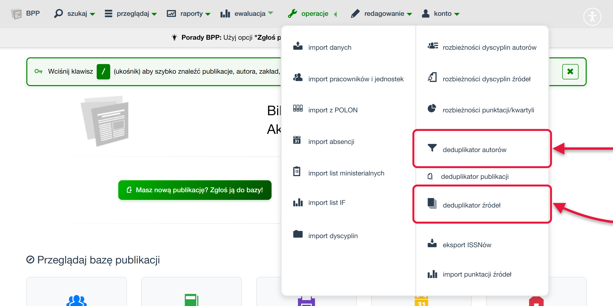

2. Deduplikator nie przeszukuje bazy na żywo — pokazuje wynik
   **skanowania**. Skanowanie uruchamia się samo co noc (o 3:00). Przy
   pierwszej wizycie albo po świeżym imporcie kliknij **„Uruchom
   skanowanie duplikatów”** (w panelu po lewej: **„Uruchom nowe
   skanowanie”**).

    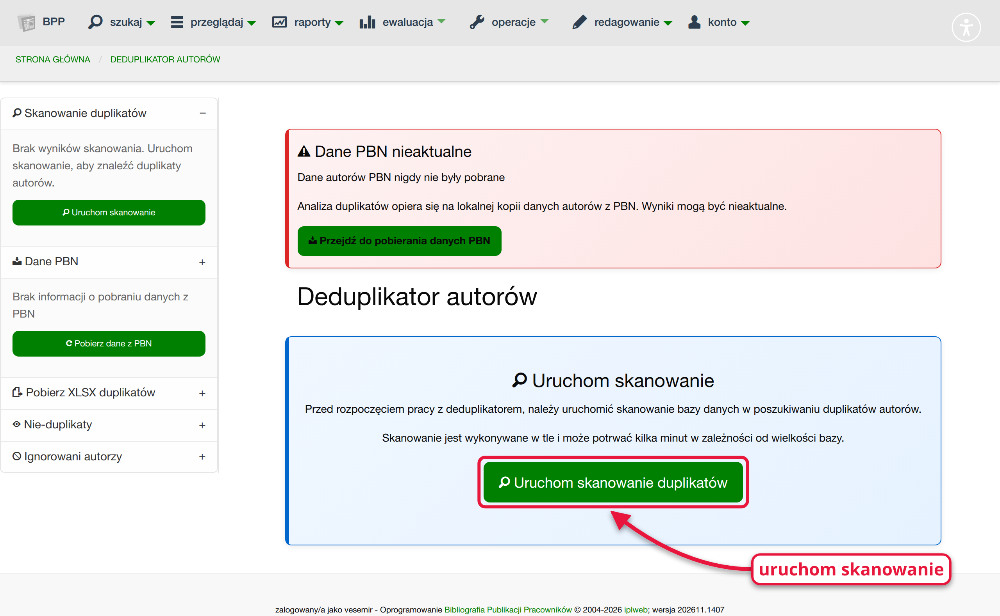

    Skanowanie idzie w tle: pasek postępu pokazuje liczbę sprawdzonych
    autorów i szacowany czas, a strona sama się odświeży po zakończeniu.
    W tym czasie można pracować gdzie indziej. Ponowne uruchomienie
    zastępuje poprzednie wyniki; przycisk **„Anuluj skanowanie”** przerywa
    bieżące.

    !!! note "Czerwona ramka „Dane PBN nieaktualne”"
        Skanowanie ma dwie części: **PBN** (porównuje autorów z listą osób
        z instytucji pobraną z PBN) i **ogólną** (porównuje autorów BPP
        między sobą). Ramka mówi tylko, że lokalna kopia danych z PBN jest
        stara albo jej nie ma — część ogólna działa normalnie. Jeśli
        uczelnia pracuje z PBN, przed skanowaniem pobierz dane przyciskiem
        **„Przejdź do pobierania danych PBN”**.

3. Po skanowaniu panel po lewej pokazuje, ile par jest **„Do
   sprawdzenia”**. Deduplikator prowadzi po kolei przez **głównych autorów**
   — przyciskami **„Następny autor”** / **„Poprzedni autor”**. Konkretną
   osobę znajdziesz polem **„Szukaj autora po nazwisku...”** (szuka
   tylko wśród głównych rekordów). Przyciski **PBN / Ogólny / Oba** zawężają
   listę do jednej części skanowania.

    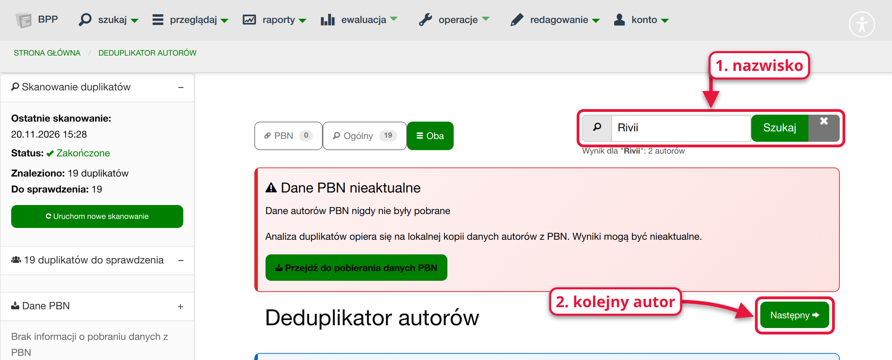

4. Niebieska ramka **„Główny rekord autora”** to rekord, który **zostaje**.
   System wybiera go sam: wygrywa rekord z ORCID, potem z identyfikatorem
   PBN, z tytułem naukowym, z dyscypliną, z większą liczbą prac. Pod spodem
   są dyscypliny i publikacje tego autora.

    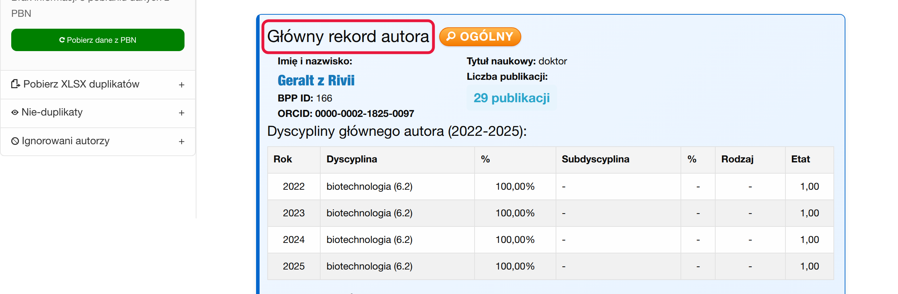

5. Niżej, w sekcji **„Możliwe duplikaty”**, każdy kandydat ma osobną
   kartę:

    - **Pewność** — jak bardzo system jest przekonany (zielona karta:
      powyżej 50%),
    - **Powody podobieństwa** — za co dodał, a za co odjął punkty
      (identyczne nazwisko, wspólne imię lub inicjał, wspólne lata
      publikacji, brak ORCID u kandydata, różny tytuł…),
    - **Podgląd** — **„Pokaż wyd. ciągłe”** / **„Pokaż wyd. zwarte”**
      otwierają prace kandydata z lat 2022–2025 w module redagowania,
      **„Otwórz w redagowaniu”** — jego rekord, **„Otwórz na stronie
      głównej”** — jego stronę,
    - **Decyzja** i **Scalanie** — patrz niżej.

    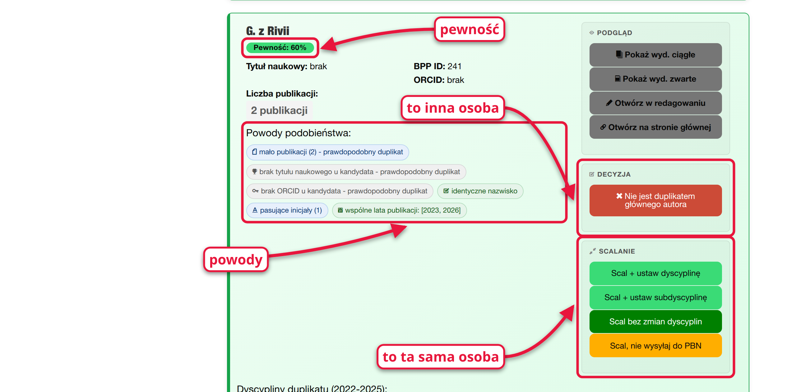

    Zanim zdecydujesz, porównaj prace obu rekordów (są wypisane pod kartą)
    — zbieżne lata, współautorzy i jednostka to najlepsze potwierdzenie.

### To ta sama osoba — scalanie {#scalanie}

W sekcji **Scalanie** wybierz jeden przycisk:

| Przycisk | Co robi |
|---|---|
| **Scal bez zmian dyscyplin** | przenosi prace kandydata na głównego autora; dyscypliny przy pracach zostają, jakie były, i prace trafiają do kolejki eksportu do PBN |
| **Scal + ustaw dyscyplinę** | jak wyżej, a pracom **bez dyscypliny** wpisuje dyscyplinę głównego autora z danego roku |
| **Scal + ustaw subdyscyplinę** | jak wyżej, ale wpisuje **subdyscyplinę** głównego autora jako dyscyplinę |
| **Scal, nie wysyłaj do PBN** | jak „Scal bez zmian dyscyplin”, ale **nie** dodaje prac do kolejki PBN |

Przyciski „+ ustaw dyscyplinę / subdyscyplinę” pojawiają się tylko wtedy,
gdy główny autor ma przypisane dyscypliny w latach 2022–2025.

Po potwierdzeniu („Czy jesteś pewny/a? … Tej operacji nie można cofnąć.”)
karta znika, a u góry pojawia się komunikat **„Autorzy zostali pomyślnie
scaleni • N publikacji przeniesionych”** (oraz liczba przeniesionych
dyscyplin i ostrzeżeń, jeśli były).

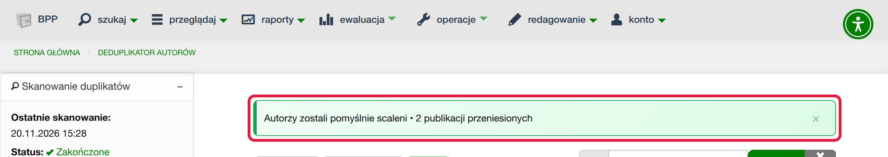

Co dokładnie dzieje się przy scaleniu:

- prace kandydata (wydawnictwa ciągłe i zwarte, patenty, prace doktorskie
  i habilitacyjne) dostają głównego autora; **jednostka** i **„zapisany
  jako”** przy pracy zostają bez zmian,
- przypisania dyscyplin kandydata, których główny autor nie ma
  (rok + dyscyplina), są kopiowane do głównego autora,
- jeśli główny autor **już jest** przy tej samej pracy z tym samym typem
  odpowiedzialności, zdublowany wpis jest usuwany (ostrzeżenie „Autor
  główny już ma publikację … Usunięto duplikat.”),
- jeśli praca ma dyscyplinę, której główny autor nie ma w roku pracy,
  dyscyplina jest z pracy **usuwana** (ostrzeżenie „Autor główny nie ma
  dyscypliny … Dyscyplina została usunięta z publikacji: …”),
- rekord kandydata jest **usuwany** z BPP (nie z PBN).

ORCID, identyfikator PBN, poprzednie nazwiska i zatrudnienie kandydata
**nie są** przenoszone. Jeśli kandydat ma coś, czego główny autor nie ma —
przepisz to do głównego rekordu (**„Otwórz w redagowaniu”**) **przed**
scaleniem.

### Scalanie wszystkich kandydatów naraz {#scal-wszystkie}

Gdy jesteś pewien wszystkich kandydatów danego autora, użyj przycisków nad
kartami: **„Scal wszystkie automatycznie”** albo **„Scal wszystkie, nie
wysyłaj do PBN”**. Kandydaci są scalani po kolei, a operacja zatrzymuje
się na pierwszym błędzie.

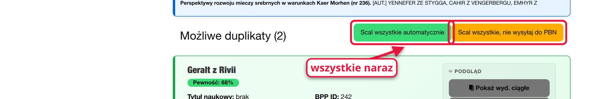

Przyciski są wyszarzone, gdy któryś kandydat ma pewność poniżej 50% —
kliknięcie wyświetla wtedy listę takich osób („Scalanie zbiorcze jest
wyłączone dla tego głównego autora…”). Rozstrzygnij ich pojedynczo,
przyciskami w sekcjach „Decyzja” / „Scalanie”. Przy wielu kandydatach
pomaga filtr **Wszyscy / Pewniaki / Słabe** nad kartami.

**Wersja „nie wysyłaj do PBN”** jest dla sytuacji, gdy wysyłka teraz nie
ma sensu albo jest niemożliwa (brak integracji z PBN, porządki na dużą
skalę, które wyślesz później jednym eksportem). Konsekwencja: w PBN prace
**zostają** przy starych danych autora, dopóki nie wyślesz ich ponownie —
np. przy następnej edycji pracy albo eksportem z modułu PBN.

### To inna osoba — „Nie jest duplikatem” {#nie-duplikat}

W sekcji **Decyzja** kliknij **„Nie jest duplikatem głównego autora”**.
Karta znika i autor trafia na listę **„Nie-duplikaty”** w panelu po lewej.

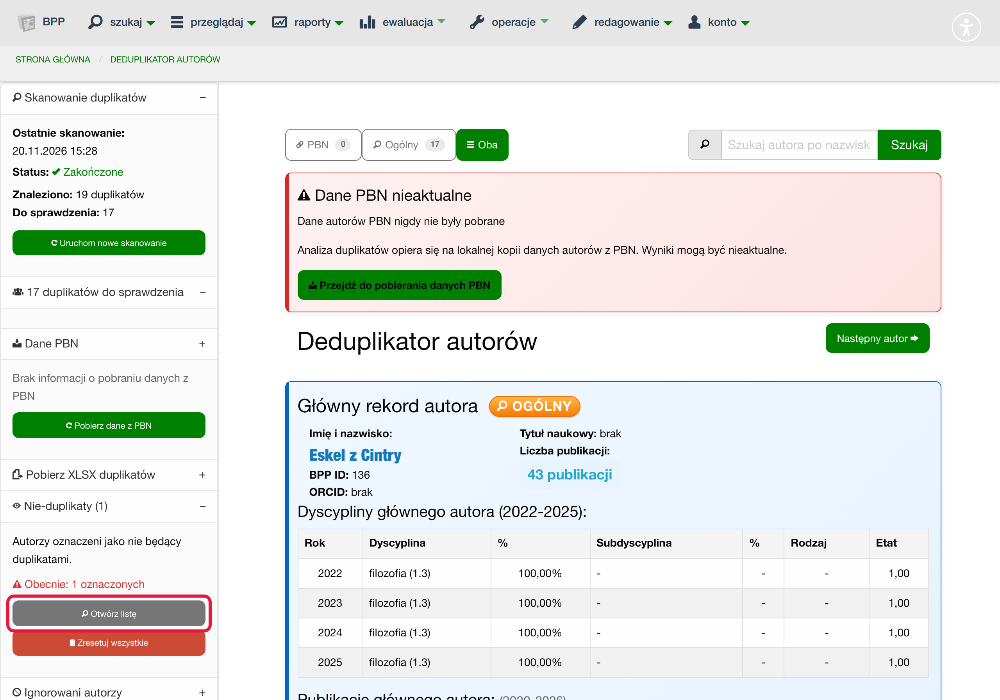

- **„Otwórz listę”** pokazuje oznaczonych autorów; pomyłkę cofasz,
  usuwając wpis z tej listy (zmiana będzie widoczna po następnym
  skanowaniu),
- **„Zresetuj wszystkie”** czyści całą listę i od razu uruchamia nowe
  skanowanie.

!!! warning "Oznaczenie dotyczy autora, nie pary"
    „Nie jest duplikatem” zapisuje **samego kandydata**, a skanowanie
    pomija go potem we **wszystkich** parach — także z innym autorem,
    którego naprawdę dubluje. Jeśli więc „G. z Rivii” nie pasuje do
    jednego Geralta, ale może pasować do innego, nie oznaczaj go — przejdź
    dalej przyciskiem **„Następny autor”**.

Przy kandydacie bez żadnych prac jest też przycisk **„Usuń autora (brak
publikacji)”** — usuwa pusty rekord (nie usuwa danych autora z PBN).

Przy autorach z części PBN w nagłówku jest jeszcze **„Ignoruj autora”** —
ukrywa autora w deduplikatorze na stałe (lista w panelu **„Ignorowani
autorzy”**, przycisk **„Zresetuj ignorowanych”**).

### Historia scaleń {#historia-scalen}

Panel **„Ostatnie scalenia”** po lewej pokazuje 10 Twoich ostatnich
wpisów z dziennika scaleń: kto do kogo, kiedy i co przeniesiono. Jeden
wpis to jedna przeniesiona **praca z wydawnictw ciągłych** (etykieta
„Przeniesienie publikacji”) albo jedna przeniesiona **dyscyplina** —
scalenie autora z dwoma artykułami daje więc dwa wpisy. Przeniesienia
wydawnictw zwartych i patentów w dzienniku się nie pojawiają. **„Zobacz wszystkie”** otwiera pełny dziennik
wszystkich redaktorów, z podglądem zmienionych rekordów i zmian dyscyplin.

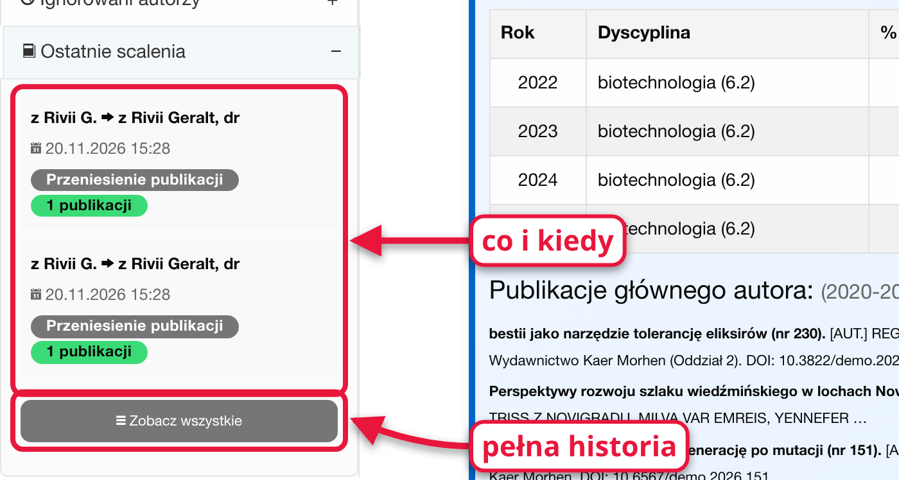

Dziennik służy do sprawdzenia, **co** się stało — przycisku „cofnij
scalenie” nie ma. Pomyłkę naprawia się ręcznie: zakłada się autora od
nowa i przepina mu prace w module redagowania.

**„Pobierz XLSX duplikatów”** (panel po lewej) zapisuje wszystkie pary do
sprawdzenia w Excelu — wygodne, gdy decyzje podejmuje ktoś inny.

## Gdy deduplikator nie pokazuje duplikatu {#gdy-deduplikator-nie-pokazuje-duplikatu}

Deduplikator pokazuje parę tylko wtedy, gdy spełnione są **wszystkie**
warunki poniżej. Sprawdź po kolei:

1. **Skanowanie było po powstaniu duplikatu.** Wyniki pochodzą z ostatniego
   skanowania (w panelu: **„Ostatnie skanowanie”**). Rekord dodany po nim
   pojawi się dopiero po następnym — uruchom je przyciskiem **„Uruchom nowe
   skanowanie”**.
2. **Nazwiska się „spotykają”.** Porównywane są tylko osoby o tym samym
   nazwisku, o wspólnym członie nazwiska dwuczłonowego (także w odwrotnej
   kolejności) albo o nazwisku wpisanym u drugiej osoby w polu
   **„Poprzednie nazwiska”**. Literówka w nazwisku („Rivii” / „Rivi”) albo
   zmiana nazwiska bez wpisu w „Poprzednie nazwiska” sprawia, że pary nie
   ma. Popraw nazwisko albo uzupełnij poprzednie nazwiska w rekordzie
   autora i uruchom nowe skanowanie.
3. **Imiona się nie wykluczają.** Jeśli obie osoby mają imiona i nie łączy
   ich ani pełne imię, ani początek imienia, ani inicjał — para jest
   odrzucana bez względu na resztę („odrzucono: zupełnie różne imiona”).
4. **Wystarczająco dużo punktów.** Do listy trafiają tylko pary
   o wystarczającej liczbie punktów. Różny ORCID (−50), różny tytuł
   naukowy, dużo prac kandydata albo duża odległość lat publikacji
   potrafią zepchnąć prawdziwy duplikat pod próg.
5. **Nie ma go na listach wyjątków.** Sprawdź panele **„Nie-duplikaty”**
   i **„Ignorowani autorzy”** (patrz [ostrzeżenie
   wyżej](#nie-duplikat)).
6. **Osoby z PBN.** Gdy któraś z osób jest na pobranej z PBN liście osób
   z instytucji, para jest oceniana w części **PBN** (przycisk **PBN**
   nad listą), a nie w części ogólnej. Dwie osoby, które **obie** są na
   tej liście, nie są ze sobą porównywane.
7. **Szukasz po właściwym nazwisku.** Pole wyszukiwania przeszukuje tylko
   **główne** rekordy. Wpisz nazwisko osoby, która powinna zostać.

**Scalanie „ręczne”.** Deduplikator nie ma przycisku „scal dowolne dwa
rekordy” — scala tylko pary znalezione przez skanowanie. Gdy poprawka
nazwiska z punktu 2 nie wystarcza:

1. otwórz prace zbędnego rekordu (na jego stronie: **„Pokaż wszystkie
   prace”**),
2. w każdej pracy w module redagowania zmień autora na właściwy rekord
   i zapisz,
3. przepisz do właściwego rekordu dyscypliny, ORCID, identyfikator PBN
   i poprzednie nazwiska, których mu brakuje,
4. usuń pusty rekord dopiero wtedy, gdy na jego stronie nie ma już żadnej
   pracy.

!!! danger "Nie usuwaj w module redagowania autora, który ma prace"
    Usunięcie autora usuwa razem z nim jego **powiązania z pracami** —
    prace zostają bez tego autora. Usuwaj tylko rekordy puste.

## Przemapuj prace autora między jednostkami {#przemapuj-prace-autora}

Scalenie nie zmienia jednostki przy pracach — prace duplikatu zostają
przypisane do jednostki, którą miał duplikat (po imporcie często
niewłaściwej). Do przeniesienia ich hurtem służy **„Przemapuj prace”**.
To narzędzie przenosi prace **jednego autora** między **jednostkami** —
nie łączy dwóch autorów.

1. Na stronie autora kliknij **„Przemapuj prace”**.

    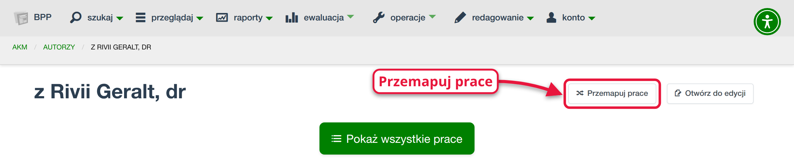

2. Tabela **„Obecny rozkład prac w jednostkach”** pokazuje, ile prac
   autora jest w każdej jednostce. Wybierz **„Jednostka źródłowa”** (skąd)
   i **„Jednostka docelowa”** (dokąd) i kliknij **„Podgląd zmian”**.

    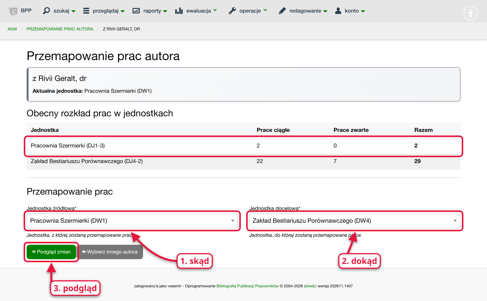

3. Podgląd pokazuje liczbę prac i przykładowe tytuły. Kliknij
   **„Potwierdź i wykonaj przemapowanie”**. Przenoszone są **wszystkie**
   prace autora z jednostki źródłowej, z każdego roku.

4. Komunikat potwierdza wynik („Pomyślnie przemapowano N prac ciągłych
   i M prac zwartych z jednostki … do jednostki …”). W tabeli **„Historia
   przemapowań”** każde przemapowanie ma przycisk **„Cofnij”**.

    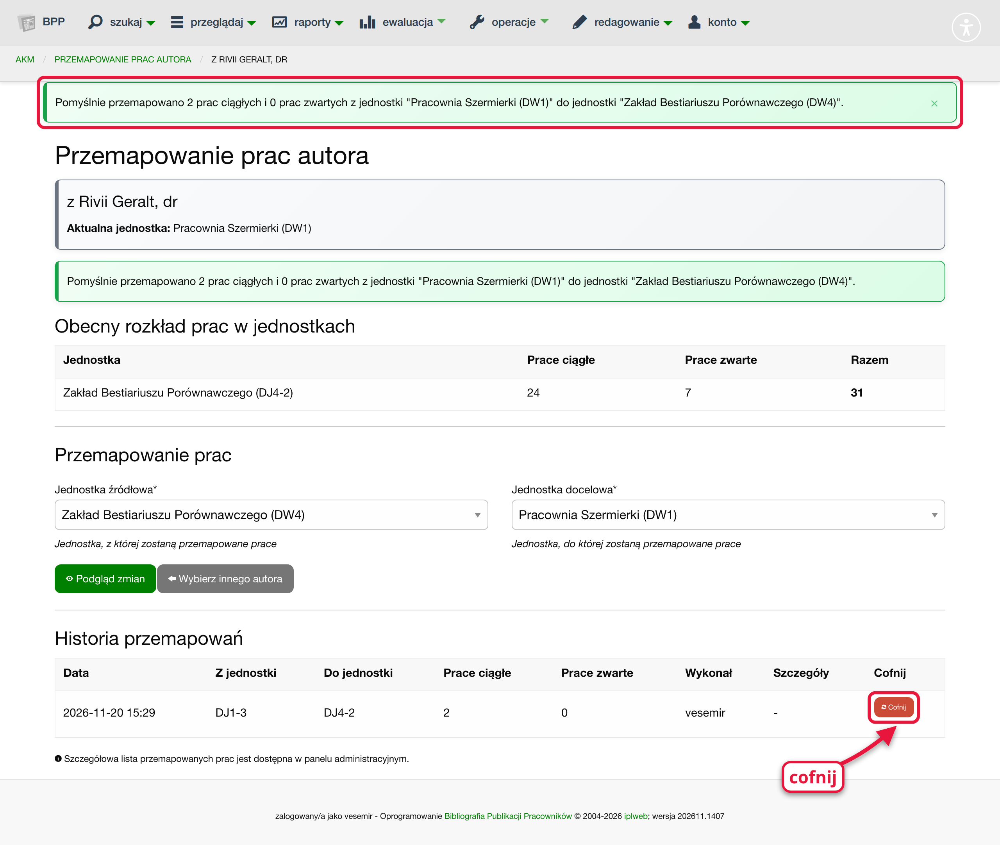

    Cofnięcie przywraca jednostkę tylko tym pracom, których od tamtej pory
    nikt nie zmienił („Cofnięto N przypisań prac; pominięto M z powodu
    późniejszych zmian afiliacji.”).

Błędy formularza: „Jednostka źródłowa i docelowa muszą być różne.”, „Nie
można przemapować prac do "Jednostki Domyślnej".” oraz „Autor … nie ma
żadnych prac w jednostce …”.

## Deduplikator źródeł {#deduplikator-zrodel}

1. **operacje → deduplikator źródeł**, kliknij **„Skanuj bazę”**.
   Otworzy się strona postępu; po zakończeniu kliknij **„Zobacz listę
   duplikatów”**.

    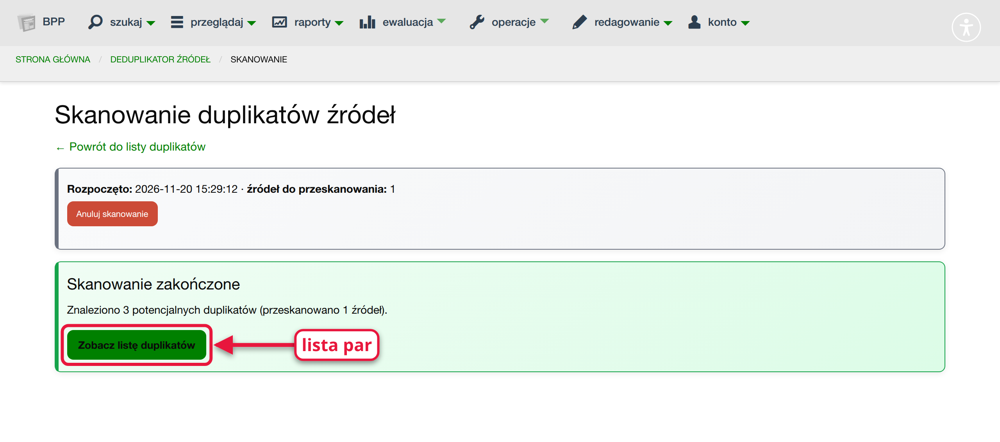

    !!! note "Skan zaczyna od źródeł z listy ministerialnej"
        Jak mówi podpis pod przyciskiem: **„Skan obejmuje źródła
        z publikacjami i ministerialnym ID.”** Punktem wyjścia są tylko
        źródła powiązane z czasopismem z PBN, które ma identyfikator
        MNiSW, i dla nich szukane są podobne źródła. Dwa duplikaty, z
        których żaden nie ma MNiSW ID, nie pojawią się na liście —
        połącz je [ręcznie](#przemapuj-zrodlo) przyciskiem „Przemapuj
        prace” na stronie źródła.

2. Lista pokazuje pary **„Źródło główne”** (to zostaje — zwykle to, które
   ma MNiSW ID, a przy remisie więcej publikacji) i **„Potencjalny
   duplikat”**, z ISSN, e-ISSN, liczbą publikacji i **pewnością** (punkty:
   po 100 za zgodny ISSN i e-ISSN, 80 za ten sam identyfikator PBN, do 60
   za nazwę, 10 za skrót; kary za różny rodzaj i zasięg).

    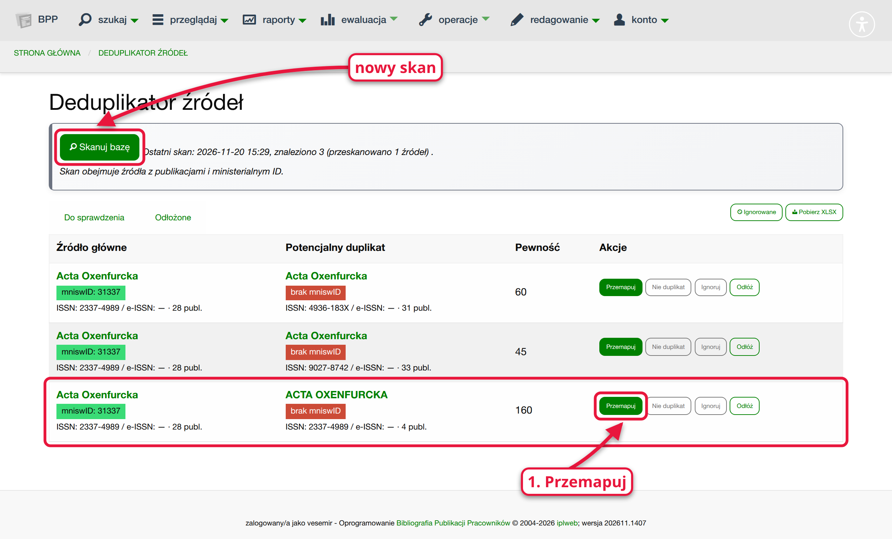

    Akcje przy parze:

    - **„Przemapuj”** — przenosi publikacje duplikatu do źródła głównego
      (formularz w następnym kroku),
    - **„Nie duplikat”** — para znika z listy na stałe (dotyczy tylko tej
      pary),
    - **„Ignoruj”** — pomija źródło-duplikat we wszystkich parach (lista:
      przycisk **„Ignorowane”**),
    - **„Odłóż”** — przenosi parę na zakładkę **„Odłożone”**; stamtąd
      wraca przyciskiem **„Cofnij”** albo **„Przywróć wszystkie
      odłożone”**.

    Na tej liście trzy pary dotyczą „Acta Oxenfurcka”: dwie mają taką samą
    nazwę, ale **inny ISSN** (pewność 60 i 45) — to raczej różne
    czasopisma, więc **„Nie duplikat”**. Para z tym samym ISSN (pewność
    160) to prawdziwy duplikat.

## Przemapuj źródło {#przemapuj-zrodlo}

1. Kliknij **„Przemapuj”** przy parze. (To samo okno otwiera przycisk
   **„Przemapuj prace”** na stronie źródła — nie ma go przy źródłach
   z listy ministerialnej, bo ich nie wolno przepinać na inne źródło.)

2. Formularz pokazuje oba źródła obok siebie (**„Źródło źródłowe”** to
   duplikat, **„Źródło docelowe”** — to, które zostaje; zgodne pola, np.
   ISSN, są wyróżnione na zielono). Sprawdź pola zaznaczone na
   zrzucie:

    - **„Źródło docelowe”** — z deduplikatora jest już wpisane,
    - **„Wyślij publikacje do kolejki PBN”** — domyślnie **zaznaczone**;
      odznacz, jeśli nie chcesz teraz wysyłać prac do PBN,
    - **„Potwierdzam przemapowanie”** — wymagane.

    Kliknij **„Przemapuj publikacje”** i potwierdź.

    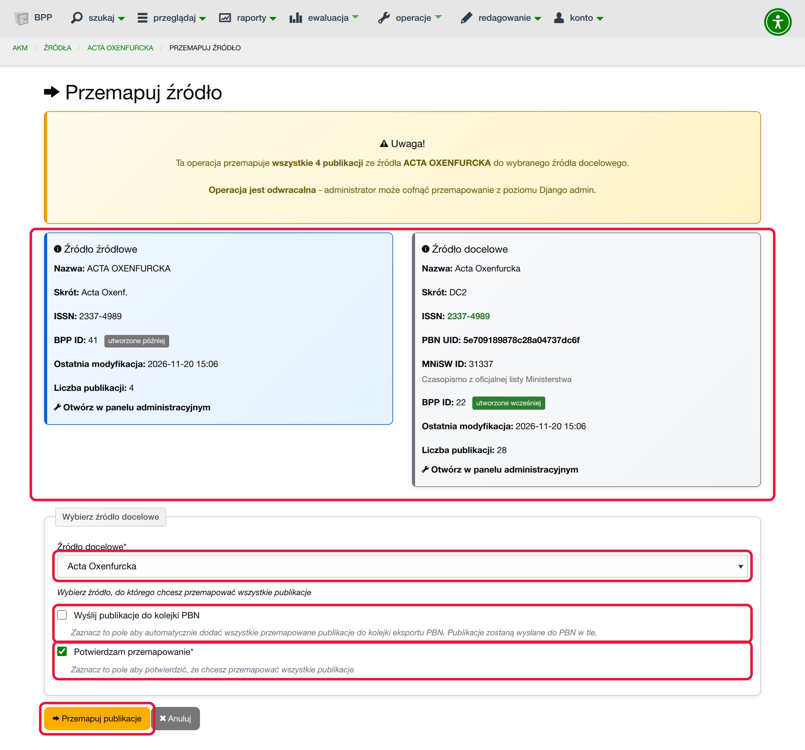

3. Otworzy się strona źródła docelowego z komunikatem „Pomyślnie
   przemapowano N publikacji ze źródła … do źródła …”. Źródło-duplikat
   zostaje w bazie, ale już bez publikacji.

    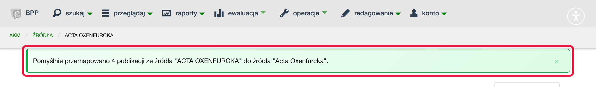

**Cofnięcie.** Przemapowania źródeł są zapisywane w historii:
**Przemapowania źródeł** w module redagowania (adres
`/admin/przemapuj_zrodlo/przemapowazrodla/` — w menu nie ma do niej
odnośnika). Przycisk **„Cofnij”** w kolumnie „Akcje” przywraca publikacje
do źródła, z którego je zabrano.

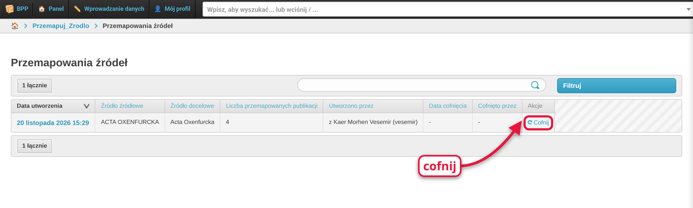

Cofane są tylko publikacje, które nadal są w źródle docelowym („Cofnięto
N z M publikacji. Część publikacji mogła być usunięta lub ponownie
przemapowana.”). Cofnięcie **nie** dodaje publikacji do kolejki PBN.

## Usuwanie źródeł bez publikacji {#usuwanie-zrodel-bez-publikacji}

Po przemapowaniu duplikat jest pustym źródłem. Puste źródła usuwa się
hurtem:

1. **redagowanie → Źródło** (otwiera się lista źródeł).
2. **„Filtruj”** → **„ma publikacje”** → **„nie ma publikacji”**.
3. Zaznacz źródła, wybierz akcję **„Usuń zaznaczone źródła BEZ publikacji
   (bez potwierdzenia)”** i kliknij **„Wykonaj”**.

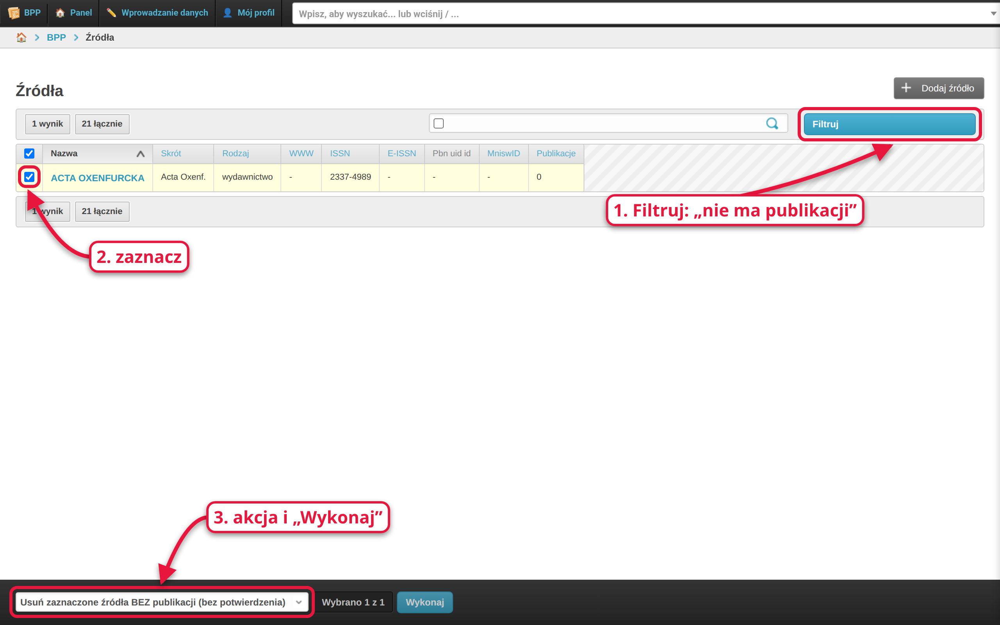

Komunikat: „Usunięto N źródeł bez publikacji.” Źródła, które mają
publikacje, są pomijane („Pominięto M (mają publikacje).”), więc
przypadkowe zaznaczenie pełnego źródła nic nie zepsuje. Akcja **nie pyta o
potwierdzenie**.

!!! warning "Po usunięciu źródła nie cofniesz przemapowania"
    Usunięcie źródła-duplikatu usuwa też wpis o jego przemapowaniu
    z historii. Usuwaj puste źródła dopiero wtedy, gdy wynik
    przemapowania jest sprawdzony.

## Co może pójść nie tak {#co-moze-pojsc-nie-tak}

**Duplikat ma identyfikator PBN albo ORCID, a główny autor nie.** Scalenie
przenosi tylko prace i dyscypliny — identyfikator PBN i ORCID duplikatu
znikają razem z nim. Przepisz je do głównego rekordu **przed** scaleniem.
Jeśli oba rekordy mają **różne** identyfikatory PBN albo różne ORCID —
zatrzymaj się: to mogą być dwie różne osoby (system i tak odejmuje za to
punkty).

**Prace już wysłane do PBN.** Zwykłe scalenie dodaje każdą przeniesioną
pracę do kolejki eksportu do PBN — prace zostaną wysłane ponownie, już
z głównym autorem. Przy setkach prac to setki wysyłek; wymagają one
autoryzacji w PBN i poprawnych danych. Wariant „nie wysyłaj do PBN” nic nie
wysyła, ale wtedy PBN zostaje przy starym stanie do następnej wysyłki.
Scalenie i usunięcie autora w BPP **nie usuwa osoby w PBN**. Jeśli praca
jest już w kolejce, dostaniesz ostrzeżenie „Publikacja … jest już
w kolejce eksportu do PBN — nie dodano ponownie.”.

**Zmiana nazwiska.** Rekordy sprzed i po zmianie nazwiska (np. nazwisko
panieńskie) są parowane tylko wtedy, gdy stare nazwisko jest wpisane w polu
**„Poprzednie nazwiska”** jednego z nich. Uzupełnij je u głównego autora
i uruchom nowe skanowanie. Po scaleniu prace zachowują nazwisko, pod którym
zostały opublikowane („zapisany jako”).

**Zmieniła się aktualna jednostka autora.** Gdy duplikat był przypisany do
innej jednostki, główny autor po scaleniu może dostać tę jednostkę jako
**aktualną**. Sprawdź jednostkę na stronie autora i — jeśli trzeba —
przenieś prace [„Przemapuj prace”](#przemapuj-prace-autora), a zatrudnienie
popraw w rekordzie autora.

**Dyscypliny zniknęły z prac.** Jeśli główny autor nie ma w danym roku
dyscypliny, którą miała praca duplikatu, dyscyplina jest z pracy usuwana
(ostrzeżenie w komunikacie i w dzienniku scaleń). Uzupełnij dyscypliny
autora i prac — inaczej prace nie będą liczone do slotów.

**Błąd scalania.** Na karcie kandydata pojawia się ramka **„Błąd
scalania”** z opisem, np. „Wystąpił wewnętrzny błąd podczas scalania
autorów.” albo „Nie znaleziono autora.” (rekord usunął już ktoś inny —
odśwież stronę). Scalenie, które się nie udało, niczego nie zmienia.

**Przemapowanie źródła odrzucone.** „Źródło "…" jest na oficjalnej liście
ministerstwa (MNiSW ID: …). Można je przemapować tylko na źródło o TYM SAMYM
MNiSW ID” — źródła z listy ministerialnej można łączyć tylko z tym samym
czasopismem. „Źródło docelowe nie może być takie samo jak źródło
źródłowe.” — wybrano to samo źródło. „Źródło "…" nie ma żadnych publikacji.
Przemapowanie nie jest możliwe.” — nie ma czego przenosić (można je
[usunąć](#usuwanie-zrodel-bez-publikacji)).

**Skanowanie nie startuje.** „Skanowanie jest już w trakcie. Poczekaj na
jego zakończenie.” — ktoś inny (albo nocne zadanie) właśnie skanuje;
poczekaj na koniec.

## Zobacz też

- [Autorzy](autorzy.md) — rekord autora, poprzednie nazwiska, dyscypliny
- [Wydawnictwa](wydawnictwa.md) — edycja prac i listy autorów
- [Jednostki](jednostki.md)
- [Sloty](sloty.md) — dlaczego dyscypliny przy pracach są ważne
