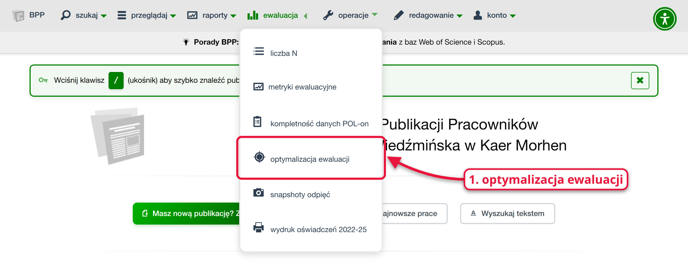
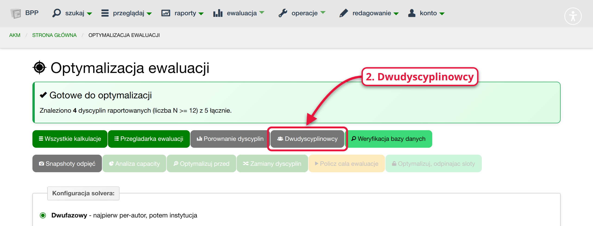
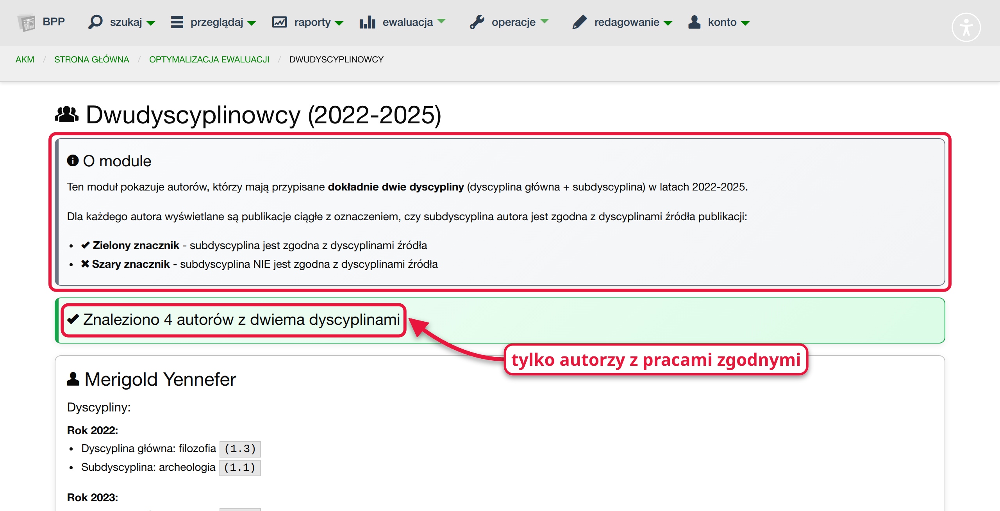
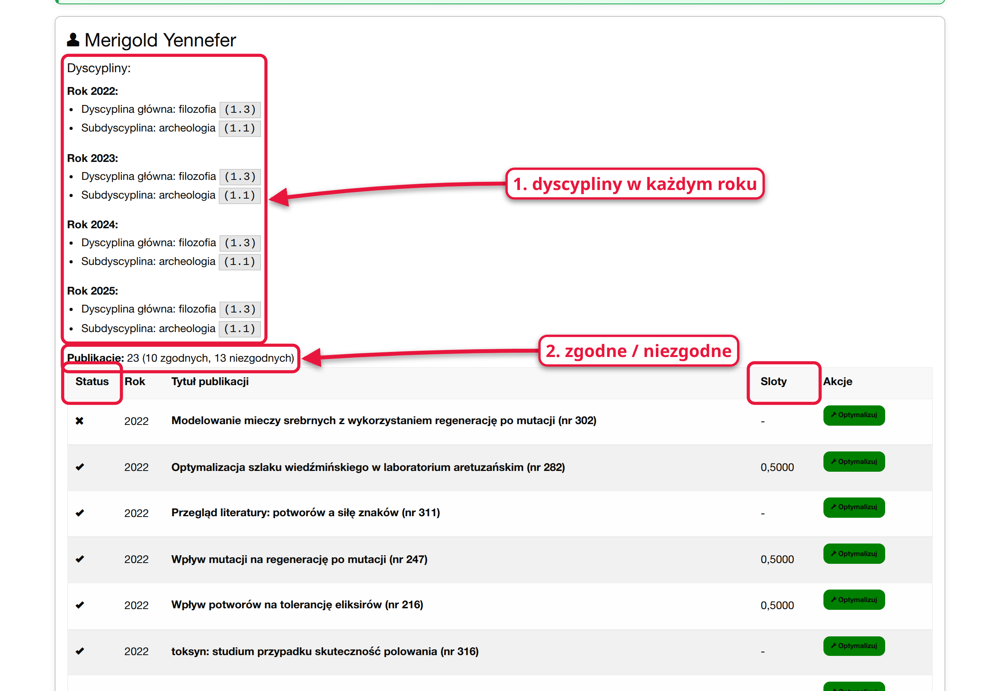
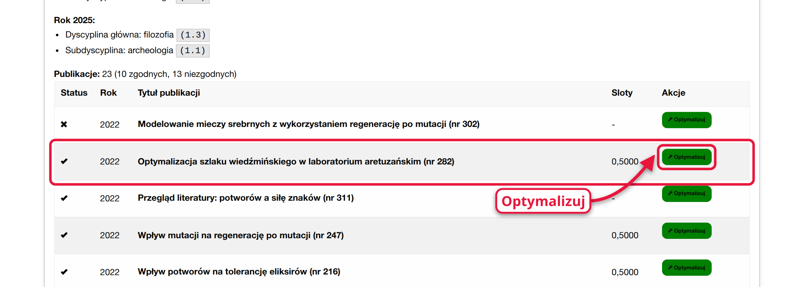
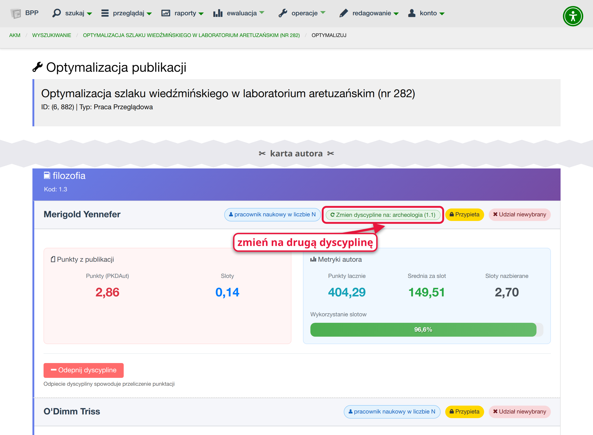
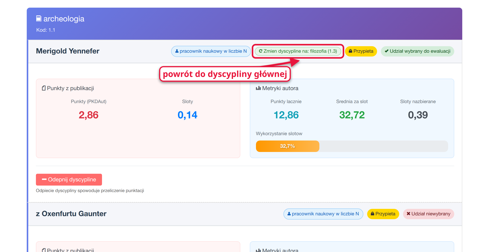

# Autorzy z dwiema dyscyplinami (dwudyscyplinowcy)

Instrukcja dla osób, które w bibliotece albo w zespole ds. ewaluacji
przygotowują zestaw prac do ewaluacji 2022–2025. Opisuje stronę
**„Dwudyscyplinowcy”**: listę autorów, którzy w danym roku mają przypisane
**dwie dyscypliny**, razem z ich artykułami i podpowiedzią, które z tych
artykułów mogłyby liczyć się w drugiej dyscyplinie.

## Po co to jest {#po-co}

Autor może zadeklarować dwie dyscypliny: **dyscyplinę główną** i drugą
dyscyplinę (w BPP nazywaną **subdyscypliną**). Każda praca autora liczy się
jednak tylko w **jednej** z nich — tej, którą wpisano przy autorze
w rekordzie pracy. Domyślnie jest to zwykle dyscyplina główna.

Bywa, że praca pasuje także do drugiej dyscypliny autora, a w tamtej
dyscyplinie przyda się bardziej (np. brakuje tam prac do wypełnienia
slotów). Strona „Dwudyscyplinowcy” pomaga takie prace znaleźć: dla każdego
artykułu sprawdza, czy **druga dyscyplina autora jest na liście dyscyplin
czasopisma** w roku wydania. Tylko wtedy przeniesienie pracy do drugiej
dyscypliny ma sens.

Co BPP bierze pod uwagę:

- lata **2022–2025** (na stałe, bez wyboru),
- autorów, którzy w danym roku mają w danych dyscyplin **dwie różne
  dyscypliny** — główną i subdyscyplinę (w formularzu autora
  sekcja **„Powiązania autor-dyscyplina”**; zwykle trafiają tam z importu
  POL-on — zobacz [Nowy rok w BPP](nowy-rok.md)),
- tylko **artykuły w czasopismach** (wydawnictwa ciągłe) — monografii
  i rozdziałów strona nie pokazuje,
- dyscypliny czasopism na dany rok (sekcja **„Przypisanie dyscyplin do
  źródła”** przy czasopiśmie, zwykle z listy ministerialnej — zobacz
  [Import list ministerialnych i punktacji czasopism](import-list-ministerialnych.md)).

Na liście pojawia się tylko autor, który ma **co najmniej jedną** pracę
zgodną z drugą dyscypliną. Autor z dwiema dyscyplinami, którego żaden
artykuł nie pasuje do subdyscypliny, nie jest pokazywany — dla niego nie ma
czego przenosić.

## Zanim zaczniesz {#zanim-zaczniesz}

**Uprawnienia.** Potrzebujesz konta w grupie **„wprowadzanie danych”**
(albo konta superużytkownika). Bez niej wejście na stronę kończy się
komunikatem „Brak uprawnień do wprowadzania danych.”

**Aktualne dane.** Strona niczego nie liczy w tle — przy każdym otwarciu
czyta bieżące dane z BPP. Żeby wynik był sensowny, w BPP muszą być:

1. dyscypliny autorów na lata 2022–2025, z wpisaną subdyscypliną,
2. dyscypliny czasopism na te same lata.

Przy bardzo dużej bazie otwarcie strony może potrwać kilka–kilkanaście
sekund.

## Jak otworzyć stronę {#jak-otworzyc}

1. W górnym menu wybierz **ewaluacja** → **optymalizacja ewaluacji**.

    

2. Na stronie „Optymalizacja ewaluacji” kliknij przycisk
   **„Dwudyscyplinowcy”**. Jest aktywny zawsze — nie trzeba czekać na
   przeliczenie punktów ani na policzenie ewaluacji.

    

## Co jest na liście {#lista}

Na górze strony („Dwudyscyplinowcy (2022-2025)”) jest ramka **„O module”**
z krótkim objaśnieniem znaczników, a pod nią podsumowanie **„Znaleziono …
autorów z dwiema dyscyplinami”**. Liczba obejmuje tylko autorów, którzy
mają przynajmniej jedną pracę zgodną z drugą dyscypliną (patrz wyżej).

Niżej każdy autor ma swoją kartę; autorzy są ułożeni alfabetycznie
(nazwisko, imię).

## Karta autora {#karta-autora}

Karta ma trzy części:

1. **„Dyscypliny:”** — osobno dla każdego roku 2022–2025, w którym autor
   ma dwie dyscypliny: **„Dyscyplina główna”** i **„Subdyscyplina”**
   z kodem dyscypliny w nawiasie. Lat, w których autor miał tylko jedną
   dyscyplinę, nie ma ani tutaj, ani w tabeli prac.
2. **„Publikacje:”** — liczba artykułów autora z tych lat oraz ile z nich
   jest **zgodnych** i **niezgodnych** z subdyscypliną.
3. Tabela prac, posortowana po roku i tytule:

| Kolumna | Co oznacza |
|---|---|
| **Status** | ✔ — subdyscyplina autora jest na liście dyscyplin czasopisma w roku wydania, więc pracę **można** policzyć w drugiej dyscyplinie. ✖ — nie jest (albo czasopismo nie ma w tym roku żadnych dyscyplin w BPP). |
| **Rok** | Rok wydania pracy. |
| **Tytuł publikacji** | Tytuł; kliknięcie otwiera stronę pracy w nowej karcie. |
| **Sloty** | Orientacyjny udział autora w slocie, gdyby praca liczyła się w subdyscyplinie. BPP liczy go jako 1 / (1 + liczba autorów tej pracy już przypiętych do subdyscypliny). Wartość pojawia się tylko wtedy, gdy w pracy jest już co najmniej jeden afiliowany autor z tą dyscypliną; w pozostałych przypadkach jest „-”. To przybliżenie — dokładną wartość pokazuje strona „Optymalizacja publikacji” po zmianie dyscypliny. |
| **Akcje** | Przycisk **„Optymalizuj”** (opis niżej). |

!!! note "Na liście są wszystkie artykuły autora z danego roku"
    Tabela pokazuje każdy artykuł autora z roku, w którym ma dwie
    dyscypliny — także prace, które już liczą się w subdyscyplinie, i prace
    bez afiliacji. Kolumna „Status” mówi tylko o zgodności
    z czasopismem, nie o tym, w której dyscyplinie praca jest teraz.
    Aktualną dyscyplinę pracy widać po kliknięciu „Optymalizuj”.

## Zmiana dyscypliny w pracy („Optymalizuj”) {#optymalizuj}

Strona „Dwudyscyplinowcy” sama niczego nie zmienia — nie ma na niej
przycisku przeliczenia ani eksportu. Jedyna akcja to przejście do strony
**„Optymalizacja publikacji”** wybranej pracy, gdzie można zmienić
dyscyplinę autora.

1. W wierszu pracy ze znacznikiem ✔ kliknij **„Optymalizuj”**.

    

2. Otworzy się strona „Optymalizacja publikacji”. Autorzy są pogrupowani
   według dyscypliny, w której praca się teraz liczy. Przy autorze z dwiema
   dyscyplinami jest zielony przycisk **„Zmien dyscypline na: …”**
   z nazwą i kodem jego drugiej dyscypliny. Obok widać, czy udział autora
   w tej pracy wszedł do ewaluacji (**„Udział wybrany do ewaluacji”** albo
   **„Udział niewybrany”**) oraz jego metryki w obecnej dyscyplinie.

    

    Jeśli druga dyscyplina **nie** jest na liście dyscyplin czasopisma,
    napis na przycisku jest przekreślony — zmiana jest możliwa, ale taka
    praca nie powinna być wykazana w tej dyscyplinie.

3. Kliknij **„Zmien dyscypline na: …”**. BPP od razu zapisuje nową
   dyscyplinę przy autorze w tej pracy, przelicza punkty i sloty pracy oraz
   metryki autorów i odświeża stronę. Karta autora przenosi się do sekcji
   nowej dyscypliny, a przycisk zmienia się na **„Zmien dyscypline na:
   …”** z dyscypliną główną — tak cofniesz zmianę.

    

Zmiana działa tak samo jak zmiana dyscypliny przy autorze w formularzu
pracy w module redagowania — jest od razu widoczna w raportach i na
stronie pracy.

!!! warning "Po kilku zmianach przelicz ewaluację"
    Zmiana dyscypliny w pojedynczej pracy nie przelicza całej
    optymalizacji. Gdy skończysz przenosić prace, wróć do „Optymalizacja
    ewaluacji” i uruchom **„Policz cala ewaluacje”** — zobacz
    [Optymalizacja ewaluacji](optymalizacja-ewaluacji.md#uruchomienie).

## Przykłady {#przyklady}

**Przykład 1. Praca pasuje do obu dyscyplin.** Autorka ma w 2022 r.
dyscyplinę główną „filozofia” i subdyscyplinę „archeologia”. Artykuł
z 2022 r. ukazał się w czasopiśmie, które ma na liście obie dyscypliny,
więc w kolumnie „Status” jest ✔. Na stronie „Optymalizacja publikacji”
widać, że w filozofii jej udział jest **„niewybrany”** — w tej dyscyplinie
ma dość lepszych prac. Po kliknięciu „Zmien dyscypline na: archeologia”
praca liczy się w archeologii, a jej udział jest **„wybrany do
ewaluacji”**: archeologia zyskała pracę, filozofia nic nie straciła.

**Przykład 2. Praca w czasopiśmie spoza drugiej dyscypliny.** Ta sama
autorka ma artykuł w czasopiśmie przypisanym tylko do filozofii. W kolumnie
„Status” jest ✖, a na stronie „Optymalizacja publikacji” napis „Zmien
dyscypline na: archeologia” jest przekreślony. Tej pracy nie przenoś — nie
może być wykazana w archeologii.

**Przykład 3. Autora nie ma na liście.** Autorka ma w danych dwie
dyscypliny, ale jej drugą dyscypliną jest „historia”, a żadne czasopismo,
w którym publikowała, nie ma historii na liście dyscyplin. Strona jej nie
pokazuje, bo nie ma żadnej pracy zgodnej z subdyscypliną. Jeśli uważasz, że
powinna tam być, sprawdź sekcję „Przypisanie dyscyplin do źródła” przy czasopismach
(**Wprowadzanie danych → Źródła**) i dyscypliny autorki.

## Związek z optymalizacją ewaluacji {#optymalizacja}

„Dwudyscyplinowcy” to narzędzie pomocnicze strony
[Optymalizacja ewaluacji](optymalizacja-ewaluacji.md). Wynik
optymalizacji zależy od tego, w której dyscyplinie liczy się każda praca —
optymalizacja sama **nie** przenosi prac między dyscyplinami autora,
wybiera tylko prace w ramach dyscyplin już wpisanych przy autorach.
Przenosząc pracę do drugiej dyscypliny, zmieniasz więc dane, na których
potem pracuje „Policz cala ewaluacje”.

Na stronie „Optymalizacja ewaluacji” są też dwa pokrewne narzędzia:

- **„Zamiany dyscyplin”** — sam wyszukuje prace, w których zamiana
  dyscypliny autora (główna ↔ druga) da więcej punktów; dostępny dopiero
  po przeliczeniu punktów,
- **„Przegladarka ewaluacji”** z filtrem **„Dyscyplina nieprzypisana”** —
  pokazuje prace autorów z dwiema dyscyplinami, w których wybrana
  dyscyplina **nie** została użyta, choć autor ją ma.

„Dwudyscyplinowcy” różni się od nich tym, że pokazuje **wszystkie**
artykuły autorów z dwiema dyscyplinami i ich zgodność z czasopismem,
niezależnie od punktów — dobrze nadaje się do przeglądu „autor po
autorze”.

## Co może pójść nie tak {#problemy}

**„Brak autorów z dwiema dyscyplinami w latach 2022-2025.”** — w BPP nie
ma autora, który miałby w tych latach subdyscyplinę **i** choć jedną pracę
zgodną z nią. Sprawdź, czy import z POL-on wpisał drugie dyscypliny i czy
czasopisma mają dyscypliny na te lata.

**Wszystkie prace mają ✖.** Czasopisma nie mają w BPP dyscyplin na dany
rok. Na tej stronie czasopismo bez dyscyplin liczy się jako niezgodne,
a na stronie „Optymalizacja publikacji” — jako zgodne (przycisk zmiany nie
jest wtedy przekreślony). Uzupełnij dyscypliny czasopism, zanim zaczniesz
przenosić prace.

**W kolumnie „Sloty” jest „-”, choć praca jest zgodna.** Żaden autor tej
pracy nie liczy się jeszcze w subdyscyplinie, więc BPP nie podaje
przybliżenia. Rzeczywisty udział zobaczysz na stronie „Optymalizacja
publikacji” po zmianie dyscypliny.
