# Impact Factor, kwartyle i punktacja źródeł — jak je uzupełnić

Przewodnik dla redaktorów, którzy co roku wpisują do BPP **Impact Factor
(IF)** i **kwartyl WoS** czasopism, a potem przenoszą te wartości na
artykuły. Cała ścieżka wygląda tak:

1. BPP przygotowuje listę ISSN czasopism (**eksport ISSNów**),
2. wklejasz ją do Journal Citation Reports (JCR) i pobierasz plik z wynikami,
3. wczytujesz ten plik do BPP (**import punktacji źródeł**) — wartości
   trafiają do **źródeł** (czasopism),
4. przenosisz je ze źródeł na **prace** — pojedynczo w formularzu rekordu
   albo hurtem na stronie **rozbieżności punktacji/kwartyli**.

Na końcu: [skąd biorą się różnice](#dlaczego-if-pracy-rozni-sie-od-if-zrodla)
między IF pracy a IF źródła i [który kwartyl](#ktory-kwartyl-bierze-bpp) BPP
zapisuje.

## Zanim zaczniesz {#zanim-zaczniesz}

**Dostęp.** Wszystkie opisane tu strony wymagają konta w grupie
**„wprowadzanie danych”** (nadaje ją administrator BPP). Formularze
rekordów i źródeł (moduł redagowania) wymagają dodatkowo uprawnienia do
redagowania. Bez grupy w górnym menu nie ma pozycji **operacje**.

**Dwa miejsca na te same liczby.** BPP przechowuje punktację w dwóch
miejscach:

- **przy źródle** — tabela „Punktacja źródła”: osobny wiersz na każdy rok
  (punkty MNiSW, Impact Factor, kwartyle Scopus i WoS…),
- **przy pracy** — sekcja „Punktacja” w formularzu artykułu; to są
  wartości, które widać w opisach, raportach i eksportach.

Import zapisuje wartości **tylko przy źródle**. Na prace przenosisz je
osobnym krokiem — świadomie, bo nie zawsze chcesz nadpisać wartość wpisaną
ręcznie.

**Licencja.** BPP nie zawiera danych Web of Science ani JCR i nie pobiera ich
samo — przetwarza wyłącznie plik, który wgrasz. Korzystanie z tych danych
odbywa się na zasadach licencji Twojej uczelni (informacja prawna jest też
na formularzu importu).

## Krok 1. Pobierz listę ISSN z BPP {#krok-1}

Menu **operacje** → **eksport ISSNów**. Przeglądarka pobierze plik
`issn_czasopism_RRRRMMDD.xlsx`.

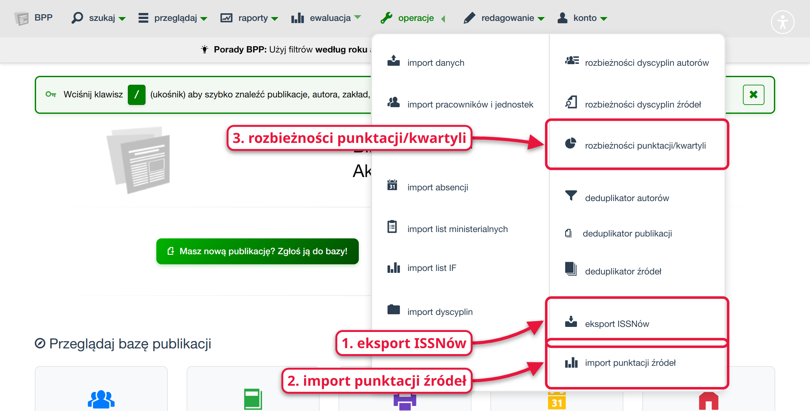

Co jest w pliku:

- ISSN **i** e-ISSN czasopism, w których w ostatnich **5 latach** jest
  przynajmniej jedna praca (czasopisma bez nowych prac są pomijane),
- numery są podzielone na **kilka kolumn po kilkaset (450–595) numerów** —
  każdą kolumnę wklejasz do JCR osobno, bo wyszukiwarka nie przyjmuje
  bardzo długich list naraz.

## Krok 2. Pobierz wyniki z JCR {#krok-2}

Ten krok robisz poza BPP, w serwisie Journal Citation Reports (dostęp
w ramach licencji uczelni):

1. Wyszukaj czasopisma po liście numerów — wklej jedną kolumnę ISSN
   z pliku z kroku 1 — i wybierz **rok JCR**, który chcesz wczytać.
2. Pobierz listę wyników jako **XLSX** albo **CSV**.
3. Powtórz dla kolejnych kolumn — każdy plik wczytasz do BPP osobno (albo
   połącz je wcześniej w jeden arkusz).

Czego BPP oczekuje od pliku: wiersza nagłówka z kolumnami **„Journal
name”** i **„JIF Quartile”**, kolumny **„RRRR JIF”** (np. „2024 JIF”) oraz
— dla dopasowania — **„ISSN”** i **„eISSN”**. Tak wygląda standardowy
eksport z JCR; dodatkowe kolumny i wiersze nad nagłówkiem są ignorowane.
Wartość „N/A” oznacza brak danych.

## Krok 3. Wczytaj plik do BPP (import punktacji źródeł) {#krok-3}

1. Menu **operacje** → **import punktacji źródeł**, potem
   **„Nowy import”**.

    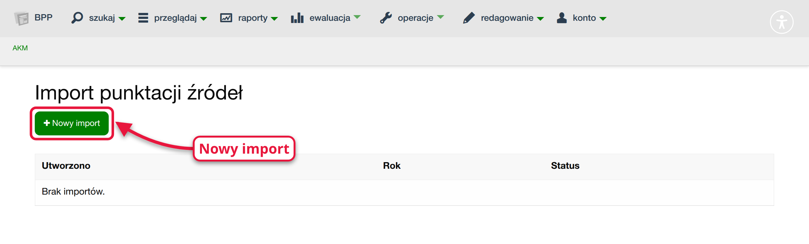

2. Wypełnij formularz:

    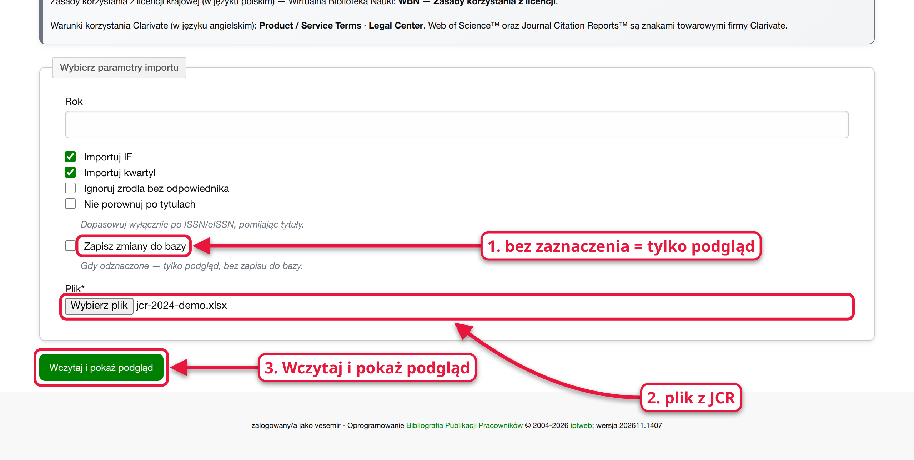

    - **Rok** — zostaw puste: BPP weźmie rok z nagłówka „RRRR JIF” (albo
      z wiersza „Selected JCR Year” nad nagłówkiem). Wpisz rok tylko wtedy,
      gdy chcesz zapisać wartości pod **innym** rokiem niż rok JCR.
    - **Importuj IF**, **Importuj kwartyl** — domyślnie oba zaznaczone.
      Odznacz, jeśli chcesz wczytać tylko jedno z nich.
    - **Ignoruj zrodla bez odpowiednika** — gdy zaznaczone, czasopisma
      z pliku, których nie ma w BPP, nie pojawią się w wynikach.
    - **Nie porownuj po tytulach** — dopasowuj tylko po ISSN/eISSN (patrz
      [Jak BPP dopasowuje czasopisma](#jak-bpp-dopasowuje-czasopisma)).
    - **Zapisz zmiany do bazy** — **zostaw odznaczone** przy pierwszym
      przebiegu. Wtedy import tylko pokazuje, co by zmienił.
    - **Plik** — plik z JCR (`.xlsx` albo `.csv`).

    Kliknij **„Wczytaj i pokaż podgląd”**.

3. Import działa w tle — strona sama pokazuje postęp. Po chwili pojawi się
   **„Podgląd gotowy”** z podsumowaniem. Kliknij **„Zobacz pełne wyniki
   importu”**.

    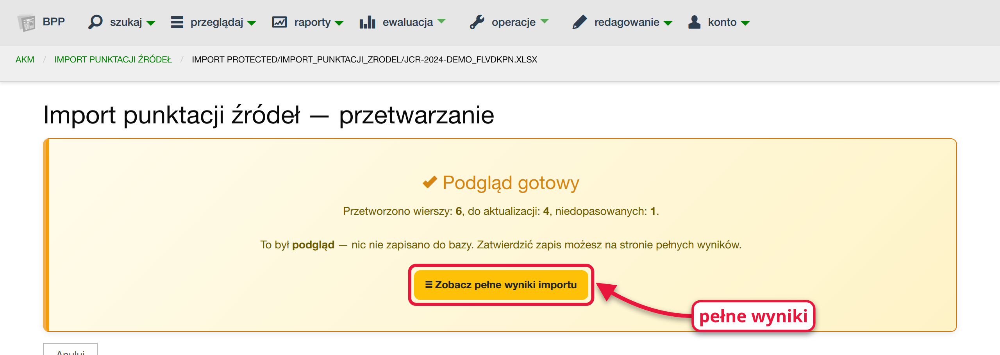

4. Sprawdź tabelę wyników. Dla każdego czasopisma widać, jak zmieni się IF
   i kwartyl, np. „IF: brak → 2.417”, „Kwartyl: brak → Q2”. Filtry nad
   tabelą: **tylko do aktualizacji**, **tylko niedopasowane**, **tylko
   duplikaty**.

    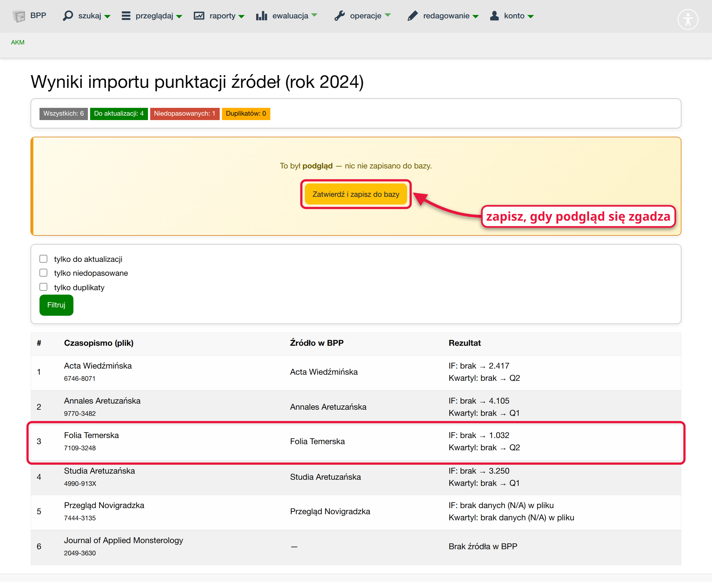

    Co znaczą wpisy w kolumnie **Rezultat**:

    | Wpis | Znaczenie |
    |---|---|
    | `IF: 1.5 → 2.417` | wartość w źródle zostanie zmieniona |
    | `IF bez zmian`, `Kwartyl bez zmian` | w BPP jest już ta sama wartość |
    | `IF: brak danych (N/A) w pliku` | JCR nie podał wartości — BPP **nie kasuje** dotychczasowej |
    | `Brak źródła w BPP` | czasopisma z pliku nie udało się dopasować (patrz niżej) |
    | `DUPLIKAT wiersza N (ISSN)` | ten sam ISSN/eISSN wystąpił w pliku wcześniej |

5. Jeśli podgląd się zgadza, kliknij **„Zatwierdź i zapisz do bazy”**.
   Nie trzeba wgrywać pliku drugi raz — BPP przetworzy ten sam plik, tym
   razem z zapisem. Po zakończeniu na stronie wyników pojawią się przyciski
   prowadzące do kolejnego kroku:

    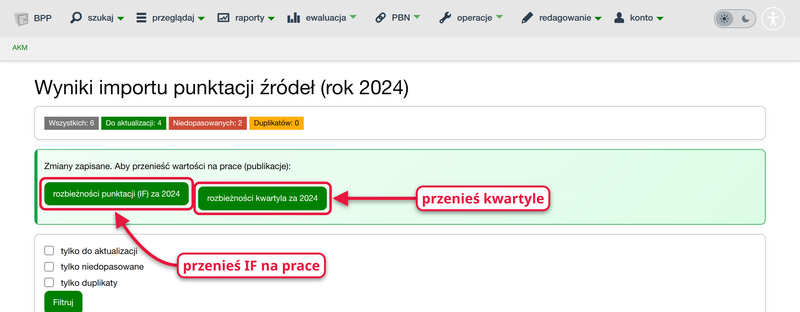

Wartości są teraz zapisane przy źródłach — w formularzu źródła (menu
**redagowanie** → **Źródło**) w tabeli **„Punktacja źródła”**, w wierszu
danego roku:

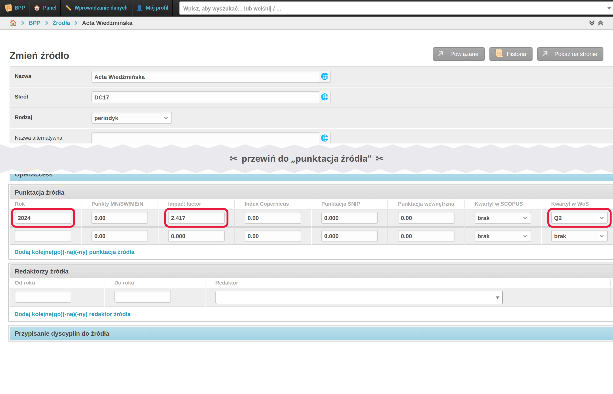

Import zmienia w tym wierszu **tylko** IF i kwartyl WoS. Pozostałe pola
(punkty MNiSW, kwartyl Scopus…) zostają bez zmian, a gdy wiersza za ten rok
jeszcze nie było, BPP go tworzy z zerami w pozostałych polach.

### CiteScore i najwyższy percentyl (Scopus) {#citescore}

W tej samej tabeli **„Punktacja źródła”**, tuż przed kwartylami, są dwie
kolumny na wskaźniki z serwisu Scopus. Obie są opcjonalne. Można je wpisać
ręcznie albo [wczytać z pliku Scopus](#import-citescore); import z pliku JCR
ich nie dotyczy:

- **„CiteScore”** — liczba nieujemna z jednym miejscem po przecinku, np.
  `7,3` (przecinek i kropka działają tak samo). Wartość ujemna albo z dwoma
  miejscami po przecinku nie zostanie zapisana.
- **„CiteScore (najwyższy percentyl)”** — liczba całkowita od 0 do 100.

Z percentyla BPP **podpowiada kwartyl Scopus**. Jeśli w wierszu danego roku
pole **„Kwartyl w SCOPUS”** jest ustawione na „brak”, to przy zapisie
zostanie wypełnione według tabeli:

| Najwyższy percentyl | Kwartyl w SCOPUS |
|---|---|
| 75–100 | Q1 |
| 50–74 | Q2 |
| 25–49 | Q3 |
| 0–24 | Q4 |

Kwartyl wybrany ręcznie ma pierwszeństwo: BPP nigdy go nie nadpisuje, także
wtedy, gdy później zmienisz percentyl. Żeby kwartyl przeliczył się na nowo,
ustaw go na „brak” i zapisz źródło. Dopóki percentyl jest wpisany, pusty
kwartyl Scopus zostanie przy zapisie uzupełniony — jeśli ma zostać pusty,
usuń też percentyl.

### Import CiteScore z pliku Scopus {#import-citescore}

Zamiast wpisywać wartości ręcznie, możesz wczytać plik wyeksportowany
z listy źródeł serwisu Scopus (zakładka „Sources”, eksport do Excela).
Potrzebne jest konto w grupie „wprowadzanie danych”.

1. Menu **operacje** → **import punktacji źródeł** → przycisk **„Nowy
   import CiteScore (Scopus)”**.
2. Wypełnij formularz i kliknij **„Wczytaj i pokaż podgląd”**:

    - **Rok** — obowiązkowy. Plik Scopus nie zawiera roku, więc BPP nie ma
      skąd go wziąć. Jeden plik = jeden rok.
    - **Importuj CiteScore i najwyższy percentyl** — domyślnie zaznaczone.
    - **Importuj SNIP** — domyślnie odznaczone. Po zaznaczeniu kolumna
      „SNIP” pliku trafia do pola „Punktacja SNIP”.
    - **Nadpisz istniejące** — domyślnie odznaczone: wartość już wpisana
      przy źródle za ten rok zostaje, nawet gdy w pliku jest inna. Puste
      pola są uzupełniane zawsze.
    - **Plik** — XLSX (albo CSV) z kolumnami „Source title”, „CiteScore”
      i „Highest percentile”. Z komórki percentyla (np. `99.0%`, pozycja
      w kategorii, nazwa kategorii) BPP bierze samą liczbę i zaokrągla ją
      do całości. Pozostałe kolumny są pomijane.

3. BPP dopasowuje każdy wiersz do źródła:

    - jeśli plik ma kolumny **ISSN / E-ISSN** — najpierw po nich (myślniki
      i wielkość liter nie mają znaczenia),
    - w pozostałych przypadkach po **tytule**: musi być identyczny
      z nazwą albo skrótem źródła w BPP, bez względu na wielkość liter
      i znaki diakrytyczne („Vedelem Tudomany” pasuje do „Védelem
      Tudomány”). BPP **nie zgaduje** po podobnych tytułach.

4. Strona wyników to **podgląd — nic nie jest jeszcze zapisane**. Wiersze
   dzielą się na:

    | Grupa | Co oznacza |
    |---|---|
    | **Do aktualizacji** | Dopasowane jednoznacznie; w kolumnie „Rezultat” widać wartość obecną i nową, np. „CiteScore: brak → 7.3”, „Kwartyl Scopus: brak → Q1 (z percentyla)” |
    | **Do rozstrzygnięcia** | BPP nie wie, którego źródła dotyczy wiersz — patrz niżej |
    | **Niedopasowane** | Takiego czasopisma nie ma w BPP. Listę pobierzesz przyciskiem **„Pobierz listę niedopasowanych”** (plik CSV). BPP **nie tworzy** nowych źródeł |

5. Rozstrzygnij wiersze sporne (filtr **„tylko do rozstrzygnięcia”**),
   a potem kliknij **„Zatwierdź i zapisz do bazy”**.

#### Kilka pasujących źródeł {#kilka-pasujacych-zrodel}

Wiersz trafia do grupy **„Do rozstrzygnięcia”** w dwóch sytuacjach:

- **w BPP jest kilka źródeł o tym tytule** (albo z tym ISSN) — np. dwa
  czasopisma o tej samej nazwie różnych wydawców albo niescalony duplikat,
- **kilka wierszy pliku pasuje do tego samego źródła** — np. Scopus ma
  osobne pozycje dla wersji drukowanej i elektronicznej.

Przy takim wierszu BPP pokazuje listę kandydatów: nazwę, ISSN i E-ISSN,
wydawcę, liczbę prac w tym źródle oraz odnośnik **„(otwórz)”** do
formularza źródła. Zaznacz właściwe źródło albo **„pomiń ten wiersz”**
i kliknij **„Zapisz wybór”**. Po wyborze w kolumnie „Rezultat” pojawi się
podgląd zmian dla wybranego źródła; decyzję możesz zmienić aż do
zatwierdzenia.

- Wiersz **bez decyzji nie jest zapisywany** — także po zatwierdzeniu.
  Pozostałe wiersze zapisują się normalnie.
- Jedno źródło może dostać wartości tylko z jednego wiersza. Jeśli
  wskażesz źródło przypisane już do innego wiersza, BPP odmówi i poda
  jego numer — najpierw pomiń tamten wiersz.
- Dwa źródła o tej samej nazwie to często duplikat. Warto go scalić
  (**deduplikator źródeł**) i powtórzyć import.

#### Co zapisuje import

- Tylko wiersz **podanego roku** w tabeli „Punktacja źródła”; gdy go nie
  ma, BPP go tworzy. Inne lata i inne kolumny (IF, punkty MNiSW, kwartyl
  WoS…) zostają bez zmian.
- **Kwartyl Scopus** — według tej samej reguły co przy wpisywaniu ręcznym:
  pusty zostaje uzupełniony z percentyla, wpisany wcześniej zostaje (także
  z zaznaczonym „Nadpisz istniejące”).
- Każde zmienione źródło dostaje wpis w **historii zmian** („Import
  CiteScore (Scopus) za rok …” z listą zmienionych wartości i nazwiskiem
  osoby, która zatwierdziła import).

Po zapisie strona wyników prowadzi przyciskiem **„rozbieżności kwartyla
Scopus za …”** do [kroku 4b](#krok-4b), gdzie przeniesiesz kwartyle na
prace.

!!! note "CiteScore zostaje przy źródle"
    Publikacje nie mają pól CiteScore, więc przyciski z kroku 4a i strona
    rozbieżności z kroku 4b ich nie przenoszą. Na prace trafia — jak dotąd —
    sam **kwartyl Scopus**, także ten podpowiedziany z percentyla.

## Krok 4a. Jeden rekord: przyciski w formularzu pracy {#krok-4a}

Gdy poprawiasz pojedynczy artykuł, otwórz go w module redagowania
(**Wydawnictwo Ciągłe**) i przewiń do sekcji **„Punktacja”**. Pod polami
są dwa przyciski:

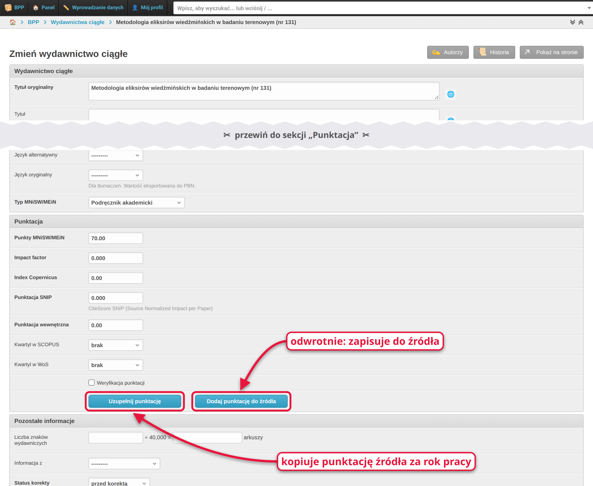

- **„Uzupełnij punktację”** — wpisuje do formularza punktację **źródła za
  rok pracy** (pola „Źródło” i „Rok” muszą być wypełnione). Po udanym
  wczytaniu przycisk zmienia napis na „Wypełniona!”. Zmiany trafiają do
  bazy dopiero po kliknięciu **Zapisz** na dole formularza.
- **„Dodaj punktację do źródła”** — działa odwrotnie: zapisuje wartości
  z formularza pracy jako punktację źródła za rok pracy. Gdy wiersz za ten
  rok już istnieje, BPP pyta „Punktacja dla tego roku już istnieje.
  Nadpisać?”.

!!! warning "„Uzupełnij punktację” kopiuje wszystkie pola, nie tylko IF"
    Przycisk przepisuje **całą** punktację źródła za dany rok: punkty
    MNiSW, Impact Factor, Index Copernicus, punktację SNIP, punktację
    wewnętrzną i oba kwartyle. Jeśli źródło ma za ten rok np. tylko IF
    z importu, a punkty MNiSW są tam zerowe, przycisk **wyzeruje** punkty
    pracy. Sprawdź pola przed zapisaniem — albo przenoś IF i kwartyle
    hurtem (krok 4b), co zmienia tylko jedno pole.

## Krok 4b. Wiele rekordów: rozbieżności punktacji/kwartyli {#krok-4b}

Menu **operacje** → **rozbieżności punktacji/kwartyli** (albo przycisk na
stronie wyników importu, który od razu ustawia rok). Strona pokazuje
**artykuły** (wydawnictwa ciągłe), w których wartość w pracy różni się od
wartości źródła **za rok pracy**.

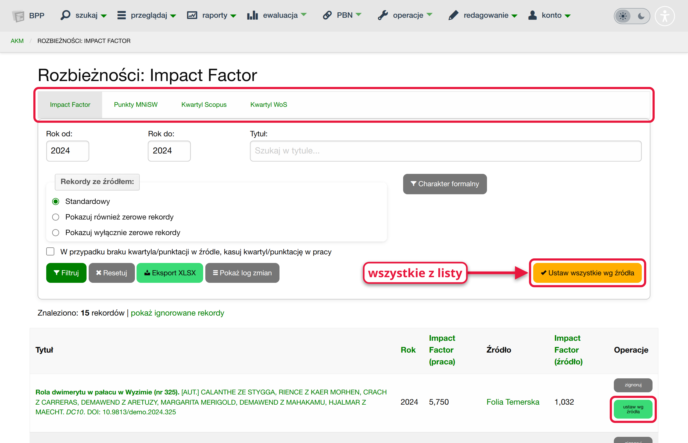

1. Wybierz zakładkę: **Impact Factor**, **Punkty MNiSW**, **Kwartyl
   Scopus** albo **Kwartyl WoS**. Każda działa tak samo, ale zmienia tylko
   swoje pole.
2. Ustaw **Rok od / Rok do** (domyślnie od 2022 do bieżącego roku) i ewentualnie
   fragment **tytułu** albo **Charakter formalny**. Lista odświeża się sama
   po zmianie pola.
3. Przenieś wartości:
    - pojedynczo — **„ustaw wg źródła”** w kolumnie „Operacje”,
    - wszystkie z listy — **„Ustaw wszystkie wg źródła”**. BPP pokaże
      stronę potwierdzenia z liczbą rekordów; kliknij **„Tak, przejdź przez
      N rekordów”**.

    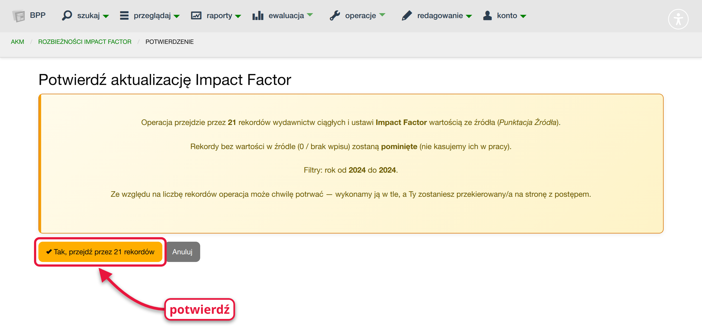

    Przy **20 i więcej** rekordach operacja idzie w tle: zobaczysz stronę
    „Aktualizacja w toku” z paskiem postępu, odświeżaną co 5 sekund, a po
    zakończeniu wrócisz na listę rozbieżności. Na koniec pojawia się
    komunikat z wynikiem:

    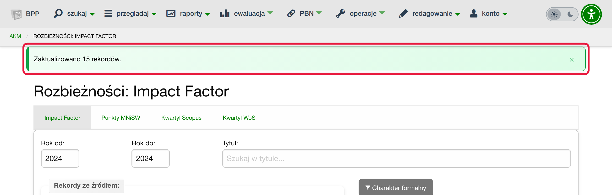

4. Powtórz w zakładce **Kwartyl WoS** (przycisk „rozbieżności kwartyla za
   RRRR” na stronie wyników importu prowadzi tam od razu).

Pozostałe przyciski:

- **zignoruj** — rekord przestaje się pojawiać na liście tej metryki (np.
  świadomie inna wartość niż w źródle). Listę ignorowanych otwiera link
  **„pokaż ignorowane rekordy”**.
- **Eksport XLSX** — bieżąca lista do Excela (tytuł, rok, wartość pracy,
  źródło, wartość źródła).
- **Pokaż log zmian** — kto, kiedy i z jakiej na jaką wartość zmienił
  rekord przez tę stronę.

**Rekordy ze źródłem** — tryb listy:

- **Standardowy** — tylko rekordy, w których źródło **ma** wartość różną od
  pracy,
- **Pokazuj również zerowe rekordy** — dodatkowo rekordy, w których praca
  ma wartość, a źródło za ten rok ma 0 / brak albo nie ma wpisu w ogóle
  (oznaczone „brak wpisu za RRRR” albo „puste w źródle”),
- **Pokazuj wyłącznie zerowe rekordy** — tylko te drugie.

Domyślnie BPP **nie kasuje** wartości w pracy, gdy źródło jej nie ma —
takie rekordy pomija („Pominięto N (źródło bez wartości za dany rok)”).
Żeby je wyczyścić, zaznacz **„W przypadku braku kwartyla/punktacji
w źródle, kasuj kwartyl/punktację w pracy”** (kwartyl staje się pusty, IF
i punkty — zerowe).

## Dlaczego IF pracy różni się od IF źródła {#dlaczego-if-pracy-rozni-sie-od-if-zrodla}

Najczęstsze przyczyny:

1. **Wartość w pracy to kopia.** Praca dostaje IF w chwili wprowadzania
   (przycisk „Uzupełnij punktację”, import publikacji, ręczny wpis). Gdy
   później zmienisz punktację źródła — importem albo ręcznie — prace **nie
   zmieniają się same**. Służy do tego krok 4.
2. **BPP porównuje z rokiem pracy.** Artykuł z 2024 r. jest porównywany
   z wierszem „Punktacja źródła” za **2024**, nie z najnowszym IF
   czasopisma. Jeśli za ten rok nie ma wiersza, na liście rozbieżności
   widać „brak wpisu za 2024”.
3. **Rok JCR a rok zapisu.** Import zapisuje wartości pod rokiem z pliku
   (nagłówek „2024 JIF” → wiersz 2024), chyba że w polu **Rok** wpiszesz
   inny. Jeśli uczelnia przyjmuje np. IF z ostatniego opublikowanego JCR
   dla prac z bieżącego roku, wczytaj ten sam plik drugi raz z odpowiednim
   rokiem w polu **Rok**.
4. **Brak danych w JCR.** „N/A” w pliku nie zmienia wartości w BPP — w źródle
   zostaje to, co było wcześniej.
5. **Rekord jest zignorowany** na liście rozbieżności — wtedy nie pojawia się
   na niej, mimo różnicy.

## Który kwartyl bierze BPP {#ktory-kwartyl-bierze-bpp}

- Kwartyl pochodzi z kolumny **„JIF Quartile”** pliku JCR i trafia do pola
  **„Kwartyl w WoS”**. Kwartyla Scopus import nie zmienia.
- Czasopismo przypisane w JCR do kilku kategorii występuje w pliku
  w kilku wierszach (z tym samym ISSN, eISSN i tytułem), każdy ze swoim
  kwartylem. BPP łączy je w jedno czasopismo i zapisuje **najlepszy**
  kwartyl, czyli o najniższym numerze. Przykład z ilustracji: „Folia
  Temerska” ma Q3 w jednej kategorii i Q2 w drugiej — w BPP zapisze się
  **Q2**.
- IF jest w tych wierszach taki sam; BPP bierze pierwszą niepustą wartość.

## Jak BPP dopasowuje czasopisma {#jak-bpp-dopasowuje-czasopisma}

Kolejno:

1. **ISSN** z pliku porównywany z polem **ISSN** źródła, potem **eISSN**
   z pliku z polem **e-ISSN** źródła — wynik musi być jednoznaczny,
2. gdy numery nie pasują — **tytuł** z pliku porównywany z nazwą źródła
   (bez rozróżniania wielkości liter); przy kilku źródłach o tej samej
   nazwie rozstrzyga ISSN. Zaznaczenie **„Nie porownuj po tytulach”**
   wyłącza ten krok.

Jeśli czasopismo wpada do „Brak źródła w BPP”, sprawdź w formularzu źródła,
czy ISSN jest wpisany, czy jest w **dobrym polu** (ISSN drukowany w „ISSN”,
elektroniczny w „e-ISSN”) i czy w BPP nie ma dwóch źródeł z tym samym
numerem (wtedy dopasowanie jest niejednoznaczne — pomoże
**deduplikator źródeł** w menu **operacje**).

## Punkty MNiSW: import list ministerialnych {#listy-ministerialne}

Punkty z wykazu czasopism i przypisane do czasopism dyscypliny wczytuje się
osobno: menu **operacje** → **import list ministerialnych** → nowy import.
Wgrywasz arkusz wykazu ministerialnego (`.xlsx` albo `.xls`) i podajesz
**Rok**, pod którym zapisać punkty.

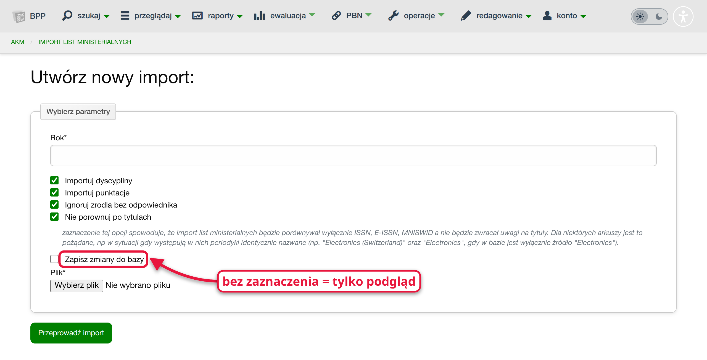

- Tu również **„Zapisz zmiany do bazy”** odznaczone = tylko podgląd.
- Dopasowanie idzie po ISSN, e-ISSN i **identyfikatorze czasopisma
  z wykazu** (przez źródła powiązane z PBN). Opcja „Nie porownuj po
  tytulach” jest tu **domyślnie zaznaczona**.
- „Importuj punktacje” zapisuje punkty w wierszu „Punktacja źródła” za
  podany rok; „Importuj dyscypliny” — dyscypliny czasopisma.

Punkty na prace przenosisz tak samo jak IF: zakładka **Punkty MNiSW** na
stronie rozbieżności (po zmianie punktów BPP przelicza też punkty
dyscyplin pracy).

W menu jest też starszy **import list IF** — wczytuje plik z kolumnami
tytułu czasopisma i IF (wzór: przycisk „pobierz plik wzorcowy”) i dopasowuje
czasopisma **wyłącznie po tytule**, bez podglądu. Do plików z JCR używaj
**importu punktacji źródeł**.

## Co może pójść nie tak {#co-moze-pojsc-nie-tak}

| Komunikat / objaw | Co zrobić |
|---|---|
| „Niewłaściwy format pliku. Dozwolone: .xlsx, .xls, .csv (otrzymano: …).” | Zapisz plik z JCR jako XLSX albo CSV. |
| Import kończy się błędem „Nie znaleziono wiersza nagłówka w pliku JCR” | W pliku nie ma wiersza z kolumnami „Journal name” i „JIF Quartile” — to nie jest eksport listy czasopism z JCR albo nagłówki zostały zmienione. |
| Import pliku `.xls` kończy się błędem | Formularz przyjmuje `.xls`, ale import odczytuje tylko `.xlsx` i `.csv` — zapisz plik ponownie jako `.xlsx`. |
| „Nie udało się ustalić roku (brak nagłówka i metadanych JCR).” | Kolumna IF nie nazywa się „RRRR JIF” i nad nagłówkiem nie ma „Selected JCR Year”. Wpisz rok w polu **Rok**. |
| „Rozmiar pliku … przekracza bezpieczny limit” | Plik jest za duży — podziel go na mniejsze. |
| Dużo wierszy „Brak źródła w BPP” | Patrz [Jak BPP dopasowuje czasopisma](#jak-bpp-dopasowuje-czasopisma). |
| „Najpierw wybierz jakieś źródło.” / „Uzupełnij pole 'Rok'” (formularz pracy) | Przyciski punktacji potrzebują wypełnionych pól „Źródło” i „Rok”. |
| „Brak danych o punktacji tego źródła dla wpisanego roku.” | Źródło nie ma wiersza „Punktacja źródła” za rok pracy — najpierw import albo ręczny wpis w źródle. |
| „Brak rekordów do aktualizacji.” | Przy obecnych filtrach nie ma rozbieżności — zmień lata albo tryb „Rekordy ze źródłem”. |
| „Źródło bez wartości za RRRR — zaznacz „kasuj…”, aby wyczyścić wartość w pracy.” | Przy rekordzie nie ma przycisku „ustaw wg źródła”, bo źródło nie ma wartości. Uzupełnij źródło albo zaznacz opcję kasowania. |
| Na liście rozbieżności nie ma monografii | Strona obejmuje tylko artykuły (wydawnictwa ciągłe) — monografie nie mają źródła z punktacją roczną. |

## Zobacz też

- [Edycja danych rekordów](wydawnictwa.md)
- [Sloty](sloty.md)
