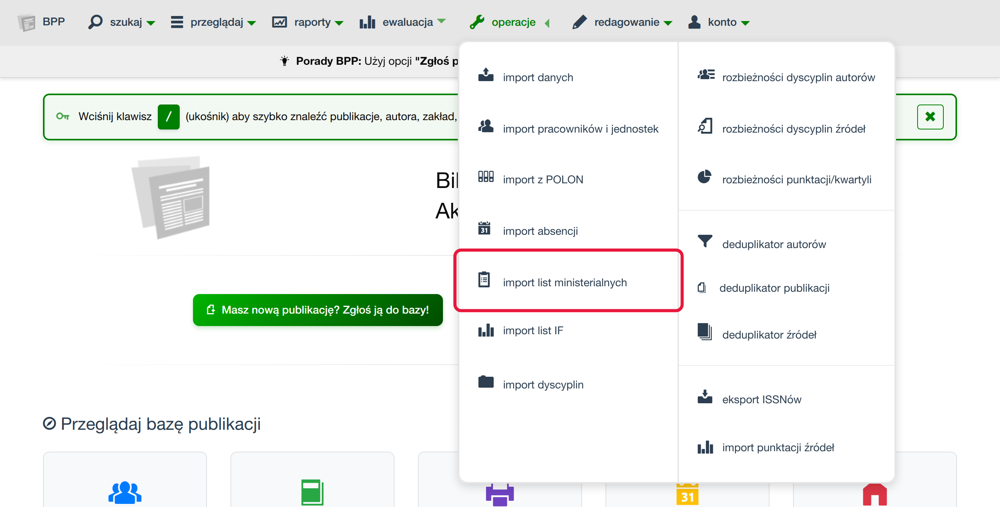
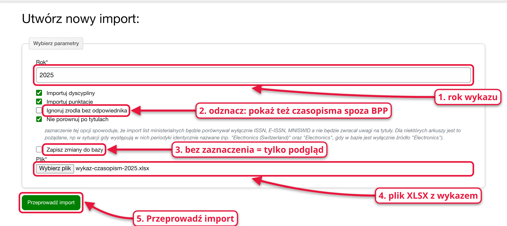
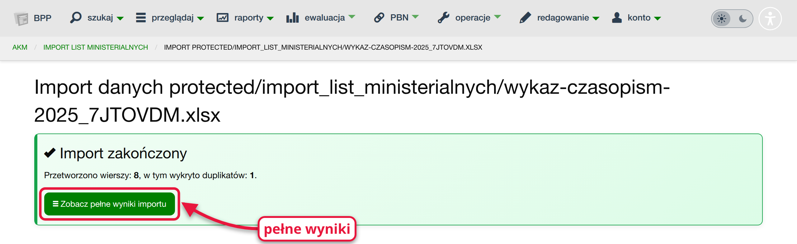
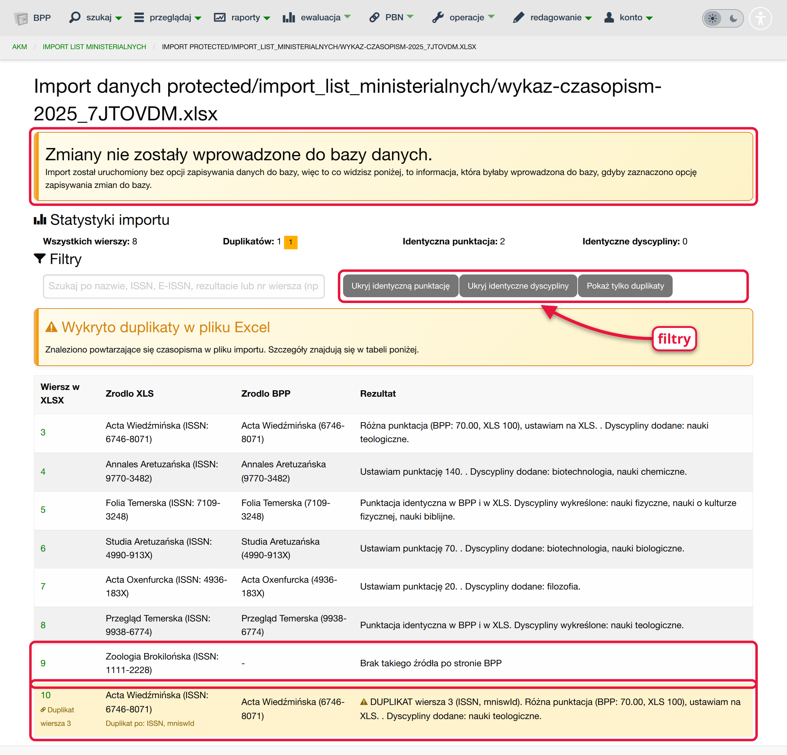
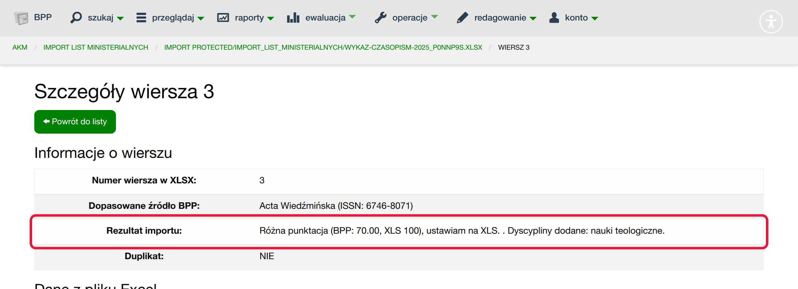
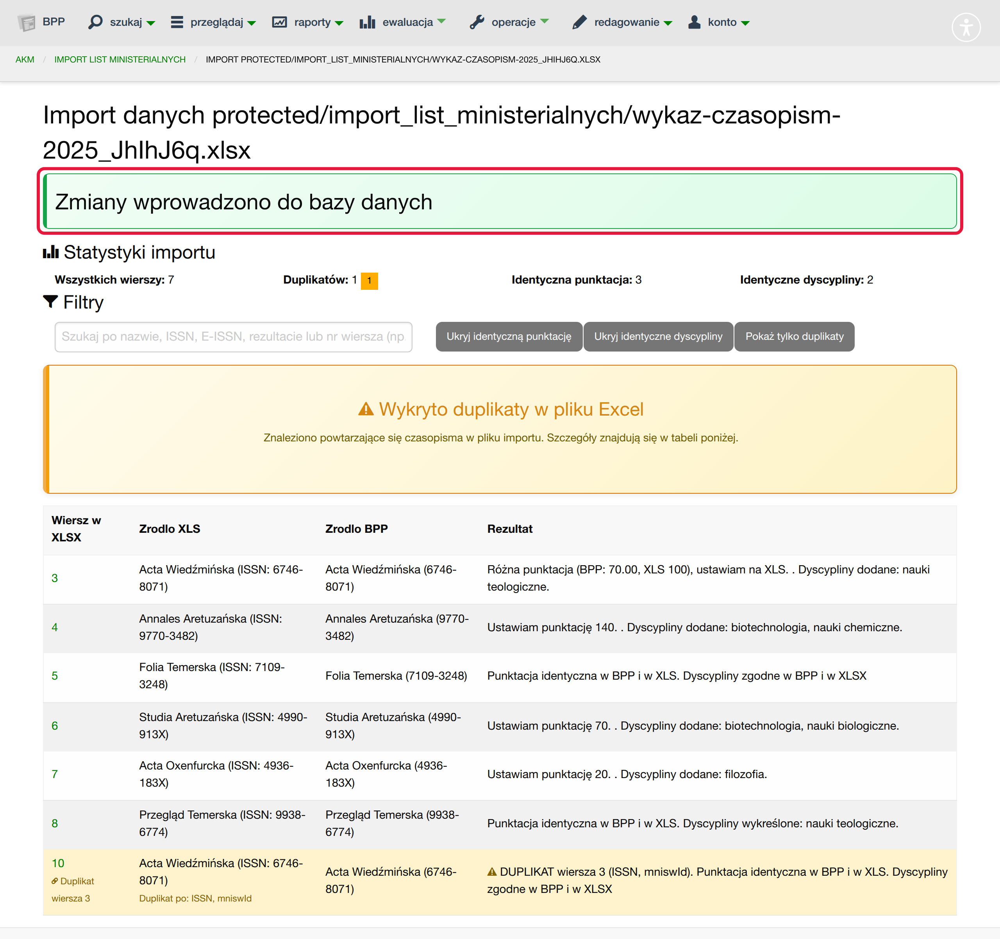
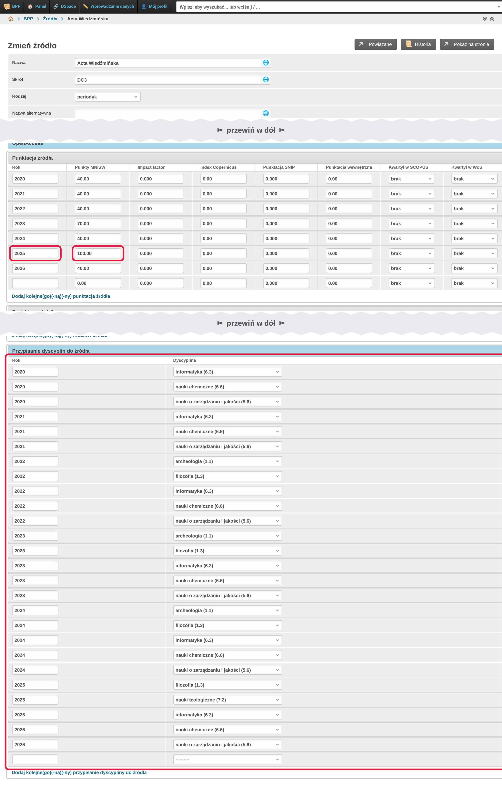
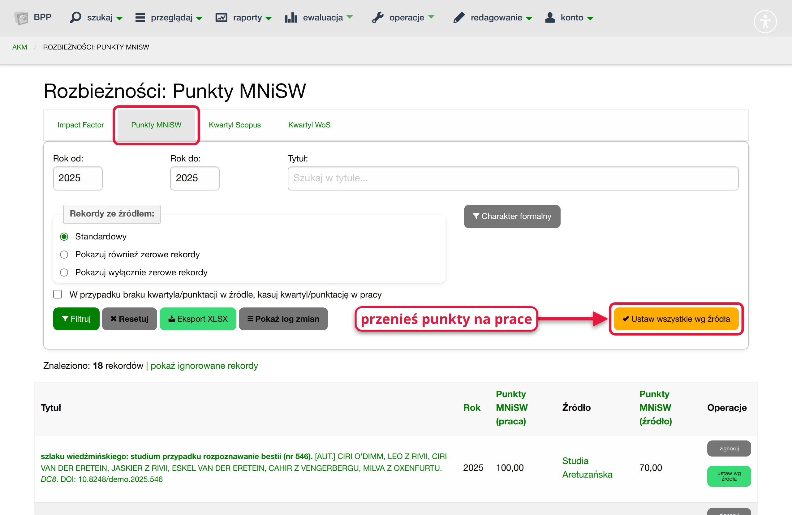
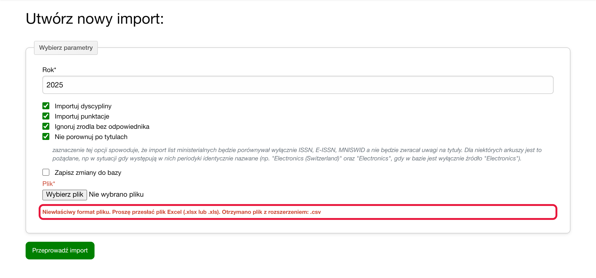
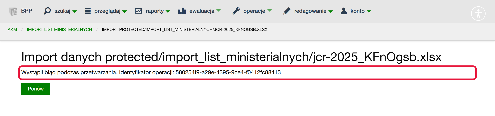

# Import list ministerialnych i punktacji czasopism

Instrukcja dla osób, które w bibliotece wprowadzają do BPP **wykaz
czasopism** ministerstwa: punkty MNiSW czasopism i przypisane do nich
dyscypliny na dany rok.

Po co to robić? Gdy redaktor wpisuje artykuł, BPP podpowiada punkty
z **punktacji źródła na rok pracy**. Od dyscyplin czasopisma zależy z kolei,
czy praca autora z daną dyscypliną „pasuje” do czasopisma — co liczy się
przy slotach i ewaluacji. Bez wczytanego wykazu przycisk „Uzupełnij
punktację” w nowej pracy nie ma czego podpowiedzieć.

Import zmienia dane **czasopism** (źródeł). Na **prace** już wpisane
przenosisz punkty osobnym krokiem — patrz
[krok 5](#krok-5-przenies-punkty-na-prace).

## Zanim zaczniesz {#zanim-zaczniesz}

**Uprawnienia.** Potrzebujesz konta w grupie **„wprowadzanie danych”** —
nadaje ją administrator BPP. Bez niej w górnym menu nie ma pozycji
**operacje**.

**Plik z wykazem.** Ministerstwo nauki publikuje wykaz czasopism
naukowych w formie komunikatu na swojej stronie internetowej; do komunikatu
dołączony jest arkusz **Excel**. Ten arkusz pobierz i wczytaj do BPP
**bez zmian** — nie usuwaj kolumn, nie zmieniaj nagłówków, nie scalaj ani nie
dziel wierszy nagłówka. BPP czyta plik tak:

- **dwa wiersze nagłówka**: w pierwszym nazwy dyscyplin, w drugim m.in.
  kolumny **„Tytuł 1”**, **„issn”**, **„e-issn”**, **„Tytuł 2”**, drugie
  **„issn”** i **„e-issn”**, **„Punktacja”** (albo „Punkty”) oraz
  **„Unikatowy Identyfikator Czasopisma”**,
- **pierwsze dziewięć kolumn** to dane czasopisma (Lp., identyfikator,
  tytuły, numery ISSN, punkty), a **każda następna kolumna** to jedna
  dyscyplina — **„x”** w komórce oznacza, że czasopismo ma przypisaną tę
  dyscyplinę,
- od trzeciego wiersza — po jednym czasopiśmie w wierszu.

Przyjmowane są tylko pliki **`.xlsx`** i **`.xls`**.

**Plik nie zawiera roku**, a ten sam wykaz obowiązuje zwykle przez kilka
lat. Rok podajesz w formularzu, więc wykaz obowiązujący np. w latach
2024–2025 wczytujesz **osobno dla każdego roku**.

**Wykaz wydawnictw** (poziomy wydawców książek) **nie** jest wczytywany
tym importem — poziom wydawcy na dany rok ustawia się w formularzu
wydawcy albo pobiera z PBN (patrz [Nowy rok w BPP](nowy-rok.md)).

!!! tip "Zawsze najpierw podgląd"
    Import ma tryb **podglądu**: pokazuje, co by zmienił, i niczego nie
    zapisuje. Najpierw uruchom go **bez** zaznaczenia „Zapisz zmiany do
    bazy”, przejrzyj wyniki, a dopiero potem powtórz z zapisem.

## Krok 1. Otwórz import {#krok-1-otworz-import}

W górnym menu wybierz **operacje** → **import list ministerialnych**.

Pojawi się lista Twoich wcześniejszych importów (każdy z datą i informacją
„zakończono pomyślnie” albo „zakończono z błędem”). Nowy import zaczynasz
przyciskiem **„utwórz nowy import”**. Przy pierwszym wejściu, gdy lista
jest pusta, BPP od razu przechodzi do formularza.

## Krok 2. Podgląd: wypełnij formularz {#krok-2-podglad}

1. **Rok** — rok, pod którym BPP zapisze punkty i dyscypliny czasopism
   (np. 2025). Pole jest obowiązkowe i nie ma wartości domyślnej.
2. Opcje (domyślnie zaznaczone są cztery pierwsze):
    - **Importuj dyscypliny** — porównuje i ustawia dyscypliny czasopism na
      podany rok,
    - **Importuj punktacje** — porównuje i ustawia punkty MNiSW czasopism na
      podany rok,
    - **Ignoruj zrodla bez odpowiednika** — czasopisma z wykazu, których nie
      ma w BPP, są **pomijane bez śladu** w wynikach. Przy podglądzie warto
      tę opcję **odznaczyć** — wtedy w wynikach zobaczysz także czasopisma,
      których BPP nie znalazło („Brak takiego źródła po stronie BPP”),
    - **Nie porownuj po tytulach** — dopasowanie tylko po numerach ISSN,
      e-ISSN i identyfikatorze czasopisma (patrz
      [Jak BPP dopasowuje czasopisma](#jak-bpp-dopasowuje-czasopisma)).
      Zostaw zaznaczone, chyba że wiesz, po co je zdjąć.
3. **Zapisz zmiany do bazy** — przy podglądzie **odznaczone**.
4. **Plik** — arkusz z wykazem.
5. Kliknij **„Przeprowadź import”**.

## Krok 3. Przejrzyj wyniki {#krok-3-wyniki}

Import działa w tle; strona sama pokazuje postęp. Po zakończeniu pojawia
się ramka **„Import zakończony”** z liczbą przetworzonych wierszy i
duplikatów. Kliknij **„Zobacz pełne wyniki importu”**.

Stronę wyników możesz zamknąć i wrócić do niej później z listy importów
(**operacje → import list ministerialnych**).

Na górze strony:

- żółta ramka **„Zmiany nie zostały wprowadzone do bazy danych.”** —
  to był podgląd; po imporcie z zapisem jest tu zielona ramka **„Zmiany
  wprowadzono do bazy danych”**,
- **Statystyki importu**: liczba wierszy w wynikach, duplikatów, wierszy
  z identyczną punktacją i z identycznymi dyscyplinami,
- **Filtry**: pole wyszukiwania (po nazwie, ISSN, E-ISSN, treści
  rezultatu albo numerach wierszy, np. `5,12,20`) i przyciski **„Ukryj
  identyczną punktację”**, **„Ukryj identyczne dyscypliny”**, **„Pokaż
  tylko duplikaty”**. Dwa pierwsze zostawiają na liście tylko to, co import
  zmienia.

W tabeli każdy wiersz pliku ma: numer wiersza w arkuszu, czasopismo z pliku,
dopasowane źródło w BPP i **Rezultat**. Możliwe rezultaty:

| Rezultat | Co znaczy |
|---|---|
| „Ustawiam punktację 140.” | Czasopismo nie ma w BPP punktów za ten rok — import je doda. |
| „Różna punktacja (BPP: 70.00, XLS 100), ustawiam na XLS.” | W BPP są inne punkty za ten rok — import zastąpi je wartością z pliku. |
| „Punktacja identyczna w BPP i w XLS” | Nic do zmiany. |
| „Dyscypliny dodane: …” | Dyscypliny z pliku, których czasopismo nie ma w BPP za ten rok. |
| „Dyscypliny wykreślone: …” | Dyscypliny, które czasopismo ma w BPP za ten rok, a których **nie ma w pliku** — import je **usunie**. |
| „Dyscypliny zgodne w BPP i w XLSX” | Nic do zmiany. |
| „Dyscyplina o nazwie '…' nie występuje w BPP.” | Nagłówek kolumny dyscypliny w pliku nie pasuje do żadnej nazwy w słowniku dyscyplin BPP — ta dyscyplina zostanie pominięta. |
| „Brak takiego źródła po stronie BPP” | BPP nie znalazło czasopisma (tylko gdy „Ignoruj zrodla bez odpowiednika” jest odznaczone). |
| „DUPLIKAT wiersza 3 (ISSN, mniswId). …” | To samo czasopismo jest w pliku drugi raz (ten sam ISSN, e-ISSN albo identyfikator) — wiersz jest podświetlony na żółto. |

!!! warning "„Dyscypliny wykreślone” naprawdę usuwa przypisania"
    Import doprowadza dyscypliny czasopisma **na podany rok** do stanu
    z pliku. Jeśli ktoś ręcznie dopisał czasopismu dyscyplinę spoza wykazu,
    import z zapisem ją usunie. Gdy chcesz zmienić tylko punkty, odznacz
    **Importuj dyscypliny**.

Duplikaty są przetwarzane tak samo jak pierwsze wystąpienie — jeśli oba
wiersze mają te same dane, nic złego się nie dzieje. Jeśli się różnią,
wygrywa **późniejszy** wiersz; sprawdź wtedy w wykazie, która wartość jest
właściwa.

Kliknięcie numeru wiersza otwiera **Szczegóły wiersza**: dopasowane źródło
BPP (z ISSN), rezultat, informację o duplikacie, wszystkie dane z pliku
i dane źródła w BPP.

## Co zrobić z czasopismami, których BPP nie znalazło {#niedopasowane}

Import **nigdy nie tworzy nowych źródeł**. Wykaz liczy kilkadziesiąt
tysięcy czasopism, a w BPP są tylko te, w których publikują autorzy
uczelni — dlatego większość wierszy wykazu nie ma odpowiednika i to jest
normalne. Zwykle wystarczy przejrzeć te, które **powinny** się dopasować
(czasopisma, w których publikują Twoi autorzy):

1. Wyszukaj czasopismo w BPP (**redagowanie** → **Źródło**) po nazwie.
2. Jeśli jest, a się nie dopasowało — sprawdź w formularzu źródła pola
   **ISSN** i **e-ISSN**: czy numer jest wpisany, czy w **dobrym polu**
   (drukowany w „ISSN”, elektroniczny w „e-ISSN”) i czy w tym samym
   zapisie co w wykazie (z myślnikiem, `1234-5678`).
3. Sprawdź, czy w BPP nie ma **dwóch źródeł z tym samym ISSN** — wtedy
   dopasowanie jest niejednoznaczne i BPP je pomija. Połącz duplikaty
   [deduplikatorem źródeł](duplikaty.md#deduplikator-zrodel).
4. Jeśli czasopisma w BPP nie ma, a jest potrzebne — dodaj źródło (z ISSN).
5. Uruchom podgląd ponownie.

Czasopisma, którego nie da się dopasować, możesz też uzupełnić ręcznie
w formularzu źródła (patrz [krok 4](#krok-4-zapisz)).

## Krok 4. Import z zapisem {#krok-4-zapisz}

Gdy podgląd się zgadza, otwórz formularz jeszcze raz (**„utwórz nowy
import”**), wypełnij go tak samo, wskaż **ten sam plik** i tym razem
zaznacz **„Zapisz zmiany do bazy”**. Opcję „Ignoruj zrodla bez
odpowiednika” możesz zostawić zaznaczoną — wyniki będą krótsze.
W tym module nie ma przycisku „zatwierdź podgląd”: zapis to po prostu
nowy import z zaznaczoną opcją.

Po zakończeniu na stronie wyników zobaczysz zieloną ramkę **„Zmiany
wprowadzono do bazy danych”**:

Wartości trafiają do formularza źródła (**redagowanie** → **Źródło** →
czasopismo):

- punkty — sekcja **„Punktacja źródła”**, wiersz z podanym **Rokiem**,
  kolumna **„Punkty MNiSW”** (pozostałe kolumny, np. Impact Factor,
  import zostawia bez zmian; nowy wiersz dostaje w nich zera),
- dyscypliny — sekcja **„Przypisanie dyscyplin do źródła”** (domyślnie
  zwinięta; kliknij nagłówek, żeby ją rozwinąć).

Tu też możesz ręcznie poprawić pojedyncze czasopismo — opis w
[Nowy rok w BPP](nowy-rok.md).

Import można powtarzać — np. po korekcie wykazu przez ministerstwo wczytaj
nowy plik na ten sam rok: BPP porówna dane i zmieni tylko to, co się
różni.

## Krok 5. Przenieś punkty na prace {#krok-5-przenies-punkty-na-prace}

Import **nie zmienia punktów w pracach** i nie przelicza ich punktów
dyscyplin. Praca ma własną kopię punktów, zapisaną w chwili wprowadzania
(przyciskiem „Uzupełnij punktację”, importem publikacji albo ręcznie).

Żeby przenieść nowe punkty czasopism na wpisane już artykuły:

1. Menu **operacje** → **rozbieżności punktacji/kwartyli**, zakładka
   **Punkty MNiSW**.
2. Ustaw **Rok od / Rok do** na rok wykazu. Lista pokazuje artykuły, w
   których punkty pracy różnią się od punktów czasopisma za rok pracy.
3. Przenieś punkty pojedynczo (**„ustaw wg źródła”**) albo wszystkie
   naraz (**„Ustaw wszystkie wg źródła”**).

Po zmianie punktów tą drogą BPP przelicza też punkty dyscyplin pracy.
Szczegóły strony rozbieżności (ignorowanie rekordów, tryby z zerowymi
wartościami, log zmian):
[Impact Factor i punktacja — krok 4b](impact-factor-i-punktacja.md#krok-4b).

Po zmianie dyscyplin czasopism warto zajrzeć też do **operacje →
rozbieżności dyscyplin źródeł** — lista prac, w których dyscyplina autora
nie należy do dyscyplin czasopisma.

## Jak BPP dopasowuje czasopisma {#jak-bpp-dopasowuje-czasopisma}

Dla każdego wiersza wykazu, kolejno:

1. **ISSN** z pliku porównywany z polem **ISSN** źródła, potem **e-ISSN**
   z pliku z polem **e-ISSN** źródła. Numer musi być zapisany identycznie
   i wskazywać **dokładnie jedno** źródło. Drugą parę numerów (przy
   „Tytuł 2”) BPP bierze tylko wtedy, gdy pierwsza jest pusta.
2. **Identyfikator czasopisma** z wykazu („Unikatowy Identyfikator
   Czasopisma”) — działa dla źródeł powiązanych z czasopismem w PBN, gdy
   BPP ma pobrane dane czasopism z PBN.
3. **Tytuł** z kolumny „Tytuł 1” (gdy pusta — z „Tytuł 2”) porównywany z nazwą źródła (bez
   rozróżniania wielkości liter, bez skrótów i bez dopasowania
   przybliżonego); przy kilku źródłach o tej samej nazwie rozstrzyga ISSN.
   Ten krok działa **tylko** przy odznaczonym „Nie porownuj po tytulach”.

Dlaczego dopasowanie po tytułach jest domyślnie wyłączone: w wykazie są
czasopisma o identycznych albo prawie identycznych tytułach (np. ta sama
nazwa z dopiskiem kraju w nawiasie), więc tytuł mógłby przypisać punkty
innego czasopisma. Jeśli je włączasz, sprawdź w podglądzie kolumnę
„Zrodlo BPP” wiersz po wierszu.

## Co może pójść nie tak {#co-moze-pojsc-nie-tak}

**Plik w złym formacie.** Gdy wskażesz plik z innym rozszerzeniem niż
`.xlsx` / `.xls`, formularz go nie przyjmie:

**Plik Excel o innym układzie** (np. eksport z JCR, wykaz z usuniętymi
albo przemianowanymi kolumnami, plik „naprawiony” w arkuszu) — import
kończy się błędem bez dalszych szczegółów:

Przycisk **„Ponów”** uruchamia import jeszcze raz na **tym samym** pliku,
więc pomoże tylko przy chwilowej awarii. Przy złym pliku pobierz wykaz
jeszcze raz ze strony ministerstwa i wczytaj go bez zmian. Jeśli błąd
się powtarza na oryginalnym pliku, przekaż administratorowi BPP
**identyfikator operacji** z komunikatu.

| Objaw | Przyczyna i co zrobić |
|---|---|
| „Niewłaściwy format pliku. Proszę przesłać plik Excel (.xlsx lub .xls). Otrzymano plik z rozszerzeniem: …” | Wskazano plik CSV, PDF itp. Wczytaj arkusz Excel z komunikatu ministerstwa. |
| „Wystąpił błąd podczas przetwarzania. Identyfikator operacji: …” | Plik ma inny układ niż wykaz (brak kolumn „Tytuł 1”, „issn”, „e-issn”, „Punktacja”…), nie jest prawdziwym plikiem Excel (np. zmieniono samo rozszerzenie) albo jest uszkodzony. Patrz wyżej. |
| „Import zakończony”, ale „Przetworzono wierszy: 0” | BPP nie dopasowało żadnego czasopisma, a „Ignoruj zrodla bez odpowiednika” było zaznaczone — powtórz podgląd z tą opcją odznaczoną, żeby zobaczyć, co się nie dopasowało. To samo widać, gdy plik ma za mało wierszy (np. sam nagłówek). |
| Dużo „Brak takiego źródła po stronie BPP” | Normalne dla wykazu — patrz [Co zrobić z czasopismami, których BPP nie znalazło](#niedopasowane). |
| „Dyscyplina o nazwie '…' nie występuje w BPP.” | Nazwa dyscypliny w nagłówku pliku różni się od nazwy w słowniku dyscyplin BPP. Zgłoś administratorowi, który z nich wymaga poprawki. |
| Po imporcie prace mają stare punkty | Import zmienia tylko czasopisma — wykonaj [krok 5](#krok-5-przenies-punkty-na-prace). |
| „Uzupełnij punktację” w pracy pokazuje „Brak danych o punktacji tego źródła dla wpisanego roku.” | Czasopismo nie ma punktacji za rok pracy — wykaz nie był wczytany na ten rok albo czasopismo się nie dopasowało. |
| Zniknęła dyscyplina czasopisma | Import z zaznaczonym „Importuj dyscypliny” usuwa dyscypliny spoza pliku („Dyscypliny wykreślone”). Dopisz ją ręcznie w formularzu źródła, jeśli była potrzebna. |
| Na liście importów nie widać importu kolegi | Lista pokazuje tylko importy zalogowanego użytkownika. |

## Zobacz też

- [Nowy rok w BPP](nowy-rok.md) — lista kontrolna danych na nowy rok,
  w tym punktacja i dyscypliny czasopism, poziomy wydawców i dyscypliny
  autorów.
- [Impact Factor i punktacja](impact-factor-i-punktacja.md) — import IF
  i kwartyli z JCR (**import punktacji źródeł**) oraz przenoszenie wartości
  na prace.
- [Duplikaty autorów i źródeł](duplikaty.md) — gdy czasopismo nie
  dopasowuje się przez zdublowane źródła.
- [Import z POL-on i liczba N](import-polon-liczba-n.md) — dyscypliny
  **autorów** (menu **import dyscyplin** w tym samym menu też dotyczy
  autorów, nie czasopism).
