# Import danych z POL-on i liczba N

Instrukcja dla osób, które w bibliotece albo w zespole ds. ewaluacji
przygotowują dane do ewaluacji 2022–2025. Opisuje, jak wczytać do BPP
zestawienie pracowników z systemu POL-on (kto jest w liczbie N, w jakiej
dyscyplinie, na jakim etacie), a potem **policzyć liczbę N** dla
każdej dyscypliny.

Po co to robić? Od przypisań z POL-on zależy, komu BPP liczy sloty, w jakiej
dyscyplinie i ile prac może pójść do ewaluacji. Bez aktualnego importu
raporty slotów i optymalizacja pracują na nieaktualnych danych.

## Zanim zaczniesz {#zanim-zaczniesz}

**Uprawnienia.** Potrzebujesz konta w grupie **„wprowadzanie danych”** —
nadaje ją administrator BPP. Bez niej w górnym menu nie ma pozycji
**operacje**, a w menu **ewaluacja** brakuje pozycji **liczba N**.

**Plik z POL-on.** W POL-on wygeneruj raport **„Rozszerzone zestawienie
pracowników podmiotu (na wybrany dzień)”** i zapisz go jako plik **Excel
(.xlsx)**. BPP przyjmuje też `.xls` i `.csv`, ale najmniej kłopotów jest
z `.xlsx` prosto z POL-on. Nie zmieniaj w pliku nazw kolumn —
BPP sprawdza, czy są w nim m.in. kolumny `NAZWISKO`, `IMIE`, `ZATRUDNIENIE`,
`OSWIADCZENIE_N`, `DYSCYPLINA_N`, `WIELKOSC_ETATU_PREZENTACJA_DZIESIETNA`.

**Plik nie zawiera roku.** Rok podajesz w formularzu importu. Do ewaluacji
2022–2025 import robi się więc **cztery razy** — osobno dla 2022, 2023, 2024
i 2025. Najlepiej z czterech zestawień wygenerowanych w POL-on na **31 grudnia**
każdego roku (dla roku bieżącego — na dzień dzisiejszy). Ten sam plik
zaimportowany dla czterech lat oznacza „wszyscy pracowali tak samo przez
cały okres”.

**Kolejność, gdy zmienili się ludzie albo jednostki.** Jeśli od ostatniego
razu doszli nowi pracownicy, ktoś odszedł albo zmieniła się struktura
uczelni, najpierw:

1. uzupełnij jednostki i autorów w BPP (nowa osoba musi mieć w BPP rekord
   autora — import z POL-on **nie tworzy** nowych autorów),
2. uruchom **operacje → import pracowników i jednostek**, żeby ustawić
   aktualne miejsca pracy (opis: [Import pracowników](../administrator/import-pracownikow.md)),
3. dopiero potem importuj dane z POL-on i licz liczbę N.

Kolejność ma znaczenie: liczba N bierze pod uwagę tylko osoby, których
**aktualna jednostka** w BPP należy do uczelni (i jest jednostką
zatrudniającą pracowników, a nie np. „Obcą jednostką”).

## Import z POL-on krok po kroku {#import-krok-po-kroku}

1. W górnym menu wybierz **operacje** → **import z POLON**.

    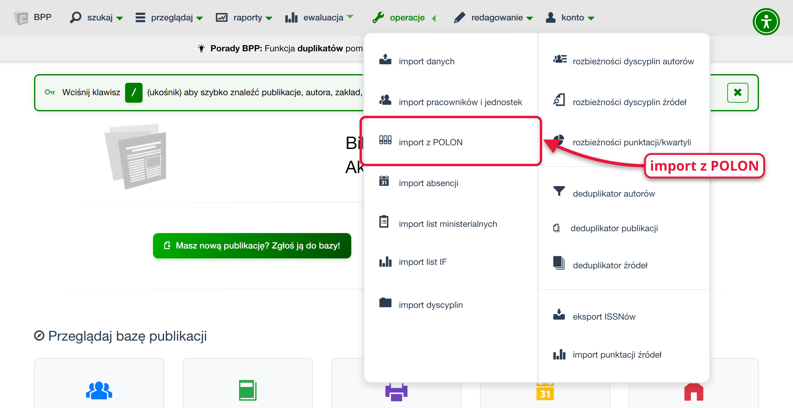

    Pojawi się lista ostatnich importów (przy pierwszym wejściu od razu
    formularz). Nowy import zaczynasz przyciskiem **„utwórz nowy import”**.

2. Wypełnij formularz:

    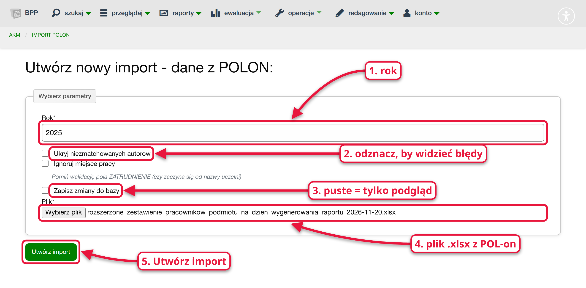

    - **Rok** — rok, którego dotyczą dane (np. 2025).
    - **Ukryj niezmatchowanych autorow** — domyślnie zaznaczone: osoby
      z pliku, których BPP nie rozpoznał, nie pojawią się w wynikach.
      **Odznacz** przy pierwszym imporcie, żeby zobaczyć, kogo brakuje
      w BPP.
    - **Ignoruj miejsce pracy** — zostaw puste. Po zaznaczeniu BPP przestaje
      sprawdzać, czy kolumna `ZATRUDNIENIE` zaczyna się od nazwy Twojej
      uczelni (przydaje się, gdy nazwa uczelni w BPP różni się od tej
      w POL-on).
    - **Zapisz zmiany do bazy** — **domyślnie wyłączone i tak zostaw za
      pierwszym razem.** Bez tej opcji import jest tylko **podglądem**:
      pokazuje, co by zmienił, ale niczego nie zapisuje. To najczęstsza
      pomyłka — import „przeszedł”, a w bazie nic się nie zmieniło.
    - **Plik** — zestawienie z POL-on.
    - **Hasło do pliku** — zostaw puste, chyba że plik Excel jest
      zabezpieczony hasłem (patrz [Plik zabezpieczony hasłem](#plik-z-haslem)).

    Kliknij **„Utwórz import”**.

3. Import działa w tle — widać pasek postępu. Możesz zamknąć stronę
   i wrócić później: import będzie na liście w **operacje → import z
   POLON**. Po zakończeniu pojawi się panel **„Import z POLON
   zakończony”**.

    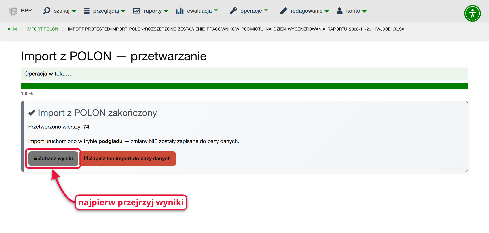

    Najpierw kliknij **„Zobacz wyniki”**.

4. Na stronie wyników żółta ramka **„Zmiany nie zostały wprowadzone do bazy
   danych.”** przypomina, że to podgląd. Niżej są: lista osób spoza pliku
   (krok 7) i **Filtry**.

    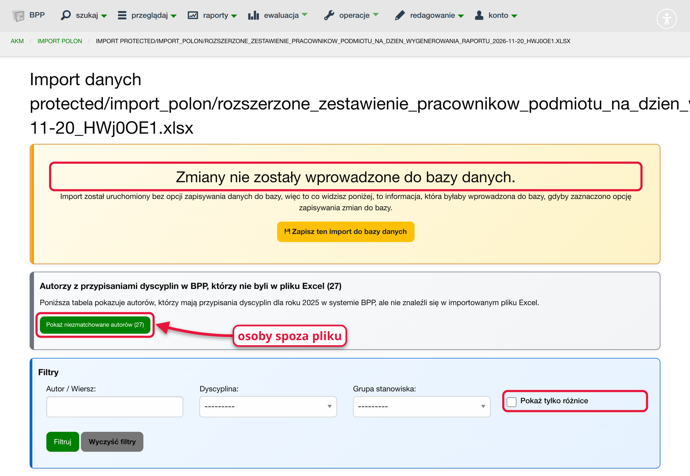

5. Zaznacz **„Pokaż tylko różnice”** — znikną wiersze z komunikatem
   „W BPP jest identycznie jak w XLSX”, zostaną tylko te, które import
   by zmienił. Najważniejsza jest ostatnia kolumna, **„Rezultat importu”**.

    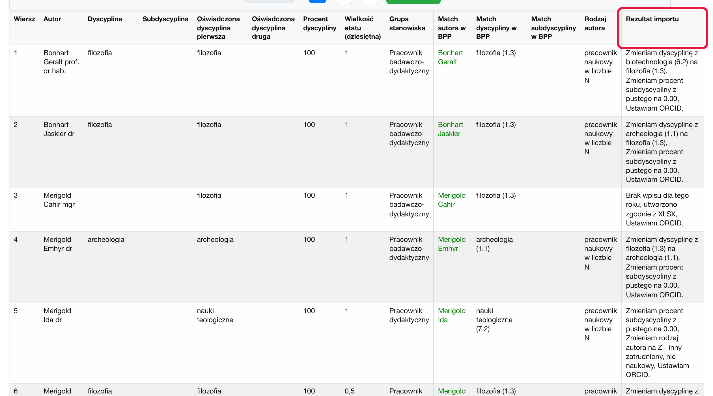

    Najczęstsze komunikaty:

    | Komunikat | Co znaczy |
    |---|---|
    | W BPP jest identycznie jak w XLSX | nic do zmiany |
    | Brak wpisu dla tego roku, utworzono zgodnie z XLSX | osoba nie miała w BPP dyscypliny na ten rok — zostanie dopisana |
    | Zmieniam dyscyplinę z … na … | inna dyscyplina niż w BPP |
    | Zmieniam procent dyscypliny / subdyscypliny z … na … | inny podział między dwie dyscypliny |
    | Zmieniam wymiar etatu z … na … | inny etat |
    | Zmieniam rodzaj autora na … | zmiana N / B / Z (jak system decyduje — [Obliczanie slotów](sloty.md#jak-system-decyduje-o-rodzaju-autora-podczas-importu-z-polon)) |
    | Usuwam wpis dyscypliny dla autora (brak dyscyplin w XLS) | w pliku osoba nie ma żadnej dyscypliny — przypisanie na ten rok zostanie usunięte |
    | Ustawiam ORCID. | BPP nie znał ORCID osoby — zostanie wpisany z pliku |
    | POTENCJALNY PROBLEM. … Proszę zweryfikować manualnie. | plik usuwa dyscyplinę, ale zostawia drugą — BPP tego nie zmieni, popraw ręcznie |

    Filtry **Dyscyplina** i **Grupa stanowiska** zawężają tabelę, a pole
    **Autor / Wiersz** szuka po nazwisku, imieniu, numerze wiersza pliku
    albo fragmencie komunikatu (np. „Nie udało” pokaże błędy dopasowania).
    Nazwisko w kolumnie **„Match autora w BPP”** prowadzi do strony autora.

6. Przejrzyj wiersze z błędami (opis każdego komunikatu: [Co może pójść
   nie tak](#co-moze-pojsc-nie-tak)). Takie wiersze import **pomija** — nie
   zmieni danych tej osoby, nawet przy zapisie do bazy.

    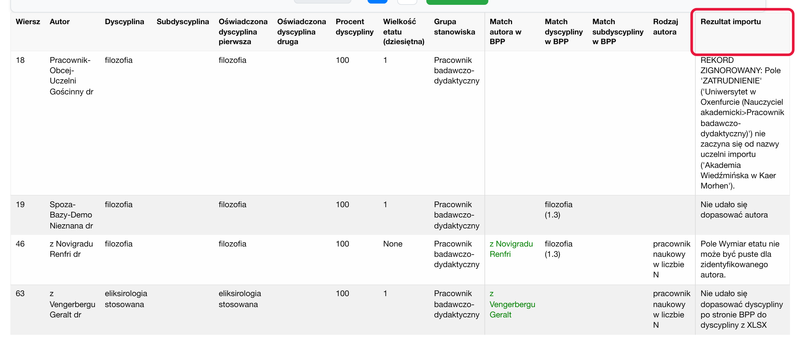

7. Kliknij **„Pokaż niezmatchowane autorów”**. Tabela **„Autorzy
   z przypisaniami dyscyplin w BPP, którzy nie byli w pliku Excel”** to
   osoby, które w BPP mają dyscyplinę na ten rok, a w zestawieniu z POL-on ich
   nie ma — zwykle ci, którzy odeszli albo przestali być w liczbie N.

    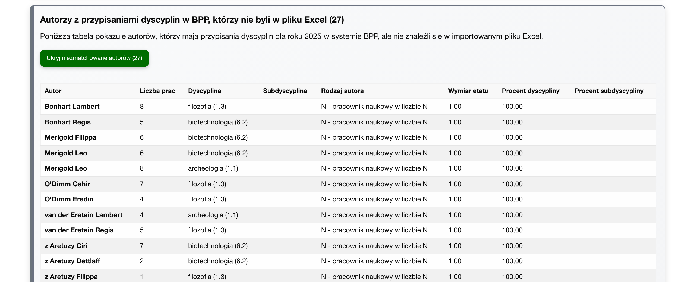

    **Import ich nie rusza** — także przy zapisie do bazy. Sprawdź każdą
    osobę: jeśli rzeczywiście nie powinna mieć dyscypliny w tym roku, usuń
    jej przypisanie na ten rok w redagowaniu autora (tabela dyscyplin na
    stronie autora, wiersz z tym rokiem). Jeśli powinna —
    zwykle oznacza to, że w POL-on brakuje oświadczenia albo BPP nie dopasował
    osoby z pliku (patrz krok 6). Te osoby nadal liczą się do liczby N, więc
    pominięcie tego kroku zawyża wynik.

8. Gdy wyniki się zgadzają, kliknij **„Zapisz ten import do bazy danych”**
   (na panelu z kroku 3 albo w żółtej ramce na stronie wyników). BPP zapyta
   o potwierdzenie:

    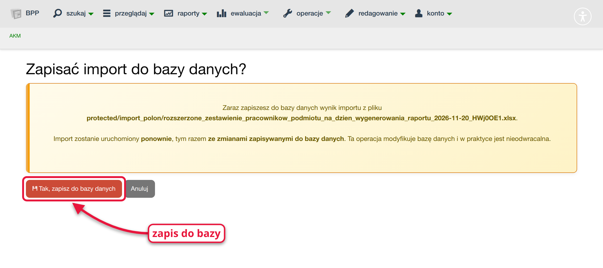

    Kliknij **„Tak, zapisz do bazy danych”**. Import uruchomi się
    **ponownie**, tym razem zapisując zmiany. Nie trzeba wgrywać pliku
    drugi raz. Zapisu nie da się cofnąć jednym kliknięciem — stąd podgląd.

9. Powtórz kroki 2–8 dla pozostałych lat. Gdy podgląd już raz przejrzałeś,
   kolejne lata możesz importować od razu z zaznaczonym **„Zapisz zmiany do
   bazy”**.

    Lista w **operacje → import z POLON** pokazuje ostatnie 10 importów
    i ich podsumowanie: ile wierszy miał plik, ile było z Twojej uczelni,
    ile dopasowano, ile zmian, ile błędów i ile osób „do odpięcia” (spoza
    pliku). Kolumna **Status** mówi, czy import był **podglądem**, czy został
    **zapisany do bazy**. Najedź na nagłówek kolumny, żeby zobaczyć jej
    definicję.

    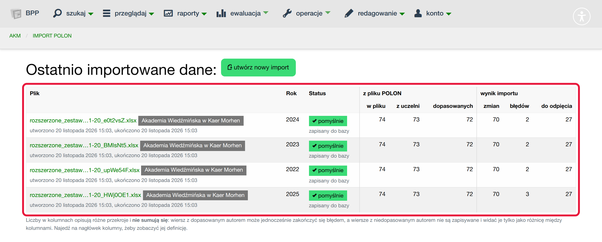

## Liczba N {#liczba-n}

1. Menu **ewaluacja** → **liczba N**.

    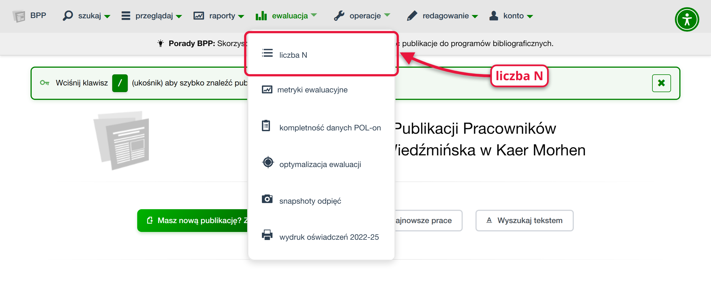

2. Kliknij **„Oblicz liczbę N”**. Po chwili pojawi się komunikat
   „Pomyślnie obliczono liczbę N dla ewaluacji 2022-2025”. Wynik jest
   zapamiętany — nie trzeba liczyć przy każdym wejściu, ale **trzeba
   przeliczyć po każdej zmianie danych** (patrz niżej).

    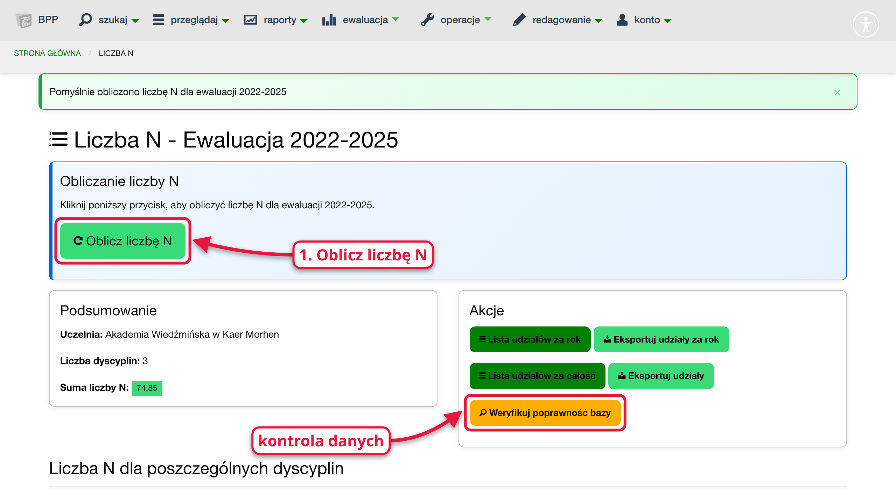

3. Niżej jest tabela **„Liczba N dla poszczególnych dyscyplin”**
   i — jeśli są — **„Dyscypliny nieraportowane”**.

    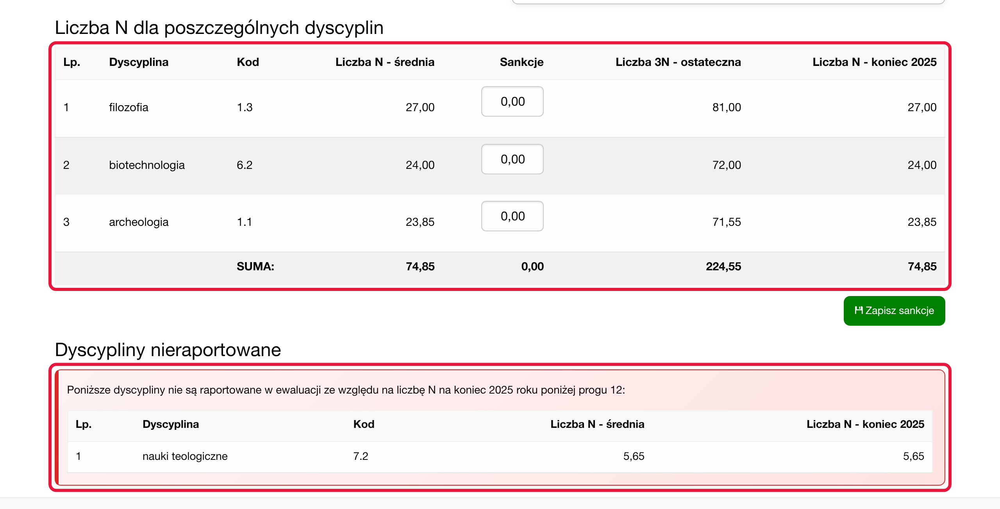

    - **Liczba N - średnia** — średnia z lat 2022–2025: dla każdego roku
      suma etatów osób typu N w dyscyplinie (etat × procent dyscypliny),
      podzielona przez 4.
    - **Sankcje** i **Liczba 3N - ostateczna** — jeśli uczelnia ma sankcje
      zmniejszające limit, wpisz je w polu i kliknij **„Zapisz sankcje”**;
      „Liczba 3N - ostateczna” to 3 × liczba N minus sankcje (limit
      slotów, z którego korzysta optymalizacja). Sankcje przetrwają
      przeliczenie liczby N.
    - **Liczba N - koniec 2025** — wartość dla samego 2025 roku.
    - **Dyscypliny nieraportowane** — dyscypliny, w których liczba N na
      koniec 2025 jest **mniejsza niż 12**. Nie są wykazywane w ewaluacji
      i nie wchodzą do sumy. Osobom z dwiema dyscyplinami, z których jedna
      jest nieraportowana, BPP dolicza do tej drugiej dodatkowy slot (do
      limitu 4).

4. Przyciski w ramce **Akcje**:

    - **Lista udziałów za rok** / **Eksportuj udziały za rok** — kto i ile
      wnosi do liczby N w poszczególnych latach (na ekran albo do Excela),
    - **Lista udziałów za całość** / **Eksportuj udziały** — to samo za cały
      okres 2022–2025,
    - **Weryfikuj poprawność bazy** — kontrola danych, które psują wynik:
      liczba przypisań według rodzaju pracownika (N, B, Z, D, brak danych),
      przypisania bez wymiaru etatu, bez procentu dyscypliny, z sumą
      procentów różną od 100% i osoby, których obie dyscypliny są
      nieraportowane. Część braków można poprawić od razu na tej stronie
      (np. ustawić brakujący wymiar etatu albo rodzaj autora). Po
      poprawkach wróć i kliknij **„Oblicz liczbę N”** jeszcze raz.

## Liczba N w BPP a SEDN {#liczba-n-a-sedn}

Liczba N z BPP służy do planowania (sloty, optymalizacja) i powinna być
**bliska** tej, którą pokaże SEDN, ale nie zawsze jest identyczna.
Najczęstsze przyczyny różnic:

- **Osoby spoza pliku** (krok 7 importu) nadal mają w BPP dyscyplinę
  i liczą się do liczby N, dopóki nie usuniesz ich przypisań.
- **Jeden plik dla kilku lat** — jeśli zaimportowałeś to samo zestawienie
  dla 2022–2025, BPP przyjmuje ten sam stan zatrudnienia dla każdego roku.
  POL-on/SEDN rozróżnia, kto pracował w którym roku.
- **Osoby, które odeszły** — BPP liczy tylko autorów, których **aktualna
  jednostka** należy do uczelni. Kto zmienił miejsce pracy (np. trafił do
  „Obcej jednostki” po imporcie pracowników), wypada z liczby N **także za
  lata, w których jeszcze pracował**.
- **Wiersze z błędami** (niedopasowany autor, nieznana dyscyplina, pusty
  etat) — te osoby nie mają aktualnych danych w BPP.
- **Zmiany po stronie POL-on** — nowe oświadczenia, korekty etatów, które
  zrobiono w POL-on po eksporcie pliku.

Pełne omówienie, z przykładami i zrzutami, jest w artykule
[Liczba N — najczęstsze pytania](liczba-n-faq.md).

**Kiedy przeliczyć liczbę N:** po każdym zapisanym imporcie z POL-on, po
imporcie pracowników i jednostek, po ręcznej zmianie dyscyplin, etatów albo
rodzaju autora i po poprawkach z **„Weryfikuj poprawność bazy”**. BPP nie
przelicza liczby N samodzielnie.

## Co może pójść nie tak {#co-moze-pojsc-nie-tak}

**Import „przeszedł”, a w bazie nic się nie zmieniło.** Import był
podglądem — nie zaznaczono **„Zapisz zmiany do bazy”**. Na liście importów
w kolumnie **Status** jest wtedy „podgląd”. Otwórz wyniki i kliknij
**„Zapisz ten import do bazy danych”**.

**„Plik nie zawiera wymaganych nagłówków. Brakujące nagłówki: …”** — to
nie jest „Rozszerzone zestawienie pracowników podmiotu” albo zmieniono
w nim nazwy kolumn. Wygeneruj raport w POL-on jeszcze raz i wgraj bez
zmian.

**„Niewłaściwy format pliku. Proszę przesłać plik Excel (.xlsx, .xls) lub CSV
(.csv).”** — wgrano plik o innym rozszerzeniu (np. PDF albo `.ods`).

**„Plik jest zabezpieczony hasłem. …”**{#plik-z-haslem} — plik zapisano
w Excelu z hasłem (**Plik → Informacje → Chroń skoroszyt → Zaszyfruj przy
użyciu hasła**). Masz dwie możliwości:

- wpisz hasło w polu **„Hasło do pliku”** i wgraj plik ponownie — BPP
  odszyfruje go przy wgrywaniu; samo hasło nie jest nigdzie zapisywane,
- albo otwórz plik w Excelu, wejdź w **Plik → Informacje → Chroń skoroszyt →
  Zaszyfruj przy użyciu hasła**, wyczyść pole hasła, zapisz plik i wgraj go
  ponownie.

**Plik z hasłem nie zostaje na serwerze.** Ze względów bezpieczeństwa danych
BPP usuwa plik zabezpieczony hasłem z serwera zaraz po przetworzeniu importu —
także po podglądzie i także wtedy, gdy import zakończył się błędem — a hasła
nigdzie nie zapisuje. Dlatego przy pliku z hasłem **podgląd i zapis do bazy to
dwa osobne importy**:

1. utwórz import **bez** „Zapisz zmiany do bazy”, wpisz hasło i obejrzyj
   podgląd,
2. jeśli wszystko się zgadza, utwórz **nowy** import, tym razem
   z zaznaczonym **„Zapisz zmiany do bazy”**, i wpisz hasło ponownie.

Przycisku **„Zapisz ten import do bazy danych”** przy takim podglądzie nie
ma. W jego miejscu jest wyjaśnienie: ze względów bezpieczeństwa danych plik
został usunięty z serwera, a hasło nie zostało nigdzie zapisane, więc tego
importu nie można zapisać do bazy ani uruchomić ponownie — trzeba utworzyć
nowy import z zaznaczonym „Zapisz zmiany do bazy” i ponownie wpisać hasło. Na liście importów zamiast nazwy pliku widać
„(plik zabezpieczony hasłem — usunięty po przetworzeniu)”. Jeśli wolisz
zwykły tryb (podgląd i zapis jednym kliknięciem), zdejmij hasło w Excelu
przed wgraniem.

Jeśli import z takim plikiem w ogóle nie wystartuje (np. anulujesz go, zanim
ruszy), plik i tak zostanie usunięty — BPP co 15 minut sprząta pliki z hasłem
zakończonych importów (także anulowanych). Plik niezakończonego importu usuwa,
gdy od utworzenia importu minęła ponad doba oraz import jeszcze się nie
rozpoczął lub od jego rozpoczęcia również minęła ponad doba.

Plik zabezpieczony hasłem może mieć najwyżej **10 MB** (zwykły plik — 100 MB):
odszyfrowanie odbywa się w pamięci serwera. Większy plik trzeba wgrać po
zdjęciu hasła w Excelu. Uszkodzony plik z hasłem kończy się komunikatem
„Nie udało się odszyfrować pliku — plik jest uszkodzony albo ten rodzaj
zabezpieczenia nie jest obsługiwany …”.

Złe hasło kończy się komunikatem **„Nieprawidłowe hasło do pliku.”**. Jeśli
plik nie ma hasła, wpisane hasło jest po prostu pomijane. Tak samo działa
formularz importu absencji. Inne importy (np. import pracowników) nie mają
pola na hasło — pokażą komunikat, że plik jest zabezpieczony hasłem, i trzeba
zdjąć hasło w Excelu.

**„REKORD ZIGNOROWANY: Pole 'ZATRUDNIENIE' (…) nie zaczyna się od nazwy
uczelni importu (…).”** — osoba jest zatrudniona w innej uczelni (w pliku
bywają osoby z dodatkowym zatrudnieniem gdzie indziej). To poprawne
zachowanie. Jeśli tak oznaczone są **wszystkie** wiersze, nazwa uczelni
w BPP różni się od tej w POL-on — poproś administratora o poprawienie nazwy
albo zaznacz **„Ignoruj miejsce pracy”**.

**„REKORD ZIGNOROWANY: Dopasowany autor (…) jest zatrudniony w innej uczelni
niż uczelnia importu …”** — dotyczy BPP obsługującego kilka uczelni: osoba
z pliku pasuje do autora innej uczelni, więc import jej nie dotyka.

**„Nie udało się dopasować autora”** — w BPP nie ma takiej osoby albo
BPP nie potrafi jej jednoznacznie wskazać (np. dwie osoby o tym samym
imieniu i nazwisku). BPP szuka najpierw po identyfikatorach (ORCID,
identyfikator osoby w PBN), potem po imieniu i nazwisku, a imienników
rozróżnia tytułem naukowym. Dodaj brakującego autora albo uzupełnij ORCID /
identyfikator PBN w rekordzie autora i powtórz import. (Ten wiersz widać
tylko przy odznaczonym **„Ukryj niezmatchowanych autorow”** — inaczej osoba
po cichu znika z wyników.)

**„Nie udało się dopasować dyscypliny po stronie BPP do dyscypliny z XLSX”**
(albo „…subdyscypliny…”) — nazwa dyscypliny z pliku nie występuje w słowniku
dyscyplin BPP. Sprawdź pisownię w pliku; jeśli dyscypliny brakuje w BPP,
poproś administratora o jej dodanie.

**„Pole Wymiar etatu nie może być puste dla zidentyfikowanego autora.”** —
w pliku brakuje wymiaru etatu tej osoby (w tabeli widać wtedy „None”
w kolumnie „Wielkość etatu”). Uzupełnij dane w POL-on i wyeksportuj plik
ponownie. Pokrewny komunikat: „Brak możliwości skonwertowania wymiaru
etatu na liczbę”.

**„Nie można skonwertować procentowego udziału dyscypliny …”** — w kolumnie
`PROCENTOWY_UDZIAL_PIERWSZA_DYSCYPLINA` jest coś innego niż liczba.

**Długa lista „Autorzy … którzy nie byli w pliku Excel”.** Zobacz krok 7.
Jeśli są tam prawie wszyscy, prawdopodobnie importowano plik dla złego roku
albo zestawienie z innego dnia.

**Liczba N wyraźnie za wysoka albo za niska.** Sprawdź: czy dla każdego roku
2022–2025 zapisano import (lista importów, Status „zapisany do bazy”), czy
po imporcie kliknięto „Oblicz liczbę N”, czy osoby spoza pliku mają
uporządkowane dyscypliny, i uruchom **„Weryfikuj poprawność bazy”**.

**„Błąd: Wykryto niespójność w danych - autor ma przypisane udziały dla
dyscypliny która nie jest ani jego dyscypliną główną ani subdyscypliną. …”**
przy liczeniu liczby N — zgłoś to administratorowi BPP.

## Zobacz też

- [Liczba N — najczęstsze pytania](liczba-n-faq.md) — dlaczego
  liczba N w BPP różni się od SEDN
- [Import pracowników](../administrator/import-pracownikow.md) — miejsca
  pracy, które decydują, kto liczy się do liczby N
- [Obliczanie slotów](sloty.md) — rodzaje autorów (N, B, Z, D) i jak import
  z POL-on je ustawia
- [Raporty krok po kroku](../uzytkownik/raporty-krok-po-kroku.md) — raporty
  slotów, które korzystają z przypisań z POL-on
