# Jak dodać publikację importerem (DOI, BibTeX, PBN)

**Importer publikacji** pobiera opis pracy z zewnętrznego źródła — z bazy
CrossRef (po DOI), z PBN albo z wklejonego wpisu BibTeX — i prowadzi Cię
krok po kroku do gotowego rekordu w BPP. Nie przepisujesz tytułu, tomu ani
stron: sprawdzasz tylko, co system rozpoznał, i dopasowujesz autorów,
źródło, dyscypliny i punkty.

Ta strona pokazuje cały import na przykładzie wklejonego wpisu BibTeX.
Import po DOI i z PBN przebiega tak samo — różni się tylko pierwszym
ekranem. Opis techniczny wszystkich źródeł danych i kroków znajdziesz
w instrukcji administratora: [Importer publikacji](../administrator/importer-publikacji.md).

!!! note "Kto może korzystać z importera"
    Potrzebujesz konta z dostępem do redagowania i w grupie
    **„wprowadzanie danych”**. Samo wejście do modułu redagowania nie
    wystarcza — bez tej grupy importer odmówi dostępu, choć pozycja
    „Import publikacji” w menu będzie widoczna. O nadanie grupy poproś
    administratora BPP.

## Gdzie jest importer

Importer otworzysz na dwa sposoby:

- na stronie BPP: menu **redagowanie → Import publikacji**,

    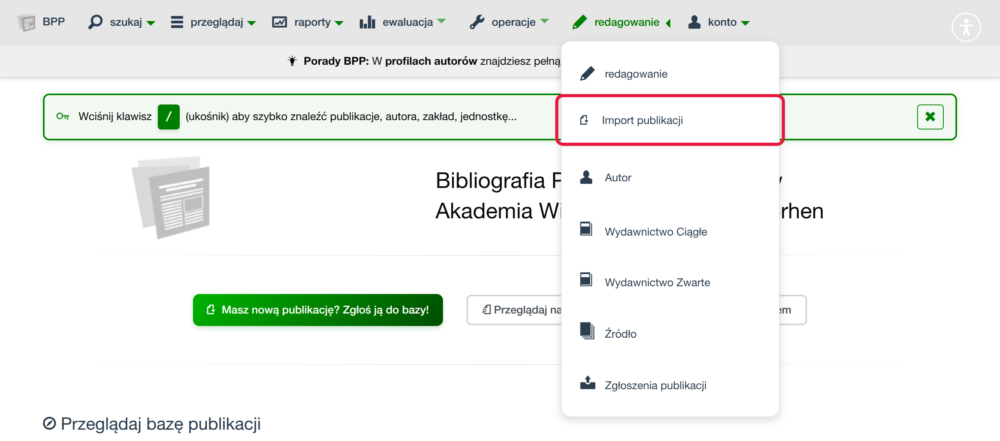

- w module redagowania: menu **Wprowadzanie danych → Importer publikacji**.

    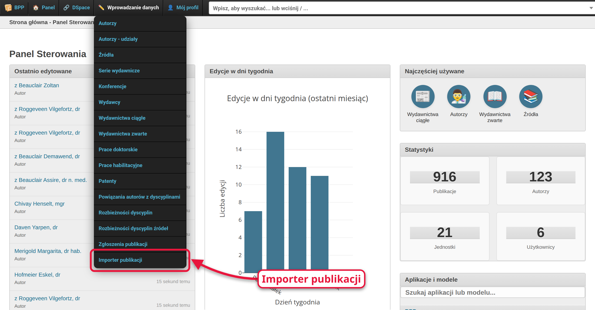

## Krok po kroku

1. **Wybierz źródło danych.** Kliknij kafelek:
    - **CrossRef — wyszukiwanie po numerze DOI** — gdy znasz DOI pracy,
    - **PBN** — gdy praca jest już w Polskiej Bibliografii Naukowej,
    - **BibTeX** — gdy masz opis w formacie BibTeX (np. wyeksportowany
      z Zotero, Mendeleya, Google Scholar albo ze strony wydawcy).

    Kafelki **DSpace** i **Pozostałe strony WWW** służą do importu ze
    strony pracy w repozytorium lub u wydawcy — opisuje je
    [instrukcja administratora](../administrator/importer-publikacji.md).

    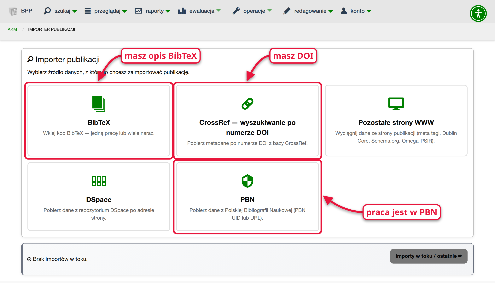

    Na dole strony jest przycisk **„Importy w toku / ostatnie”** — stąd
    wrócisz do importu, który został przerwany (np. po zamknięciu
    przeglądarki).

2. **Podaj dane publikacji** (ekran „Krok 1: Podaj dane publikacji”).

    - **DOI** — wklej numer DOI w pole **„Identyfikator DOI”** i kliknij
      **„Pobierz dane”**.

        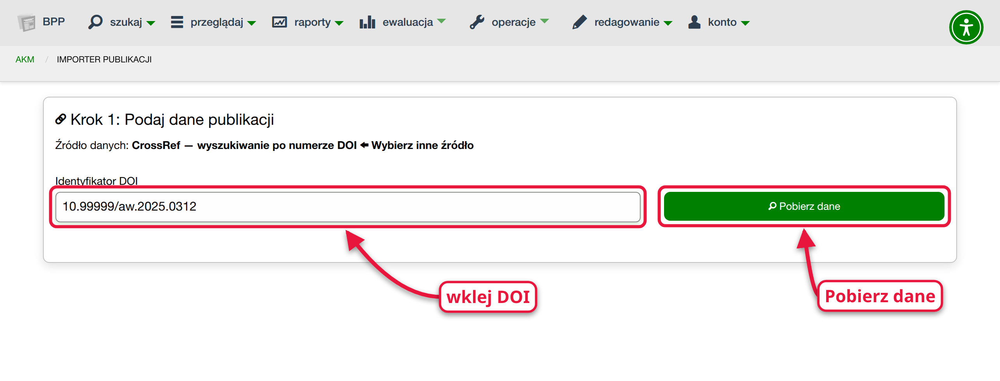

    - **PBN** — wklej **PBN UID** (24 znaki, cyfry i litery a–f) albo
      adres pracy skopiowany z PBN (zawierający `/publication/view/…`)
      i kliknij **„Pobierz dane”**.

        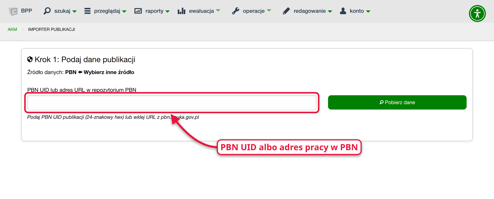

    - **BibTeX** — wklej cały wpis (od `@article{` do zamykającego `}`)
      w pole **„Dane publikacji”** i kliknij **„Importuj”**. W przykładzie
      importujemy artykuł z czasopisma „Acta Wiedźmińska”.

        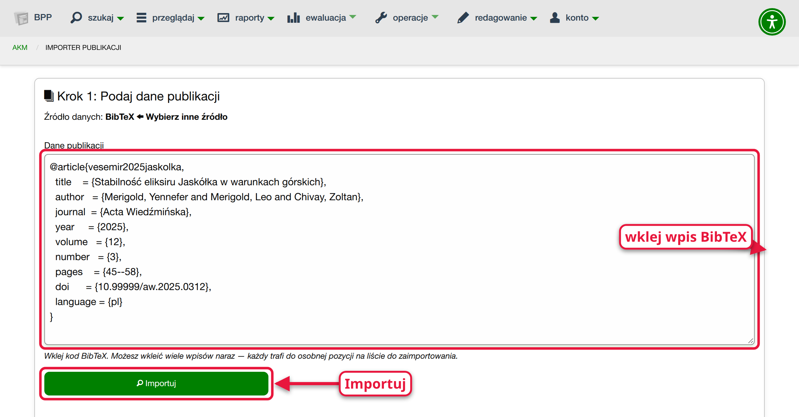

    Pobieranie trwa zwykle kilka sekund — w tym czasie widać pasek
    postępu, który odświeża się sam co 3 sekundy. Możesz zostać na
    stronie albo wrócić później przez „Importy w toku / ostatnie”.

    !!! tip "Kilka prac naraz"
        Do pola BibTeX możesz wkleić wiele wpisów jednocześnie. Importer
        utworzy wtedy listę **„Import wielu prac”**: każdą pracę
        importujesz osobno przyciskiem **„Importuj”** (tym samym
        kreatorem co niżej) albo pomijasz.

3. **Weryfikacja danych publikacji.** Na górze widać, co importer odczytał
   (tytuł, DOI, źródło, tom, numer, strony, liczba autorów). Sprawdź te
   dane, a poniżej uzupełnij pola z gwiazdką:
    - **Rodzaj rekordu** — *Wydawnictwo ciągłe (artykuł)*,
      *Wydawnictwo zwarte (książka/rozdział)* albo *Patent*,
    - **Rok publikacji** — wpisany automatycznie; popraw, jeśli jest
      błędny lub go brakuje,
    - **Charakter formalny**, **Typ MNiSW** i **Język**.

    Część pól może być już wypełniona — zielony komunikat „Na podstawie
    typu … ustawiono …” mówi, co importer dobrał sam. Zawsze możesz to
    zmienić. Gdy zamiast niego widzisz szary komunikat „Na podstawie
    typu … zaznaczono rodzaj rekordu …”, importer rozpoznał tylko rodzaj
    rekordu (np. dla książki *Wydawnictwo zwarte*), a **Charakter
    formalny** musisz wybrać samodzielnie. Kliknij **„Dalej”**.

    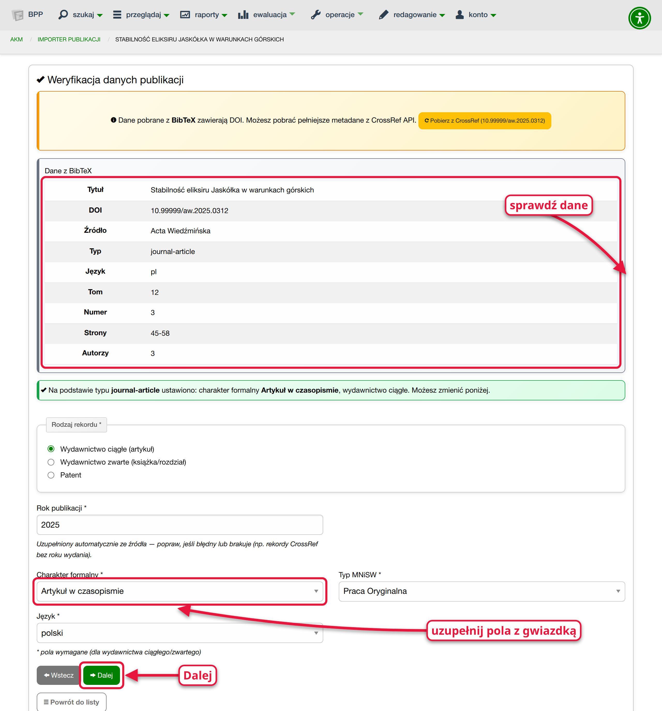

    Jeśli praca ma DOI, a import nie zaczął się od CrossRef, na górze jest
    też przycisk **„Pobierz z CrossRef (…)”**. Brakujące pola importer
    uzupełnia z CrossRef sam, więc przycisk przydaje się tylko wtedy, gdy
    dane ze źródła, które wybrałeś, są **błędne** (np. zniekształcony
    tytuł albo lista autorów ze strony WWW) — bieżący import zostanie
    wtedy w całości zastąpiony danymi z CrossRef. Przycisku nie ma, gdy
    CrossRef nie zna tego numeru DOI.

    **Źródła danych.** Zaraz po pobraniu danych importer sam sprawdza
    drugie źródło i w niebieskiej ramce **„Źródła danych”** pokazuje, co
    z niego wziął:

    - przy imporcie po DOI, z BibTeX-a, ze strony WWW i z repozytorium —
      szuka pracy **w PBN** po numerze DOI, a książki także po ISBN. Jeśli
      ją znajdzie, rekord zostanie powiązany z tym **odpowiednikiem
      w PBN** (odnośnik „pokaż w PBN”), a autorzy dostaną identyfikatory
      osób z PBN — dzięki temu importer rozpozna ich w BPP nawet przy
      innym zapisie nazwiska;
    - przy imporcie **z PBN**, z BibTeX-a, ze strony WWW i z repozytorium
      — gdy praca ma numer DOI, pobiera dane **z CrossRef** i uzupełnia np.
      tytuł czasopisma, streszczenie, strony, licencję i numery ORCID
      autorów;
    - gdy praca jest w PBN — odczytuje **oświadczenia z profilu instytucji
      w PBN** i podpowiada z nich dyscypliny autorów (patrz krok
      „Dopasowanie autorów”).

    Z drugiego źródła importer bierze **tylko to, czego brakuje** — danych
    ze źródła, które wybrałeś, nie nadpisuje. Wiersz „Uzupełniono: …”
    wymienia pola pochodzące z drugiego źródła. Jeśli drugiego źródła nie
    dało się sprawdzić (np. PBN nie odpowiada albo uczelnia nie ma
    skonfigurowanego dostępu), ramka podaje powód, a import działa dalej
    na danych pierwszego źródła. Gdy w PBN jest kilka książek o tym samym
    ISBN albo książka o innym tytule, importer niczego nie wiąże sam —
    wskażesz właściwą pracę w kroku „Sprawdź w PBN”.

    Czerwone ostrzeżenie **„Odpowiednik w PBN jest już zajęty”** oznacza,
    że praca znaleziona w PBN jest już powiązana z innym rekordem w BPP
    (odnośnik w ostrzeżeniu). To najpewniej ta sama praca — sprawdź, czy
    nie tworzysz duplikatu. Jeśli mimo to utworzysz rekord, nie zostanie
    on powiązany z PBN.

4. **Dopasowanie źródła** (ekran „Krok 3: Dopasowanie źródła”). Dla
   artykułu importer szuka w BPP czasopisma o **podobnej nazwie** do tej
   z danych źródłowych (widać ją w ramce „Źródło w danych dostawcy”).
   Sprawdź, czy w polu **„Źródło (czasopismo)”** jest właściwy tytuł —
   jeśli nie, zacznij pisać nazwę i wybierz czasopismo z listy. Kliknij
   **„Dalej”**.

    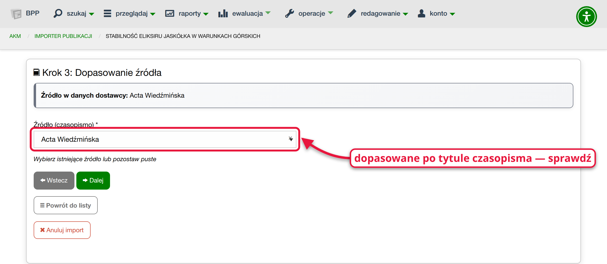

    Dla książki zamiast czasopisma wskazujesz **wydawcę** (z listy albo
    wpisując go w pole „Wydawca - szczegóły”), a dla rozdziału dodatkowo
    **wydawnictwo nadrzędne**, czyli książkę, w której rozdział się
    ukazał — patrz [niżej](#rozdział-wymaga-wydawnictwa-nadrzędnego).

5. **Dopasowanie autorów.** To najważniejszy krok. Każdy autor z danych
   źródłowych ma kolorowy status w kolumnie **„Dopasowanie”**:
    - **dokładne** (zielony) — importer jednoznacznie znalazł tę osobę
      w BPP,
    - **luźne** (żółty) — znalazł kandydata, ale nie ma pewności (np. kilka
      osób o tym samym imieniu i nazwisku); pod nazwiskiem widać
      „2 kandydatów”,
    - **niedopasowany** (czerwony) — tej osoby nie ma w BPP,
    - **ręczne** — dopasowanie ustawione przez Ciebie.

    W kolumnach **„Jednostka”** i **„Dyscyplina”** widać, z jaką
    afiliacją i dyscypliną autor trafi do rekordu. Dyscyplina jest
    podpowiadana sama, gdy autor ma w danym roku tylko jedną
    (**„Jedyna dyscyplina autora”**) albo gdy pochodzi ze zgłoszenia
    publikacji. Dyscyplina ze zgłoszenia to propozycja zgłaszającego —
    jeśli autor nie ma przypisania na rok publikacji, powstanie ono
    dopiero przy **„Utwórz publikację”** (w Twoim imieniu). Autorowi spoza
    uczelni importer nie podpowiada ze zgłoszenia ani dyscypliny, ani
    żadnej jednostki poza obcą jednostką uczelni — w zamian wpisuje obcą
    jednostkę (praca zapisze go bez afiliacji). Gdy uczelnia nie ma
    ustawionej obcej jednostki, kolumna „Jednostka” pokazuje **„wybierz
    jednostkę”** — autor bez jednostki nie trafi do pracy. Autorowi, który
    w chwili tworzenia pracy nie jest autorem uczelni (np. po odpięciu go od
    jednostek uczelni), importer nie założy przypisania do dyscypliny ze
    zgłoszenia — **„Utwórz publikację”** pokaże komunikat; usuń wtedy jego
    dyscyplinę w kroku „Autorzy”.

    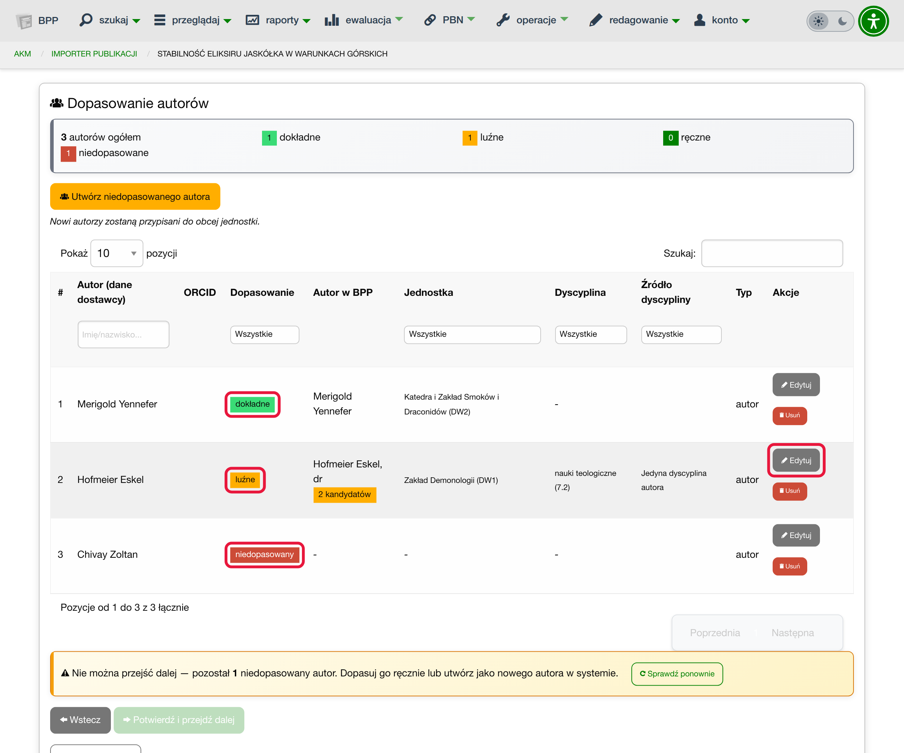

    **Redaktorzy.** Przy książce (monografii, książce redagowanej,
    materiałach konferencyjnych) importer pobiera też redaktorów —
    z CrossRef (pole `editor`), PBN, BibTeX-a (pole `editor` w `@book`,
    `@collection`, `@proceedings`) i DSpace. Trafiają na listę przed
    autorami, z wartością **„redaktor”** w kolumnie **„Typ”**, i dopasowuje
    się ich tak samo jak autorów; w rekordzie dostają typ odpowiedzialności
    „red.”. Monografia redagowana bez autorów ma na liście samych
    redaktorów. Przy rozdziale lub referacie redaktorzy dotyczą książki
    nadrzędnej, więc importer ich nie dodaje. Typ możesz zmienić w oknie
    **„Edytuj”** (pole **„Typ autora”**).

    Przy każdym wierszu ze statusem innym niż „dokładne” kliknij
    **„Edytuj”**.

6. **Wybierz właściwą osobę.** W oknie edycji, w sekcji **„Znalezieni
   kandydaci”**, kliknij osobę z właściwej jednostki (przy każdym
   kandydacie widać jednostkę i liczbę publikacji w BPP). Pola
   **„Autor w BPP”** i **„Jednostka”** wypełnią się same. Wybierz też
   **„Dyscyplinę”** — jeśli zostawisz ją pustą, importer wpisze
   dyscyplinę autora z roku publikacji, gdy jest tylko jedna (i uczelnia
   ma włączone podpowiadanie dyscyplin). Kliknij
   **„Zapisz”**.

    Lista **„Dyscyplina”** zawiera dyscypliny przypisane autorowi na rok
    publikacji. Jeśli autor **nie ma przypisanej dyscypliny na ten rok**,
    pod polem pojawia się żółty komunikat *„Autor nie ma przypisanej
    dyscypliny na rok …”*, a lista podpowiada:

    - dyscypliny autora z **ubiegłego roku** (albo z najbliższego
      wcześniejszego roku, w którym autor miał przypisanie — komunikat
      mówi, z którego roku pochodzą),
    - gdy autor nie miał dyscypliny **nigdy** — dyscypliny **typowe dla
      uczelni**, czyli najczęściej przypisywane autorom w pracach z ostatnich
      trzech lat (od najczęstszej; lista jest przeliczana raz na dobę),
    - gdy w bazie nie ma jeszcze prac z dyscyplinami — wszystkie dyscypliny.

    Wybrana w ten sposób dyscyplina zostanie przy **„Utwórz publikację”**
    **przypisana autorowi na rok publikacji** (w module redagowania:
    autor → „Powiązania autor-dyscyplina”) i użyta w tworzonej pracy.
    W wierszu autora widać wtedy etykietę **„przypiszę na rok …”**.
    Przypisanie zostaje odnotowane w historii autora (i samego przypisania)
    z Twoim loginem, tytułem pracy oraz numerem sesji importu i rekordu,
    np. *„Przypisano dyscyplinę „nauki o bezpieczeństwie” na rok 2026 przez
    użytkownika Jan Kowalski (jkowalski) podczas importu pracy „…”
    (sesja importu #116, rekord #9398)”*. Autorowi, który ma już
    przypisanie na ten rok, importer niczego nie zmienia.

    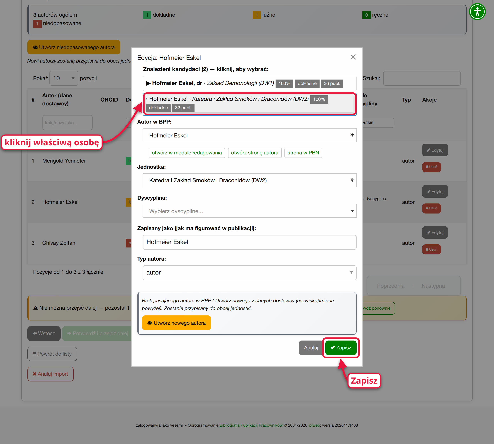

    Gdy nikt z listy nie pasuje, w polu **„Autor w BPP”** zacznij pisać
    nazwisko i wybierz osobę z wyszukiwarki. Linki pod polem
    („otwórz w module redagowania”, „otwórz stronę autora”, „strona
    w PBN”) pomagają upewnić się, że to ta osoba.

    **Skąd dopasowanie i dyscyplina.** Pod etykietą dopasowania
    („dokładne”, „luźne”) importer podaje, po czym rozpoznał autora:
    *„po identyfikatorze PBN”*, *„po ORCID”* albo *„po imieniu
    i nazwisku”*. Kolumna ze źródłem dyscypliny pokazuje **„Z oświadczenia
    w profilu instytucji w PBN”**, gdy dyscyplina pochodzi z oświadczenia
    autora dla tej pracy w PBN. Takie oświadczenie rozstrzyga np. autora
    z dwiema dyscyplinami. Aktualne oświadczenia importer pobiera z PBN,
    jeśli jesteś zalogowany do PBN; w przeciwnym razie korzysta z kopii
    danych PBN zapisanej w BPP.

    Gdy źródła się różnią, przy autorze (w kolumnie z dyscypliną) pojawia
    się ramka mówiąca, co jest w PBN, co w drugim źródle i co importer
    przyjął:

    - **żółte ostrzeżenie** — oświadczenie w PBN podaje dyscyplinę, której
      autor nie ma w BPP wśród przypisań na rok pracy. Importer jej nie
      przyjmuje (rekordu z taką dyscypliną nie da się zapisać) i zostawia
      to, co wynika z przypisania. Sprawdź, który zapis jest właściwy:
      popraw przypisanie dyscyplin autora w BPP albo oświadczenie w PBN —
      PBN może nie przyjąć oświadczenia z inną dyscypliną niż dotychczasowa;
    - **żółte ostrzeżenie „nie jest autorem uczelni”** — autor ma
      oświadczenie w PBN, ale w BPP nie ma przypisania dyscypliny na rok
      pracy i nie należy do żadnej jednostki uczelni. Importer nie przyjmuje
      wtedy dyscypliny. Jeśli to pracownik uczelni, przypisz go do jednostki
      uczelni i wybierz dyscyplinę przyciskiem „Edytuj”;
    - **niebieska informacja** — oświadczenie w PBN podaje inną dyscyplinę
      niż zgłoszenie publikacji. Pierwszeństwo ma PBN; jeśli właściwa jest
      dyscyplina ze zgłoszenia, zmień ją przyciskiem „Edytuj”.

7. **Autor, którego nie ma w BPP.** Otwórz **„Edytuj”** przy autorze
   „niedopasowanym” i kliknij **„Utwórz nowego autora”**. Nowa osoba
   powstanie w BPP z imieniem i nazwiskiem z danych źródłowych
   i zostanie przypisana do **obcej jednostki** (czyli jako autor spoza
   uczelni, bez afiliacji).

    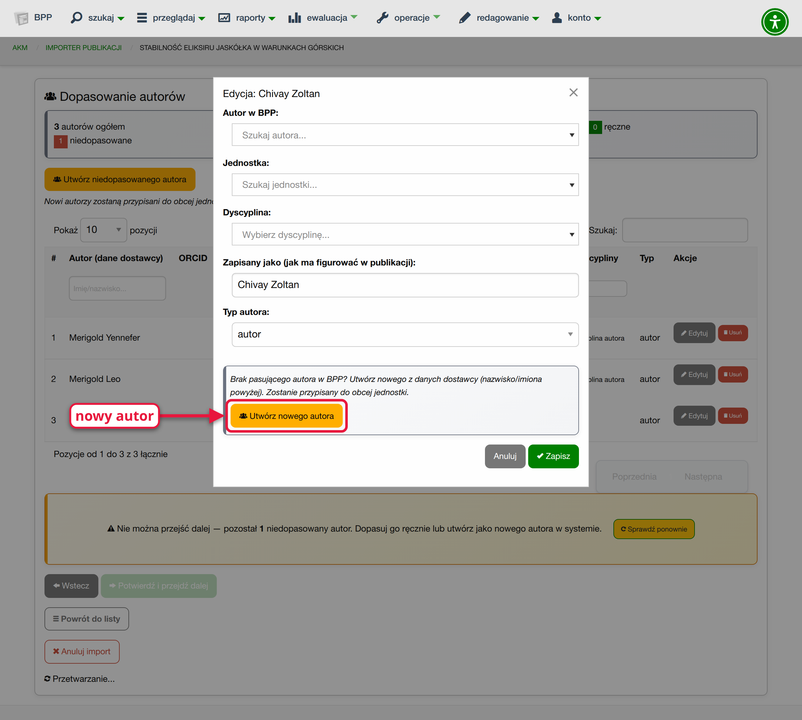

    Gdy niedopasowanych autorów jest wielu, możesz utworzyć ich
    wszystkich naraz przyciskiem **„Utwórz N niedopasowanych autorów”**
    nad tabelą (przy jednym autorze: „Utwórz niedopasowanego autora”).
    Przed utworzeniem upewnij się, że to naprawdę ktoś spoza uczelni —
    pracownik utworzony drugi raz to duplikat do późniejszego scalania.

    **Odpowiednik w PBN.** Zanim importer utworzy nowego autora, szuka tej
    osoby w danych pobranych z PBN — po kolei: po identyfikatorze osoby
    (podaje go import z PBN), po numerze ORCID, a na końcu po imieniu
    i nazwisku wśród osób zatrudnionych w uczelni. Gdy wskazanie jest
    jednoznaczne, nowy autor od razu dostaje **odpowiednik w PBN**
    (pole „PBN UID” autora), a w jego historii zostaje wpis, skąd się wziął.
    Jeśli wskazana osoba ma już autora w BPP (znaleziona po identyfikatorze
    albo ORCID), importer przypisze wiersz do niego zamiast tworzyć duplikat.

    Gdy pasującej osoby nie ma albo pasuje ich kilka, autor powstaje **bez
    odpowiednika** — importer nie zgaduje. Widać to w kolumnie **„Autor
    w BPP”**: czerwona etykieta **„bez odpowiednika w PBN”** z powodem pod
    spodem (np. *„imię i nazwisko (osoba z instytucji): pasuje kilka osób
    w PBN (…)”*). Szara etykieta o tej samej treści oznacza autora, który
    był już w BPP i nie ma odpowiednika. **Oświadczenia autora bez
    odpowiednika w PBN i bez ORCID nie trafiają do PBN**, więc u pracownika
    uczelni warto to od razu uzupełnić: w module redagowania otwórz autora
    i wybierz osobę w polu „PBN UID”.

    Przed utworzeniem wielu autorów naraz żółta ramka nad tabelą i okno
    potwierdzenia mówią, ilu z nich nie będzie miało odpowiednika, np.
    *„Bez odpowiednika w PBN: 2 z 5”*. Dla autorów spoza uczelni to zwykle
    w porządku; jeśli na liście są pracownicy, najpierw poszukaj ich
    ręcznie („Edytuj”) albo poproś administratora o pobranie aktualnych
    danych osób z PBN. Przy ponad 200 niedopasowanych autorach importer
    nie liczy tego z góry — etykiety zobaczysz po utworzeniu.

    Autorów, którzy **już są** w BPP bez odpowiednika w PBN, administrator
    dopasowuje zbiorczo — patrz
    [Dopasowanie autorów do osób z PBN](../administrator/integracja-pbn.md#dopasowanie-autorow-do-osob-z-pbn).

    Autor, który w ogóle nie powinien trafić do rekordu (np. błędny wpis
    w danych źródłowych), usuniesz z importu przyciskiem **„Usuń”**.

8. **Potwierdź autorów.** Gdy nie zostanie żaden niedopasowany autor,
   przycisk **„Potwierdź i przejdź dalej”** stanie się aktywny. Kliknij go.

    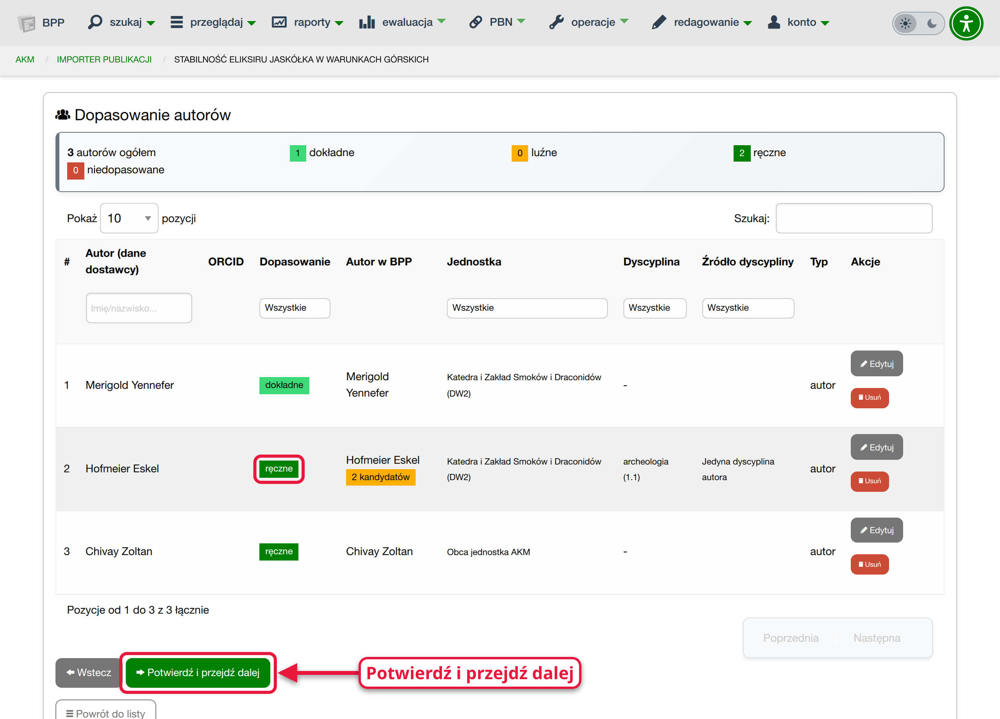

9. **Punktacja** (ekran „Krok: Punktacja”). Importer proponuje punkty
   MNiSW na podstawie punktacji czasopisma za rok publikacji (dla
   książek — poziomu wydawcy) i pokazuje, skąd je wziął. Popraw wartość
   w polu **„Punkty MNiSW”**, jeśli trzeba, albo zostaw ją pustą.
   Czerwony komunikat o dyscyplinach HST przypomina, że w naukach
   humanistycznych, społecznych i teologicznych próg może być wyższy.
   Kliknij **„Dalej”**.

    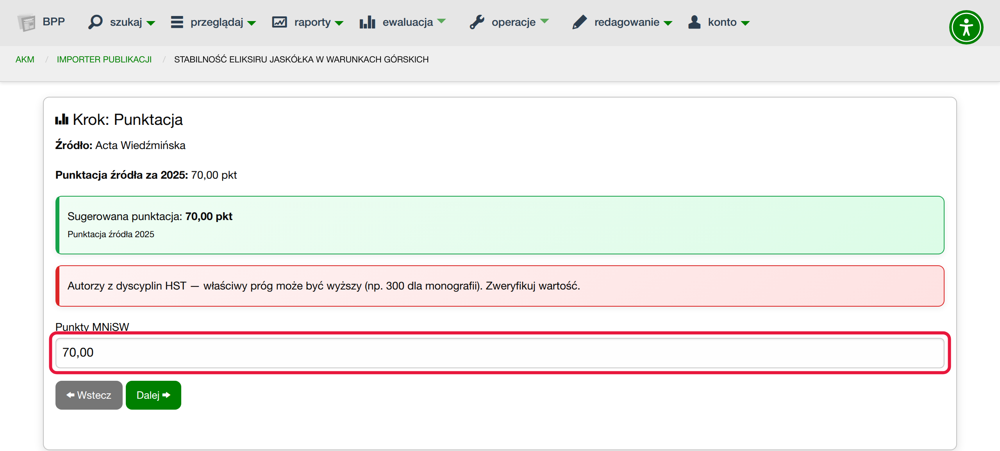

10. **Sprawdź w PBN** (krok opcjonalny). Jeśli importer znalazł pracę
    w PBN już przy pobieraniu danych, zobaczysz ją tu jako **„Wybrany
    odpowiednik PBN”** — możesz ją zostawić albo kliknąć **„Wyczyść
    wybór”**. Poza tym importer może wyszukać pracę w PBN po DOI, tytule,
    ISBN (książki) i adresie WWW, żeby powiązać rekord z jej
    odpowiednikiem i nie tworzyć w PBN duplikatu. Wyszukiwanie wymaga
    zalogowania do PBN (**„Zaloguj się do PBN”**). Jeśli nie chcesz tego
    robić, kliknij **„Pomiń”** albo **„Dalej”**. Przy imporcie z PBN tego
    kroku nie ma — odpowiednik jest znany od początku i utworzony rekord
    jest z nim powiązany.

    **Zmiana lub usunięcie odpowiednika.** Gdy wyczyścisz wybór albo
    wskażesz inną pracę, importer wycofuje wszystko, co wziął z poprzedniej
    pracy w PBN: uzupełnione pola publikacji, identyfikatory osób, numery
    ORCID i dyscypliny z oświadczeń. Dla nowo wskazanej pracy pobiera te
    dane od nowa. Twoje własne decyzje zostają — ręcznie dopasowani autorzy
    i ręcznie wybrane dyscypliny nie są ruszane. Jeśli któryś autor był
    rozpoznany wyłącznie po identyfikatorze osoby z poprzedniej pracy,
    importer wróci do kroku „Dopasowanie autorów” z komunikatem, ilu
    autorów trzeba dopasować ponownie. Prac oznaczonych w PBN jako usunięte
    nie da się wybrać na odpowiednik.

    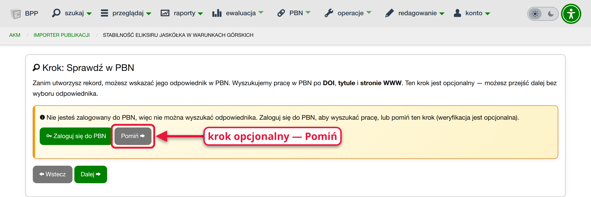

11. **Przegląd końcowy.** Sprawdź podsumowanie: dane publikacji, źródło
    i listę autorów z jednostkami i dyscyplinami. Jeśli coś się nie
    zgadza, cofnij się przyciskiem **„Wstecz”**. Gdy wszystko jest
    w porządku, przewiń na dół i kliknij **„Utwórz publikację”**.

    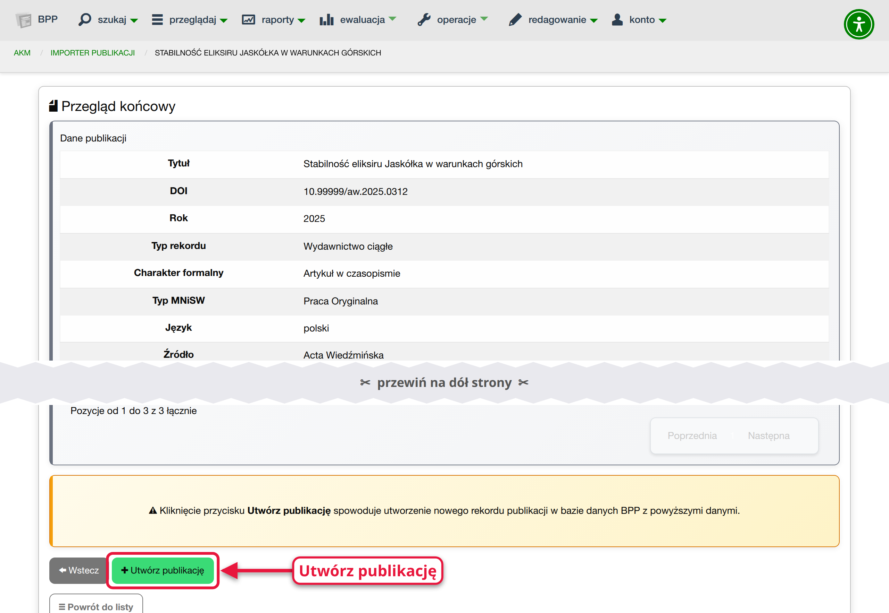

    Jeśli uczelnia ma włączoną bieżącą wysyłkę do PBN, obok jest też
    przycisk **„Utwórz i dodaj do kolejki eksportu PBN”** — utworzy rekord
    i od razu zleci jego wysłanie do PBN.

12. **Gotowe.** Zobaczysz **„Publikacja została utworzona”**. Rekord jest
    już w BPP, z adnotacją „Dodano przez importer publikacji (…)”.
    Kliknij **„Edytuj w module redagowania”**, żeby uzupełnić to, czego
    importer nie ustawia (np. słowa kluczowe, streszczenie, informacje
    o otwartym dostępie), albo **„Importuj kolejną publikację”**.

    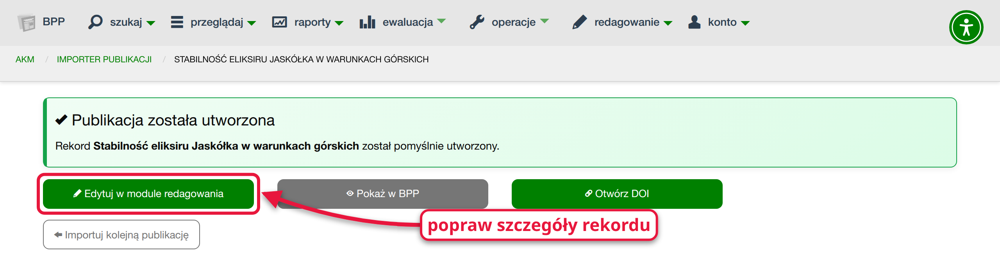

Przerwany import możesz w każdej chwili dokończyć (**„Powrót do listy”**,
potem **„Importy w toku / ostatnie”**) albo porzucić przyciskiem
**„Anuluj import”**.

## Lista „Sesje importu”: filtry i zapamiętany widok

Przycisk **„Importy w toku / ostatnie”** otwiera listę **„Sesje importu”**.
Nad tabelą są filtry: **„Data od”**, **„Data do”**, **„Tytuł”**, **„DOI”**,
**„Źródło”**, **„Utworzył”**, **„Zmodyfikował”** oraz:

- **„Status”** — można zaznaczyć kilka statusów naraz (np. „Błąd importu”
  i „Zakończono”). Poza zwykłymi etapami importu („Pobrano dane”,
  „Dopasowano źródło”, „Punktacja”…) jest tu też **„Anulowano”** (bez
  zaznaczenia tego statusu anulowane importy są ukryte, jak dotąd) oraz
  **„Utknięte”** — importy, w których pobieranie danych albo tworzenie
  rekordu od kilku minut nie robi postępu;
- przycisk **„Tylko błędy importu”** — jednym kliknięciem zostawia na
  liście tylko importy zakończone błędem; drugie kliknięcie wyłącza filtr;
- **„Etap błędu”** — „Pobieranie danych” albo „Tworzenie rekordu”, czyli
  etap, na którym import się nie powiódł (ten sam etap widać w tabeli pod
  czerwoną etykietą „Błąd importu”; po najechaniu na etykietę widać treść
  błędu);
- **„Rekord wynikowy”** — „Z rekordem” (import utworzył publikację)
  albo „Bez rekordu”. W kolumnie **„Rekord”** są odnośniki **„Pokaż”**
  (strona publikacji w BPP) i **„Edytuj”** (moduł redagowania). Jeśli
  utworzoną publikację później usunięto, w kolumnie widać „usunięty”,
  a import nadal liczy się jako „Z rekordem”.

Przycisk **„Reset”** czyści filtry (sortowanie zostaje). Kliknięcie
nagłówka kolumny zmienia sortowanie.

Lista pamięta ustawienia. Filtry i sortowanie są w adresie strony, więc
odświeżenie (F5) i przycisk „Wstecz” w przeglądarce pokazują ten sam
widok, a adres można zapisać w zakładkach. Ostatni zestaw jest też
zapamiętany na czas zalogowania: gdy wrócisz na listę przyciskiem
„Importy w toku / ostatnie”, zobaczysz ten sam widok z komunikatem
*„Pokazuję zapamiętane filtry i sortowanie z Twojej ostatniej wizyty na
tej liście: …”*. Przycisk **„Wyczyść”** w komunikacie przywraca widok
domyślny.

## Co może pójść nie tak

### „Potencjalne duplikaty w BPP”

Na ekranie weryfikacji pojawia się czerwona ramka **„Potencjalne
duplikaty w BPP”** z listą rekordów. Importer znalazł w bazie pracę
o tym samym DOI (oznaczenie **[DOI]**) albo identycznym tytule.

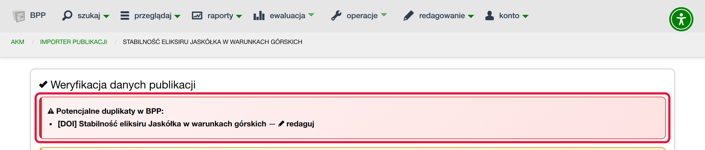

Otwórz istniejący rekord (link **„redaguj”**). Jeśli to ta sama praca —
nie importuj jej drugi raz, kliknij **„Anuluj import”**. Jeśli to inna
praca (np. inny rozdział o tym samym tytule), zaznacz pole **„System BPP
twierdzi, że prawdopodobnie dodaję teraz duplikat tej pracy, ale ja uważam
inaczej. Dodaj rekord mimo to.”** — bez tego nie przejdziesz dalej.

### DOI w różnej postaci

W pole „Identyfikator DOI” możesz wkleić:

- sam numer: `10.1234/abcd.2025.17`,
- adres: `https://doi.org/10.1234/abcd.2025.17`,
  `http://dx.doi.org/10.1234/abcd.2025.17` (dopiski po znaku `?` są
  pomijane).

Wielkość liter nie ma znaczenia. **Nie zadziała** natomiast:

- DOI z przedrostkiem `doi:` (np. `doi:10.1234/abcd`) — usuń `doi:`,
- adres z `www` (`https://www.doi.org/…`) — usuń `www.`,
- adres artykułu na stronie wydawcy (np. `https://wydawca.example/doi/10.1234/abcd`)
  — skopiuj z niego sam numer zaczynający się od `10.`.

W tych przypadkach importer nie zgłosi błędu od razu — dopiero po próbie
pobrania zobaczysz: *„Problem dostawcy: nie udało się pobrać danych.
Sprawdź poprawność identyfikatora i spróbuj ponownie.”* Ten sam komunikat
dostaniesz, gdy DOI jest poprawny, ale CrossRef go nie zna (część
wydawców rejestruje DOI w innych agencjach) — wtedy użyj kafelka
**Pozostałe strony WWW** z adresem strony artykułu albo BibTeX-a.

### Zły identyfikator PBN

PBN UID ma dokładnie 24 znaki (cyfry i litery a–f). Skrócony lub
przepisany z błędem identyfikator importer odrzuca od razu, z komunikatem
*„Nie rozpoznano formatu dla dostawcy „PBN”.”* i podpowiedzią, jak
wygląda poprawny.

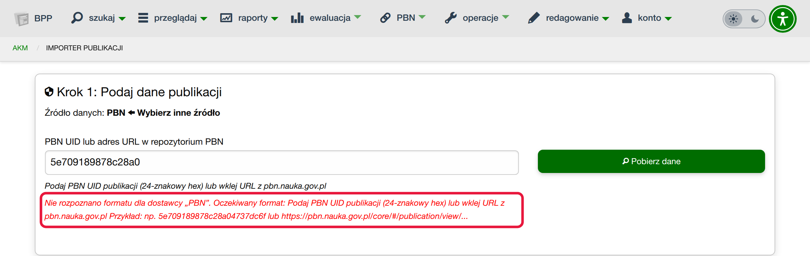

Najpewniej jest skopiować cały adres pracy z przeglądarki, gdy jest
otwarta w PBN.

### Nawiasy klamrowe LaTeX-a w BibTeX-ie

Wpisy BibTeX często chronią wielkie litery klamrami, np.
`title = {Badania {Kaer Morhen}}`, albo zapisują polskie znaki kodami
LaTeX-a (`{\'o}`, `{\l}`). W **nazwiskach autorów** importer usuwa
klamry i kody, ale razem z nimi znika znak diakrytyczny, a czasem cała
litera (`{\'o}` daje „o”, `{\l}` znika) — sprawdź pisownię w kolumnie
„Autor (dane dostawcy)” i w razie potrzeby popraw pole „Zapisany jako”.
W **tytule** klamry i kody LaTeX-a **zostają** — trafiają
dosłownie do tytułu rekordu („Badania {Kaer Morhen}”), a tytułu nie da
się poprawić w kreatorze.

Najlepiej usunąć klamry z tytułu **przed** wklejeniem. Jeśli zauważysz je
dopiero na ekranie weryfikacji, dokończ import i popraw tytuł w module
redagowania (**„Edytuj w module redagowania”** na ostatnim ekranie).

### Niepełna lista autorów

Importer dodaje do rekordu tylko autorów obecnych w danych źródłowych.
Nie ma w nim przycisku „dodaj autora”. Gdy w BibTeX-u, CrossRef lub PBN
brakuje części autorów (albo lista kończy się na „et al.” / „i in.”):

- przy BibTeX-ie najprościej dopisać brakujące osoby w polu `author`
  przed wklejeniem (rozdzielając je słowem `and`),
- w pozostałych przypadkach dokończ import, a brakujących autorów dodaj
  w module redagowania.

Uwaga też na odwrotny przypadek: gdy w BibTeX-ie autorzy nie są
rozdzieleni słowem `and` (np. tylko przecinkami), importer potraktuje
ich jako jedną osobę. Usuń taki wiersz przyciskiem **„Usuń”** i popraw
wpis albo dodaj autorów w module redagowania.

### Rozdział wymaga wydawnictwa nadrzędnego

Jeśli na ekranie weryfikacji wybierzesz *Wydawnictwo zwarte* i charakter
formalny rozdziału, krok „Dopasowanie źródła” poprosi o książkę, w której
rozdział się ukazał: **„Wydawnictwo nadrzędne (BPP)”** albo
**„Wydawnictwo nadrzędne (PBN)”** — jedno z dwóch. Bez tego zobaczysz
błąd *„Dla rozdziału wymagane jest wydawnictwo nadrzędne.”*, a gdy
wypełnisz oba pola — *„Podaj tylko jedno: wydawnictwo nadrzędne lub
wydawnictwo nadrzędne w PBN.”*

Jeśli książki nie ma jeszcze w BPP, **najpierw zaimportuj lub dodaj
książkę**, a potem wróć do rozdziału (przerwany import znajdziesz
w „Importy w toku / ostatnie”).

Dla każdej książki i rozdziału trzeba też podać wydawcę — inaczej
pojawi się *„Podaj wydawcę lub wpisz szczegóły wydawcy.”*

### Źródło dopasowane po tytule, nie po ISSN

Importer szuka czasopisma w BPP **po podobieństwie nazwy**, nie po ISSN.
Dlatego:

- przy czasopismach o bardzo podobnych nazwach (np. dwie serie
  „Acta …” albo „Annales …” różniące się jednym słowem) może podstawić
  niewłaściwe — zawsze porównaj tytuł w polu **„Źródło (czasopismo)”**
  z ramką „Źródło w danych dostawcy”, a w razie wątpliwości otwórz
  czasopismo w module redagowania i sprawdź ISSN,
- gdy w BPP jest kilka czasopism o tej samej nazwie i różnych ISSN,
  pole zostanie puste, a nad nim pojawi się komunikat *„Nie dopasowano
  automatycznie źródła, bo w bazie istnieją zduplikowane źródła o tej
  samej nazwie (…) i różnych ISSN-ach.”* z odnośnikiem do deduplikatora
  źródeł. Wybierz właściwe czasopismo ręcznie albo poproś administratora
  o uporządkowanie duplikatów,
- gdy czasopisma w ogóle nie ma w BPP, pole też będzie puste, a dla
  artykułu jest wymagane (*„Źródło jest wymagane dla wydawnictwa
  ciągłego.”*) — najpierw dodaj czasopismo w module redagowania
  (**Wprowadzanie danych → Źródła**), potem wróć do importu.

### „Nie można przejść dalej — pozostał 1 niedopasowany autor”

Przycisk „Potwierdź i przejdź dalej” jest nieaktywny, dopóki choć jeden
autor jest „niedopasowany”. Dopasuj go, utwórz jako nowego albo usuń
z importu. Jeśli po zmianach licznik się nie odświeżył, kliknij
**„Sprawdź ponownie”**.

Komunikat *„Brak skonfigurowanej obcej jednostki w ustawieniach
uczelni. Skontaktuj się z administratorem.”* przy tworzeniu nowego
autora oznacza, że w ustawieniach uczelni nie wskazano obcej jednostki —
to musi poprawić administrator.

### Autor przypisany do wydziału

Przy **„Utwórz publikację”** może pojawić się *„Nie można utworzyć pracy —
część autorów jest przypisana z afiliacją do jednostki, która nie
przyjmuje afiliacji (np. wydział).”* z listą osób. Wróć do autorów
(**„Wstecz”**) i zmień tym osobom jednostkę na katedrę/zakład albo na
obcą jednostkę.

### Autor ma na ten rok inną dyscyplinę

Przy **„Utwórz publikację”** może pojawić się żółta ramka *„Nie można
utworzyć pracy — dyscypliny autorów”* z listą osób, które mają na rok
publikacji przypisane dyscypliny, ale nie tę wybraną w imporcie (np.
dyscyplina przyszła ze zgłoszenia publikacji albo przypisania autora
zmieniono w międzyczasie). Przy każdej osobie widać wybraną dyscyplinę
i dyscypliny przypisane na ten rok. Nic nie zostaje zapisane, dane
importu są zachowane. Możesz:

- w kroku **„Autorzy”** (odnośnik w ramce) wybrać autorowi jedną
  z przypisanych mu dyscyplin, albo
- kliknąć nazwisko — strona autora w module redagowania otworzy się
  w nowej karcie — i poprawić jego przypisanie dyscyplin na ten rok,

a potem kliknąć ponownie **„Utwórz publikację”**. Ta sama lista pojawia
się w ramce **„Wystąpił błąd”**, jeśli przypisania zmieniły się już po
kliknięciu — po poprawce kliknij **„Spróbuj ponownie”**.

Autorowi, który na rok publikacji **nie ma żadnej** dyscypliny, importer
sam przypisze dyscyplinę wybraną w kroku autorów (patrz wyżej).

### Błąd serwera lub połączenia

- Czerwona ramka **„Wystąpił błąd”** po pobieraniu danych lub tworzeniu
  rekordu: komunikat mówi, czyj to problem.
    - *„Problem dostawcy: …”* (serwer nie odpowiada, zwrócił błąd HTTP,
      brak połączenia) — kłopot po stronie CrossRef/PBN/strony wydawcy.
      Kliknij **„Spróbuj ponownie”** za kilka minut.
    - *„Problem aplikacji: wystąpił błąd podczas pobierania danych”*
      (albo *„…tworzenia rekordu”*) — błąd w BPP; administrator dostał
      powiadomienie. Kliknij **„Spróbuj ponownie”**; jeśli błąd się
      powtarza, zgłoś go z DOI/identyfikatorem pracy.
- Komunikat **„Błąd serwera (500). Sprawdź logi serwera.”** albo
  **„Błąd połączenia z serwerem.”** w miejscu kreatora — odśwież stronę
  (F5). Dotychczasowe kroki są zapisane, a import znajdziesz w
  „Importy w toku / ostatnie”. Jeśli błąd wraca, zgłoś go do pomocy
  technicznej, podając adres strony, na której wystąpił.

Zanim ponowisz import po błędzie przy **tworzeniu** rekordu, sprawdź
w BPP, czy praca jednak nie powstała — dzięki temu nie zrobisz duplikatu.

## Zobacz też

- [Importer publikacji — instrukcja administratora](../administrator/importer-publikacji.md)
  (wszystkie źródła danych, mapowanie typów, powiązanie ze zgłoszeniami)
- [Zgłaszanie publikacji](../administrator/zglaszanie-publikacji.md) —
  zgłoszenie z DOI otworzysz w importerze przyciskiem „Użyj importera”
- [Wydawnictwa](wydawnictwa.md) i [Autorzy](autorzy.md) — ręczne
  dodawanie i poprawianie rekordów
