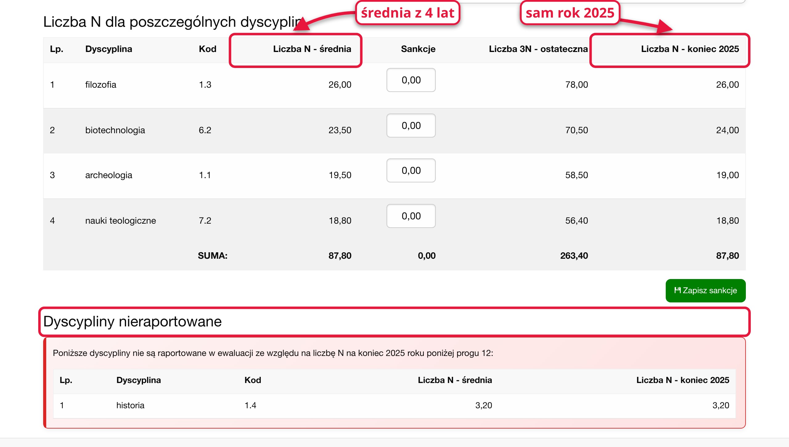
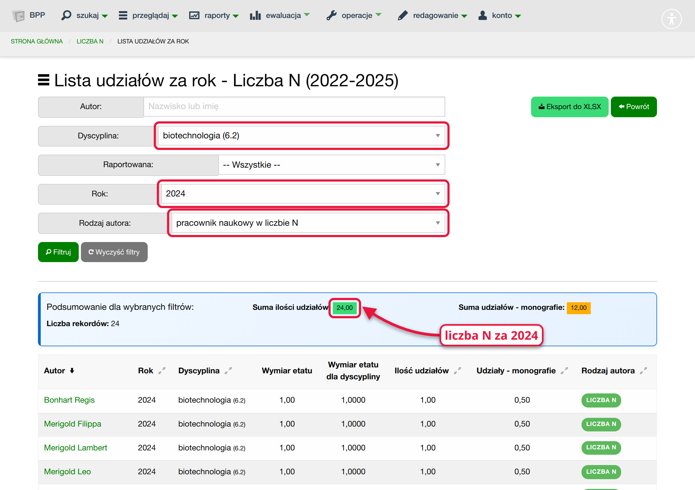
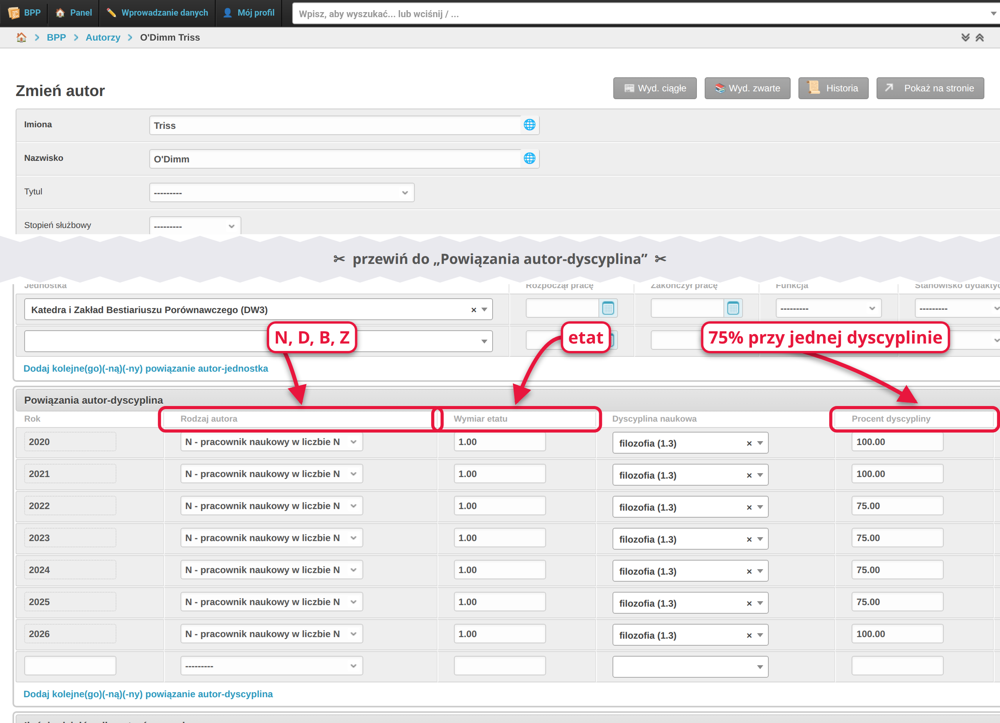
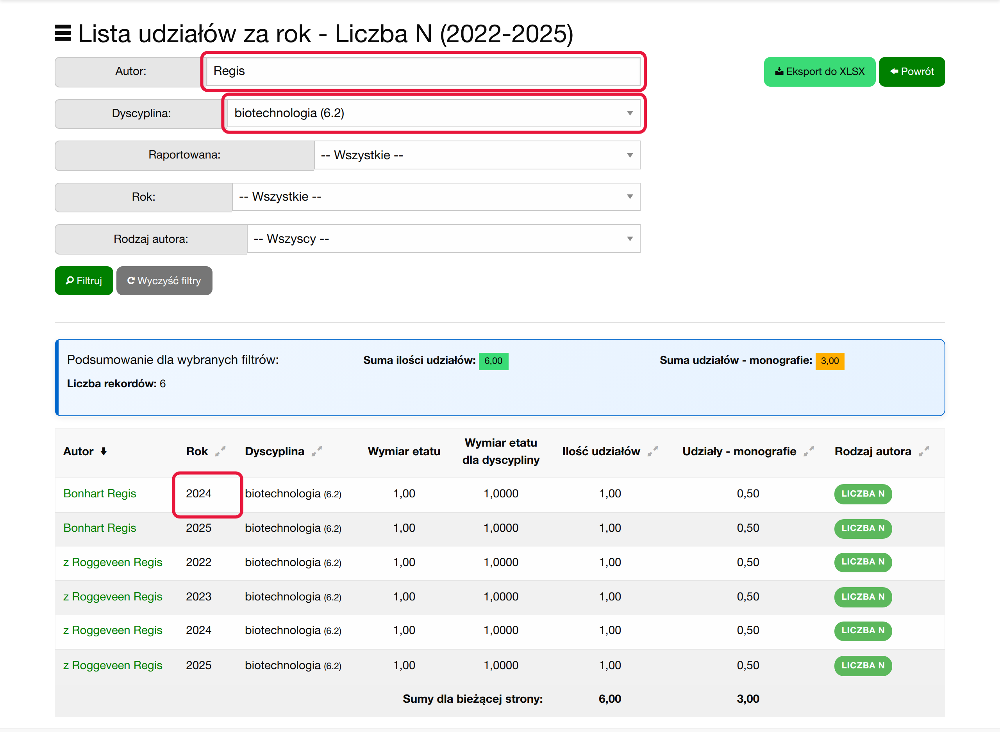
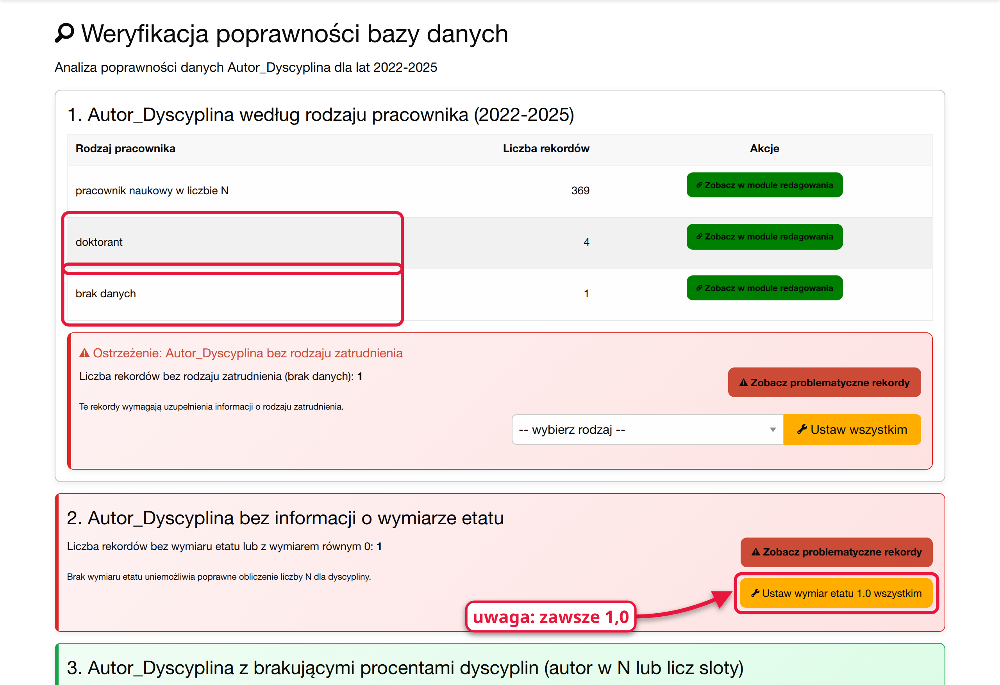

# Liczba N — najczęstsze pytania

Liczba N w BPP prawie nigdy nie jest identyczna co do setnej części z tą,
którą widzisz w SEDN albo wyliczasz z POL-on. Ta strona zbiera najczęstsze
przyczyny różnic: przy każdej opisuje, **jak liczy BPP** i **gdzie w BPP to
sprawdzić**.

Strona uzupełnia instrukcję [Import danych z POL-on i liczba
N](import-polon-liczba-n.md) — tam jest opis importu krok po kroku
i przycisku **„Oblicz liczbę N”**; tu tego nie powtarzamy.

!!! note "Czego ta strona nie rozstrzyga"
    Opisujemy wyłącznie to, jak liczy BPP. Nie opisujemy przepisów ani
    tego, jak liczy SEDN. Jeśli SEDN pokazuje inną wartość, poniższe pytania
    pomogą znaleźć miejsce, w którym dane w BPP różnią się od danych w
    POL-on — rozstrzygające są dane i przepisy, nie BPP.

**Uprawnienia.** Wszystkie ekrany z tej strony wymagają konta w grupie
**„wprowadzanie danych”**.

## Jak w skrócie BPP liczy liczbę N? {#jak-liczy-bpp}

Dla każdej osoby i każdego roku 2022–2025 BPP bierze jej przypisanie do
dyscypliny (tabelę **„Powiązania autor-dyscyplina”** w redagowaniu autora)
i liczy jej **udział** w dyscyplinie:

> udział = wymiar etatu × procent dyscypliny ÷ 100

Do liczby N wchodzą tylko udziały osób z **rodzajem autora „N”** w danym
roku. Na stronie **ewaluacja → liczba N**:

- **Liczba N - średnia** = (suma udziałów z 2022 + 2023 + 2024 + 2025) ÷ 4,
- **Liczba N - koniec 2025** = suma udziałów z samego 2025 roku.

Każde z pytań niżej to jedno miejsce, w którym ten rachunek może dać inny
wynik niż SEDN.

## Którą liczbę z BPP porównywać z SEDN? {#ktora-liczba}

To pierwsze, co warto sprawdzić — dwie kolumny w tabeli liczą co innego.
**„Liczba N - średnia”** to średnia z czterech lat, **„Liczba N - koniec
2025”** to sam rok 2025. Porównuj z SEDN tę wartość, która odpowiada temu
samemu okresowi.

Żeby porównać **jeden rok** (np. 2024) albo znaleźć konkretne osoby,
użyj listy udziałów:

1. Na stronie liczby N w ramce **Akcje** kliknij **„Lista udziałów za rok”**.
2. Ustaw filtry **Rok**, **Rodzaj autora** = „pracownik naukowy w liczbie N”
   i **Dyscyplina**.
3. **„Suma ilości udziałów”** w podsumowaniu to liczba N tej dyscypliny
   w tym roku.

Tabela pod podsumowaniem pokazuje każdą osobę z jej etatem i udziałem
(**„Wymiar etatu dla dyscypliny”** to etat × procent dyscypliny). Przycisk
**„Eksport do XLSX”** zapisze tę samą listę do Excela — wygodnie porównać ją
z zestawieniem z POL-on wiersz po wierszu.

## Dlaczego ktoś, kto pracuje, nie liczy się do N? {#kto-sie-liczy}

BPP liczy osobę do N tylko wtedy, gdy **wszystkie** te warunki są spełnione:

1. **Ma w BPP przypisanie do dyscypliny na ten rok** (wiersz z tym rokiem
   w tabeli **„Powiązania autor-dyscyplina”**).
2. **Rodzaj autora w tym wierszu to „N - pracownik naukowy w liczbie N”.**
   Rodzaje D (doktorant), B (pracownik badawczy spoza N), Z (inny
   zatrudniony) i puste pole („brak danych”) **nie wchodzą** do liczby N.
3. **Jego aktualna jednostka należy do uczelni i ma zaznaczone „Skupia
   pracowników”** — więcej w pytaniu [o osoby, które
   odeszły](#osoby-ktore-odeszly).
4. **Ma wpisany wymiar etatu** — bez etatu BPP nie policzy udziału.

Gdzie sprawdzić: **redagowanie → autorzy**, otwórz osobę i przewiń do
**„Powiązania autor-dyscyplina”**. Każdy rok to osobny wiersz.

## Skąd BPP wie, że ktoś jest w N? {#oswiadczenie-n}

Z importu z POL-on. BPP ustawia rodzaj **N** wtedy, gdy w pliku w kolumnie
`OSWIADCZENIE_N` jest „tak”; dyscypliny bierze wtedy z kolumn
`DYSCYPLINA_N` i `DYSCYPLINA_N_KOLEJNA`.

Osoba, która ma w pliku tylko **oświadczenie o dyscyplinach**
(`OSWIADCZENIE_O_DYSCYPLINACH` = „tak”), a nie ma „tak” w `OSWIADCZENIE_N`,
dostaje w BPP dyscypliny z kolumn `OSWIADCZONA_DYSCYPLINA_PIERWSZA`
i `OSWIADCZONA_DYSCYPLINA_DRUGA`, ale rodzaj **B** albo **Z** — i **nie
liczy się do N**. (B albo Z zależy od kolumny `GRUPA_STANOWISK`; dla
liczby N to bez znaczenia.)

Jeśli SEDN liczy kogoś do N, a BPP nie: sprawdź w wynikach importu z POL-on
(**operacje → import z POLON**, „Zobacz wyniki”, pole **Autor / Wiersz**)
wiersz tej osoby — co było w pliku w kolumnie `OSWIADCZENIE_N` i jaki był
**„Rezultat importu”**. Jeśli w pliku było „tak”, a osoby nie ma, najczęściej
import jej nie dopasował (komunikaty w [Co może pójść nie
tak](import-polon-liczba-n.md#co-moze-pojsc-nie-tak)).

Gdy przy kolejnym imporcie osoba z rodzajem N nie ma już „tak” w
`OSWIADCZENIE_N`, BPP zmienia jej rodzaj na **Z** — i wypada z N w tym roku.
Jeśli w pliku nie ma przy niej żadnej dyscypliny, BPP usuwa jej przypisanie
na ten rok.

## Doktorant ma publikacje i sloty, a nie ma go w liczbie N {#doktoranci}

Tak ma być: rodzaj **D (doktorant)** ma w BPP liczone sloty, ale **nie
wchodzi** do liczby N. Import z POL-on zmienia D na N tylko wtedy, gdy
w pliku jest „tak” w `OSWIADCZENIE_N`; w pozostałych przypadkach doktoranta
zostawia bez zmian.

Doktorant, którego **aktualna jednostka** nie ma zaznaczonego „Skupia
pracowników” (np. jednostka „Doktoranci”), w ogóle nie pojawia się na
listach udziałów (patrz [następne pytanie](#osoby-ktore-odeszly)).

## Osoba odeszła w 2024 — dlaczego zniknęła też z lat 2022–2023? {#osoby-ktore-odeszly}

BPP sprawdza **aktualną** jednostkę autora, nie jednostkę z danego roku.
Liczy tylko autorów, których aktualna jednostka:

- należy do Twojej uczelni i
- ma zaznaczone pole **„Skupia pracowników”** (odznacza się je dla jednostek
  w rodzaju „Studenci”, „Doktoranci”, „Pracownicy emerytowani” i dla obcych
  jednostek).

Kto po imporcie pracowników trafił do obcej jednostki albo do jednostki
bez „Skupia pracowników”, wypada z liczby N **we wszystkich latach
2022–2025**, także w tych, w których jeszcze pracował. SEDN liczy takie osoby
w latach zatrudnienia, więc średnia w BPP wychodzi wtedy niższa.

Gdzie sprawdzić: na liście udziałów za rok tej osoby w ogóle nie ma, choć
w redagowaniu autora ma dyscypliny i rodzaj N. Aktualną jednostkę widać na
publicznej stronie autora; ustawia ją import pracowników (opis: [Import
pracowników](../administrator/import-pracownikow.md)).

## Ktoś pracuje na pół etatu — ile wnosi do N? {#etat}

Tyle, ile wynosi **wymiar etatu** w BPP pomnożony przez procent dyscypliny:
osoba na 0,5 etatu z jedną dyscypliną wnosi 0,50. Wymiar etatu BPP bierze
z kolumny `WIELKOSC_ETATU_PREZENTACJA_DZIESIETNA` pliku z POL-on — po jednej
wartości na osobę i rok.

Czego BPP **nie** robi, a co może dać różnicę:

- **Nie dzieli roku na części.** Daty zatrudnienia od–do z pliku są
  zapisywane, ale liczenie liczby N ich nie używa: kto ma przypisanie na
  dany rok, liczy się za cały rok z wymiarem etatu z pliku.
- **Nie odejmuje nieobecności.** Absencje wczytane do BPP nie zmieniają
  liczby N.
- **Nie sumuje kilku wierszy tej samej osoby.** Jeśli osoba występuje
  w pliku z POL-on dwa razy (np. dwa stosunki pracy), BPP ma na ten rok
  jedno przypisanie i zapisuje w nim wymiar etatu z **ostatniego**
  przetworzonego wiersza. Przy dwóch umowach po 0,5 etatu w BPP zostanie 0,5,
  nie 1,0. Wyszukaj taką osobę w wynikach importu po nazwisku — zobaczysz
  oba wiersze.

Gdzie sprawdzić: kolumna **„Wymiar etatu”** na liście udziałów za rok albo
w redagowaniu autora (zrzut wyżej).

## Osoba ma dwie dyscypliny — jak BPP dzieli jej etat? {#dwie-dyscypliny}

Według procentów z przypisania: wymiar etatu × **procent dyscypliny** idzie
do pierwszej dyscypliny, wymiar etatu × **procent subdyscypliny** — do
drugiej. Pracownik na pełnym etacie z podziałem 60/40 wnosi 0,60 do jednej
i 0,40 do drugiej dyscypliny.

Przy imporcie z POL-on procent pierwszej dyscypliny pochodzi z kolumny
`PROCENTOWY_UDZIAL_PIERWSZA_DYSCYPLINA`, a procent drugiej BPP wylicza jako
100 minus ten procent.

**Pułapka: jedna dyscyplina, ale procent mniejszy niż 100.** Jeśli w pliku
osoba ma jedną dyscyplinę, a w `PROCENTOWY_UDZIAL_PIERWSZA_DYSCYPLINA`
np. 75, BPP zapisze **75%** w jedynej dyscyplinie i 25% „w pustej” drugiej.
Do liczby N pójdzie wtedy tylko 0,75 etatu. **„Weryfikuj poprawność bazy”
tego nie wychwyci** — suma procentów to 100. Sprawdzisz to w redagowaniu
autora (kolumna **„Procent dyscypliny”** przy pustej **„Subdyscyplinie
naukowej”**) albo na liście udziałów za rok: **„Wymiar etatu dla
dyscypliny”** mniejszy niż **„Wymiar etatu”** u osoby z jedną dyscypliną.

## Dlaczego nowo zatrudniona osoba wnosi do średniej tak mało? {#nowi-pracownicy}

Bo **„Liczba N - średnia”** zawsze dzieli przez **4**, niezależnie od tego,
w ilu latach osoba ma dane. Osoba zatrudniona od 2024 na pełny etat wnosi
(0 + 0 + 1 + 1) ÷ 4 = 0,50. Tak samo osoba bez przypisania w którymś roku
(np. nie zaimportowano tego roku z POL-on) wnosi za ten rok 0.

Gdzie sprawdzić: **„Lista udziałów za rok”**, wpisz w pole **Autor**
nazwisko **albo** imię (jedno słowo — pole nie szuka po „nazwisko imię”)
i ewentualnie zawęź **Dyscypliną**. Zobaczysz, za które lata osoba ma
wiersze. Brak roku, w którym osoba pracowała, zwykle oznacza, że nie
zapisano importu z POL-on za ten rok (lista importów, kolumna **Status**).

## Różnica jest na drugim miejscu po przecinku {#zaokraglenia}

BPP zaokrągla **udział każdej osoby w każdym roku** do dwóch miejsc po
przecinku (np. 0,33 etatu × 50% = 0,165 → 0,17), a potem średnią — znowu do
dwóch miejsc. Przy wielu osobach z „nieokrągłymi” etatami i podziałami
dyscyplin te zaokrąglenia się sumują. Różnica rzędu kilku setnych to zwykle
ten efekt, a nie błąd w danych.

## Kiedy dyscyplina jest „nieraportowana”? {#prog-12}

Gdy jej **„Liczba N - koniec 2025”** — czyli suma udziałów osób z rodzajem
N w samym **2025 roku** — jest **mniejsza niż 12**. Średnia z czterech lat
nie ma tu znaczenia. Takie dyscypliny BPP przenosi do tabeli **„Dyscypliny
nieraportowane”** i nie wlicza ich do sumy (zrzut na początku strony:
historia, 3,20).

Co z tego wynika:

- Dyscyplina z dużą średnią, ale z niewielką liczbą osób na koniec 2025,
  trafi do nieraportowanych. Dyscyplina, która urosła dopiero w 2025, może
  przekroczyć próg mimo niskiej średniej.
- Dyscyplina, w której przez cały okres nie było **nikogo z rodzajem N**,
  nie pojawi się w żadnej z tabel.

!!! warning "Uwaga przy optymalizacji"
    Moduł optymalizacji wybiera dyscypliny do liczenia według **średniej**
    (≥ 12), a tabela na stronie liczby N — według **końca 2025**. Jeśli
    dyscyplina ma średnią co najmniej 12, a na koniec 2025 mniej niż 12
    (albo odwrotnie), optymalizacja może ją potraktować inaczej, niż pokazuje
    tabela. Zgłoś taki przypadek administratorowi BPP.

## Czy liczbę N można poprawić ręcznie? {#reczne-poprawki}

Nie — strona liczby N nie ma pola do wpisania wartości, a każde **„Oblicz
liczbę N”** liczy wszystko od nowa z przypisań autorów. Jedyne pole
z ręcznie wpisaną wartością to **Sankcje**: zmniejszają **„Liczbę 3N -
ostateczną”** (limit slotów dla optymalizacji), ale **nie zmieniają samej
liczby N**. Sankcje przetrwają przeliczenie.

Liczbę N poprawiasz więc przez **dane**: rodzaj autora, wymiar etatu,
dyscypliny i procenty w **„Powiązaniach autor-dyscyplina”** (ręcznie albo
ponownym importem z POL-on), a potem **„Oblicz liczbę N”**. BPP nie
przelicza liczby N samodzielnie — po każdej zmianie danych kliknij przycisk
jeszcze raz.

## Czy „Weryfikuj poprawność bazy” naprawi różnicę? {#weryfikacja}

Pomoże ją **znaleźć**, ale jej przyciski naprawcze działają hurtowo — używaj
ich ostrożnie.

- **Tabela rodzajów pracownika** — ile przypisań z lat 2022–2025 ma rodzaj
  N, D, B, Z i ile **„brak danych”**. Przypisania z „brak danych” nie
  wchodzą do liczby N.
- **„Ustaw wszystkim”** przy „brak danych” ustawia **jeden wybrany rodzaj
  wszystkim** przypisaniom bez rodzaju. Jeśli wybierzesz N, wszystkie te osoby
  wejdą do liczby N — także te, które w POL-on nie mają oświadczenia N.
  Lepiej najpierw kliknąć **„Zobacz problematyczne rekordy”**.
- **„Ustaw wymiar etatu 1.0 wszystkim”** wpisuje **pełny etat** każdemu
  przypisaniu bez wymiaru etatu. Jeśli część tych osób pracuje na niepełny
  etat, liczba N wyjdzie **zawyżona**. Bezpieczniej uzupełnić etat
  w POL-on i zaimportować plik jeszcze raz.
- **„Ustaw procent dyscypliny 100%”** (sekcje 3 i 3.1) dotyczy tylko osób
  z jedną dyscypliną bez wpisanego procentu — nie poprawi [pułapki
  75%](#dwie-dyscypliny).

Operacji z tych przycisków **nie da się cofnąć**. Po poprawkach wróć na
stronę liczby N i kliknij **„Oblicz liczbę N”**.

## Lista kontrolna, gdy liczba N się nie zgadza {#lista-kontrolna}

1. Czy porównujesz ten sam okres — średnią ze średnią albo 2025 z 2025?
2. Czy dla każdego roku 2022–2025 jest zapisany import z POL-on (Status
   „zapisany do bazy”), i czy po nim kliknięto **„Oblicz liczbę N”**?
3. Na **„Liście udziałów za rok”** dla jednego roku i jednej dyscypliny:
   kogo brakuje, a kto jest w nadmiarze w porównaniu z zestawieniem z
   POL-on?
4. U brakujących: rodzaj autora (N?), wymiar etatu, aktualna jednostka
   („Skupia pracowników”), dopasowanie w imporcie.
5. U nadmiarowych: czy nie są to [osoby spoza
   pliku](import-polon-liczba-n.md#import-krok-po-kroku) (krok 7 importu),
   którym zostało stare przypisanie.
6. U osób z „dziwnym” udziałem: procent dyscypliny przy jednej dyscyplinie,
   kilka wierszy w pliku z POL-on.

## Zobacz też

- [Import danych z POL-on i liczba N](import-polon-liczba-n.md) — import
  krok po kroku, przycisk „Oblicz liczbę N”, komunikaty importu
- [Obliczanie slotów](sloty.md) — rodzaje autorów N, D, B, Z
- [Import pracowników](../administrator/import-pracownikow.md) — aktualne
  jednostki, od których zależy, kto w ogóle jest liczony
