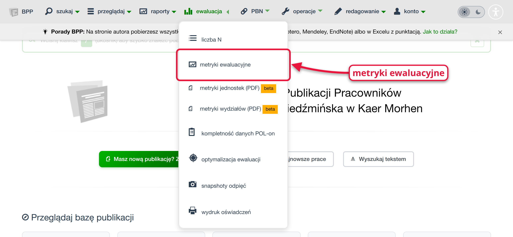
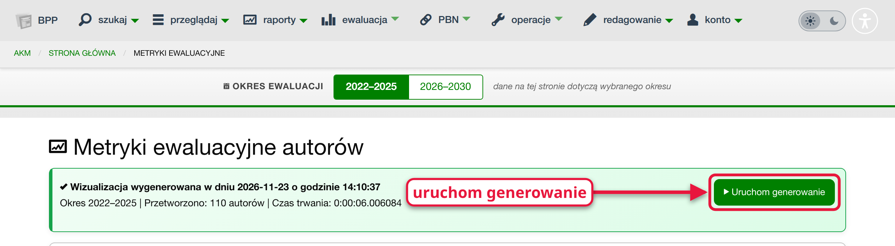
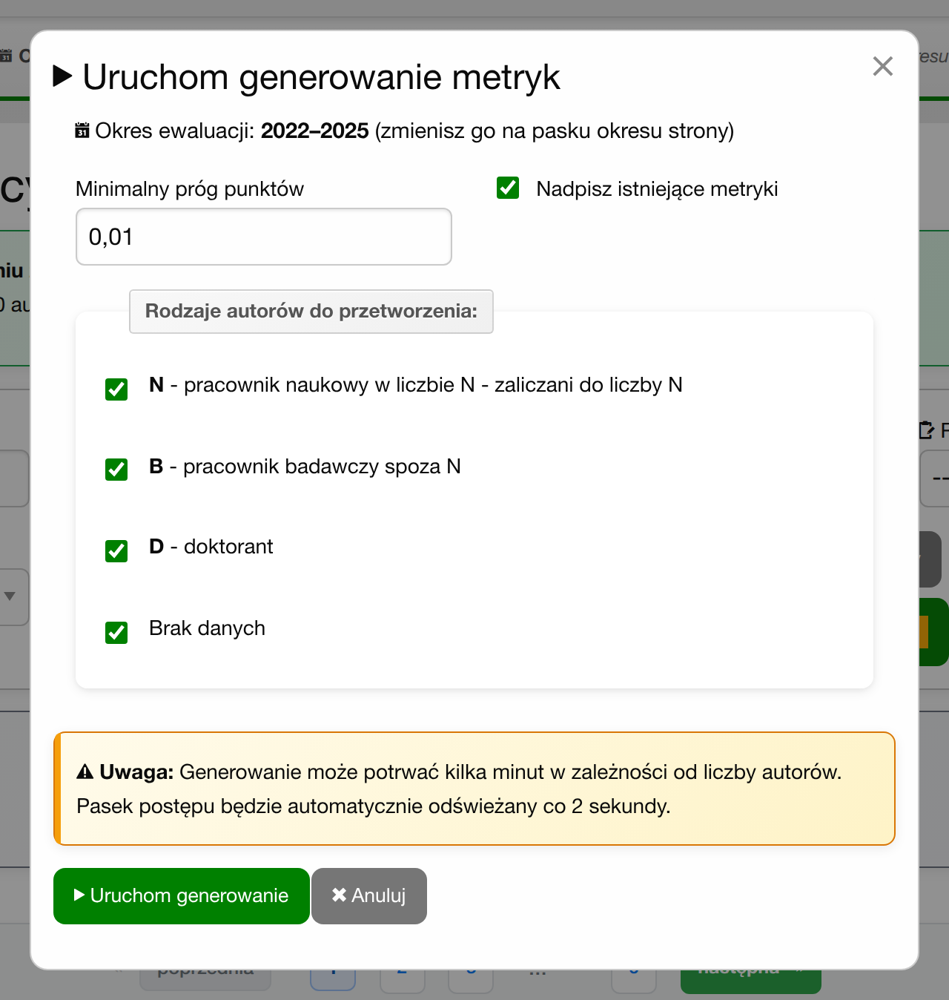
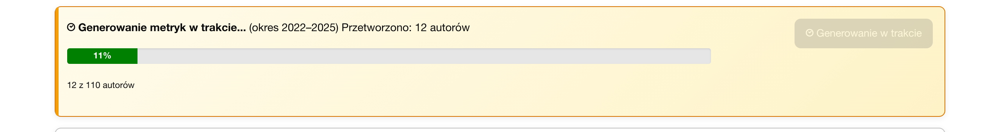
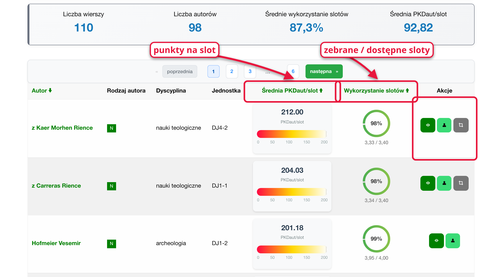
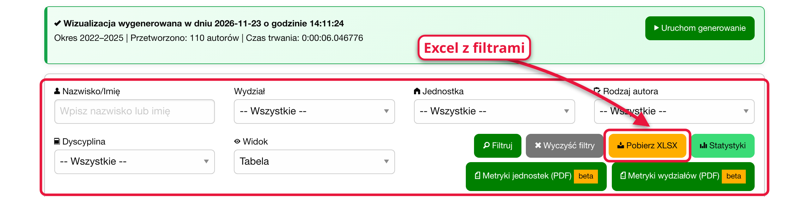
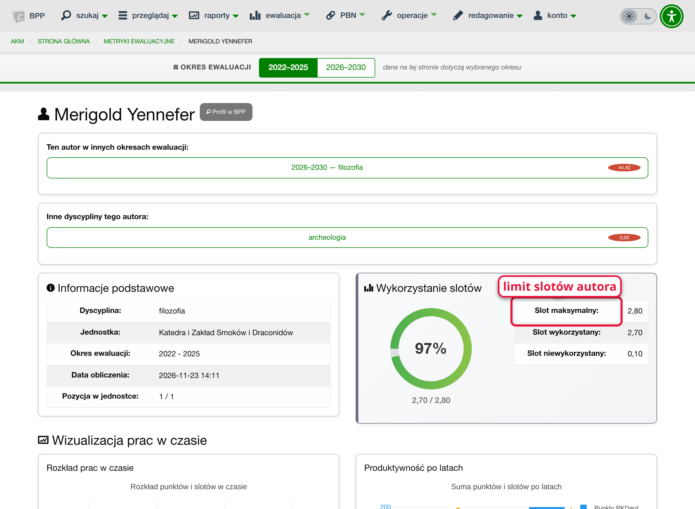
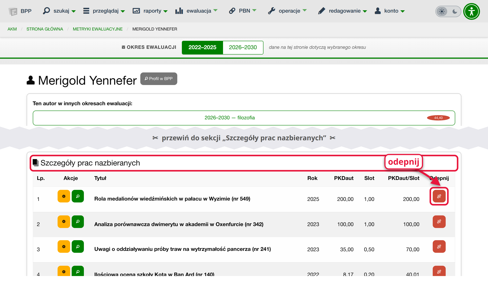
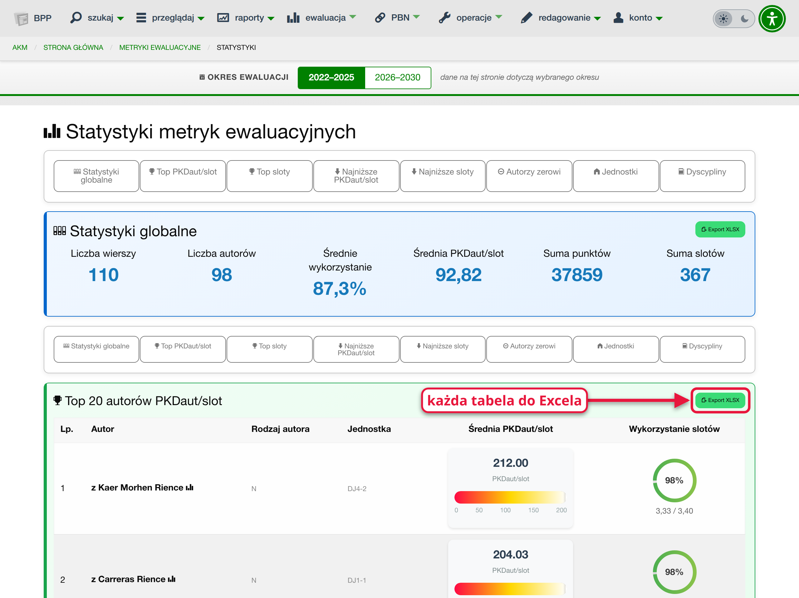

# Metryki ewaluacyjne autorów

Metryki ewaluacyjne to zestawienie „ile punktów i slotów wnosi każdy autor
w każdej dyscyplinie” w okresie ewaluacji 2022–2025. Dla każdej pary
autor + dyscyplina BPP:

- ustala **limit slotów** autora (z liczby N),
- wybiera z jego prac taki zestaw, który w tym limicie daje **najwięcej
  punktów** (tzw. algorytm plecakowy),
- pokazuje, ile punktów przypada średnio na jeden slot i jak bardzo autor
  wypełnił swój limit.

Dzięki temu w jednym miejscu widać, kto ma jeszcze wolne sloty, kto ma prace
„na zapas”, a kto w danej dyscyplinie nie ma nic. Metryki są **narzędziem
do planowania** — nie są wynikiem ewaluacji.

Ta strona prowadzi po kolei przez:

- [przeliczenie metryk](#przeliczenie-metryk),
- [czytanie tabeli](#tabela-metryk) i [filtry oraz eksport do Excela](#filtry-i-eksport),
- [szczegóły jednego autora](#szczegoly-autora) — w tym odpinanie dyscypliny,
- [statystyki zbiorcze](#statystyki) i [metryki jednostek w PDF](metryki-jednostek.md),
- [typowe pytania](#typowe-pytania) i [co może pójść nie tak](#co-moze-pojsc-nie-tak).

Pojęcia **punkty MNiSW**, **PKDaut** i **slot** wyjaśnia strona
[Gdzie sprawdzić punkty i sloty](../uzytkownik/punkty-i-sloty.md), a zasady
liczenia slotów — [Obliczanie slotów](sloty.md).

## Zanim zaczniesz {#zanim-zaczniesz}

**Dostęp.** Pełna lista metryk, statystyki, eksport do Excela i odpinanie
dyscyplin wymagają konta w grupie **„wprowadzanie danych”** (albo konta
superużytkownika). Przycisk **„Uruchom generowanie”** widzi dodatkowo tylko
osoba z dostępem do panelu administracyjnego (*w zespole*, `is_staff`).
Grupę i dostęp nadaje administrator BPP.

Zwykły użytkownik powiązany z autorem też może wejść na tę stronę — przez
przycisk **„Moje metryki ewaluacyjne”** w [swoim profilu](../uzytkownik/moj-profil-autora.md).
Widzi wtedy **wyłącznie własne** wiersze, bez przycisków przeliczania,
eksportu i statystyk.

**Dane wejściowe.** Metryki liczą się z tego, co już jest w BPP:

- **przypisań dyscyplin autorów** w latach 2022–2025 — rodzaj autora (N, B,
  D…), wymiar etatu i procent dyscypliny, zwykle z
  [importu z POL-on](import-polon-liczba-n.md),
- **dyscyplin przy autorach w pracach** — praca liczy się autorowi tylko
  w tej dyscyplinie, którą ma przypisaną w rekordzie, i tylko wtedy, gdy
  ta dyscyplina jest **przypięta**,
- **punktów** prac (punkty MNiSW, z nich PKDaut i sloty).

Po większych zmianach w tych danych metryki trzeba
[przeliczyć](#przeliczenie-metryk) — same się nie odświeżają (wyjątek:
[odpięcie i przypięcie dyscypliny](#odpinanie) z poziomu metryk).

## Gdzie to jest {#gdzie-to-jest}

Menu **ewaluacja → metryki ewaluacyjne**.

Pod ścieżką nawigacji jest pasek **Okres ewaluacji** — kliknij okres
(np. 2022–2025 albo 2026–2030), a cała strona pokaże dane tego okresu.
Okres jest też w adresie strony, np.
`/ewaluacja_metryki/2026-2030/`: taki link można wysłać komuś innemu
i otworzy się u niego dokładnie ten okres. To samo dotyczy liczby N,
optymalizacji, snapshotów odpięć i wydruku oświadczeń.

## Przeliczenie metryk {#przeliczenie-metryk}

1. Pod tytułem strony jest ramka statusu. Po ostatnim przeliczeniu mówi
   **„Wizualizacja wygenerowana w dniu … o godzinie …”**, ilu autorów
   przetworzono, ile było błędów i jak długo to trwało. Jeśli metryk nigdy
   nie liczono — **„Brak danych o generowaniu.”**. Kliknij
   **„Uruchom generowanie”**.

    

2. Otworzy się okno **„Uruchom generowanie metryk”**. W typowej sytuacji
   **niczego nie zmieniaj** i kliknij **„Uruchom generowanie”**.

    

    | Pole | Domyślnie | Co znaczy |
    |---|---|---|
    | **Okres ewaluacji** | okres wybrany na pasku | tylko informacja: metryki liczą się dla okresu wybranego na pasku **Okres ewaluacji** u góry strony. Żeby policzyć inny okres, zamknij okno i przełącz pasek |
    | **Minimalny próg punktów** | 0,01 | praca bierze udział w liczeniu, jeśli jej **punkty MNiSW** (za całą pracę) są co najmniej takie; 0,01 = pomiń prace bez punktów |
    | **Nadpisz istniejące metryki** | zaznaczone | przed liczeniem kasuje wszystkie dotychczasowe metryki (patrz [uwaga niżej](#nadpisz)) |
    | **Rodzaje autorów do przetworzenia** | wszystkie | dla kogo liczyć metryki: rodzaje autorów, dla których BPP liczy sloty (zwykle **N**, **B**, **D**), oraz **„Brak danych”** |

    Autor trafia do przeliczenia, jeśli w **którymkolwiek** roku okresu miał
    w tej dyscyplinie zaznaczony rodzaj. Odznaczenie np. **D** pomija
    doktorantów.

3. Okno się zamknie, a ramka statusu zrobi się żółta. Najpierw jest
   **„Oczekiwanie na rozpoczęcie przetwarzania...”** (zadanie czeka
   w kolejce), potem **„Przeliczanie liczby N i przygotowanie danych...”**
   — BPP **przelicza liczbę N** (zawsze, przy każdym generowaniu), a na
   końcu **„Generowanie metryk w trakcie...”** z napisem
   **„Przetworzono: … autorów”** i rosnącym paskiem postępu (na
   zrzucie niżej). Ramka odświeża się sama co 2 sekundy, a po
   zakończeniu przeładowuje całą stronę.

    

    Przeliczanie biegnie w tle — możesz zamknąć stronę i wrócić później.
    Trwa od kilku sekund do kilku minut, zależnie od liczby autorów.

!!! warning "W trakcie przeliczania lista jest pusta lub niepełna"
    Ponieważ **„Nadpisz istniejące metryki”** najpierw kasuje stare
    wiersze, do końca przeliczania tabela, eksport i statystyki pokazują
    tylko autorów już policzonych. Nie pobieraj wtedy Excela.

### „Nadpisz istniejące metryki” {#nadpisz}

Odznaczenie tego pola **nic nie zmienia** — metryki są przeliczane
i nadpisywane zawsze, a stare wiersze kasowane, tak jakby pole było
zaznaczone. Dotyczy to też autorów, których przy tym przeliczeniu pominiesz
(np. odznaczając rodzaj **D**) — ich metryki znikną z listy aż do
następnego pełnego przeliczenia.

## Tabela metryk {#tabela-metryk}

Nad tabelą są cztery liczby dla **aktualnie przefiltrowanych** wierszy:

- **Liczba wierszy** — par autor + dyscyplina (autor w dwóch dyscyplinach
  to dwa wiersze),
- **Liczba autorów** — różnych osób,
- **Średnie wykorzystanie slotów** — średnia z kolumny „Wykorzystanie
  slotów”,
- **Średnia PKDaut/slot** — średnia z kolumny „Średnia PKDaut/slot”
  (zwykła średnia z wierszy, nie ważona slotami).

Każdy wiersz tabeli to jeden autor w jednej dyscyplinie. Domyślnie
najlepsi (największa średnia PKDaut/slot) są na górze; po 20 wierszy na
stronę.

| Kolumna | Co pokazuje |
|---|---|
| **Autor** | kliknięcie (albo w dowolne miejsce wiersza) otwiera [szczegóły](#szczegoly-autora); nagłówek sortuje alfabetycznie |
| **Rodzaj autora** | N, B, D… z **najnowszego** roku, w którym autor ma tę dyscyplinę; „Brak danych”, gdy rodzaju nie wpisano |
| **Dyscyplina** | znika, gdy w metrykach jest tylko jedna dyscyplina |
| **Jednostka** | **aktualna** jednostka autora (skrót) — nie ta, w której pisał prace |
| **Średnia PKDaut/slot** | suma PKDaut wybranych prac podzielona przez sumę ich slotów; pasek ma skalę 0–200 |
| **Wykorzystanie slotów** | ile slotów zajmują wybrane prace / limit slotów autora, w procentach; pod kółkiem obie liczby, np. „3,92 / 4,00” |
| **Akcje** | oko — szczegóły; ludzik — strona autora w BPP; nożyczki — **„Kadruj”**, czyli pokaż tylko wiersze tego autora (przycisk jest tylko u autorów z więcej niż jedną dyscypliną) |

Jak czytać dwie główne liczby:

- **Limit slotów** (w szczegółach: *Slot maksymalny*) — z
  [liczby N](import-polon-liczba-n.md#liczba-n): suma rocznych udziałów
  autora w dyscyplinie (etat × procent dyscypliny) za lata 2022–2025,
  zaokrąglona w górę do 1, jeśli jest mniejsza, i obcięta do 4. Pełny etat
  w jednej dyscyplinie przez cztery lata = **4 sloty**.
- **Wybrane prace** (w szczegółach: *prace nazbierane*) — spośród wszystkich
  prac autora w tej dyscyplinie BPP wybiera zestaw, który mieści się
  w limicie slotów i daje **największą sumę PKDaut**. To od nich liczone są
  „Średnia PKDaut/slot” i „Wykorzystanie slotów”.

**Wykorzystanie 100%** oznacza, że autor ma dość punktowanych prac, żeby
wypełnić cały limit. **Mniej niż 100%** — wszystkie jego prace razem nie
wypełniają limitu: każda nowa punktowana praca w tej dyscyplinie podniesie
wynik.

Pole **„Widok”** zamiast tabeli pokazuje te same wiersze jako wykresy
(„Całokształt slotów”, mapy ciepła, wykres bąbelkowy itp.); kliknięcie
punktu na wykresie otwiera szczegóły autora. Wykresy nie mają podziału na
strony — pokazują wszystkie przefiltrowane wiersze naraz.

## Filtry i eksport do Excela {#filtry-i-eksport}

- **Nazwisko/Imię** — fragment nazwiska **lub** imienia,
- **Wydział** — tylko gdy uczelnia używa wydziałów i ma ich więcej niż
  jeden,
- **Jednostka** — według **aktualnej** jednostki autora,
- **Rodzaj autora** — w tym **„Brak danych”**,
- **Dyscyplina** — tylko gdy dyscyplin jest więcej niż jedna,
- **Widok** — tabela albo jeden z wykresów.

Zmiana pola od razu przeładowuje listę (przycisk **„Filtruj”** robi to samo).
**„Wyczyść filtry”** wraca do pełnej listy. Kliknięcie nagłówka
**„Średnia PKDaut/slot”**, **„Wykorzystanie slotów”** albo **„Autor”**
zmienia sortowanie.

**„Pobierz XLSX”** zapisuje do Excela **wszystkie wiersze zgodne z bieżącymi
filtrami i sortowaniem** (nie tylko widoczną stronę). Plik ma więcej kolumn
niż tabela: ID systemu kadrowego, ORCID, PBN UID, wydział, slot maksymalny,
nazbierany i niewykorzystany, % wykorzystania, PKDaut i średnią PKDaut/slot
osobno dla prac wybranych i dla wszystkich, liczbę prac (wybranych
i wszystkich) oraz lata okresu.

**„Statystyki”** otwiera [zestawienia zbiorcze](#statystyki).

## Szczegóły jednego autora {#szczegoly-autora}

Kliknij nazwisko w tabeli. Strona szczegółów pokazuje jedną parę autor +
dyscyplina. Jeśli autor ma kilka dyscyplin, nad danymi są przyciski
**„Inne dyscypliny tego autora”**.

- **Informacje podstawowe** — dyscyplina, jednostka, okres, data
  przeliczenia i **„Pozycja w jednostce”** (miejsce autora wśród osób z tej
  samej jednostki i dyscypliny według średniej PKDaut/slot, np. „1 / 4”).
- **Wykorzystanie slotów** — **Slot maksymalny** (limit), **Slot
  wykorzystany** (zajęty przez wybrane prace) i **Slot niewykorzystany**
  (różnica).
- **Wizualizacja prac w czasie** — wykresy punktów i slotów w latach.
- **Wymiar etatu i procent dyscypliny w latach 2022-2025** — dane, z których
  wziął się limit slotów, z rodzajem autora w każdym roku i średnimi.
  Pierwsze miejsce do sprawdzenia, gdy limit wygląda podejrzanie.
- **Prace nazbierane (algorytm plecakowy)** i **Wszystkie prace** — liczba
  prac, suma PKDaut, suma slotów i średnia PKDaut/slot dla prac wybranych
  oraz dla wszystkich prac autora w tej dyscyplinie.
- **Szczegóły prac nazbieranych** — wybrane prace z PKDaut, slotem
  i PKDaut/slot każdej z nich. Żółty przycisk otwiera optymalizację
  publikacji, zielony — stronę pracy.
- **Wszystkie prace w okresie** — wszystkie prace autora w tej dyscyplinie;
  prace wybrane mają etykietę **„Wybrana”**.
- **Prace z odpiętą dyscypliną w okresie** — prace, w których dyscyplina
  autora jest odpięta, z **szacunkowymi** PKDaut i slotem (punkty pracy
  i 1 slot podzielone równo przez liczbę autorów).

### Odpinanie i przypinanie dyscypliny {#odpinanie}

Czerwony przycisk (**„Odepnij dyscyplinę”**) przy pracy odpina dyscyplinę
tego autora **w samym rekordzie publikacji** — tak samo jak odznaczenie pola
„przypięta” przy autorze w redagowaniu pracy. Zielony przycisk
(**„Przypnij dyscyplinę”**) w sekcji prac odpiętych robi odwrotnie.

!!! danger "To zmienia dane pracy, nie tylko metryki"
    Przycisk działa od razu, **bez pytania o potwierdzenie**. Odpięta
    dyscyplina nie jest wykazywana do PBN i nie liczy się do punktów
    pracy — zmianę widać we wszystkich raportach slotów, nie tylko tutaj.
    Używaj go świadomie.

Po kliknięciu BPP od razu przelicza punktację tej pracy i metryki
**wszystkich** jej autorów z dyscypliną (odpięcie u jednego autora zmienia
podział punktów i slotów między pozostałych), po czym wraca do szczegółów.
Pełnego przeliczenia nie trzeba uruchamiać.

Szersze planowanie, które prace przypiąć, a które odpiąć, żeby uczelnia
zebrała jak najwięcej punktów, opisuje strona [Optymalizacja ewaluacji](optymalizacja-ewaluacji.md)
(menu **ewaluacja → optymalizacja ewaluacji**); stan odpięć można
zapamiętać i przywrócić w **ewaluacja → snapshoty odpięć**.

## Statystyki {#statystyki}

Przycisk **„Statystyki”** nad tabelą otwiera **„Statystyki metryk
ewaluacyjnych”** — zestawienia dla całej uczelni (filtry z listy tu nie
działają):

- **Statystyki globalne** — liczba wierszy i autorów, średnie wykorzystanie,
  średnia PKDaut/slot, suma punktów i suma slotów,
- **Top 20 autorów PKDaut/slot** i **Top 20 autorów sloty wypełnione**,
- **Rozkład wykorzystania slotów** — ile wierszy mieści się w przedziałach
  0–25%, 25–50% itd.,
- **Najniższe 20 autorów** wg PKDaut/slot i wg slotów (bez zerowych),
- **Lista autorów zerowych** — osoby z zerową średnią, które w danej
  dyscyplinie były w liczbie N, z latami, w których były,
- **Top 10 jednostek** wg średniej PKDaut/slot i **Statystyki wg dyscyplin**.

Każda sekcja ma własny przycisk **„Export XLSX”**.

## Metryki jednostek (PDF) {#metryki-jednostek}

Z metryk autorów BPP składa też zestawienie PDF dla kierownika jednostki —
kółka z wypełnieniem slotów i punktami każdej osoby, wykres „kto wypełnia
sloty, a kto pisze lepsze prace”, potencjał i zalecenia. Menu **ewaluacja →
metryki jednostek (PDF)** albo przycisk **„Metryki jednostek (PDF)”** nad
tabelą. Kto je widzi, jak nadać dostęp kierownikom i jak je czytać —
[Metryki jednostek](metryki-jednostek.md).

## Typowe pytania {#typowe-pytania}

**Dlaczego autor ma średnią 200, a wykorzystanie tylko 38%?**
Średnia liczy się tylko z wybranych prac. Autor ma mało prac, ale wysoko
punktowanych — np. jedną pracę za 200 punktów na 1,5 slota z 4 możliwych.
Wysoka średnia nie znaczy, że limit jest wypełniony.

**Dlaczego autor ma limit 4, a pracował na pół etatu?**
Limit to suma czterech lat. Sprawdź w szczegółach tabelę **„Wymiar etatu
i procent dyscypliny”**: pół etatu przez cztery lata to 2 sloty, ale jeśli
w którymś roku wpisano pełny etat albo 100% dyscypliny, limit rośnie. Jest
też reguła liczby N: osobie z dwiema dyscyplinami, z których jedna jest
nieraportowana, BPP dolicza slot do tej drugiej (do limitu 4) — patrz
[Liczba N](import-polon-liczba-n.md#liczba-n).

**Dlaczego praca autora nie jest wśród wybranych?**
Po kolei:

1. jest w **„Wszystkich pracach w okresie”**, ale bez etykiety „Wybrana” —
   inne prace dają więcej PKDaut w tym samym limicie slotów; tak ma być,
2. jest w **„Pracach z odpiętą dyscypliną”** — dyscyplina jest odpięta,
   przypnij ją,
3. nie ma jej nigdzie — praca nie ma punktów MNiSW (poniżej progu 0,01),
   jest spoza lat 2022–2025, autor ma w niej **inną dyscyplinę** albo
   żadnej, albo praca nie ma slotów (patrz
   [Praca ma punkty, ale nie ma slotu?](../uzytkownik/punkty-i-sloty.md#praca-ma-punkty-ale-nie-ma-slotu)).

**Dlaczego autora nie ma na liście?**
Metryki powstają tylko dla par autor + dyscyplina, które mają wyliczone
udziały w liczbie N (lista **„Lista udziałów za całość”** na stronie liczby
N). Autora nie będzie, gdy w latach 2022–2025 nie ma przypisanej
dyscypliny, rodzaju autora albo wymiaru etatu, gdy jego rodzaj odznaczono
przy przeliczaniu, albo gdy dane zmieniono po ostatnim przeliczeniu.

**Dlaczego jednostka w metrykach jest inna niż w pracach?**
Kolumna pokazuje **aktualną** jednostkę autora z dnia przeliczenia, filtr
„Jednostka” też.

**Zmieniłem dane — dlaczego metryki są stare?**
Metryki to zdjęcie z chwili przeliczenia (data w ramce statusu i „Data
obliczenia” w szczegółach). Po zmianach przeliczeń, przypisań dyscyplin czy
punktów kliknij **„Uruchom generowanie”** ponownie.

## Co może pójść nie tak {#co-moze-pojsc-nie-tak}

**Brak przycisku „Uruchom generowanie”.** Twoje konto nie ma dostępu do
panelu administracyjnego (*w zespole*). Poproś administratora albo inną
osobę z takim dostępem.

**Strona „Brak uprawnień” (błąd 403)** przy statystykach, odpinaniu
dyscypliny albo szczegółach innego autora — konto nie jest w grupie
„wprowadzanie danych”, więc widzi tylko własne metryki. Grupę nadaje
administrator BPP.

**„Nie znaleziono metryki ewaluacyjnej dla tego autora i dyscypliny. Proszę
o wygenerowanie metryk ponownie.”** — link do szczegółów prowadzi do pary,
której po ostatnim przeliczeniu już nie ma (np. trwa przeliczanie albo
autor stracił dyscyplinę). Poczekaj na koniec przeliczania albo przelicz
metryki.

**„Generowanie jest już w trakcie (rozpoczęte: …)”** — ktoś inny właśnie
przelicza. Poczekaj, aż ramka statusu zrobi się zielona.

**Czerwona ramka „Generowanie metryk zostało anulowane.”** Przeliczanie
wykonuje usługa zadań w tle. Jeśli w ciągu 5 minut od uruchomienia zadanie
w ogóle się nie rozpocznie (ramka cały czas pokazuje **„Oczekiwanie na
rozpoczęcie przetwarzania...”**), BPP samo anuluje to uruchomienie
i odblokowuje przycisk **„Uruchom generowanie”**. Komunikat w ramce mówi,
co dalej:

- **„Usługa przetwarzania zadań w tle nie działa — zgłoś to
  administratorowi systemu”** — ponowne klikanie nic nie da, dopóki
  administrator nie uruchomi usługi;
- **„Usługa przetwarzania zadań w tle działa — spróbuj uruchomić
  generowanie ponownie”** — zadanie nie doczekało się swojej kolejki
  (np. serwer był zajęty innymi zadaniami); uruchom generowanie jeszcze
  raz.

Ten sam komunikat pojawia się na stronach **Metryki jednostek** i **Metryki
wydziałów**, jeśli to one uruchomiły przeliczenie w okresie bez metryk.
Przeliczanie, które już ruszyło (ramka pokazuje **„Przeliczanie liczby N
i przygotowanie danych...”** albo licznik autorów) i nadal pracuje, nie
jest anulowane, nawet jeśli trwa długo.

Anulowane zostaje natomiast przeliczanie, które ruszyło i **zostało
przerwane w trakcie** — najczęściej przez restart usługi zadań w tle
podczas aktualizacji systemu. BPP sprawdza, czy ktokolwiek jeszcze nad nim
pracuje; jeśli nie, po około dwóch minutach ramka robi się czerwona
z komunikatem **„Generowanie metryk: zadanie zostało przerwane przed
zakończeniem (…) i nie zostanie dokończone. Uruchom je ponownie.”** Część
metryk mogła zostać już przeliczona — uruchom generowanie jeszcze raz, żeby
przeliczyć wszystkie. Gdy usługa zadań w tle nie działa dłużej niż 5 minut,
komunikat każe zgłosić to administratorowi systemu.

**W ramce statusu „Błędy: …”** — części par autor + dyscyplina nie udało
się policzyć; pozostałe metryki są poprawne. Jeśli błędy się powtarzają,
zgłoś to administratorowi (szczegóły są w dzienniku serwera).

**„Brak danych do wyświetlenia.”** w tabeli — metryk jeszcze nie
przeliczono albo filtry nic nie zwracają. Komunikat podpowiada polecenie
dla administratora (`oblicz_metryki`), ale redaktor może po prostu kliknąć
**„Uruchom generowanie”**.

**Wszyscy mają „Brak danych” w rodzaju autora lub limit 1.** Do BPP nie
trafiły dane z POL-on (rodzaje, etaty, procenty dyscyplin). Zacznij od
[importu z POL-on](import-polon-liczba-n.md) i jego **„Weryfikuj
poprawność bazy”**.

## Zobacz też

- [Metryki jednostek — zestawienie PDF dla kierownika](metryki-jednostek.md)
- [Gdzie sprawdzić punkty i sloty](../uzytkownik/punkty-i-sloty.md) —
  punkty MNiSW, PKDaut i sloty na stronach autora i pracy
- [Obliczanie slotów](sloty.md) — rodzaje autorów i progi algorytmu slotów
- [Import danych z POL-on i liczba N](import-polon-liczba-n.md) — skąd
  biorą się etaty, procenty dyscyplin i limit slotów
- [Raporty krok po kroku](../uzytkownik/raporty-krok-po-kroku.md) — raporty
  slotów autora i uczelni
