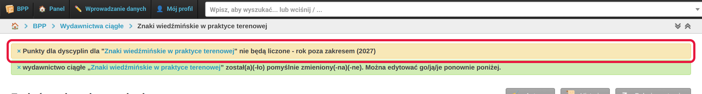
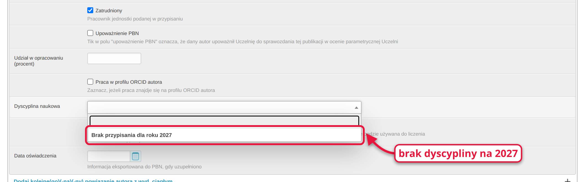
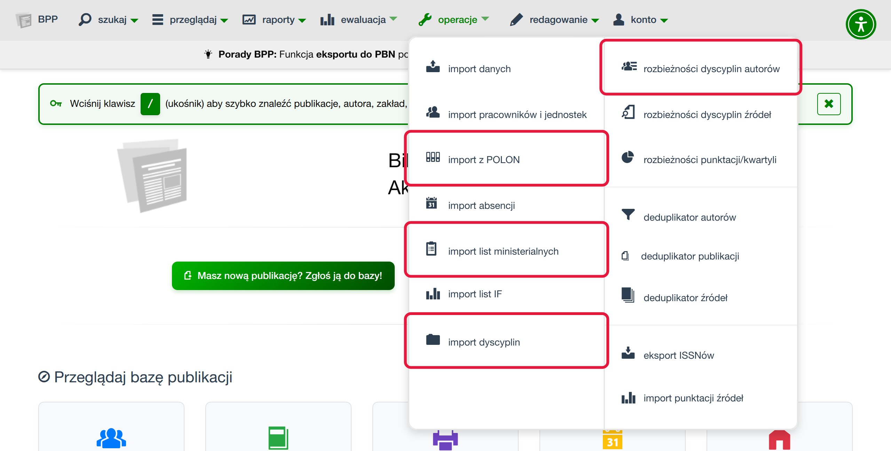
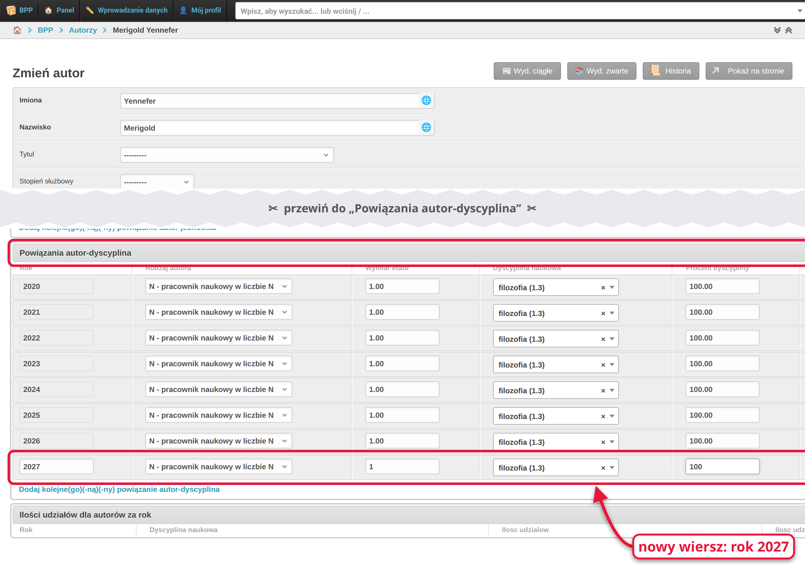
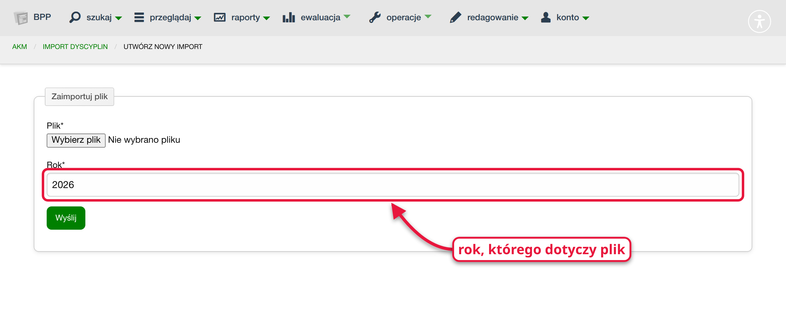
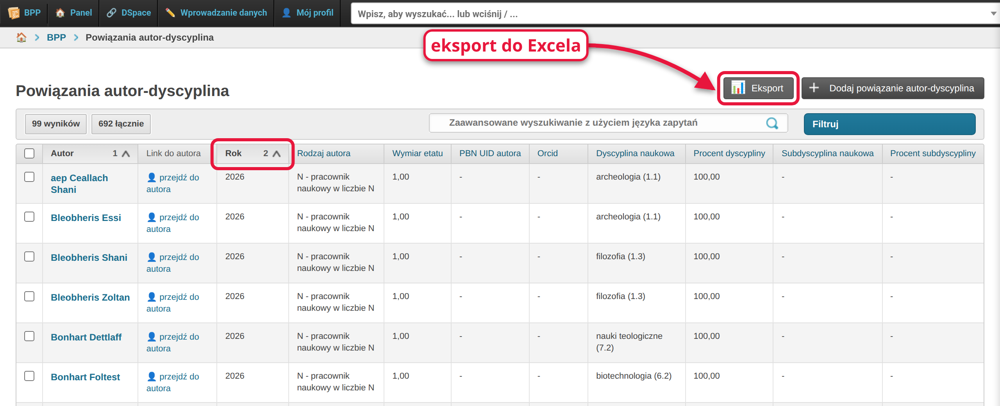
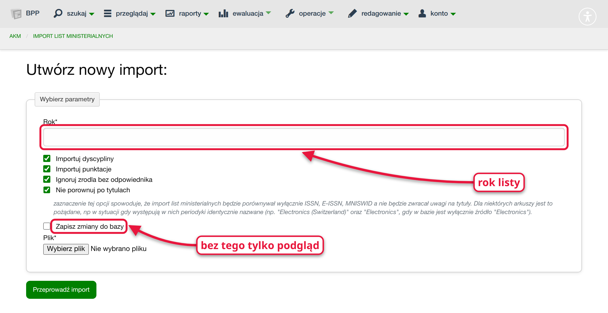
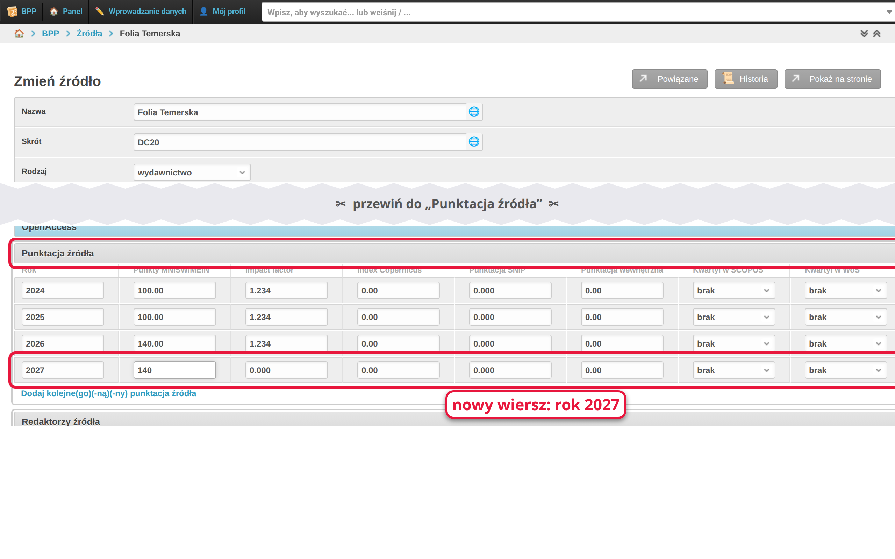
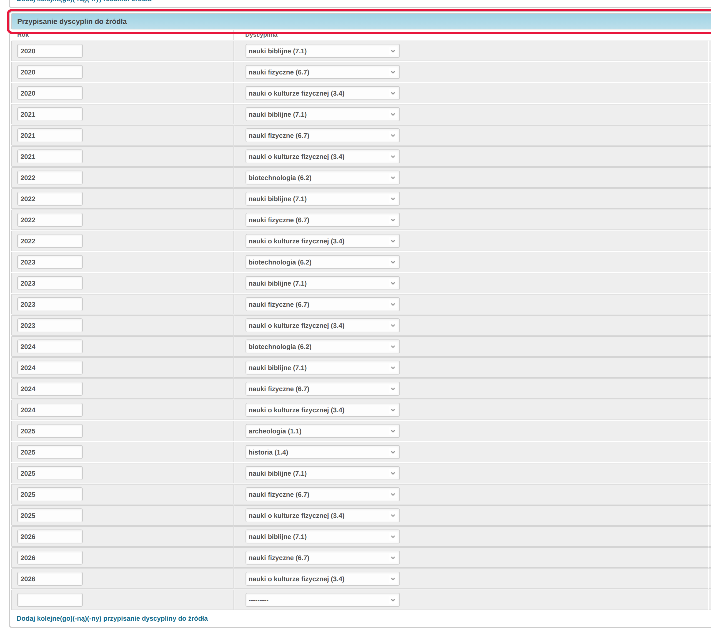
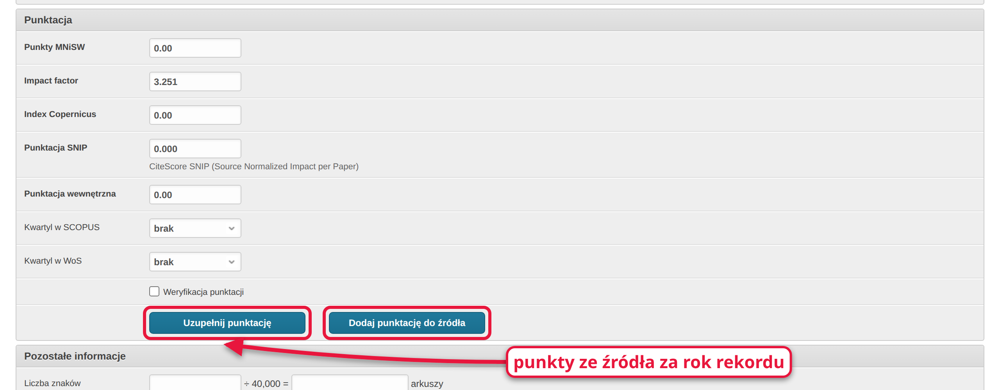

# Nowy rok w BPP — lista kontrolna (dyscypliny, punkty, sloty, oświadczenia)

Co roku w styczniu wraca to samo pytanie: „wpisuję pracę z nowego roku
i BPP nie liczy punktów ani slotów, nie da się wydrukować oświadczenia,
system pisze *rok poza zakresem*”. Zwykle nic się nie zepsuło — po prostu
**dla nowego roku brakuje danych**, które BPP przechowuje osobno na każdy
rok. Ta strona to lista kontrolna: co trzeba przygotować i gdzie to
zrobić.

Przykłady na zrzutach dotyczą roku **2027**: autorka ma dyscypliny
wpisane do 2026 r., czasopismo ma punktację do 2026 r., a w bazie jest już
artykuł z 2027 r.

## Kto może to zrobić

Wszystko poniżej robi redaktor z grupy **„wprowadzanie danych”**
(menu **operacje** na stronie BPP i moduł redagowania — menu
**Wprowadzanie danych**). Wyjątek to punkt 1 — górną
granicę lat ustawia program, więc zmienia ją aktualizacja BPP, którą
instaluje administrator systemu.

## Dwie różne przyczyny

BPP liczy punkty i sloty pracy tylko wtedy, gdy spełnione są **oba**
warunki:

1. **Program obsługuje dany rok.** Algorytmy punktów i slotów mają wpisany
   ostatni obsługiwany rok. Obecnie jest to **2026**. Dla pracy z późniejszego
   roku przy zapisie pojawia się komunikat:

    

    Tego **nie da się naprawić danymi** — granicę podnosi nowa wersja BPP.
    Jeśli widzisz ten komunikat w styczniu, poproś administratora
    o aktualizację BPP do wersji obsługującej nowy rok. Po aktualizacji
    wystarczy ponownie zapisać rekord.

2. **Dane na ten rok są w bazie** — dyscypliny autorów, punktacja
   i dyscypliny czasopism, poziomy wydawców. Te dane redakcja przygotowuje
   sama, opisuje je reszta strony.

## Lista kontrolna

- [ ] BPP zaktualizowane do wersji obsługującej nowy rok (punkt 1 wyżej).
- [ ] **Dyscypliny autorów** na nowy rok — z **rodzajem autora** (np.
  „N”) i wymiarem etatu.
- [ ] **Punktacja czasopism** na nowy rok.
- [ ] **Dyscypliny czasopism** na nowy rok.
- [ ] **Poziomy wydawców** na nowy rok (dla książek i rozdziałów).
- [ ] Prace z nowego roku wpisane **przed** uzupełnieniem danych —
  otwarte i zapisane ponownie, a dyscypliny przy autorach uzupełnione.

!!! info "Nie ma przycisku „skopiuj z poprzedniego roku”"
    BPP nie ma funkcji, która jednym kliknięciem przepisuje dyscypliny
    autorów, punktację czy dyscypliny czasopism z roku poprzedniego na
    nowy. Przypisania zmieniają się co roku (oświadczenia pracowników,
    nowe wykazy czasopism), więc i tak trzeba je sprawdzić, a kopia
    „w ciemno” mogłaby dać błędne sloty. Dane na nowy rok wczytuje się z plików (POL-on, wykaz
    ministerialny, plik z dyscyplinami) albo wpisuje ręcznie — patrz
    niżej. Jedynym wyjątkiem są **poziomy wydawców**: administrator
    systemu może je skopiować poleceniem serwisowym (patrz
    sekcja „Poziomy wydawców” niżej).

## Dyscypliny autorów

Bez dyscypliny autora na dany rok nie da się przypisać dyscypliny
w rekordzie pracy. W formularzu pracy, w polu **Dyscyplina naukowa**
przy autorze, zamiast listy dyscyplin zobaczysz:

### Sposób 1: import z POL-on (zalecany)

Dyscypliny, rodzaj autora i wymiar etatu najlepiej wczytać z eksportu
POL-on: menu **operacje → import z POLON**, w formularzu podajesz **rok**,
którego dotyczy plik. Import tworzy wpisy na ten rok i od razu przelicza
prace autorów. Szczegóły: [Import z POL-on i liczba N](import-polon-liczba-n.md).

### Sposób 2: ręcznie, przy autorze

1. W module redagowania (menu **redagowanie → redagowanie**) wybierz
   **Wprowadzanie danych → Autorzy** i otwórz autora.
2. Przewiń do sekcji **„Powiązania autor-dyscyplina”**. Jest tam po
   jednym wierszu na rok. W pustym wierszu na dole wpisz **Rok** (np. 2027),
   wybierz **Rodzaj autora**, wpisz **Wymiar etatu**, **Dyscyplinę
   naukową** i **Procent dyscypliny** (oraz ewentualnie subdyscyplinę
   z procentem). Kolejny pusty wiersz dodasz linkiem **„Dodaj
   kolejne(go)(-ną)(-ny) powiązanie autor-dyscyplina”**.
3. Kliknij **„Zapisz”**.

W wierszach już zapisanych pole **Rok** jest zablokowane — żeby
„przenieść” dyscyplinę na nowy rok, dodaj **nowy** wiersz, nie zmieniaj
starego.

!!! warning "Rodzaj autora jest obowiązkowy dla slotów"
    Sloty liczą się tylko dla autorów, którzy w danym roku mają rodzaj
    **N** (pracownik naukowy w liczbie N), **B** (pracownik badawczy spoza
    N) albo **D** (doktorant). Wiersz bez rodzaju autora (albo z rodzajem
    **Z**) pozwala przypisać dyscyplinę w pracy, ale **sloty dla tego
    autora nie powstaną**.

### Sposób 3: import dyscyplin z pliku

**operacje → import dyscyplin** → **„dodaj nowy plik”**. Wskazujesz plik
XLS (wzór pod przyciskiem **„pobierz plik wzorcowy”**) i **Rok** — domyślnie
podpowiada się bieżący rok, sprawdź go. Następnie przypisujesz kolumny pliku
(nazwisko, imię, ORCID, dyscyplina, procent…), oglądasz podgląd i dopiero
wtedy zatwierdzasz zmiany.

!!! warning "Import dyscyplin nie ustawia rodzaju autora"
    Plik importu dyscyplin nie ma kolumn **rodzaj autora** ani **wymiar
    etatu**. Nowe wiersze utworzone tym importem mają te pola puste — po
    imporcie uzupełnij je (ręcznie albo importem z POL-on), inaczej
    sloty się nie policzą (patrz ramka wyżej).

### Sprawdzenie: lista wszystkich przypisań

W module redagowania **Wprowadzanie danych → Powiązania autorów
z dyscyplinami** pokazuje przypisania wszystkich autorów.
Kliknij **„Filtruj”** i wybierz rok — porównaj liczbę wyników dla
starego i nowego roku. Przycisk **„Eksport”** zapisze listę do Excela.
Kolumna **„Link do autora”** (👤 **przejdź do autora**) otwiera kartę
autora w module redagowania — ten sam link jest na formularzu edycji
pojedynczego przypisania, tuż pod polem **„Autor”**.

Plik z eksportu za poprzedni rok to wygodny punkt wyjścia: po poprawkach
(zmiana roku, zmiany dyscyplin) można go wczytać przez **import
dyscyplin**. Pamiętaj wtedy o ostrzeżeniu o rodzaju autora.

## Punktacja i dyscypliny czasopism

Punkty pracy w czasopiśmie wpisuje się w rekordzie, ale BPP podpowiada je
z **punktacji źródła na rok rekordu**. Jeśli czasopismo nie ma punktacji
na nowy rok, przycisk **„Uzupełnij punktację”** w rekordzie pokaże
okienko **„Brak danych o punktacji tego źródła dla wpisanego roku.”**

### Sposób 1: import wykazu ministerialnego (zalecany)

**operacje → import list ministerialnych**. Podaj **Rok** wykazu
i plik XLSX z wykazem czasopism. Zaznaczone **Importuj dyscypliny**
i **Importuj punktacje** wpisują punkty i dyscypliny czasopism na ten
rok. Bez zaznaczenia **Zapisz zmiany do bazy** import jest tylko
podglądem — najpierw obejrzyj wynik, potem uruchom go ponownie z tym
polem zaznaczonym.

!!! tip "Gdy wykaz na nowy rok jeszcze nie wyszedł"
    Ministerstwo często publikuje wykaz później niż w styczniu. Do tego
    czasu możesz zaimportować dotychczasowy wykaz jako **nowy rok**
    (w polu **Rok** wpisz nowy rok) — punktacja i dyscypliny czasopism
    zostaną wpisane na nowy rok w obecnym kształcie. Gdy wyjdzie nowy
    wykaz, zaimportuj go na ten sam rok: import porówna dane i poprawi
    różnice.

Gdy uczelnia korzysta z integracji z PBN, punkty i dyscypliny pojedynczych
czasopism można też uzgodnić z PBN w **PBN → komparator źródeł PBN**.

### Sposób 2: ręcznie, przy źródle

1. W module redagowania **Wprowadzanie danych → Źródła**, otwórz
   czasopismo.
2. Sekcja **„Punktacja źródła”**: w pustym wierszu wpisz **Rok** i **Punkty
   MNiSW** (oraz inne wskaźniki, jeśli je prowadzicie).

    

3. Sekcja **„Przypisanie dyscyplin do źródła”** jest domyślnie zwinięta —
   kliknij jej nagłówek. Każda dyscyplina czasopisma to osobny wiersz
   z rokiem.

    

4. Kliknij **„Zapisz”**.

### Z poziomu rekordu pracy

W formularzu wydawnictwa ciągłego, w sekcji **„Punktacja”**:

- **„Uzupełnij punktację”** wpisuje do rekordu punktację źródła za rok
  rekordu (najpierw musi być wypełnione **Źródło** i **Rok**),
- **„Dodaj punktację do źródła”** działa odwrotnie — zapisuje punkty
  wpisane w rekordzie jako punktację źródła na rok rekordu. Gdy punktacja
  na ten rok już istnieje, BPP zapyta **„Punktacja dla tego roku już
  istnieje. Nadpisać?”**

Dyscypliny czasopism nie blokują liczenia slotów, ale z nich korzystają
raport **operacje → rozbieżności dyscyplin źródeł** i moduły optymalizacji
ewaluacji — brak dyscyplin na nowy rok to fałszywe „rozbieżności”.

## Poziomy wydawców

Punkty monografii i rozdziałów zależą od **poziomu wydawcy w danym roku**
(**Wprowadzanie danych → Wydawcy**, sekcja **„poziomy wydawcy”**:
rok + poziom I lub II). Bez
wpisu na nowy rok wydawca jest traktowany jak wydawca bez poziomu.
Uzupełnij poziomy ręcznie albo poproś administratora systemu o skopiowanie
poziomów z poprzedniego roku — BPP ma do tego polecenie serwisowe
(`klonuj_poziom_wydawcy`), które nie nadpisuje poziomów już wpisanych na
nowy rok.

## Prace wpisane przed uzupełnieniem danych

Prace z nowego roku wpisane, zanim pojawiły się dyscypliny autorów, nie
mają dyscyplin przy autorach i nie mają slotów. Po uzupełnieniu danych:

- **operacje → rozbieżności dyscyplin autorów** pokazuje rekordy, w których
  dyscyplina przy autorze różni się od dyscypliny autora w danym roku (lub
  jej brak). Zaznacz rekordy i wybierz akcję **„Ustaw pierwszą dyscyplinę
  autora jako dyscyplinę rekordu”** (albo drugą — dla autorów z dwiema
  dyscyplinami).
- Sloty przeliczają się przy zapisie rekordu. Import z POL-on przelicza prace
  autorów sam; po ręcznych zmianach otwórz i zapisz rekord.

## Oświadczenia

Ikona drukarki do wydruku oświadczenia jest w tabeli **„Punkty i sloty
autorów”** na stronie pracy. Ta tabela pojawia się **dopiero, gdy praca
ma policzone sloty** — dlatego dla pracy z nowego roku bez danych (albo
z roku poza zakresem programu) nie ma czego wydrukować. Po uzupełnieniu
danych i zapisaniu rekordu ikona się pojawi.

Masowy wydruk **ewaluacja → wydruk oświadczeń 2022-25** obejmuje tylko
okres ewaluacji 2022–2025 — prac z 2026 r. i późniejszych tam nie ma.

## Co może pójść nie tak

| Co widzisz | Dlaczego | Co zrobić |
|---|---|---|
| Po zapisie rekordu: *Punkty dla dyscyplin dla "…" nie będą liczone - rok poza zakresem (2027)* | Ta wersja BPP nie obsługuje jeszcze tego roku. | Aktualizacja BPP (administrator), potem ponowny zapis rekordu. |
| *Brak przypisania dla roku 2027* na liście dyscyplin przy autorze | Autor nie ma dyscypliny na ten rok. | Dodaj dyscyplinę autorowi (POL-on, ręcznie lub import dyscyplin). |
| Przy zapisie rekordu, przy dyscyplinie autora: *Autor nie ma przypisania na dany rok do takiej dyscypliny.* | Dyscyplina wybrana w pracy nie jest dyscypliną autora w roku pracy (np. zmieniono rok rekordu). | Popraw dyscyplinę w pracy albo dyscypliny autora na ten rok. |
| Okienko: *Brak danych o punktacji tego źródła dla wpisanego roku.* | Czasopismo nie ma punktacji na rok rekordu. | Import wykazu ministerialnego albo punktacja wpisana przy źródle. |
| Po zapisie rekordu: *Nie można obliczyć punktów dla dyscyplin dla "…": punkty MNiSW rekordu (…) i rok (…) nie pozwalają na dopasowanie tego rekordu do jakiejkolwiek grupy* | Punkty w rekordzie nie pasują do progów punktowych (np. zostały 0 lub puste). | Wpisz punkty (przycisk **„Uzupełnij punktację”**). |
| Dyscyplina przypisana, punkty są, ale slotów brak | Autor nie ma na ten rok **rodzaju autora** N/B/D (częste po imporcie dyscyplin z pliku), nie afiliuje albo dyscyplina jest odpięta. | Uzupełnij rodzaj autora w „Powiązania autor-dyscyplina”, zapisz rekord. |
| W raporcie slotów: *Upewnij się, że ta wartość jest mniejsza lub równa 2026.* | Raporty slotów nie przyjmują lat spoza obsługiwanego zakresu. | Jak w pierwszym wierszu — aktualizacja BPP. |
| Brak ikony drukarki (oświadczenia) na stronie pracy | Praca nie ma policzonych slotów. | Usuń przyczynę braku slotów (wiersze wyżej). |

## Zobacz też

- [Import z POL-on i liczba N](import-polon-liczba-n.md) — wczytywanie
  dyscyplin, rodzaju autora i wymiaru etatu z POL-on.
- [Sloty](sloty.md) — reguły liczenia slotów i rodzaje autorów.
- [Autorzy](autorzy.md) — redagowanie autorów.
- [Punkty i sloty](../uzytkownik/punkty-i-sloty.md) — gdzie użytkownik
  widzi punkty i sloty.
