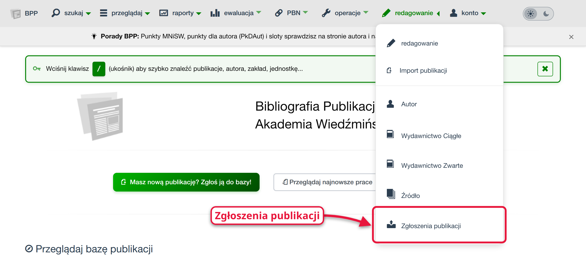
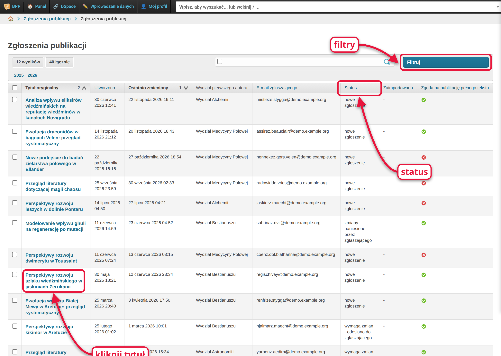
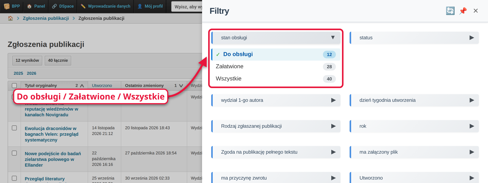
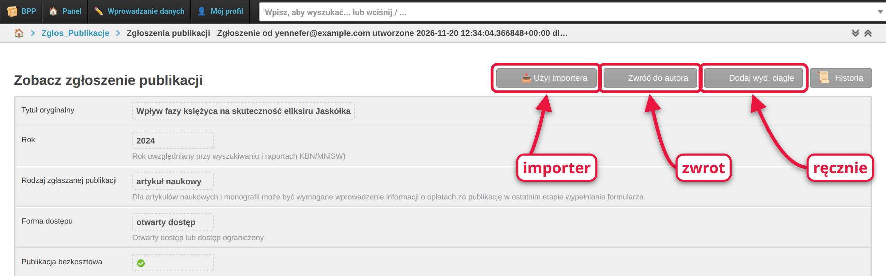
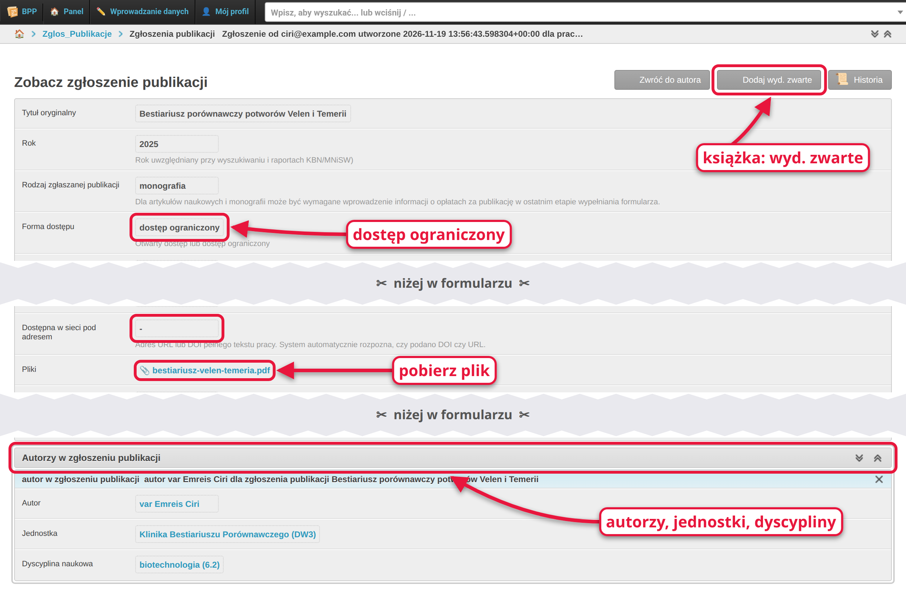
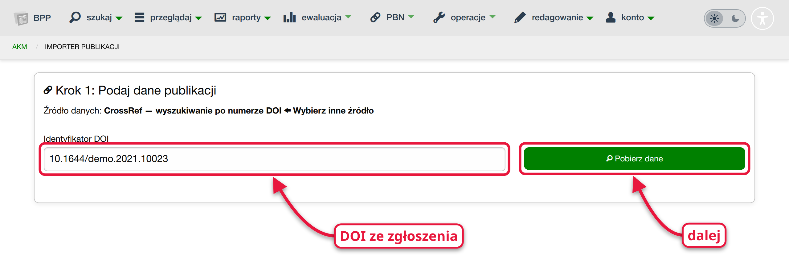
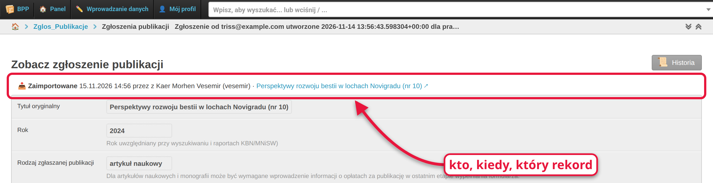
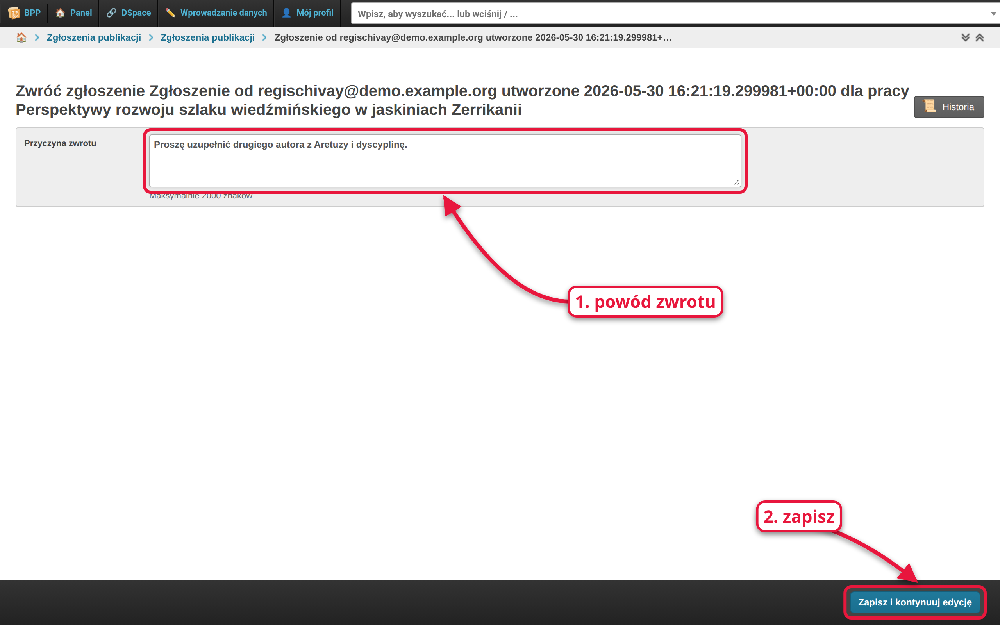

# Obsługa zgłoszeń publikacji (dla redaktora)

Pracownicy uczelni mogą sami zgłaszać brakujące prace przez formularz
**„Zgłoś publikację”** (jak to wygląda po ich stronie:
[Jak zgłosić nową publikację](../uzytkownik/zgloszenie-publikacji.md)).
Zgłoszenie **nie jest** jeszcze rekordem w bazie — trafia do redaktora,
który je sprawdza i na jego podstawie dopisuje pracę albo odsyła je
autorowi do poprawki. Ta strona opisuje tę drugą stronę: gdzie zgłoszenia
czekają i co można z nimi zrobić.

## Czego potrzebujesz

- konta z dostępem do modułu redagowania,
- grupy **„zgłoszenia publikacji”** — bez niej lista zgłoszeń jest
  niedostępna, a pozycja „Zgłoszenia publikacji” znika z menu modułu
  redagowania,
- grupy **„wprowadzanie danych”** — żeby dopisać pracę do bazy
  (importerem albo ręcznie).

Grupy nadaje administrator w **Administracja → Użytkownicy**.

## Skąd wiesz, że jest nowe zgłoszenie

Po każdym wysłanym zgłoszeniu BPP wysyła e-mail **„Zgłoszenie publikacji
z dnia … – tytuł”** z linkiem do zgłoszenia. Odbiorców wybiera tak:

1. **Przypisanie do wydziału.** Jeśli administrator przypisał osoby do
   wydziałów (**Administracja → Obsługa zgłoszeń prac - wydziały**),
   powiadomienie dostają osoby przypisane do wydziału **pierwszego autora
   ze zgłoszenia, który ma jednostkę uczelni** (autorzy z „obcej
   jednostki” są pomijani). Przypisanie obejmuje wydział i wszystkie jego
   jednostki podrzędne.
2. W pozostałych przypadkach — wszyscy z grupy **„zgłoszenia publikacji”**,
   którzy mają wpisany adres e-mail.
3. Gdy w tej grupie nie ma nikogo z adresem — wszyscy z grupy
   **„wprowadzanie danych”**.

Ten sam e-mail przychodzi ponownie, gdy autor poprawi zwrócone zgłoszenie.
Odpowiedź na wiadomość („Odpowiedz”) trafia prosto do zgłaszającego.

## Krok po kroku

1. W górnym menu BPP wybierz **redagowanie → Zgłoszenia publikacji**
   (otworzy się w nowej karcie). W module redagowania ta sama lista jest
   w menu **Wprowadzanie danych → Zgłoszenia publikacji**.

    

2. **Lista zgłoszeń.** Domyślnie widać tylko zgłoszenia **do obsługi**:
   nowe, zwrócone autorowi i poprawione przez autora. Kolumna **Status**
   mówi, na jakim etapie jest każde z nich. Najświeższe są na górze.

    

    Statusy, które zobaczysz:

    | Status | Co znaczy |
    |---|---|
    | nowe zgłoszenie | czeka na redaktora |
    | wymaga zmian - odesłano do zgłaszającego | zwrócone, czeka na poprawkę autora |
    | zmiany naniesione przez zgłaszającego | autor poprawił — znowu czeka na redaktora |
    | zaimportowany przez importer prac | praca dopisana importerem, sprawa zamknięta |

    W bazie mogą być też zgłoszenia ze starszych wersji BPP o statusach
    „zaakceptowany - dodany do bazy BPP”, „odrzucono w całości” albo „spam”.

3. **Filtry.** Przycisk **„Filtruj”** otwiera panel filtrów. Najważniejszy
   jest **stan obsługi**: **Do obsługi** (domyślny), **Załatwione**
   (zaimportowane, zaakceptowane, odrzucone, spam) i **Wszystkie**.
   Pozostałe filtry to m.in. **status**, **wydział 1-go autora**,
   **Rodzaj zgłaszanej publikacji**, **rok**, **ma załączony plik**,
   **ma przyczynę zwrotu** i **Zaimportował**. Pole wyszukiwania nad listą
   przeszukuje tytuł, e-mail zgłaszającego i przyczynę zwrotu.

    

    Gdy wybierzesz konkretny **status** (np. „spam”), filtr „stan obsługi”
    przestaje zawężać listę — inaczej wynik byłby pusty.

4. **Otwórz zgłoszenie** — kliknij tytuł. Zgłoszenia nie da się
   edytować; to podgląd tego, co przysłał autor. Nad formularzem są
   przyciski, którymi je obsłużysz:

    - **Użyj importera** — dopisanie pracy importerem (zalecane; krok 5),
    - **Zwróć do autora** — odesłanie do poprawki (krok 6),
    - **Dodaj wyd. ciągłe** / **Dodaj wyd. zwarte** — ręczne dopisanie
      rekordu (krok 7).

    

    Kiedy który przycisk się pokazuje:

    - **Użyj importera** — tylko gdy zgłoszenie ma link lub DOI w polu
      „Dostępna w sieci pod adresem” i nie zostało jeszcze zaimportowane,
    - **Zwróć do autora** — dla statusów „nowe zgłoszenie” i „zmiany
      naniesione przez zgłaszającego”,
    - **Dodaj wyd. ciągłe** dla artykułu, **Dodaj wyd. zwarte** dla
      monografii i rozdziału, oba dla „inne”.

    Zgłoszenie z **dostępem ograniczonym** nie ma linku — zamiast tego
    autor dołącza plik (PDF). Pobierzesz go z pola **Pliki**. Na dole
    strony są autorzy z jednostkami i dyscyplinami wskazanymi przez
    zgłaszającego.

    

5. **Dopisanie importerem.** Kliknij **„Użyj importera”**. Importer
   otworzy się z wybranym źródłem i wypełnionym identyfikatorem: przy DOI
   — **CrossRef** (DOI wyłuskany z linku), przy zwykłym adresie —
   **Pozostałe strony WWW**. Kliknij **„Pobierz dane”** i przejdź kolejne
   kroki importera (opis: [Importer publikacji](importer-publikacji.md)).

    

    W trakcie importu baner przypomina **„Ten import domknie zgłoszenie
    publikacji #…”** (przyciskiem **„Odepnij”** można to powiązanie
    zdjąć). Po utworzeniu rekordu zgłoszenie samo dostaje status
    **„zaimportowany przez importer prac”** i wypada z listy „Do
    obsługi”, a importer pokazuje **„Domknięto zgłoszenie publikacji #…”**
    i przycisk **„Wróć do zgłoszeń”** (wraca na listę z tymi samymi
    filtrami). Na stronie zgłoszenia pojawia się pasek **„Zaimportowane”**
    — kiedy, przez kogo i link do nowego rekordu:

    

    Importer potrafi też sam znaleźć zgłoszenie: jeśli zaczniesz import
    bez przycisku (np. z menu **Import publikacji**), a DOI pracy zgadza
    się z DOI w dokładnie jednym otwartym zgłoszeniu, BPP powiąże je
    samo (ten sam baner „Ten import domknie…”). Gdy pasuje kilka
    zgłoszeń, importer pokaże listę i wybierasz właściwe. Zgłoszeń
    zwróconych autorowi importer nie domyka.

6. **Zwrot do autora.** Kliknij **„Zwróć do autora”**, wpisz **Przyczynę
   zwrotu** (najwyżej 2000 znaków) i kliknij **„Zapisz i kontynuuj
   edycję”**.

    

    Co się dzieje dalej:

    - status zmienia się na **„wymaga zmian - odesłano do zgłaszającego”**,
      zgłoszenie zostaje na liście „Do obsługi”,
    - zgłaszający dostaje e-mail **„Prośba o korektę zgłoszenia publikacji
      z dnia … – tytuł”** z treścią przyczyny zwrotu i **linkiem do
      poprawienia formularza**; odpowiedź na ten e-mail trafi do Ciebie
      (Twój adres jest ustawiony jako adres zwrotny),
    - po poprawce status zmienia się na **„zmiany naniesione przez
      zgłaszającego”**, a redaktorzy znowu dostają powiadomienie.

    Link do poprawki działa do czasu, aż autor ją wyśle. Każdy kolejny
    zwrot tworzy nowy link.

7. **Ręczne dopisanie.** **„Dodaj wyd. ciągłe”** / **„Dodaj wyd. zwarte”**
   otwiera formularz nowego rekordu z danymi ze zgłoszenia: tytułem, rokiem,
   adresem WWW (z datą dostępu = dziś), opłatami, wydawcą i wydawnictwem
   nadrzędnym (jeśli autor wybrał je z listy) oraz autorami z jednostkami
   i dyscyplinami. W polu **Adnotacje** zostaje e-mail zgłaszającego
   i numer zgłoszenia. Uzupełnij resztę opisu i zapisz rekord.

    !!! note "Dyscypliny i jednostki ze zgłoszenia to propozycje"
        Zgłoszenie nie zmienia danych autorów — dyscyplina wybrana przez
        zgłaszającego jest tylko propozycją. Autorowi, który nie ma na rok
        pracy przypisania do proponowanej dyscypliny, formularz jej nie
        wpisze (zapis rekordu i tak by jej nie przyjął) — nad formularzem
        pojawi się komunikat. Przypisz ją wtedy w edycji autora albo
        dopisz pracę **importerem**, który sam założy przypisanie.
        Autorowi spoza uczelni formularz nie wpisuje ani dyscypliny, ani
        jednostki uczelni ze zgłoszenia (zamiast niej — obcą jednostkę
        uczelni, z odznaczonym „Afiliuje”), żeby zapis pracy nie zrobił
        z niego pracownika. Wybór jednostki obcej w formularzu autora
        rekordu sam odznacza „Afiliuje” — obca jednostka nigdy nie afiliuje.

    !!! warning "Ustaw obcą jednostkę uczelni"
        Autora spoza uczelni można zgłosić wyłącznie z **obcą jednostką
        uczelni** (Uczelnia → pole „Obca jednostka”). Jeśli nie jest
        ustawiona, formularz zgłoszenia odrzuci takiego autora, a lista
        zgłoszeń w module redagowania pokazuje ostrzeżenie (tak samo
        `manage.py check --database default`). BPP nie zakłada tej jednostki
        sam — ustaw ją ręcznie (jednostka z wyłączonym „Skupia
        pracowników”).

    !!! warning "Ręczne dopisanie nie zamyka zgłoszenia"
        Po zapisaniu rekordu tą drogą zgłoszenie **dalej ma status „nowe
        zgłoszenie”** i zostaje na liście „Do obsługi”. Usuń je ręcznie
        (krok 8). Importer zamyka zgłoszenie sam — to jeden z powodów,
        dla których jest zalecany.

8. **Usuwanie zgłoszeń** (duplikaty, spam, prace dopisane ręcznie).
   Przycisk **„Usuń”** jest na dole strony zgłoszenia; kilka naraz usuniesz
   z listy: zaznacz je, wybierz akcję **„Usuń wybrane(-nych) zgłoszenia
   publikacji”** i kliknij **„Wykonaj”**. Usunięte zgłoszenie znika
   z listy (także z „Wszystkie”). Statusów „odrzucono w całości” ani
   „spam” nie da się dziś ustawić z poziomu BPP.

## Co może pójść nie tak

- **Nie ma pozycji „Zgłoszenia publikacji” w menu „Wprowadzanie danych”**
  albo po kliknięciu w górnym menu widać brak uprawnień — konto nie jest
  w grupie „zgłoszenia publikacji”.
- **Nie ma przycisku „Użyj importera”** — zgłoszenie nie ma linku ani DOI
  (np. dostęp ograniczony z plikiem PDF) albo zostało już zaimportowane.
  Dopisz pracę ręcznie albo uruchom importer z innego źródła.
- **Nie ma przycisku „Zwróć do autora”** — zgłoszenie już czeka na
  poprawkę autora albo jest zamknięte.
- **Po zwrocie:** *„Z uwagi na błąd wysyłania komunikatu z powiadomieniem,
  użytkownik … nie został powiadomiony o dodaniu zgłoszenia. Prosimy wysłać
  e-mail ręcznie.”* — status zmienił się, ale e-mail do autora nie wyszedł.
  Napisz do niego sam i podaj przyczynę zwrotu. Gdy wszystko poszło
  dobrze, zobaczysz *„Użytkownik … został powiadomiony o zwróceniu
  zgłoszenia przez e-mail.”*
- **Nikt nie dostaje powiadomień o nowych zgłoszeniach** — osoby z grupy
  „zgłoszenia publikacji” (albo przypisane do wydziału) nie mają wpisanego
  adresu e-mail. Gdy wysyłka się nie uda, zgłaszający widzi komunikat, że
  „zespół Biblioteki nie został powiadomiony”, a zgłoszenie i tak trafia
  na listę.
- **Zgłoszenie po imporcie dalej jest „do obsługi”** — import nie był
  powiązany ze zgłoszeniem (np. zgłoszenie było wtedy zwrócone autorowi,
  inne DOI, powiązanie odpięte). Usuń zgłoszenie ręcznie.

## Zobacz też

- [Jak zgłosić nową publikację](../uzytkownik/zgloszenie-publikacji.md) — strona autora
- [Zgłaszanie publikacji — administrator](../administrator/zglaszanie-publikacji.md) — włączanie formularza, logowanie, opłaty, przypisanie do wydziałów
- [Importer publikacji](importer-publikacji.md)
- [Wydawnictwa ciągłe i zwarte](wydawnictwa.md)
