# Optymalizacja ewaluacji — wybór prac do slotów

Instrukcja dla osób, które w bibliotece albo w zespole ds. ewaluacji
przygotowują zestaw prac do ewaluacji 2022–2025. Opisuje, jak BPP
**sam dobiera prace do slotów** w każdej dyscyplinie tak, żeby suma
punktów była jak największa, jak czytać wynik i co z nim zrobić dalej
(eksport do Excela, odpięcie prac, które do ewaluacji nie wejdą).

Optymalizacja liczy całą uczelnię naraz: dla każdej **dyscypliny
raportowanej** (liczba N co najmniej 12) wybiera prace tak, żeby:

- żaden autor nie przekroczył swojego limitu slotów — najwyżej **4 sloty**,
  w tym najwyżej **2 sloty z monografii** (przy niepełnym etacie albo dwóch
  dyscyplinach limit jest mniejszy — wynika z udziałów policzonych razem
  z liczbą N),
- dyscyplina zmieściła się w limicie **3N** (kolumna „Liczba 3N -
  ostateczna” w module liczby N, po odjęciu sankcji),
- monografie za mniej niż 200 punktów („LOW-MONO”) stanowiły najwyżej
  **20%** wybranych prac,
- sloty autorów spoza liczby N stanowiły najwyżej **20%** wszystkich slotów.

Co to są punkty i sloty i skąd się biorą — zobacz
[Gdzie sprawdzić punkty i sloty](../uzytkownik/punkty-i-sloty.md)
i [Obliczanie slotów](sloty.md).

## Zanim zaczniesz {#zanim-zaczniesz}

**Uprawnienia.** Potrzebujesz konta w grupie **„wprowadzanie danych”** —
nadaje ją administrator BPP. Bez niej w menu **ewaluacja** nie ma pozycji
**optymalizacja ewaluacji**, a wejście na stronę kończy się komunikatem
„Brak uprawnień do wprowadzania danych.” Do przywracania stanu z listy
**snapshotów odpięć** (zobacz [Co zrobić z wynikiem](#co-dalej)) potrzebna jest dodatkowo grupa **„raporty”**.

**Aktualne dane wejściowe.** Optymalizacja korzysta z tego, co już jest
w BPP, więc najpierw:

1. zaimportuj dane z POL-on i **policz liczbę N** — opis:
   [Import danych z POL-on i liczba N](import-polon-liczba-n.md),
2. przelicz **metryki ewaluacyjne** (menu **ewaluacja** → **metryki
   ewaluacyjne**) — bez nich strony autorów w wynikach nie są dostępne,
3. upewnij się, że punkty prac są przeliczone (patrz „Przyciski są
   wyszarzone” niżej).

**Konieczny działający system zadań w tle.** Obliczenia wykonuje serwer
w tle (tzw. kolejka zadań). Jeśli po kliknięciu nic się nie dzieje, a status
stoi na „Oczekiwanie na rozpoczęcie przetwarzania”, zgłoś to administratorowi.
Samo przeliczenie metryk, które nie rozpocznie się w ciągu 5 minut, jest
anulowane automatycznie — patrz
[Metryki ewaluacyjne](metryki-ewaluacyjne.md).

## Uruchomienie optymalizacji {#uruchomienie}

1. W górnym menu wybierz **ewaluacja** → **optymalizacja ewaluacji**.

    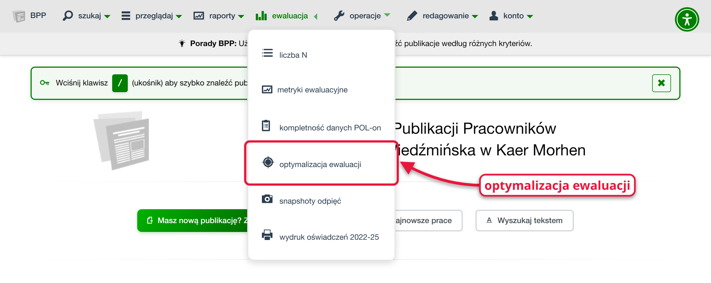

2. Na górze strony sprawdź ramkę z liczbą N. Zielona **„Gotowe do
   optymalizacji”** podaje, ile dyscyplin jest raportowanych — tylko one
   będą liczone. Czerwona **„Brak danych liczby N!”** oznacza, że najpierw
   trzeba policzyć liczbę N.

    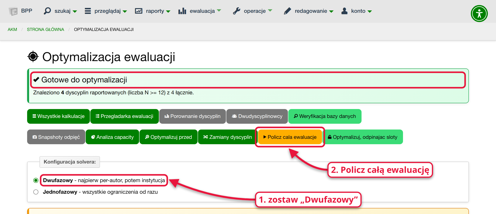

3. W ramce **„Konfiguracja solvera”** zostaw domyślny tryb **„Dwufazowy”**
   (najpierw najlepsze prace dla każdego autora, potem dopasowanie do
   limitów dyscypliny). Tryb **„Jednofazowy”** uwzględnia wszystkie
   ograniczenia od razu — bywa wolniejszy, przydaje się do porównania.

4. Kliknij **„Policz cala ewaluacje”** i potwierdź pytanie „Czy na pewno
   chcesz uruchomic optymalizacje dla WSZYSTKICH dyscyplin raportowanych…?”.

    !!! warning "Poprzednie wyniki znikają"
        Każde uruchomienie kasuje wcześniejsze wyniki optymalizacji tej
        uczelni. Jeśli chcesz zachować poprzedni stan, najpierw pobierz
        pliki Excel (zobacz [Co zrobić z wynikiem](#co-dalej)).

5. Otworzy się strona **„Status przeliczania ewaluacji”**, która odświeża
   się co 3 sekundy i pokazuje postęp dla każdej dyscypliny. Możesz ją
   zamknąć — obliczenia trwają dalej, a na stronie głównej zamiast
   przycisku startu pojawi się **„Zobacz status ewaluacji”**.

    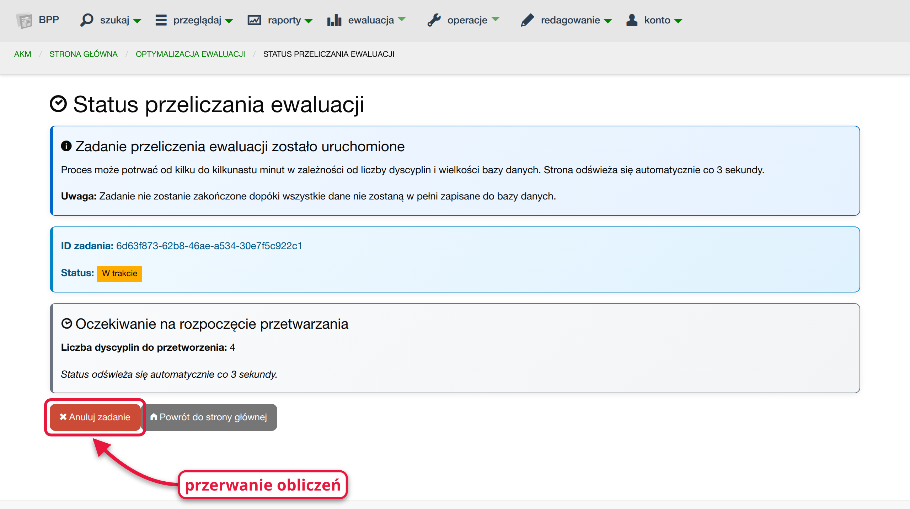

    **Ile to trwa?** Dyscypliny liczą się równolegle; całość zajmuje
    zwykle od kilku do kilkunastu minut. Jedna dyscyplina może liczyć się
    najdłużej 10 minut — potem jest przerywana (patrz „Co może pójść nie
    tak”). **„Anuluj zadanie”** przerywa obliczenia; niedokończone
    dyscypliny dostaną status „Błąd” z opisem „Anulowane przez użytkownika”.

Po zakończeniu BPP sam wraca na stronę główną z komunikatem „Przeliczanie
ewaluacji zakończone pomyślnie! Przeliczono … dyscyplin.”

## Jak czytać wynik {#wynik}

1. Tabela **„Ostatnie kalkulacje”** ma po jednym wierszu na dyscyplinę,
   a na dole wiersz **RAZEM**.

    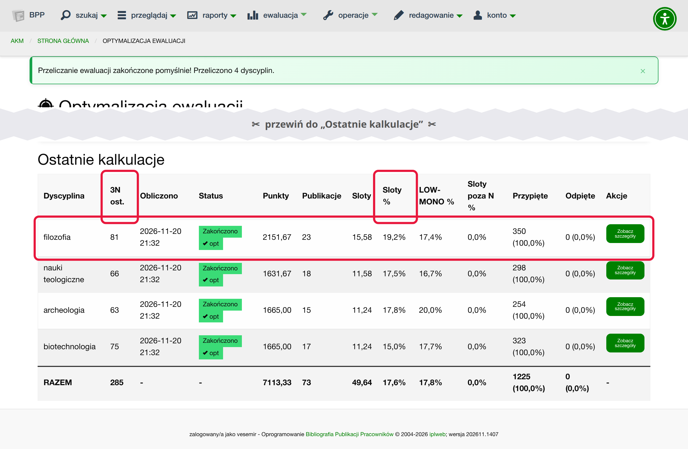

    - **3N ost.** — limit slotów dyscypliny (3 × liczba N minus sankcje),
    - **Status** — „Zakończono” i znaczek **„opt”**, gdy znaleziono
      najlepszy możliwy wynik; żółty wykrzyknik oznacza wynik poprawny
      (wszystkie limity spełnione), ale być może nie najlepszy,
    - **Punkty**, **Publikacje**, **Sloty** — suma punktów, liczba prac
      i suma slotów wybranych do ewaluacji,
    - **Sloty %** — jaka część limitu 3N jest wypełniona,
    - **LOW-MONO %** i **Sloty poza N %** — udział tanich monografii
      i autorów spoza liczby N (każdy najwyżej 20%),
    - **Przypięte / Odpięte** — ile powiązań autor–praca z lat 2022–2025
      w tej dyscyplinie liczy się do slotów, a ile jest odpiętych.

    Przycisk **„Zobacz szczegóły”** otwiera wynik jednej dyscypliny.
    Wszystkie dotychczasowe obliczenia widać pod przyciskiem
    **„Wszystkie kalkulacje”**, a zestawienie dyscyplin obok siebie —
    pod **„Porownanie dyscyplin”**.

2. Strona **„Wyniki optymalizacji”** dyscypliny pokazuje na górze sumę
   punktów, slotów, liczbę prac i udział LOW-MONO, potem wykresy
   **„Analiza liczby N”** (ile punktów i slotów wnoszą autorzy w liczbie N,
   a ile spoza niej). Niżej jest tabela **„Wyniki autorów”**:

    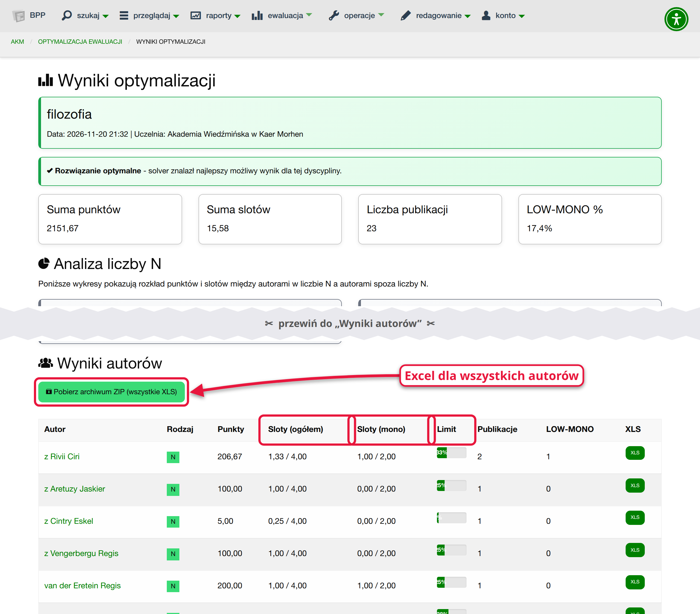

    - **Rodzaj** — rodzaj autora (zielony znaczek = osoba w liczbie N),
    - **Sloty (ogółem)** — ile slotów autora wykorzystano / jaki jest jego
      limit (zwykle 4),
    - **Sloty (mono)** — to samo dla monografii (limit zwykle 2),
    - **Limit** — pasek wykorzystania limitu slotów,
    - **XLS** — prace autora w układzie zgodnym z SEDN; **„Pobierz archiwum
      ZIP (wszystkie XLS)”** — to samo dla wszystkich autorów dyscypliny
      w jednym pliku.

    Autor z niskim wykorzystaniem limitu ma po prostu za mało punktowanych
    prac w tej dyscyplinie — optymalizacja nie „dosypie” mu slotów.

3. Kliknij nazwisko autora, żeby zobaczyć **„Prace autora”**:

    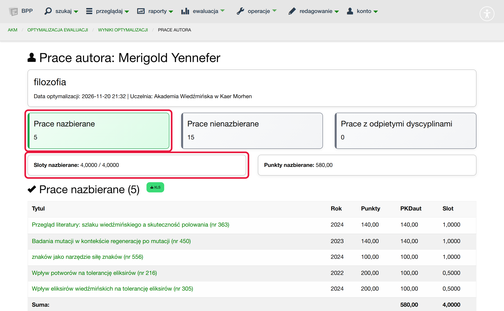

    - **Prace nazbierane** — prace z metryki ewaluacyjnej autora, z punktami
      przypadającymi na autora (**PKDaut**) i slotem,
    - **Prace nienazbierane** — pozostałe prace autora w tej dyscyplinie,
    - **Prace z odpietymi dyscyplinami** — prace, w których dyscyplina tego
      autora jest odpięta i nie liczy się do slotów.

    !!! note "Dwa różne wybory prac"
        Ta strona pokazuje **najlepszy zestaw dla samego autora** (jego
        metrykę ewaluacyjną), a nie to, co wybrała optymalizacja całej
        dyscypliny. Ten drugi wybór bywa skromniejszy, bo musi spełnić
        limity dyscypliny (np. 20% tanich monografii) — widać go w kolumnach
        **Punkty** i **Sloty (ogółem)** w tabeli „Wyniki autorów” i w pliku
        **XLS** z tej tabeli. Gdy liczby się różnią, wiążący dla ewaluacji
        jest wynik optymalizacji dyscypliny.

    Każdą listę można pobrać przyciskiem **XLS** przy nagłówku. Autor
    z dwiema dyscyplinami ma u góry przycisk **„Przejdz do dyscypliny: …”**.
    Nazwisko w tabeli jest linkiem tylko wtedy, gdy autor ma policzoną
    metrykę ewaluacyjną w tej dyscyplinie.

## Co zrobić z wynikiem {#co-dalej}

1. **Eksport do Excela.** Na stronie głównej, pod przyciskami, są:

    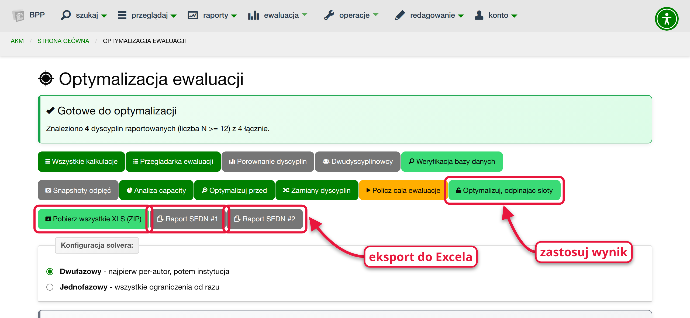

    - **„Pobierz wszystkie XLS (ZIP)”** — pliki XLS wszystkich autorów
      ze wszystkich dyscyplin (archiwum przygotowuje się po zakończeniu
      „Policz cala ewaluacje”),
    - **„Raport SEDN #1”** — jeden wiersz na autora i pracę: identyfikator
      PBN pracy, tytuł, rodzaj, rok, imię i nazwisko, wartość udziału
      (slot), punkty do ewaluacji, punkty całkowite i kolumna **„WSKAZANE
      PRZEZ ALGORYTM”** (czy praca weszła do ewaluacji),
    - **„Raport SEDN #2”** — jeden wiersz na pracę: kto ją oświadczył,
      punktacja źródła, punktacja ogółem i punktacja udziałów wybranych do
      ewaluacji.

    Pliki służą do porównania z SEDN i do pracy z kierownikami dyscyplin.
    **BPP niczego nie wysyła do SEDN** — wybór prac w SEDN robi się tam.

2. **Odpięcie prac, które nie weszły do ewaluacji** — przycisk
    **„Optymalizuj, odpinajac sloty”**. Po potwierdzeniu BPP:

    1. sprawdza, czy każda dyscyplina raportowana ma policzoną
       optymalizację,
    2. zapisuje **snapshot** (kopię) obecnego stanu przypięć,
    3. **odpina dyscyplinę** w powiązaniach autor–praca z lat 2022–2025,
       które nie zostały wybrane do ewaluacji (zostawia prace wybrane oraz
       te, w których autor ma pełny slot),
    4. przelicza punktację i jeszcze raz liczy optymalizację wszystkich
       dyscyplin.

    Po co? Odpięty autor przestaje „zabierać” udział w pracy
    wieloautorskiej, więc współautorom z tej samej dyscypliny rośnie slot
    i punkty. Cały proces trwa zwykle 20–30 minut; strona **„Optymalizacja
    z odpinaniem slotów”** pokazuje bieżący etap (walidacja, snapshot,
    odpinanie, przeliczanie punktacji, optymalizacja).

    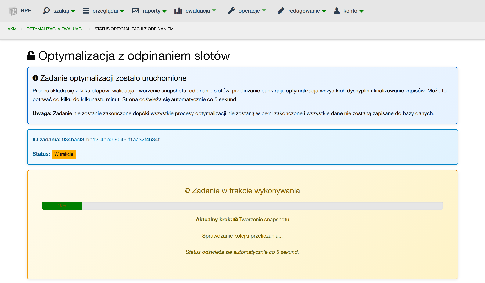

    Po zakończeniu BPP wraca na stronę główną z komunikatem
    „Optymalizacja z odpinaniem zakończona pomyślnie! Odpiętych publikacji:
    …”, a kolumna **Odpięte** w tabeli pokazuje, ile powiązań odpięto
    w każdej dyscyplinie.

    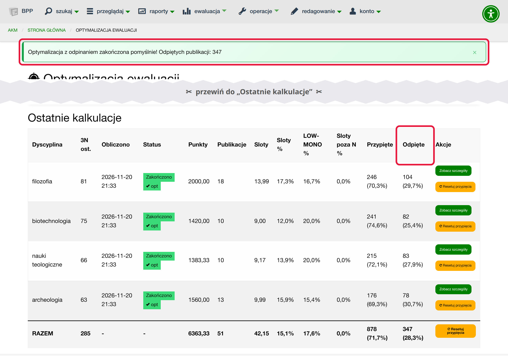

    **Porównaj wynik przed i po.** Sprawdź w wierszu **RAZEM** sumę
    punktów i slotów (przed odpinaniem zapisuje ją też adnotacja snapshotu,
    punkt 3). Jeśli po odpinaniu punktów jest **mniej**, przywróć snapshot
    i zgłoś to administratorowi — odpinanie ocenia prace według metryk
    autorów, a nie według wyniku optymalizacji, więc może odpiąć pracę,
    którą optymalizacja wybrała.

    !!! warning "To zmienia dane w bazie"
        Odpięcie widać od razu w rekordach prac i w raportach slotów.
        Rób to, gdy dane wejściowe (liczba N, dyscypliny, punkty) są już
        ostateczne.

3. **Powrót do stanu sprzed odpięcia.** Menu **ewaluacja** → **snapshoty
    odpięć** (albo przycisk **„Snapshoty odpięć”**). Snapshot zrobiony przez
    odpinanie ma adnotację „Snapshot przed optymalizacją z odpinaniem.
    Suma punktów: …”. Kliknij go i potwierdź **„Tak, zaaplikuj snapshot”** —
    pojawi się komunikat „Zaaplikowano snapshot odpięć nr …”.

    Snapshoty są zapisywane osobno dla każdego okresu ewaluacji: snapshot
    obejmuje tylko prace z lat okresu wybranego na pasku **Okres ewaluacji**,
    więc jego zaaplikowanie nie zmienia przypięć prac z innego okresu. Lista
    snapshotów pokazuje snapshoty wybranego okresu oraz starsze snapshoty
    sprzed podziału na okresy (kolumna **Okres**: „wszystkie lata”) — te
    przywracają przypięcia prac ze wszystkich lat. Reset przypięć i odpinanie
    też działają tylko na pracach z lat wybranego okresu. Patenty nie biorą
    udziału w przypięciach i odpięciach — reset ani odpinanie ich nie
    zmieniają.
    Uwaga: snapshot nadpisuje **wszystkie** ręczne przypięcia i odpięcia
    zrobione po jego utworzeniu. Przycisk **„Resetuj przypięcia”** w tabeli
    wyników działa inaczej — przypina z powrotem wszystkie prace z lat
    2022–2025 w danej dyscyplinie (albo we wszystkich, w wierszu RAZEM),
    także te odpięte ręcznie.

    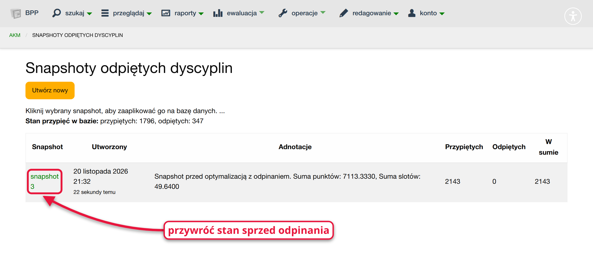

## Ręczna poprawka jednej pracy {#jedna-praca}

Gdy wiesz, że w konkretnej pracy dyscyplinę autora trzeba odpiąć, przypiąć
albo zamienić na drugą dyscyplinę autora, nie musisz liczyć całej uczelni.

1. Otwórz stronę pracy i w ramce **„Punkty i sloty autorów”** kliknij
   **„Optymalizuj”** (przycisk widzą tylko osoby z grupy „wprowadzanie
   danych”).

    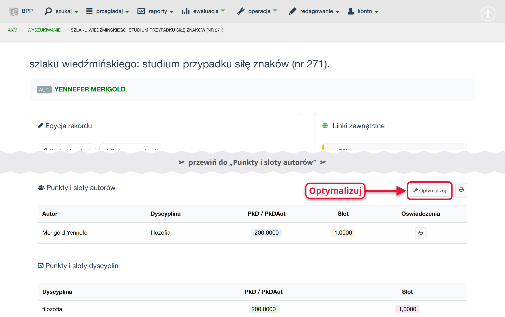

2. Strona **„Optymalizacja publikacji”** pokazuje punkty pracy, łączną
   liczbę przypiętych slotów i — dla każdego autora z dyscypliną — jego
   punkty i sloty z tej pracy, metryki (punkty łącznie, średnia za slot,
   sloty nazbierane, wykorzystanie slotów) oraz znaczniki **„Przypieta”**
   i **„Udział wybrany do ewaluacji” / „Udział niewybrany”** (czy praca weszła do
   prac nazbieranych autora).

    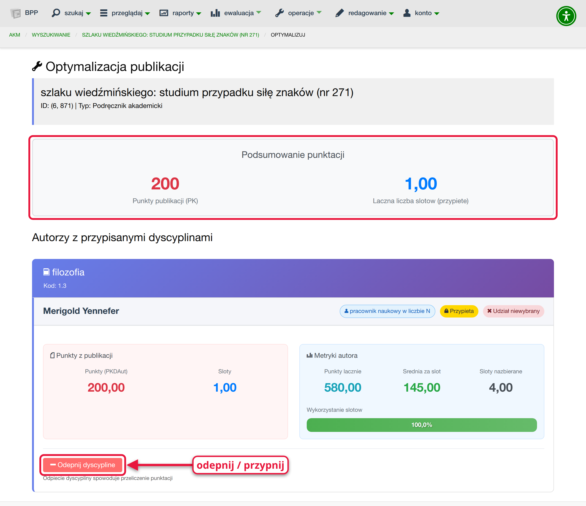

3. **„Odepnij dyscypline”** / **„Przypnij dyscypline”** zmienia przypięcie
   od razu i przelicza punktację tej pracy oraz metryki autorów. Dla
   odpiętego autora BPP pokazuje wartości orientacyjne („Dyscyplina odpieta
   - wartosci orientacyjne”) — ile by dostał po ponownym przypięciu.
   Jeśli autor ma w danym roku drugą dyscyplinę, pojawia się też przycisk
   **„Zmien dyscypline na: …”**.

Po kilku takich poprawkach uruchom **„Policz cala ewaluacje”** jeszcze raz,
żeby wyniki na stronie optymalizacji były aktualne.

## Narzędzia dodatkowe {#narzedzia-dodatkowe}

Na stronie głównej są też narzędzia do analiz przed ostatecznym wyborem:

- **„Przegladarka ewaluacji”** — wszystkie prace dyscyplin raportowanych
  z możliwością przypinania i odpinania na jednej liście,
- **„Optymalizuj przed”** — wyszukuje prace wieloautorskie, w których
  odpięcie jednego autora zwiększy wynik współautorów,
- **„Zamiany dyscyplin”** — prace, w których zamiana dyscypliny autora
  (główna ↔ druga dyscyplina) da więcej punktów,
- **„Analiza capacity”** — propozycje odpięć według wolnego miejsca
  w limitach autorów,
- **„Dwudyscyplinowcy”** — autorzy z dwiema dyscyplinami i ich artykuły,
  które mogą liczyć się w drugiej dyscyplinie; jak z tego korzystać:
  [Autorzy z dwiema dyscyplinami](dwudyscyplinowcy.md),
- **„Weryfikacja bazy danych”** — prace z autorami o slocie poniżej 0,1;
  przycisk jest czerwony, gdy takie prace są — popraw je przed
  optymalizacją.

## Co może pójść nie tak {#co-moze-pojsc-nie-tak}

**Przyciski są wyszarzone, a po kliknięciu pojawia się „Czekamy na
przeliczenie punktów. Obecnie jest … rekordów do przeliczenia.”** — BPP
jeszcze przelicza punkty po zmianach w pracach. Pasek postępu pod
przyciskami pokazuje, ile zostało; przyciski odblokują się same. Ten sam
powód ma komunikat „Przed optymalizacją poczekaj na przeliczenie punktów.
Obecnie jest … rekordów do przeliczenia.”

**„Brak danych liczby N dla uczelni! Przed optymalizacją musisz najpierw
policzyć liczbę N.”** (na stronie: „Brak danych liczby N!”) — policz liczbę
N: [Import danych z POL-on i liczba N](import-polon-liczba-n.md#liczba-n).

**„Znaleziono … dyscyplin z danymi liczby N, ale żadna nie ma liczby N >= 12
(nie są raportowane). Optymalizacja nie przetworzy żadnych dyscyplin.”** —
żadna dyscyplina nie jest raportowana. Sprawdź import z POL-on (etaty,
procenty dyscyplin) i przelicz liczbę N.

**„Brak wykonanych optymalizacji. Uruchom polecenie python src/manage.py
solve_evaluation …”** — to tylko informacja, że jeszcze nic nie policzono.
Polecenie jest dla administratora; Ty kliknij **„Policz cala ewaluacje”**.

**„Zadanie optymalizacji już działa. Przekierowuję do statusu.”** — ktoś
(może Ty w innej karcie) już uruchomił obliczenia. Poczekaj na koniec.

**Dyscyplina ma status „Błąd”.** Najczęściej: „Przekroczono limit czasu
obliczeń (10 minut). Spróbuj ponownie lub sprawdź logi systemu.” — duża
dyscyplina nie zmieściła się w czasie. Uruchom obliczenia jeszcze raz
w spokojniejszej porze; jeśli się powtarza, zgłoś to administratorowi.
Szczegóły innych błędów (przycisk **„Szczegóły”** na stronie statusu) widzi
tylko administrator — przekaż mu nazwę dyscypliny i godzinę.

**„Dyscyplina … nie ma wykonanej optymalizacji. Najpierw uruchom 'Policz
całą ewaluację'.”** — przy **„Optymalizuj, odpinajac sloty”**: najpierw
musi być policzona każda dyscyplina raportowana (bez błędów).

**„Brak dyscyplin raportowanych (liczba N >= 12). Najpierw uruchom
optymalizację dla dyscyplin.”** — jak wyżej, brak liczby N albo żadna
dyscyplina nie ma N ≥ 12.

**„Plik ZIP nie został jeszcze wygenerowany. Uruchom 'Policz całą
ewaluację'.”** — archiwum wszystkich XLS powstaje tylko na końcu „Policz
cala ewaluacje” uruchomionego z przycisku.

**„Brak ukończonych optymalizacji do eksportu”** (raporty SEDN) albo **„Brak
prac do eksportu dla tego autora”** — nie ma jeszcze wyników albo autor
nie ma wybranych prac.

**Na stronie „Optymalizacja publikacji”: „Nieaktualne dane metryk” /
„Metryka autora nie istnieje”** — przebuduj metryki ewaluacyjne (menu
**ewaluacja** → **metryki ewaluacyjne**). Przy „Metryka autora nie istnieje”
bywa też link **„Uzupelnij procent dyscypliny i wymiar etatu”** — brakuje
danych z POL-on dla tego autora.

**Wynik różni się od tego, co pokazuje SEDN.** Optymalizacja w BPP jest
narzędziem planowania. Różnice biorą się zwykle z innej liczby N (zobacz
[Liczba N w BPP a SEDN](import-polon-liczba-n.md#liczba-n-a-sedn)),
z punktów lub dyscyplin prac, które różnią się między BPP a PBN, albo
z oświadczeń złożonych inaczej niż przypięcia w BPP.

**Strona postępu pokazuje czerwoną ramkę „… zadanie zostało przerwane przed
zakończeniem …”.** Przeliczenia i analizy tego modułu („Policz całą
ewaluację”, optymalizacja z odpinaniem, analiza możliwości odpinania,
analiza zamiany dyscyplin, przeliczanie w przeglądarce ewaluacji, odpinanie
sensownych możliwości) wykonuje usługa zadań w tle. Jeśli zadanie zostanie
przerwane — najczęściej przez restart tej usługi podczas aktualizacji
systemu — BPP zauważa po około dwóch minutach, że nikt już nad nim nie
pracuje, kończy odświeżanie strony postępu i pokazuje ten komunikat.
Wystarczy uruchomić zadanie ponownie; nie trzeba czekać ani prosić
administratora o „odblokowanie”. Inaczej jest przy komunikacie **„… usługa
przetwarzania zadań w tle nie działa od co najmniej 5 min”** — wtedy
ponowne uruchomienie nic nie da, dopóki administrator systemu nie uruchomi
usługi.

## Zobacz też

- [Gdzie sprawdzić punkty i sloty](../uzytkownik/punkty-i-sloty.md) —
  punkty, PKDaut i sloty na stronie pracy i autora
- [Obliczanie slotów](sloty.md) — rodzaje autorów i progi algorytmu
- [Import danych z POL-on i liczba N](import-polon-liczba-n.md) — dane, od
  których zależą limity
