# Oświadczenia autorów i ich wysyłka do PBN

Do ewaluacji uczelnia może wykazać pracę autora tylko w tej dyscyplinie,
w której autor ją **oświadczył** — podpisał oświadczenie upoważniające
uczelnię do wykazania osiągnięcia (art. 265 ust. 13 ustawy Prawo
o szkolnictwie wyższym i nauce). To samo oświadczenie trzeba też przekazać
do PBN.

W BPP oświadczenie nie jest osobnym dokumentem w bazie, tylko trzema polami
przy autorze w rekordzie pracy. Ta strona prowadzi po kolei przez:

- [gdzie w rekordzie jest oświadczenie](#w-rekordzie) — dyscyplina,
  „przypięta”, data oświadczenia,
- [wydruk jednego oświadczenia](#wydruk-z-rekordu) ze strony pracy,
- [wydruk wielu oświadczeń naraz](#wydruk-masowy) (PDF, DOCX, HTML, XLSX),
- [wysyłkę oświadczeń do PBN](#wysylka-do-pbn) — zbiorczo, dla prac już
  wysłanych do PBN,
- [logi wysyłki](#logi) i [co może pójść nie tak](#co-moze-pojsc-nie-tak).

## Zanim zaczniesz {#zanim-zaczniesz}

**Dostęp.** Wszystkie opisane tu strony wymagają konta w grupie
**„wprowadzanie danych”** (albo konta superużytkownika). Bez tej grupy
strony wydruku i wysyłki oświadczeń się nie otworzą, a w menu nie ma
odpowiednich pozycji. Grupę nadaje administrator BPP.

**Dyscypliny autorów na dany rok.** W pracy można wybrać tylko taką
dyscyplinę, jaką autor ma przypisaną **na rok tej pracy** (jedną albo dwie).
Jak je uzupełnić — [Nowy rok w BPP](nowy-rok.md#dyscypliny-autorów).

**Ustawienia uczelni.** Ikony drukarki na stronie pracy pokazują się, gdy
w ustawieniach uczelni włączona jest opcja **„Drukuj oświadczenia dla
autorów”**, a wydruk dla drugiej dyscypliny — gdy włączona jest opcja
**„Drukuj alternatywne oświadczenia dla autorów”**. Obie są domyślnie
włączone; zmienia je administrator.

**PBN.** Menu **PBN** (a w nim wysyłka oświadczeń) widać tylko wtedy, gdy
uczelnia ma włączoną integrację z PBN. Przed wysyłką trzeba się
[zalogować do PBN](pbn-wysylka-i-synchronizacja.md#autoryzacja).

## Oświadczenie w rekordzie pracy {#w-rekordzie}

Otwórz pracę do edycji (**redagowanie** → wydawnictwa ciągłe albo zwarte,
albo **„Otwórz do edycji”** na stronie pracy) i przewiń do sekcji
**„Powiązania autorów z rekordem”**. Przy każdym autorze:

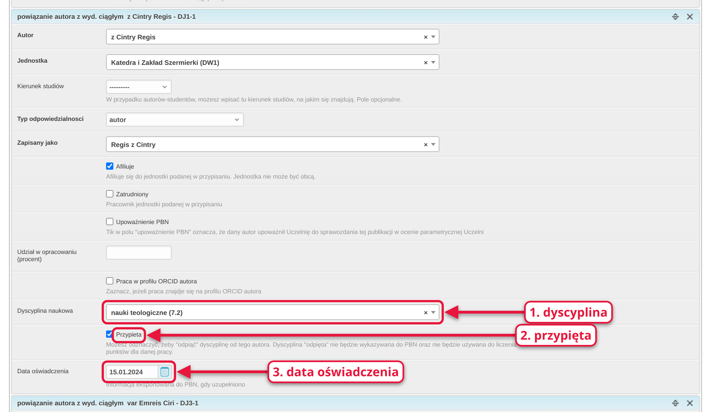

1. **Dyscyplina naukowa** — dyscyplina, w której autor oświadcza tę pracę.
   Lista podpowiada tylko dyscypliny autora z roku pracy. Puste pole =
   autor nie składa oświadczenia do tej pracy.
2. **Przypieta** — zaznaczone (domyślnie) znaczy: oświadczenie obowiązuje.
   Odznaczenie „odpina” dyscyplinę: zostaje wpisana w rekordzie, ale **nie
   jest wysyłana do PBN** i **nie liczy się do punktów** tej pracy.
3. **Data oświadczenia** — data podpisania oświadczenia. Pole jest
   opcjonalne; gdy je wypełnisz, data trafia do PBN i jest drukowana na
   oświadczeniu przy miejscu na podpis.

Zapisz rekord. Po zapisie BPP przelicza punkty i sloty pracy.

!!! tip "Wyszukiwanie prac z dyscyplinami"
    Jak w module Redagowanie znaleźć prace, w których przynajmniej jeden
    autor ma dyscyplinę — [Wyszukiwanie i filtrowanie rekordów](wyszukiwanie-redagowanie.md#rekordy-z-dyscyplinami).

## Wydruk oświadczenia ze strony pracy {#wydruk-z-rekordu}

1. Otwórz stronę pracy (nie formularz edycji) i przewiń na dół, do tabeli
   **„Punkty i sloty autorów”**.

    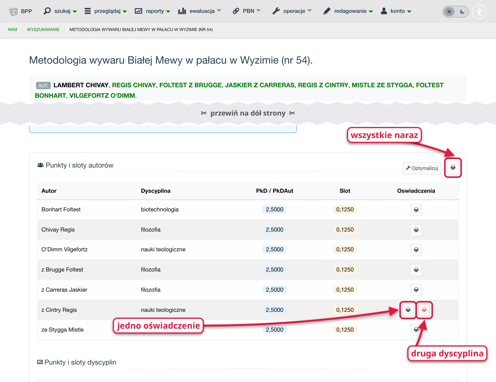

    - ikona drukarki **w wierszu autora** — oświadczenie tego autora
      w dyscyplinie wpisanej w pracy,
    - **różowa** ikona obok — oświadczenie tego samego autora w jego
      **drugiej** dyscyplinie (tylko gdy autor ma na ten rok dwie
      dyscypliny),
    - ikona drukarki **przy nagłówku** — wszystkie oświadczenia tej pracy,
      każde na osobnej stronie (dla autorów z dwiema dyscyplinami — po dwa).

2. Oświadczenie otwiera się w nowej karcie i od razu pokazuje okno
   drukowania. Na wydruku są: autor, ORCID, dyscypliny autora, treść
   upoważnienia z nazwą uczelni i dyscypliną, data oświadczenia (jeśli
   wpisana), miejsce na podpis i opis pracy.

    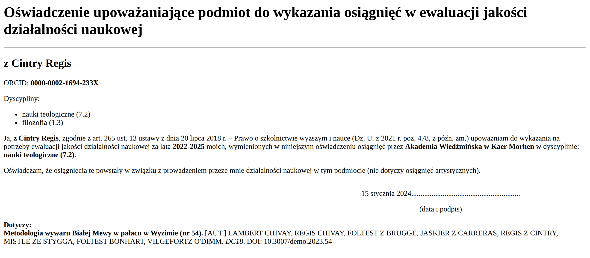

Tabela „Punkty i sloty autorów” pojawia się **tylko dla prac z policzonymi
slotami** — w pracy bez punktów, z roku bez danych albo bez dyscyplin
autorów ikon nie będzie. Wydruk „wszystkie naraz” obejmuje autorów, którzy
mają w tej pracy punkty.

## Wydruk wielu oświadczeń naraz {#wydruk-masowy}

1. W górnym menu **ewaluacja** kliknij **wydruk oświadczeń**.

    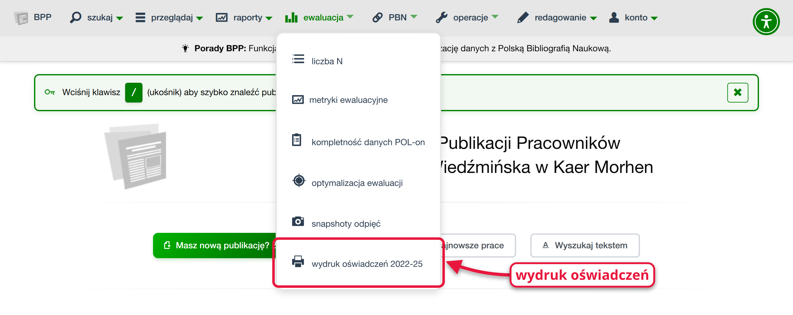

2. Pod ścieżką nawigacji, na pasku **Okres ewaluacji**, wybierz okres
   (np. 2022–2025 albo 2026–2030). Lista pokazuje wszystkie pary
   „autor — praca” z wpisaną dyscypliną z lat tego okresu. Zawęź ją polami
   **Rok od**, **Rok do** (tylko w obrębie okresu), **Autor**
   (fragment imienia lub nazwiska), **Tytuł**, **Dyscyplina**
   i **Przypięta** (tak / nie / wszystkie), potem kliknij **Filtruj**.
   **Resetuj** czyści filtry.

    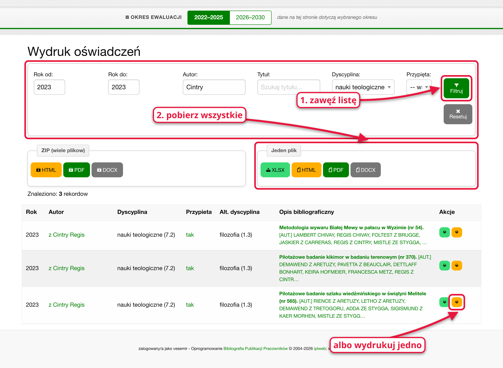

    Treść oświadczenia („upoważniam do wykazania na potrzeby ewaluacji
    jakości działalności naukowej za lata …”) podaje lata okresu, do którego
    należy praca — dla pracy z 2027 r. „2026-2030”, dla pracy z 2024 r.
    „2022-2025”. Prace z okresu 2026–2030 drukują się z osobnego szablonu
    treści (`oswiadczenia/tresc_jednego_oswiadczenia_2026_2030.html`,
    w panelu administracyjnym: **Szablony**). Na start ma treść jak dla
    2022–2025, lata „2026-2030” i adnotację **„[stara podstawa prawna]”**
    przy podstawie prawnej — administrator uzupełnia ją, gdy będzie
    obowiązujący tekst dla nowego okresu, bez ruszania treści oświadczeń
    za 2022–2025.

    Kolumna **Alt. dyscyplina** pokazuje drugą dyscyplinę autora, jeśli ją
    ma. W kolumnie **Akcje** zielona drukarka drukuje jedno oświadczenie,
    pomarańczowa — oświadczenie w drugiej dyscyplinie.

    !!! warning "Lista obejmuje też dyscypliny odpięte"
        Wydruk masowy nie pomija dyscyplin odpiętych — są na liście
        z „nie” w kolumnie **Przypieta**. Jeśli drukujesz oświadczenia do
        podpisu, ustaw **Przypięta: tak**.

3. Pobierz wszystkie oświadczenia z listy (z uwzględnieniem filtrów):
    - **ZIP (wiele plikow)** — **HTML**, **PDF** albo **DOCX**: archiwum
      z osobnym plikiem dla każdego oświadczenia, w folderach według
      autorów,
    - **Jeden plik** — **XLSX** (zestawienie w arkuszu: rok, autor,
      dyscyplina, przypięta, alternatywna dyscyplina, opis), albo **HTML**,
      **PDF**, **DOCX** — wszystkie oświadczenia w jednym dokumencie, każde
      na nowej stronie.

    Gdy lista ma więcej niż 5000 pozycji, zamiast przycisków ZIP pojawia
    się sekcja **ZIP (czesci)** — pobierz kolejne paczki po 5000.

4. XLSX pobiera się od razu. Pozostałe formaty BPP przygotowuje w tle —
   zobaczysz stronę **„Generowanie oświadczeń”** z paskiem postępu
   („Trwa generowanie…”). Po zakończeniu („Zakończono!”) plik pobierze się
   sam; jeśli nie — kliknij **„Pobierz plik”** (**„Pobierz plik ZIP”**).

    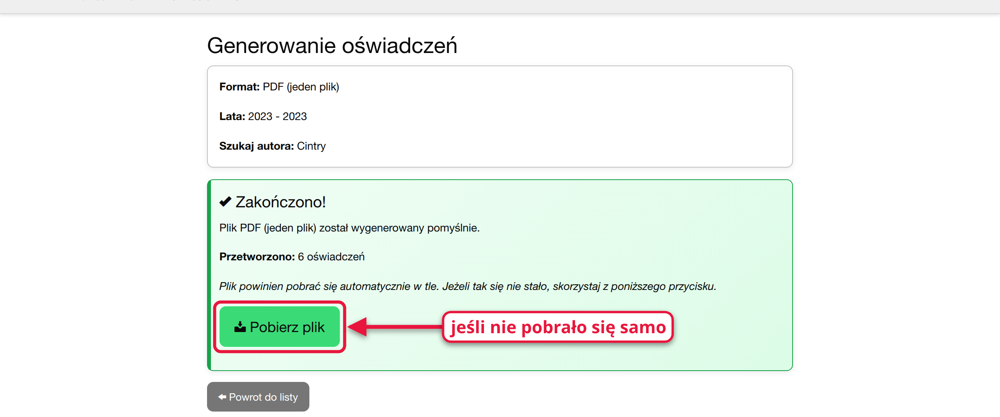

    Stronę można zamknąć i pracować dalej — plik generuje się na serwerze.
    Wygenerowany plik widzi i pobiera **tylko osoba, która go zamówiła**,
    a BPP usuwa go po **7 dniach**.

## Wysyłka oświadczeń do PBN {#wysylka-do-pbn}

Gdy wysyłasz pracę do PBN ([PBN: wysyłanie prac](pbn-wysylka-i-synchronizacja.md#jedna-praca)),
oświadczenia jadą razem z nią. Osobna **wysyłka oświadczeń** służy do
czegoś innego: **ponownego przesłania samych oświadczeń** dla wielu prac,
które już są w PBN — np. po masowym uzupełnieniu dat oświadczeń, po
odpięciu dyscyplin albo po porządkach w dyscyplinach autorów.

!!! danger "Wysyłka najpierw usuwa oświadczenia w PBN"
    Dla **każdej** pracy z zakresu BPP najpierw **kasuje w PBN wszystkie
    oświadczenia tej pracy**, a potem wysyła je od nowa — tylko te, które
    w BPP są **przypięte**. Praca, w której w BPP nie ma żadnej przypiętej
    dyscypliny, zostaje w PBN **bez oświadczeń** (status
    „Zsynchronizowana”). Zanim wyślesz cały zakres lat, upewnij się, że
    dane w BPP są kompletne.

**Jakie oświadczenia trafiają do PBN.** Autor jest wysyłany, gdy w pracy:
ma dyscyplinę, jest ona **przypięta**, autor **afiliuje** do jednostki
uczelni (nie obcej) i jest powiązany z osobą w PBN (pole **„Odpowiednik
w PBN”**) albo ma wpisany ORCID. Data oświadczenia jedzie, jeśli jest
wpisana. Jeżeli autor spełnia pozostałe warunki, ale nie ma **ani**
odpowiednika w PBN, **ani** ORCID, BPP pomija całą pracę (w logu: błąd
z listą takich autorów) i nie rusza jej oświadczeń w PBN — zob.
[Autor bez odpowiednika w PBN i bez ORCID](pbn-wysylka-i-synchronizacja.md#autor-bez-identyfikatora).
Pole „Zatrudniony” nie ma znaczenia — mimo że ramka „Kryteria
wyboru publikacji” na stronie wysyłki tak sugeruje.

1. Zaloguj się do PBN: menu **PBN** → **autoryzuj PBN API**
   ([szczegóły](pbn-wysylka-i-synchronizacja.md#autoryzacja)). Potem
   w tym samym menu kliknij **wysylka oswiadczen do PBN**.

    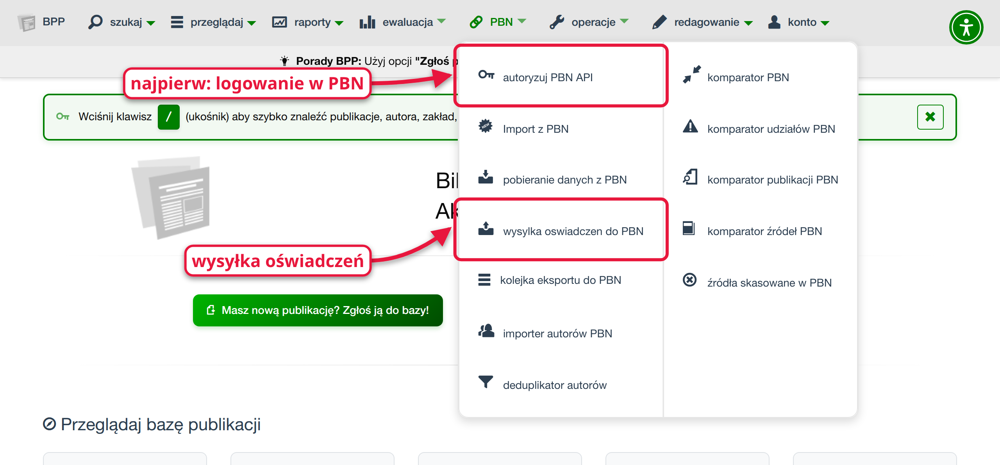

2. Na pasku **Okres ewaluacji** (pod ścieżką nawigacji) wybierz okres.
   W panelu **Parametry** wpisz zakres lat (**Rok od**, **Rok do**;
   domyślnie cały wybrany okres, tylko w jego obrębie) i ewentualnie fragment tytułu (**Tytul
   (zawiera)**), kliknij **Odswiez**. Pod spodem zobaczysz, ile prac
   (z PBN UID, czyli już wysłanych do PBN) obejmie wysyłka i ile mają
   oświadczeń. Na dole strony, w **Podglad publikacji**, jest lista tych
   prac z liczbą oświadczeń i przypiętych; **„Eksportuj do Excel”** zapisuje
   ją do arkusza.

    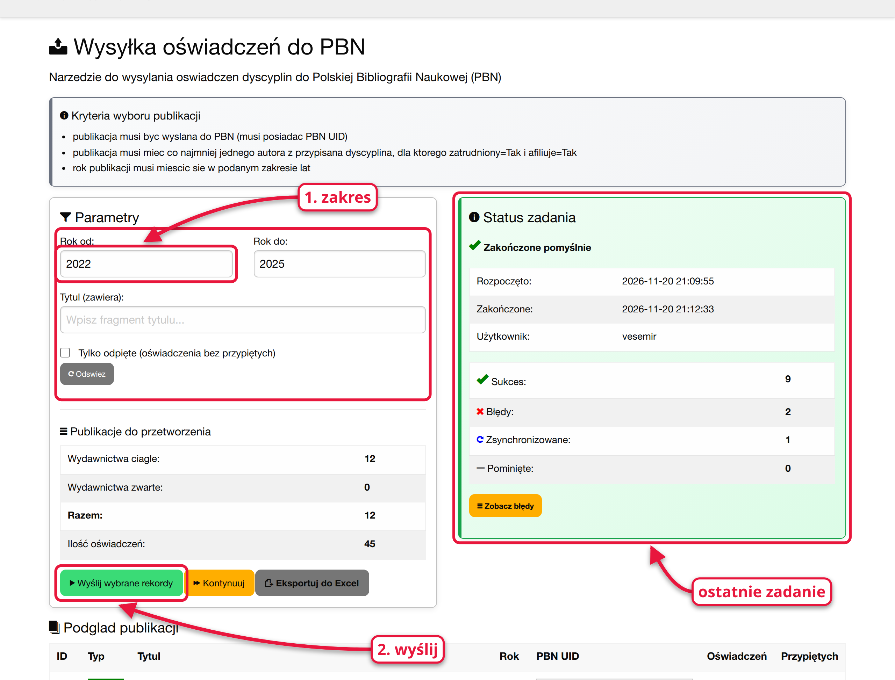

3. Kliknij **„Wyślij wybrane rekordy”**. Panel **Status zadania** po
   prawej pokaże postęp („Wysyłka w toku…”, procent, bieżąca praca) i
   liczniki: **Sukces**, **Błędy**, **Zsynchronizowane** (oświadczenia
   skasowane, bo brak przypiętych), **Pominięte**. Strona odświeża się
   sama; można ją zamknąć — wysyłka idzie na serwerze.

    Jeśli nie jesteś zalogowany do PBN, zadanie nie wystartuje — nad
    przyciskami pojawi się czerwony komunikat:

    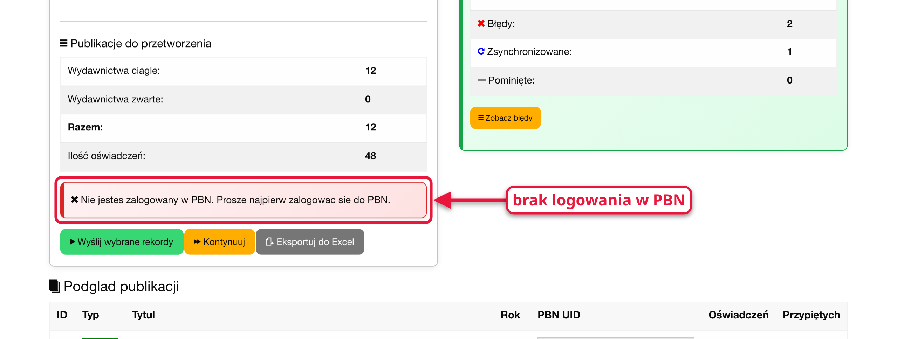

4. Po zakończeniu panel pokazuje **„Zakończone pomyślnie”**, czas
   i użytkownika. Gdy były błędy — kliknij **„Zobacz błędy”**
   ([logi](#logi)).

**„Kontynuuj”** (pomarańczowy przycisk, widoczny po zakończonym lub
przerwanym zadaniu) uruchamia wysyłkę jeszcze raz, ale **pomija prace,
które już raz wysłały się z sukcesem** (w którymkolwiek wcześniejszym
zadaniu) — przydaje się po przerwaniu albo po poprawieniu błędów.
**„Anuluj”** (podczas wysyłki) oznacza zadanie jako przerwane.

W danej chwili może trwać tylko **jedna** wysyłka oświadczeń — niezależnie
od tego, kto ją uruchomił.

### „Tylko odpięte” — tylko do podglądu {#tylko-odpiete}

Zaznaczenie **„Tylko odpięte (oświadczenia bez przypiętych)”** i **Odswiez**
zawęża liczniki, podgląd i eksport do Excela do prac, w których **wszystkie**
dyscypliny są odpięte (kolumna **Przypiętych** = 0). To dobry sposób, żeby
sprawdzić, którym pracom wysyłka skasuje oświadczenia w PBN.

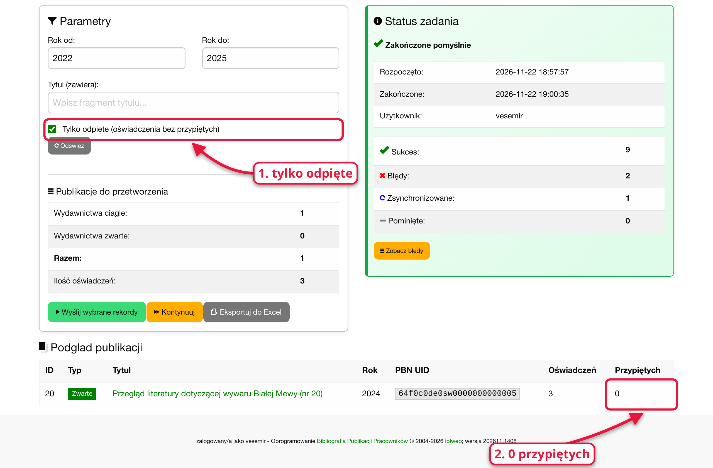

!!! warning "Wysyłka nie uwzględnia tego pola"
    **„Wyślij wybrane rekordy”** przy zaznaczonym „Tylko odpięte” **i tak
    obejmuje wszystkie prace z zakresu lat** (i tytułu), nie tylko odpięte.
    Żeby wysłać mniej prac, zawęź lata albo wpisz fragment tytułu.

## Logi wysyłki {#logi}

Każda przetworzona praca zostawia wpis w logu. Do logów prowadzi **„Zobacz
błędy”** w panelu statusu (od razu z filtrem na błędy ostatniego zadania);
pełną listę otwiera adres `/pbn-wysylka-oswiadczen/logs/`.

1. Wybierz **Zadanie** (numer, data, status) i **Status** (Sukces, Blad,
   Zsynchronizowana, Pominiete), kliknij **Filtruj**. Przy każdej pracy
   widać PBN UID, liczbę prób i datę.

    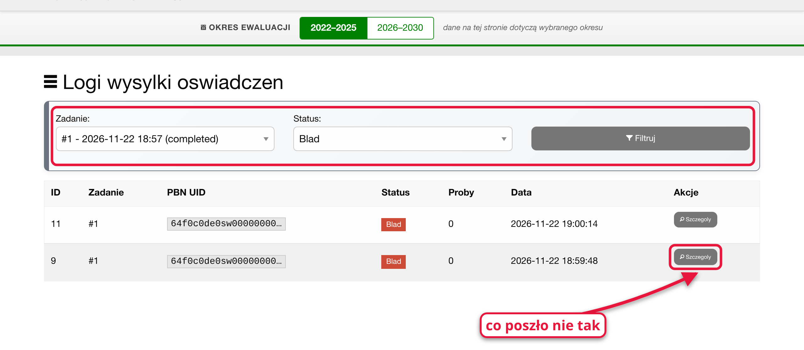

2. **„Szczegoly”** pokazuje komunikat błędu, dokładnie to, co BPP wysłało
   do PBN, i odpowiedź PBN. **„Otworz publikacje”** prowadzi do strony
   pracy.

    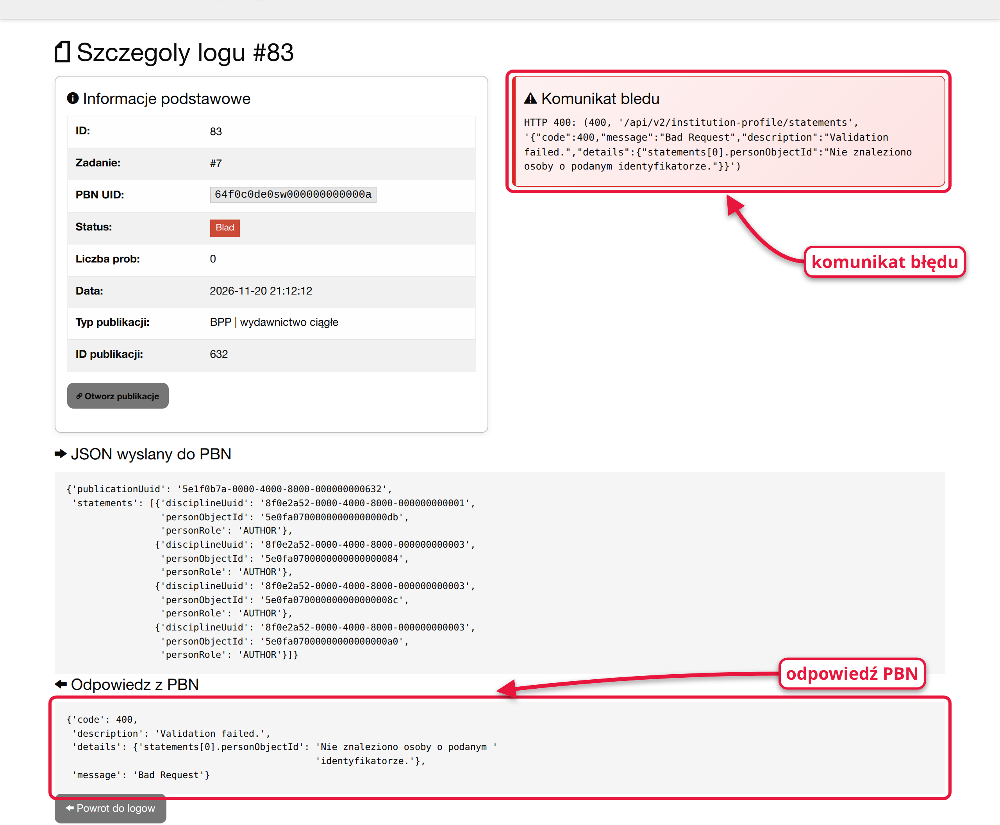

    Odpowiedź PBN zwykle mówi, czego dotyczy błąd — np.
    `statements[0]` to pierwsze oświadczenie z listy wysłanej powyżej.

## Co może pójść nie tak {#co-moze-pojsc-nie-tak}

| Co widzisz | Dlaczego | Co zrobić |
|---|---|---|
| Przy zapisie rekordu, przy dyscyplinie: *Autor nie ma przypisania na dany rok do takiej dyscypliny.* | Autor nie ma tej dyscypliny w roku pracy (np. zmieniono rok rekordu). | Popraw dyscyplinę w pracy albo [dyscypliny autora na ten rok](nowy-rok.md#dyscypliny-autorów). |
| Brak ikon drukarki na stronie pracy | Praca nie ma policzonych slotów, konto nie jest w grupie „wprowadzanie danych” albo wyłączono opcję „Drukuj oświadczenia dla autorów”. | Zob. [Nowy rok w BPP](nowy-rok.md#co-może-pójść-nie-tak); sprawdź grupę konta. |
| Brak różowej ikony / kolumna „Alt. dyscyplina” = „-” | Autor ma na ten rok jedną dyscyplinę (albo wyłączono „Drukuj alternatywne oświadczenia dla autorów”). | Zgodnie z danymi — nic. Ewentualnie uzupełnij drugą dyscyplinę autora. |
| Na wydruku nie ma daty, tylko kropki | Pole „Data oświadczenia” jest puste. | Wpisz datę w rekordzie albo uzupełnij ręcznie na papierze. |
| Generowanie: *Brak oswiadczen do wygenerowania dla podanych filtrow.* | Filtry nie pasują do żadnej pozycji. | Zmień filtry (rok, autor, „Przypięta”). |
| Generowanie: **„Błąd!”** *Wystąpił błąd podczas generowania plików* | Błąd po stronie serwera (np. przy PDF). | Spróbuj formatu HTML lub DOCX; przekaż treść błędu administratorowi. |
| Strona generowania stoi na *Oczekuje na uruchomienie...* | Na serwerze nie działa obsługa zadań w tle. | Zgłoś administratorowi. |
| *Nie jestes zalogowany w PBN. Prosze najpierw zalogowac sie do PBN.* | Brak autoryzacji w PBN. | Menu **PBN** → **autoryzuj PBN API**, potem ponownie „Wyślij wybrane rekordy”. |
| *Twoj token PBN wygasl. Prosze zalogowac sie ponownie do PBN.* | Autoryzacja jest starsza niż 24 godziny. | Jak wyżej. |
| *Zadanie wysylki jest juz uruchomione. Prosze poczekac na jego zakonczenie.* | Ktoś (może Ty) już wysyła oświadczenia. | Poczekaj na koniec — postęp jest w panelu „Status zadania”. |
| *Nie udalo sie uruchomic zadania. Szczegoly zapisano w zadaniu i przekazano administratorowi.* | Serwer nie przyjął zadania. | Zgłoś administratorowi. |
| Panel statusu: *Zadanie może być zawieszone (brak aktualizacji od 15 minut)* | Wysyłka przestała robić postęp (np. restart serwera). | **Anuluj**, potem **Kontynuuj**. Zadanie „w toku” dłużej niż dobę BPP sam oznacza jako nieudane: *Zadanie oznaczone jako nieudane z powodu przestarzalego statusu (proces prawdopodobnie sie zakonczyl)*. |
| Zadanie zakończone błędem *Prace serwisowe w PBN. Proszę spróbować ponownie za kilka godzin.* | PBN ma przerwę techniczną. | Po kilku godzinach **Kontynuuj**. |
| Log, status „Zsynchronizowana”: *Brak autorow z przypieta dyscyplina - oswiadczenia skasowane* | W pracy nie ma przypiętej dyscypliny — oświadczenia w PBN skasowano. | Jeśli to błąd: przypnij dyscypliny w rekordzie i wyślij ponownie. |
| Log, błąd: *Dane lokalne wymagaja aktualizacji: Nie jestem w stanie ustalić lokalnie identyfikatora UUID dla publikacji …* | BPP nie zna identyfikatora pracy w profilu instytucji w PBN. | [Pobierz dane z PBN](pbn-wysylka-i-synchronizacja.md#import-pobieranie-komparatory) albo wyślij tę pracę do PBN w całości. |
| Log, błąd: *HTTP 400: …* | PBN odrzucił oświadczenia — szczegóły w „Odpowiedz z PBN”. | Popraw autora wskazanego w odpowiedzi (np. powiązanie z osobą w PBN, ORCID), wyślij ponownie. |
| Log, błąd: *Wszystkie proby nieudane (5x): …* | PBN nie odpowiadał (błąd serwera, blokada) mimo ponowień. | **Kontynuuj** później. |
| Log, błąd: *Nie wysłano: oświadczenia nie mogą zostać wysłane, bo autor nie ma ani odpowiednika w PBN, ani ORCID: …* | Autor z przypiętą dyscypliną nie ma ani odpowiednika w PBN, ani ORCID. BPP nie rusza wtedy oświadczeń tej pracy w PBN (niczego nie kasuje ani nie wysyła). | Ustaw autorowi **Odpowiednik w PBN** albo wpisz ORCID i wyślij ponownie; zob. [Autor bez odpowiednika w PBN i bez ORCID](pbn-wysylka-i-synchronizacja.md#autor-bez-identyfikatora). |
| Oświadczenia autora nie trafiają do PBN, choć praca się wysłała | Autor nie afiliuje albo jest w obcej jednostce. | Popraw afiliację autora w pracy; zob. [komunikaty PBN](pbn-wysylka-i-synchronizacja.md#komunikaty). |

## Zobacz też {#zobacz-tez}

- [PBN: wysyłanie prac, kolejka i porównanie z BPP](pbn-wysylka-i-synchronizacja.md)
  — logowanie do PBN, wysyłka prac, komparator udziałów (rozbieżności
  dyscyplin między BPP a PBN).
- [Wyszukiwanie i filtrowanie rekordów](wyszukiwanie-redagowanie.md) —
  jak znaleźć prace do poprawy.
- [Nowy rok w BPP](nowy-rok.md) — dyscypliny autorów i punktacja na nowy
  rok.
- [Import z POL-on i liczba N](import-polon-liczba-n.md) — skąd biorą się
  dyscypliny autorów.
- [Sloty](sloty.md) — kiedy praca ma punkty i sloty.
