# PBN: wysyłanie prac, kolejka i porównanie z BPP

Przewodnik dla redaktorów, którzy wysyłają prace z BPP do Polskiej
Bibliografii Naukowej (PBN). Po kolei: **jak zalogować się do PBN z poziomu
BPP, jak wysłać jedną pracę albo wiele naraz, jak czytać kolejkę eksportu
i co zrobić z komunikatem o błędzie** — a na koniec, jak sprawdzić, czego
brakuje po stronie BPP albo PBN.

Konfigurację integracji (adres API, aplikacja i token w PBN, konto do
operacji w tle) robi administrator — opisuje ją strona
[Integracja z PBN API](../administrator/integracja-pbn.md).

## Zanim zaczniesz {#zanim-zaczniesz}

**Uprawnienia.** Potrzebujesz konta z dostępem do modułu redagowania i grupy
**„wprowadzanie danych”**. Dopiero wtedy w górnym menu widać pozycję
**PBN**.

**Menu PBN pojawia się tylko wtedy, gdy uczelnia ma włączoną integrację**
(„Czy używać integracji z PBN?” w ustawieniach uczelni). Przyciski
**„Zapisz i wyślij do PBN”** w formularzu pracy wymagają drugiego
ustawienia — „Włącz opcjonalną aktualizację przy edycji”. Jeśli ich nie
widzisz, poproś administratora.

**Konto w PBN.** Wysyłasz prace **swoim** kontem PBN — z rolą, która
pozwala dodawać publikacje instytucji. Wyjątek: administrator może
w Twoim koncie BPP ustawić pole „przedstawiaj w PBN jako” — wtedy prace
zlecone **w tle** idą kontem wskazanej osoby i to ona musi być
zalogowana do PBN.

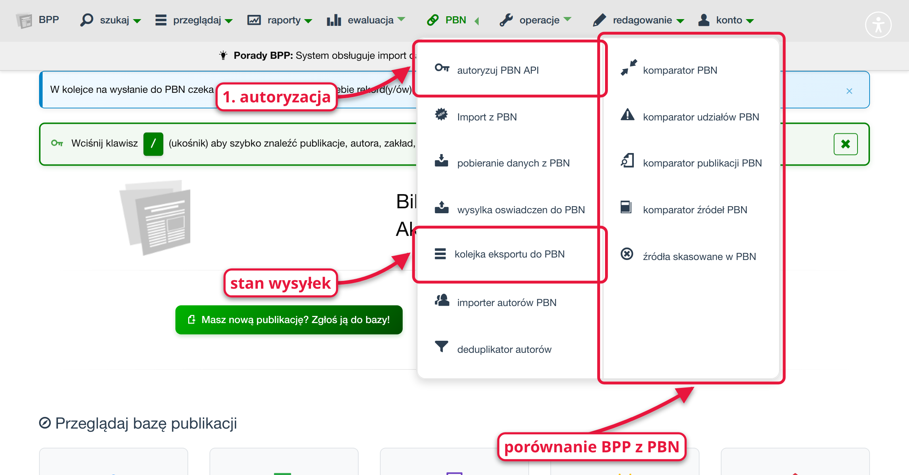

Lewa kolumna menu to praca z danymi (autoryzacja, import, pobieranie,
wysyłka, kolejka), prawa — narzędzia do porównywania BPP z PBN.

## 1. Zaloguj się do PBN („autoryzuj PBN API”) {#autoryzacja}

BPP nie zna Twojego hasła do PBN. Zamiast tego raz na jakiś czas
**autoryzujesz** BPP — PBN wydaje wtedy przepustkę (token), z którą BPP
wysyła prace w Twoim imieniu.

1. Menu **PBN** → **autoryzuj PBN API**.
2. Zostaniesz przeniesiony na stronę logowania PBN. Zaloguj się swoim
   kontem PBN i potwierdź dostęp dla aplikacji BPP.
3. PBN odeśle Cię z powrotem do BPP, na stronę, z której zaczynałeś.
   U góry pojawi się komunikat **„Autoryzacja w PBN API przeprowadzona
   pomyślnie.”**

Jeśli adres autoryzacji otworzysz z zakładki albo wpiszesz go ręcznie,
BPP najpierw pokaże stronę pośrednią — kliknij **„Przejdź do logowania
w PBN”**:

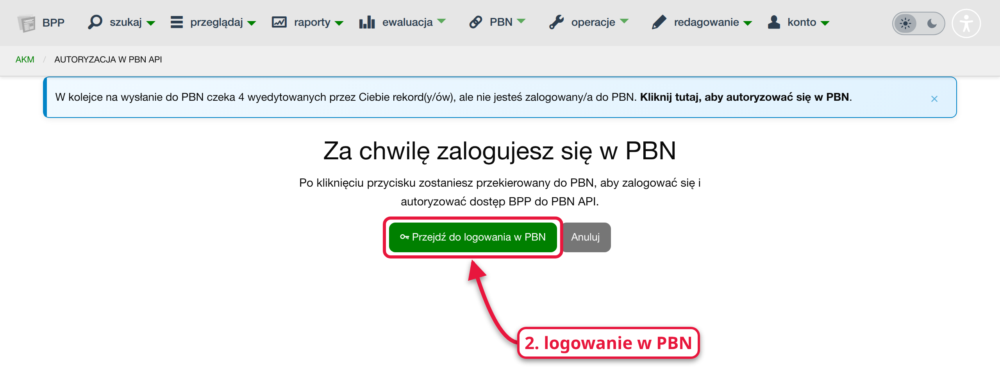

**Jak długo to działa?** BPP uznaje autoryzację za ważną przez
**24 godziny**. Potem autoryzuj się ponownie. Gdy przepustka wygaśnie,
a w kolejce czekają zlecone przez Ciebie prace, na każdej stronie BPP
zobaczysz niebieski komunikat **„W kolejce na wysłanie do PBN czeka …
wyedytowanych przez Ciebie rekord(y/ów), ale nie jesteś zalogowany/a do
PBN. Kliknij tutaj, aby autoryzować się w PBN.”** Wystarczy kliknąć
odnośnik.

!!! tip "Prace czekające na autoryzację ruszą same"
    Prace, które w kolejce czekały na Twoje zalogowanie (status
    „Oczekuje na autoryzacje uzytkownika”), BPP wysyła ponownie
    **automatycznie** zaraz po udanej autoryzacji.

## 2. Wyślij jedną pracę {#jedna-praca}

Otwórz pracę w module redagowania (wydawnictwo ciągłe albo zwarte). Na
dolnym pasku, obok zwykłego „Zapisz”, są dwa przyciski:

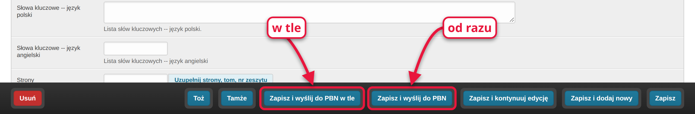

| Przycisk | Co się dzieje | Kiedy wybrać |
|---|---|---|
| **Zapisz i wyślij do PBN** | BPP zapisuje pracę i od razu wysyła ją do PBN. Czekasz na odpowiedź, wynik widzisz w komunikatach u góry formularza. | Gdy chcesz od razu wiedzieć, czy się udało, i poprawić błąd na miejscu. |
| **Zapisz i wyślij do PBN w tle** | BPP zapisuje pracę i dopisuje ją do **kolejki eksportu**. Wysyłka odbywa się na serwerze, możesz pracować dalej. | Gdy PBN odpowiada wolno, gdy wysyłasz wiele prac po kolei albo gdy nie jesteś teraz zalogowany do PBN. |

### Wysyłka od razu — czytanie komunikatów

Po kliknięciu **„Zapisz i wyślij do PBN”** formularz otwiera się ponownie,
a nad nim pojawiają się komunikaty:

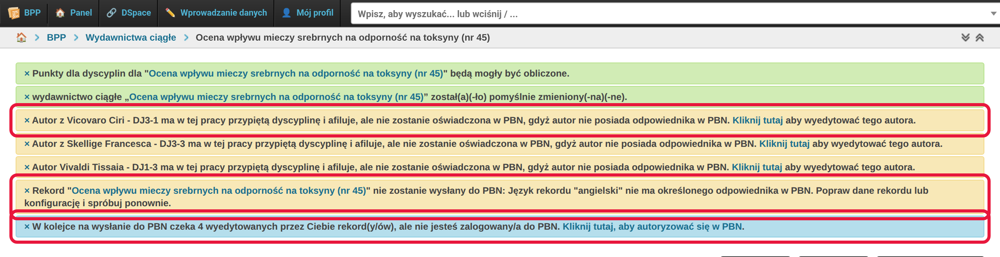

- **zielony** „Dane w PBN dla rekordu … zostały zaktualizowane” — sukces;
  obok są odnośniki „Kliknij tutaj, aby otworzyć w PBN” i „Otwórz widok
  wysłanych danych”,
- **czerwony** „Rekord … NIE został wysłany do PBN. Ci autorzy mają w tej
  pracy przypiętą dyscyplinę i afiliują, ale nie mają ani odpowiednika
  w PBN, ani identyfikatora ORCID …” — praca **nie** poszła, bo
  oświadczenie wymienionych osób by przepadło. Pod komunikatem jest lista
  autorów z odnośnikami do ich formularzy; co zrobić — w punkcie
  [Autor bez odpowiednika w PBN i bez ORCID](#autor-bez-identyfikatora),
- **niebieski** „Autor … nie ma odpowiednika w PBN — jego oświadczenie
  zostanie wysłane z identyfikatorem ORCID” — tylko informacja, praca
  została wysłana,
- **żółty** „Rekord … nie zostanie wysłany do PBN: …” — praca **nie**
  poszła; po dwukropku jest powód (na obrazku: język pracy nie ma
  odpowiednika w PBN). Sposoby naprawy — w tabeli
  [Komunikat → co zrobić](#komunikaty),
- **niebieski** — przypomnienie o autoryzacji (punkt 1).

### Autor bez odpowiednika w PBN i bez ORCID {#autor-bez-identyfikatora}

Oświadczenie o dyscyplinie PBN przypisuje do **osoby**, więc BPP musi mu
podać, o kogo chodzi: przez **Odpowiednik w PBN** autora albo przez jego
**Identyfikator ORCID**. Jeżeli autor ma w pracy przypiętą dyscyplinę,
afiliuje w jednostce uczelni, a nie ma ani jednego, ani drugiego — BPP
**nie wysyła tej pracy wcale** i pokazuje listę takich autorów. (Dawniej
praca szła do PBN bez oświadczenia tej osoby, z samym żółtym ostrzeżeniem,
które łatwo było przeoczyć.)

Co zrobić — do wyboru:

1. kliknij autora na liście i w jego formularzu ustaw **Odpowiednik
   w PBN** (osobę z PBN; przy wielu autorach pomoże **importer autorów
   PBN** z menu PBN), albo
2. wpisz autorowi **Identyfikator ORCID** — wtedy oświadczenie pójdzie
   z ORCID-em; PBN przypisze je do osoby, jeśli zna ten ORCID,
3. jeżeli ta osoba **nie powinna** być oświadczana w tej pracy — w pracy,
   w wierszu tego autora, odepnij dyscyplinę albo popraw afiliację.

Potem wyślij pracę ponownie. To samo dotyczy wysyłki w tle, akcji „Wyślij
do PBN” na liście prac i [wysyłki samych oświadczeń](oswiadczenia.md):
w kolejce eksportu taka praca trafia do **błędów merytorycznych**, a na
stronie wpisu jest ta sama lista autorów z odnośnikami.

Zatrzymanie nie zależy od ustawienia uczelni „Wysyłaj prace bez
oświadczeń”. Praca, w której **nikt** nie ma przypiętej dyscypliny, jest
wysyłana jak dotąd (przy włączonym ustawieniu — bez oświadczeń).

Administrator może to zatrzymanie wyłączyć ustawieniem uczelni **Wysyłaj
prace, gdy autor nie ma identyfikatora w PBN** (zob.
[konfiguracja PBN](../administrator/konfiguracja-pbn.md)). Praca jest wtedy
wysyłana **bez oświadczeń** takich autorów, a po wysyłce — obok zielonego
komunikatu o sukcesie — pojawia się żółte ostrzeżenie „UWAGA: oświadczenia
rekordu … w PBN są NIEPEŁNE. Z 10 autorów z przypiętą dyscypliną do PBN
trafiło 5 oświadczeń, pominięto 5” z listą pominiętych autorów
i odnośnikami do ich formularzy. Przy wysyłce w tle to samo ostrzeżenie
jest na stronie wpisu w kolejce eksportu (ramka „Oświadczenia w PBN są
niepełne”), a przy [wysyłce samych oświadczeń](oswiadczenia.md) —
w logu przy danej pracy. Po uzupełnieniu autora wyślij pracę ponownie, żeby
dosłać brakujące oświadczenia.

Administrator może sprawdzić, ilu prac i autorów to dotyczy, poleceniem
`python src/manage.py pbn_oswiadczenia_bez_identyfikatora` (opcje
`--rok-od`, `--rok-do`, `--uczelnia-id`, `--szczegoly`); polecenie niczego
nie zmienia i nie łączy się z PBN.

### W PBN jest mniej autorów niż w BPP {#mniej-autorow-w-pbn}

BPP wysyła do PBN **wszystkich** autorów pracy — także tych, którzy nie
mają odpowiednika w PBN (idą jako samo imię i nazwisko). Zaraz po udanej
wysyłce BPP pobiera z PBN zapisany rekord i porównuje liczbę autorów. Gdy
PBN zapisał ich mniej, obok zielonego komunikatu o sukcesie pojawia się
żółte ostrzeżenie:

> UWAGA: PBN zapisał 4 z 6 wysłanych autorów — w PBN brakuje 2.
> Prawdopodobnie brakuje: …

Liczby są pewne; nazwiska to wskazówka (dopasowanie po imieniu i nazwisku,
a PBN może zapisać osobę pod inną pisownią). Co zrobić: otwórz pracę w PBN
i sprawdź listę autorów, wymienionym autorom ustaw w BPP **Odpowiednik
w PBN** i wyślij pracę ponownie. Przy wysyłce w tle to samo ostrzeżenie
jest w komunikacie wpisu w kolejce eksportu.

#### Mniej autorów w profilu instytucji {#mniej-autorow-w-profilu-instytucji}

Częstszy przypadek: sam rekord publikacji w PBN ma komplet autorów, a mniej
widać ich dopiero w **profilu instytucji** — czyli tam, gdzie uczelnia
składa oświadczenia. BPP sprawdza po wysyłce także profil instytucji
i ostrzega osobnym komunikatem:

> UWAGA: w profilu instytucji w PBN jest 1 z 3 wysłanych autorów — brakuje 2.
> Prawdopodobnie brakuje: …

Profil instytucji bywa aktualizowany przez PBN z opóźnieniem albo wskazuje
inną wersję pracy niż bieżąca, więc tuż po pierwszej wysyłce ostrzeżenie
może być przejściowe.

Sprawdzenie działa przy wysyłce z formularza rekordu, akcją „Wyślij do
PBN” i z kolejki eksportu. Gdy PBN nie zwróci wpisu pracy z profilu
instytucji, BPP niczego nie porównuje (nie sięga po dane pobrane wcześniej).

Porównanie liczy razem autorów, redaktorów i tłumaczy. BPP niczego przy
tym w PBN nie poprawia — tylko pokazuje różnicę.

### Praca jest już w PBN — „Pobierz po ISBN” i „Pobierz po DOI” {#pobierz-po-isbn-doi}

Jeżeli praca (albo książka, z której pochodzi rozdział) jest już w PBN, nie
wysyłaj jej drugi raz — powiąż ją z istniejącym rekordem. Przy pustym polu
**Odpowiednik w PBN** są przyciski **„Pobierz po ISBN”** (wydawnictwa
zwarte) i **„Pobierz po DOI”**. BPP szuka rekordu po wartości z pola
„ISBN” (gdy puste — „E-ISBN”) albo „DOI”:

- najpierw w danych z PBN już pobranych do BPP i w pracach BPP, które mają
  ustawiony odpowiednik w PBN — to trwa chwilę,
- jeżeli tam nic nie ma — w PBN, po kilku zapisach tego samego numeru:
  ISBN bez myślników i z myślnikami, w odmianie 13- i 10-cyfrowej; DOI tak,
  jak je wpisano, i małymi literami. Adres `https://doi.org/` przed DOI nie
  przeszkadza.

Rok pracy nie zawęża wyszukiwania (rok w PBN bywa inny), tylko ustawia na
początku listy rekordy z tego samego roku. Znaleziony rekord pojawia się
w wyszukiwarce pola **Odpowiednik w PBN** — **wybierz go sam**; przyciski
niczego nie wiążą automatycznie. Przy każdym rekordzie w nawiasie jest jego
rodzaj w PBN, np. `[książka]` albo `[rozdział]`.

!!! warning "Rozdział i książka mają ten sam ISBN"

    Rozdział nosi ISBN książki, więc „Pobierz po ISBN” w rozdziale znajdzie
    zwykle **książkę**. Nie wybieraj rekordu `[książka]` jako odpowiednika
    rozdziału. Rozdział wprowadź z **wydawnictwem nadrzędnym** (książką),
    książce ustaw odpowiednik w PBN, a rozdział wyślij do PBN — albo, jeśli
    rozdział już jest w PBN, wybierz rekord `[rozdział]` (najprościej znaleźć
    go przyciskiem „Pobierz po DOI”, jeśli rozdział ma własne DOI).

### Wysyłka w tle

Po **„Zapisz i wyślij do PBN w tle”** zobaczysz komunikat **„Utworzono
zlecenie wysyłki rekordu … w tle do PBN. Kliknij tutaj, aby śledzić
stan.”** Odnośnik prowadzi do wpisu w kolejce eksportu (punkt 4).

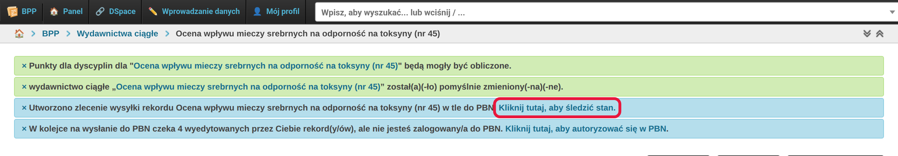

Jeśli ta praca już czeka w kolejce, BPP nie doda jej drugi raz — pokaże
**„Rekord … jest już w kolejce do eksportu do PBN.”**

## 3. Wyślij wiele prac naraz {#wiele-prac}

1. W module redagowania otwórz listę **wydawnictw ciągłych** albo
   **zwartych** i zawęź ją (filtr, wyszukiwanie), np. do jednego roku.
2. Zaznacz prace w pierwszej kolumnie.
3. Na dolnym pasku wybierz akcję **„Wyślij do PBN w tle”** i kliknij
   **„Wykonaj”**.

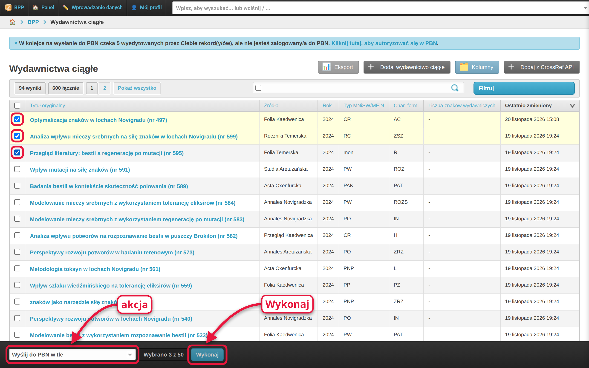

BPP potwierdzi: **„Zakolejkowano N rekordów do wysyłki do PBN. Proces
przebiega w tle.”** Prace pojawią się w kolejce eksportu po chwili.

| Akcja | Limit | Uwagi |
|---|---|---|
| **Wyślij do PBN w tle** | do **2000** prac naraz | zalecana; prace już czekające w kolejce są pomijane |
| **Wyślij do PBN** | do **10** prac naraz | wysyła od razu, jedna po drugiej — przy większej liczbie BPP odmówi: „Możesz wysłać maksymalnie 10 rekordów naraz.” |

## 4. Kolejka eksportu do PBN {#kolejka}

Menu **PBN** → **kolejka eksportu do PBN** pokazuje każdą pracę wysyłaną
w tle: kto ją zlecił, kiedy, ile było prób i jak się skończyło.

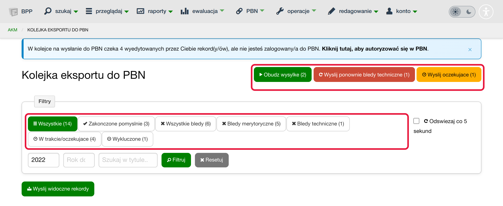

### Statusy

Przyciski filtrów u góry liczą wpisy w każdym stanie; ikona w kolumnie
**Status** mówi to samo dla pojedynczej pracy.

| Filtr (ikona w kolumnie Status) | Znaczenie | Co zrobić |
|---|---|---|
| **Zakonczone pomyslnie** (ptaszek) | praca jest w PBN | nic |
| **Bledy merytoryczne** (trójkąt) | PBN albo BPP odrzuciły **dane pracy** (brak DOI, brak oświadczeń, autor z dyscypliną bez odpowiednika w PBN i bez ORCID, błąd walidacji w PBN) | popraw pracę i wyślij ponownie |
| **Bledy techniczne** (krzyżyk) | awaria po drodze (np. błąd serwera PBN, brak uprawnień konta) | wyślij ponownie; jeśli wraca — zgłoś (patrz niżej) |
| **W trakcie/oczekujace** (zegar) | zlecona, wysyłana albo czeka na ponowienie | poczekaj |
| w tym: (kłódka) | czeka, aż zlecający **zaloguje się do PBN** | autoryzuj się (punkt 1) |
| **Wykluczone** (kółko z minusem) | tego rodzaju pracy BPP celowo nie wysyła (ustawienie charakteru formalnego, praca bez punktów przy wyłączonym eksporcie PK=0) | to nie błąd; zmienić może tylko administrator |

BPP **sam ponawia** wysyłkę, gdy przyczyna jest przejściowa: po
zablokowaniu pracy w PBN — po kilku minutach, przy pracach serwisowych
PBN — po kilku godzinach. Błędów merytorycznych nie ponawia — czekają na
Ciebie.

### Przyciski zbiorcze

Nad filtrami (widać tylko te, które mają coś do zrobienia):

- **Obudz wysylke (N)** — wysyła wpisy, których nikt jeszcze nie
  podjął,
- **Wyslij ponownie bledy techniczne (N)** — ponawia wszystkie błędy
  techniczne,
- **Wyslij oczekujace (N)** — ponawia wpisy czekające na autoryzację
  (najpierw się zaloguj),
- pod filtrami **Wyslij widoczne rekordy** — ponawia to, co jest akurat
  na liście (do 100 wpisów); najpierw zawęź listę filtrem, rokiem albo
  wyszukiwaniem w tytule.

**Odswiezaj co 5 sekund** odświeża tabelę bez przeładowania strony.

### Czytanie błędu

Pod każdą pracą zakończoną błędem lista pokazuje skrót powodu:

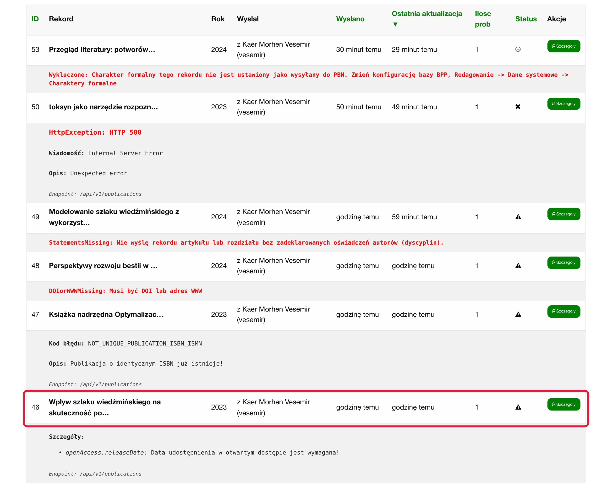

Kliknij wiersz (albo **Szczegoly**), aby otworzyć pełny opis:

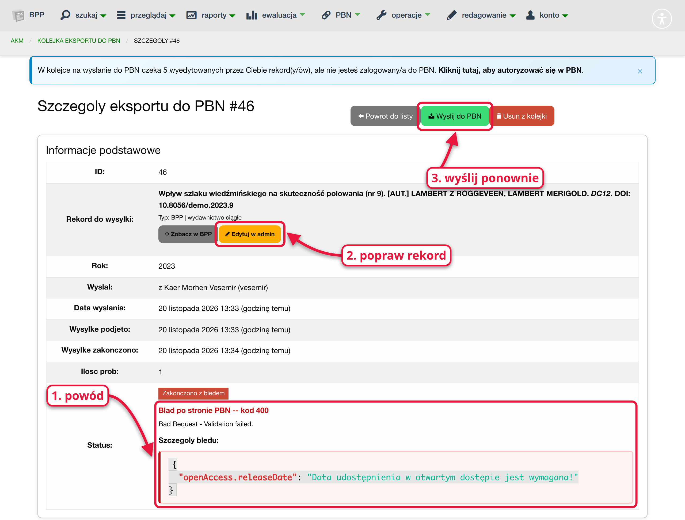

1. **Przeczytaj powód.** Przy błędzie od PBN widać „Blad po stronie PBN
   -- kod …” i **Szczegoly bledu** — nazwę pola i komunikat PBN (na
   obrazku: brak daty udostępnienia w otwartym dostępie).
2. **Popraw pracę** — **Edytuj w admin** otwiera jej formularz.
3. **Wyślij ponownie** — przycisk **Wyslij do PBN** na stronie
   szczegółów (albo „Zapisz i wyślij do PBN w tle” w formularzu pracy).

Niżej na stronie szczegółów:

- **Wyslane dane JSON** — dokładnie to, co poszło do PBN; przyciski
  „JSON wyslanych danych” (kopiuje) i „Pobierz plik JSON”,
- **Zgloszenie do helpdesku PBN** — kopiuje do schowka gotową treść
  zgłoszenia z opisem błędu i wysłanymi danymi; wklej ją w e-mail do
  pomocy technicznej PBN, gdy błąd leży po ich stronie,
- **Prompt dla AI** — kopiuje opis problemu do wklejenia w czat AI,
- **Historia komunikatow** — wszystkie próby wysyłki po kolei,
- **Usun z kolejki** — usuwa wpis (pracy nie usuwa, ani w BPP, ani
  w PBN).

## 5. Import, pobieranie danych i komparatory {#import-pobieranie-komparatory}

Te narzędzia działają w drugą stronę — **z PBN do BPP** — i łatwo je
pomylić.

| | **Import z PBN** | **Pobieranie danych z PBN** |
|---|---|---|
| Co robi | **tworzy w BPP** rekordy na podstawie PBN: prace, autorów, źródła, wydawców, oświadczenia | odświeża **lokalną kopię** danych PBN przechowywaną w BPP (publikacje i oświadczenia instytucji, osoby, źródła) |
| Czy zmienia rekordy BPP | dodaje tylko te prace, których w BPP jeszcze nie ma (bez powiązanego odpowiednika w PBN); **istniejących nie nadpisuje** | nie — zmienia tylko kopię danych PBN |
| Jak często | jednorazowo (np. przy wdrożeniu BPP) albo „Aktualizacja” — rzadko, świadomie | regularnie, przed każdym porównaniem; strona ostrzega, gdy dane mają ponad 7 dni |
| Wymaga autoryzacji w PBN | tak | tak |

### Import z PBN

**PBN** → **Import z PBN**. Do wyboru są trzy gotowe zestawy:
**Wszystko**, **Aktualizacja** (autorzy, publikacje, oświadczenia
i opłaty) i **Tylko źródła** (źródła i ich punktacja). Bez aktywnej
autoryzacji strona pokazuje „Brak aktywnej sesji PBN” z przyciskiem
**Zaloguj się do PBN**. Postęp i wynik widać w **Historii importów**.

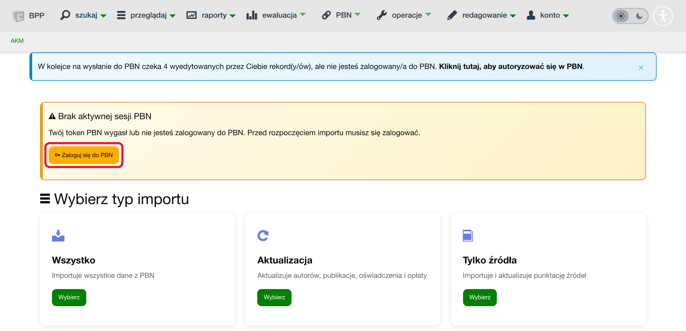

!!! warning "Import tworzy nowe rekordy"
    Praca z PBN, której BPP nie powiązał z istniejącym rekordem, zostanie
    dodana jako nowa — to może dać duplikat pracy wprowadzonej wcześniej
    ręcznie. Na bieżącej bazie częściej potrzebujesz **pobierania danych**
    i **komparatorów**, a importu — po uzgodnieniu z administratorem.

### Pobieranie danych z PBN

**PBN** → **pobieranie danych z PBN** („PBN Downloader”). Trzy niezależne
przyciski: **Pobierz publikacje z PBN**, **Pobierz osoby z PBN**,
**Pobierz zrodla z PBN**. Każde pobieranie może potrwać kilka minut;
status (data, użytkownik, ewentualny błąd) widać pod przyciskiem.

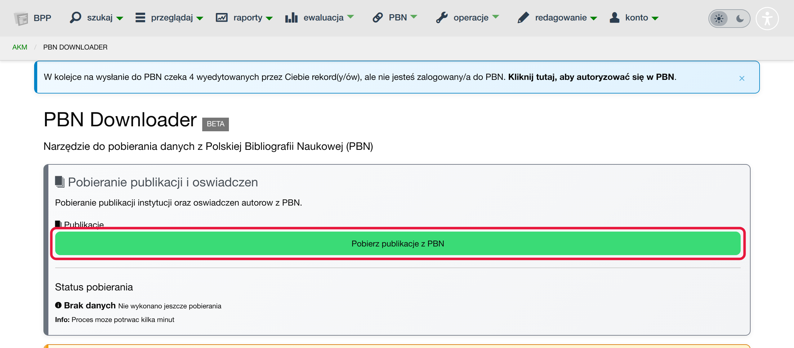

### Komparatory — czego brakuje po której stronie

Komparatory porównują BPP z **lokalną kopią** PBN — najpierw pobierz
świeże dane, inaczej wyniki będą nieaktualne (strony same o tym
ostrzegają).

| Narzędzie (menu PBN) | Na co odpowiada |
|---|---|
| **komparator PBN** | przegląd za okres ewaluacji 2022–2025: ile prac **nigdy nie wysłano** do PBN, prace **w PBN nieistniejące w BPP**, prace i autorzy **skasowani w PBN**, a nadal powiązani w BPP, źródła skasowane w PBN, liczba rozbieżności dyscyplin; każdy kafelek ma przycisk **„Pokaż w module redagowania”** z gotową listą |
| **komparator publikacji PBN** | prace powiązane z PBN, których **dane się różnią** (tytuł, rok, DOI, ISBN, ISSN, WWW, liczba autorów; dodatkowe pola do wyboru); tabela „Wartość w BPP / Wartość w PBN”, eksport do XLSX |
| **komparator źródeł PBN** | czasopisma z inną **punktacją** albo **dyscyplinami** niż w PBN; „Ustaw punkty wg PBN” przepisuje punkty z PBN |
| **komparator udziałów PBN** („Problemy PBN”) | rozbieżności **dyscyplin** autorów w pracach między BPP a oświadczeniami w PBN oraz oświadczenia z PBN, którym w BPP brakuje autora, powiązania autora z pracą albo samej pracy |
| **źródła skasowane w PBN** | źródła usunięte w PBN, do przemapowania na aktualne |

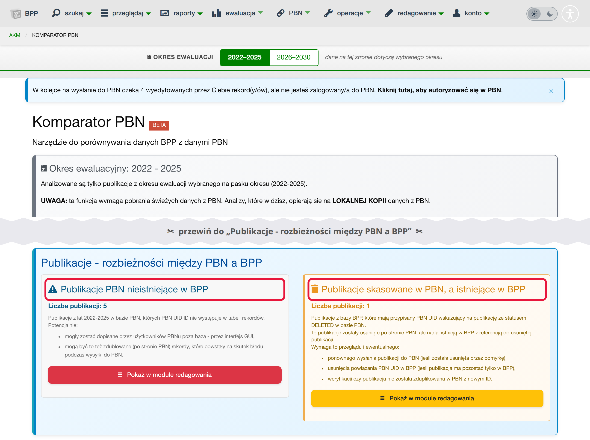

Komparator publikacji przegląda **do 100 prac każdego typu naraz** —
przy dużej bazie zawęź lata albo wyszukaj po tytule, DOI lub ISBN.
Komparatory źródeł i udziałów mają przycisk **Przebuduj** — przelicza
rozbieżności po pobraniu nowych danych.

## Komunikat → co zrobić {#komunikaty}

Najczęstsze komunikaty z formularza pracy i z kolejki eksportu (w kolejce
ten sam powód bywa poprzedzony nazwą błędu, np. `DOIorWWWMissing:`).

| Komunikat (fragment) | Przyczyna | Co zrobić |
|---|---|---|
| „Najpierw wykonaj autoryzację w PBN API …” | nie jesteś zalogowany do PBN | **PBN** → **autoryzuj PBN API** |
| „Brak dostępu z powodu nieprawidłowego tokena -- wymagana autoryzacja w PBN” / w kolejce „Użytkownik bez autoryzacji w PBN, spróbuję po zalogowaniu do PBN.” | autoryzacja wygasła | autoryzuj się ponownie; wpisy z kolejki ruszą same |
| „Brak dostępu -- najprawdopodobniej użytkownik nie posiada odpowiednich uprawnień po stronie PBN/POLON” / w kolejce „Brak uprawnień …” | Twoje konto PBN nie ma uprawnień do publikacji instytucji | poproś osobę zarządzającą kontami PBN w uczelni o nadanie roli |
| „Musi być DOI lub adres WWW” | praca nie ma DOI ani adresu WWW | uzupełnij DOI albo WWW |
| „Język rekordu "…" nie ma określonego odpowiednika w PBN” | język nie jest powiązany ze słownikiem PBN | zgłoś administratorowi (słownik języków) albo, jeśli język jest błędny, popraw go w pracy |
| „Nie wyślę rekordu artykułu lub rozdziału bez zadeklarowanych oświadczeń autorów (dyscyplin).” | żaden autor nie ma w tej pracy dyscypliny | uzupełnij dyscypliny autorów w pracy; wysyłkę prac bez oświadczeń może włączyć administrator |
| „Rekord … NIE został wysłany do PBN. Ci autorzy mają w tej pracy przypiętą dyscyplinę i afiliują, ale nie mają ani odpowiednika w PBN, ani identyfikatora ORCID …” / w kolejce „… oświadczenia nie mogą zostać wysłane, bo autor nie ma ani odpowiednika w PBN, ani ORCID: …” | oświadczenia wymienionych autorów nie da się przypisać do osoby w PBN, więc BPP nie wysyła pracy | w formularzu autora ustaw **Odpowiednik w PBN** (pomoże **importer autorów PBN**) albo wpisz **Identyfikator ORCID** i wyślij pracę ponownie; jeśli osoba nie powinna być oświadczana — odepnij jej dyscyplinę albo popraw afiliację w pracy. Szczegóły: [Autor bez odpowiednika w PBN i bez ORCID](#autor-bez-identyfikatora) |
| „UWAGA: w profilu instytucji w PBN jest … z … wysłanych autorów — brakuje …” | praca została wysłana, ale profil instytucji w PBN pokazuje mniej autorów niż rekord w BPP (sam rekord publikacji może mieć komplet) | otwórz pracę w profilu instytucji i sprawdź listę autorów. Szczegóły: [Mniej autorów w profilu instytucji](#mniej-autorow-w-profilu-instytucji) |
| „UWAGA: PBN zapisał … z … wysłanych autorów — w PBN brakuje …” | praca została wysłana z kompletem autorów, ale PBN zapisał ich mniej | otwórz pracę w PBN i sprawdź listę autorów; wymienionym autorom ustaw **Odpowiednik w PBN** i wyślij pracę ponownie. Szczegóły: [W PBN jest mniej autorów niż w BPP](#mniej-autorow-w-pbn) |
| „UWAGA: oświadczenia rekordu … w PBN są NIEPEŁNE. Z … autorów z przypiętą dyscypliną do PBN trafiło … oświadczeń, pominięto …” | praca została wysłana, ale bez oświadczeń wymienionych autorów (nie mają ani odpowiednika w PBN, ani ORCID); uczelnia ma włączone „Wysyłaj prace, gdy autor nie ma identyfikatora w PBN” | w formularzu autora ustaw **Odpowiednik w PBN** albo wpisz **Identyfikator ORCID** i wyślij pracę ponownie. Szczegóły: [Autor bez odpowiednika w PBN i bez ORCID](#autor-bez-identyfikatora) |
| „Autor … nie ma odpowiednika w PBN — jego oświadczenie zostanie wysłane z identyfikatorem ORCID …” | informacja: autor ma ORCID, ale nie jest powiązany z osobą w PBN | nic; jeśli oświadczenia tej osoby nie widać potem w PBN, ustaw autorowi **Odpowiednik w PBN** |
| „Wygląda na to, że wydawnictwo nadrzędne tego rekordu nie posiada odpowiednika w PBN …” | rozdział, którego książka nie jest jeszcze w PBN | najpierw wyślij książkę (albo ustaw jej **Odpowiednik w PBN**), potem rozdział |
| „Rekord … został odrzucony przez PBN z powodu błędów walidacji danych: …” / w kolejce „Blad po stronie PBN -- kod 400” | PBN nie przyjął danych; lista pod spodem mówi, które pole | popraw wskazane pole, np. `openAccess.releaseDate` „Data udostępnienia w otwartym dostępie jest wymagana!” — uzupełnij dane otwartego dostępu |
| `NOT_UNIQUE_PUBLICATION_ISBN_ISMN` „Publikacja o identycznym ISBN już istnieje!” | ta książka już jest w PBN (także: rozdział z ISBN-em książki wysyłany jako osobna książka) | nie wysyłaj jej drugi raz — powiąż pracę z istniejącą w PBN (pole **Odpowiednik w PBN**, przycisk [„Pobierz po ISBN”](#pobierz-po-isbn-doi)); rozdział wprowadź z wydawnictwem nadrzędnym |
| „… obiekt po stronie serwera PBN jest zablokowany. Spróbuj ponownie za jakiś czas.” / w kolejce „Zasób zablokowany w PBN (HTTP 423), ponawiam wysyłkę za kilka minut...” | ktoś (albo inny proces) właśnie zmienia tę pracę w PBN | poczekaj; kolejka ponowi sama |
| „Po stronie PBN trwają prace serwisowe …” / „Prace serwisowe w PBN, spróbuję za kilka godzin” | przerwa techniczna PBN | poczekaj; kolejka ponowi sama |
| „Identyczne dane rekordu … zostały wgrane do PBN w dniu … Nie aktualizuję w PBN API.” | od ostatniej wysyłki nic się nie zmieniło | nic — praca jest aktualna; aby mimo to wysłać, zmień coś w pracy albo poproś administratora o usunięcie wpisu o wysłanych danych |
| „Eksport prac z PK=0 jest wyłączony w konfiguracji.” / „Wykluczone: Eksport prac bez punktów PK wyłączony w konfiguracji.” | artykuł lub rozdział bez punktów, a uczelnia nie wysyła takich prac | uzupełnij punkty, jeśli praca je ma; inaczej to zamierzone |
| „Rekord … nie będzie eksportowany do PBN zgodnie z ustawieniem dla charakteru formalnego.” / „Wykluczone: Charakter formalny tego rekordu nie jest ustawiony jako wysyłany do PBN …” | ten charakter formalny nie jest wysyłany do PBN | sprawdź, czy charakter formalny pracy jest właściwy; zmiana ustawienia — administrator |
| „Wystąpił błąd HTTP z PBN, załączam traceback” (np. HTTP 500) | awaria po stronie PBN | **Wyslij ponownie bledy techniczne**; jeśli błąd wraca — **Zgloszenie do helpdesku PBN** |
| „Rekord … jest już w kolejce do eksportu do PBN.” | praca czeka już w kolejce | sprawdź jej stan w kolejce |
| „Możesz wysłać maksymalnie 10 rekordów naraz.” | za dużo zaznaczonych prac dla wysyłki od razu | użyj akcji **„Wyślij do PBN w tle”** (do 2000) |

## Co może pójść nie tak {#co-moze-pojsc-nie-tak}

- **Nie ma menu „PBN”** — konto nie jest w grupie „wprowadzanie danych”
  albo uczelnia nie ma włączonej integracji z PBN.
- **Nie ma przycisków „Zapisz i wyślij do PBN”** — wyłączone
  „Włącz opcjonalną aktualizację przy edycji” w ustawieniach uczelni.
- **Po autoryzacji: „Nie można zakończyć autoryzacji w PBN API -
  nie znaleziono aktualnej autoryzacji rozpoczętej w tej sesji …”** —
  logowanie w PBN trwało dłużej niż 10 minut albo zaczęto je w innym
  oknie. Kliknij ponownie **„autoryzuj PBN API”**.
- **„Bez możliwości autoryzacji - błąd odpowiedzi z serwera
  autoryzacyjnego …”** albo **„Nie można autoryzować zalogowania do PBN
  - …”** — problem z konfiguracją aplikacji w PBN; zgłoś administratorowi.
- **Praca zlecona w tle długo „W trakcie/oczekujace”** — sprawdź, czy nie
  ma kłódki (autoryzacja); jeśli nie, kliknij **Obudz wysylke**.
- **Komparator pokazuje „Dane PBN nieaktualne”** — uruchom pobieranie
  danych z PBN i odczekaj, aż się skończy.

## Zobacz też {#zobacz-tez}

- [Integracja z PBN API](../administrator/integracja-pbn.md) — konfiguracja
  po stronie administratora,
- [Wydawnictwa](wydawnictwa.md) — m.in. dlaczego nie można usunąć pracy
  z wpisanym „Odpowiednikiem w PBN”,
- [Autorzy](autorzy.md) — identyfikatory autora, w tym ORCID.
