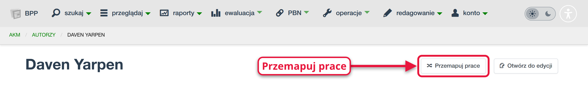
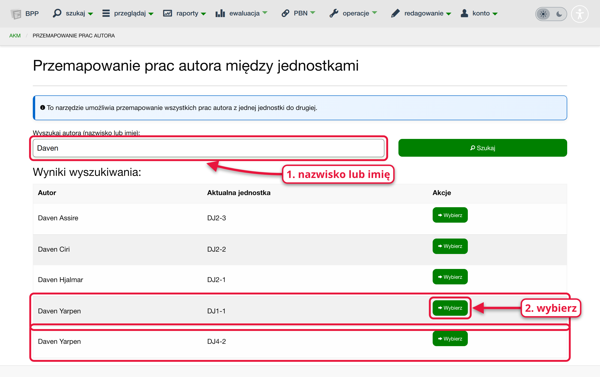
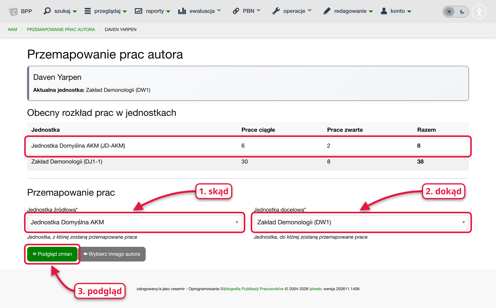
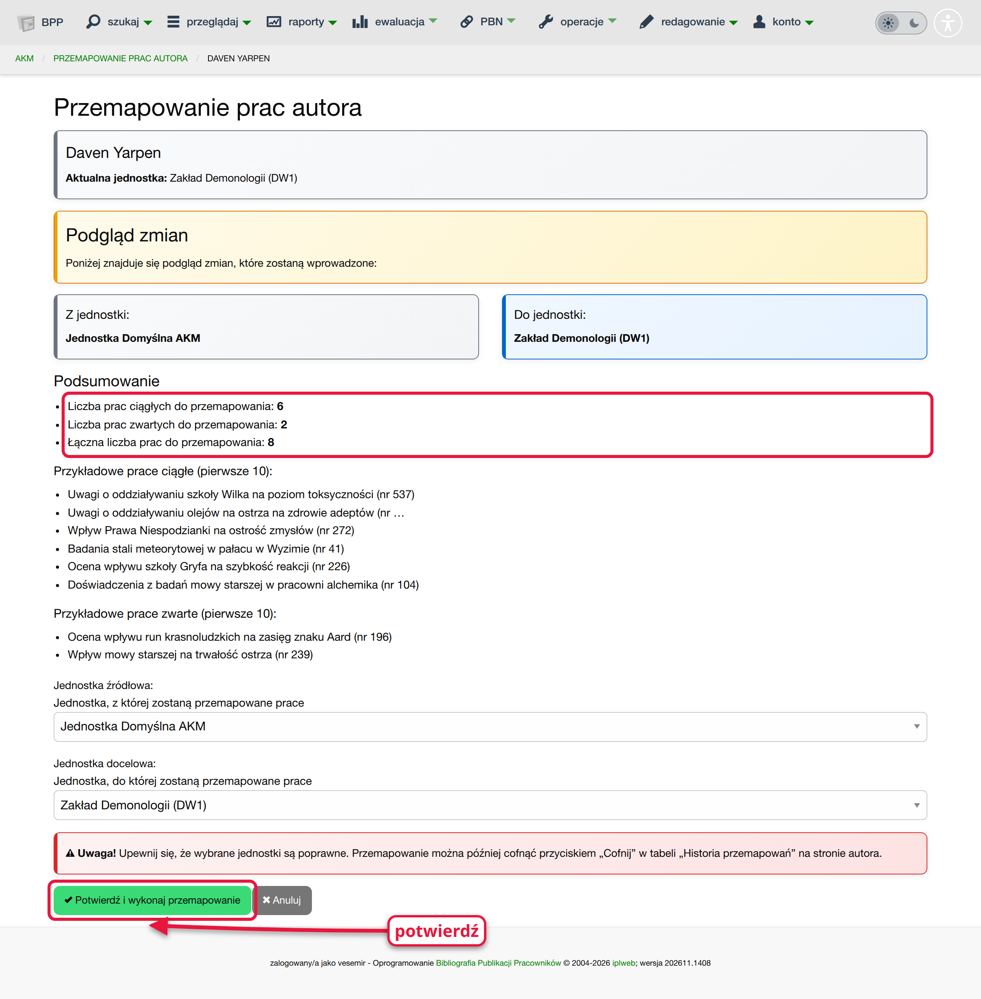
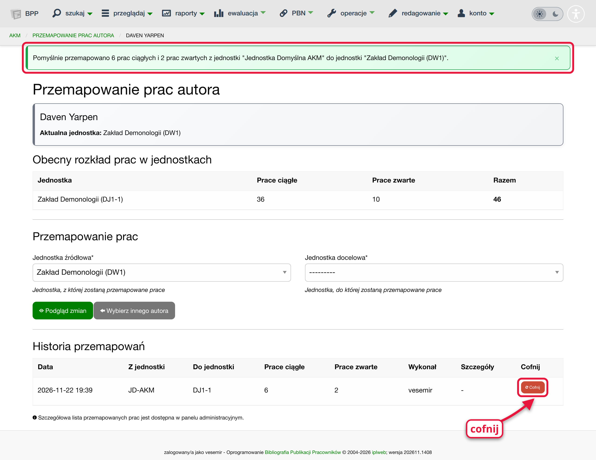
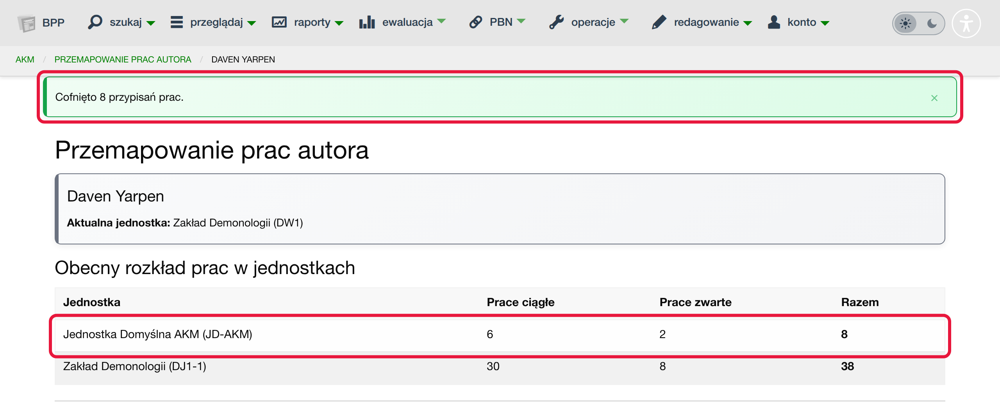
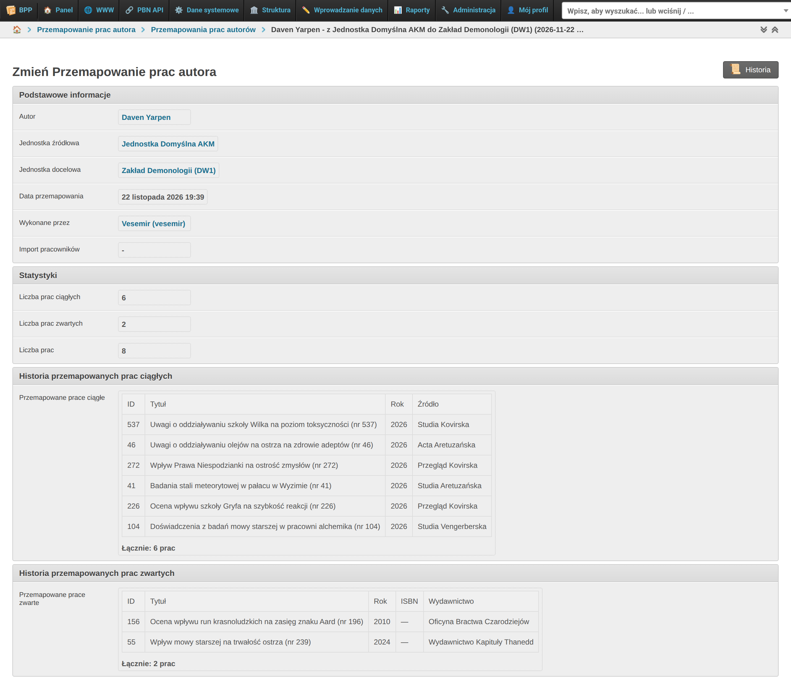

# Przemapowanie prac autora (przeniesienie prac do innej jednostki)

Każda praca w BPP zapisuje przy autorze **jednostkę**, w której ten autor
ją przygotował. Po imporcie danych albo po zmianie miejsca pracy zdarza
się, że część prac autora wisi przy niewłaściwej jednostce — na przykład
przy „Jednostce Domyślnej”, do której import odkłada prace, gdy nie umie
ustalić jednostki. Takie prace nie pojawiają się w raportach i na listach
właściwej jednostki.

Narzędzie **„Przemapuj prace”** przenosi hurtem **wszystkie** prace
**jednego autora** z jednej jednostki do drugiej — bez otwierania każdej
pracy osobno.

!!! info "To narzędzie nie łączy dwóch autorów"
    Przemapowanie zmienia tylko **jednostkę** przy pracach tego samego
    rekordu autora. Nie przenosi prac na **inny rekord** autora. Jeśli ta
    sama osoba jest w bazie dwa razy (np. „Geralt z Rivii” i „G. z Rivii”),
    najpierw scal rekordy w [deduplikatorze
    autorów](duplikaty.md#deduplikator-autorow), a dopiero potem
    przemapuj prace, które po scaleniu zostały przy złej jednostce.

## Kto może z niego korzystać {#kto-moze}

Przemapowanie i jego cofanie wymagają konta w grupie **„wprowadzanie
danych”** (albo konta superużytkownika). Tylko te osoby widzą na stronie
autora przycisk **„Przemapuj prace”**; ktoś spoza grupy, kto wpisze adres
narzędzia ręcznie, dostaje błąd 403. Grupę nadaje administrator BPP
(zob. [Grupy uprawnień](../administrator/grupy-uprawnien.md)).

## Gdzie to jest {#gdzie}

W górnym menu nie ma osobnej pozycji. Narzędzie otwiera się na dwa
sposoby:

- ze **strony autora** — przycisk **„Przemapuj prace”** obok „Otwórz do
  edycji” (najprostsza droga),
- z wyszukiwarki autorów narzędzia — przycisk **„Wybierz innego autora”**
  na formularzu albo odnośnik **„Przemapowanie prac autora”** w ścieżce
  nawigacji u góry strony.

## Krok po kroku {#krok-po-kroku}

1. **Wybierz autora.** Otwórz jego stronę (menu **przeglądaj → autorzy**
   albo wyszukiwarka) i kliknij **„Przemapuj prace”**.

    Jeśli zaczynasz od wyszukiwarki narzędzia, wpisz w pole **„Wyszukaj
    autora (nazwisko lub imię):”** nazwisko **albo** imię i kliknij
    **„Szukaj”**. Lista pokazuje do 50 osób z kolumną **„Aktualna
    jednostka”** (skrót jednostki). Przy osobie, o którą chodzi, kliknij
    **„Wybierz”**.

    

    !!! tip "Dwie osoby o tym samym nazwisku"
        Na zrzucie są dwa rekordy „Daven Yarpen” — z różnymi
        jednostkami. To mogą być dwie różne osoby albo duplikat. Zanim
        klikniesz „Wybierz”, upewnij się na stronie autora (ORCID,
        jednostka, prace), że to ten właściwy. Przemapowanie dotyczy
        **wyłącznie** wybranego rekordu — prac drugiego nie rusza.

2. **Sprawdź rozkład prac.** U góry widać nazwisko i **„Aktualna
   jednostka”** autora. Tabela **„Obecny rozkład prac w jednostkach”**
   pokazuje, ile **prac ciągłych** (artykuły), **prac zwartych** (książki
   i rozdziały) i **razem** autor ma w każdej jednostce. To z niej
   odczytasz, gdzie są prace „zabłąkane”.

3. **Wybierz jednostki.** W sekcji **„Przemapowanie prac”**:

    - **„Jednostka źródłowa”** — skąd zabrać prace. Lista zawiera tylko
      jednostki, w których autor ma jakieś prace;
    - **„Jednostka docelowa”** — dokąd je przenieść. Lista zawiera
      wszystkie jednostki uczelni oprócz jednostki domyślnej.

    Formularz sam podpowiada wybór: gdy autor ma prace tylko w jednej
    jednostce, ustawia ją jako źródłową; gdy ma prace w jednostce
    domyślnej (jej nazwa zaczyna się od „Jednostka Domyślna”, np.
    „Jednostka Domyślna” albo „Jednostka Domyślna” ze skrótem uczelni na
    końcu), ustawia ją jako źródłową. W obu
    przypadkach jako docelową podpowiada **aktualną jednostkę** autora
    (jeśli jest inna niż źródłowa). Podpowiedź zawsze możesz zmienić.

    Kliknij **„Podgląd zmian”**.

    

4. **Sprawdź podgląd.** Na stronie **„Podgląd zmian”** są: **„Z
   jednostki:”** i **„Do jednostki:”**, podsumowanie (liczba prac
   ciągłych, zwartych i łączna) oraz pierwsze 10 tytułów każdego rodzaju.
   Nic jeszcze nie zostało zmienione. Jeśli coś się nie zgadza, kliknij
   **„Anuluj”** — wrócisz do formularza.

    

5. **Potwierdź.** Kliknij **„Potwierdź i wykonaj przemapowanie”**. BPP
   wraca do formularza i pokazuje komunikat „Pomyślnie przemapowano N
   prac ciągłych i M prac zwartych z jednostki … do jednostki …”. Tabela
   rozkładu prac pokazuje już nowy stan, a na dole strony pojawia się
   wpis w **„Historii przemapowań”**.

    

Przenoszone są **wszystkie** prace autora z jednostki źródłowej — z
każdego roku i każdego rodzaju (ciągłe i zwarte). Nie da się wybrać
pojedynczych prac ani zakresu lat. Jeśli chcesz przenieść tylko część
prac, zmień jednostkę ręcznie w każdej z nich (moduł redagowania →
rekord pracy → lista autorów).

### Komunikaty o błędach {#bledy}

| Komunikat | Co zrobić |
|---|---|
| „Jednostka źródłowa i docelowa muszą być różne.” | Wybierz inną jednostkę docelową. |
| „Nie można przemapować prac do "Jednostki Domyślnej". Jednostka Domyślna jest przeznaczona tylko dla prac importowanych.” | Wybierz właściwą jednostkę docelową. |
| „Autor … nie ma żadnych prac w jednostce ….” | Prace z tej jednostki zostały już przeniesione (np. w innej karcie przeglądarki). Odśwież stronę. |

## Co się zmienia, a co nie {#co-sie-zmienia}

**Zmienia się** tylko jednostka przypisana autorowi przy każdej
przeniesionej pracy. Od tej chwili prace liczą się do raportów, list
i statystyk **jednostki docelowej**, a nie źródłowej.

**Nie zmieniają się:**

- **rekord autora** — jego „Aktualna jednostka” i historia zatrudnienia
  (zakładka jednostek w module redagowania autora) zostają bez zmian;
  przemapowanie nie dopisuje autorowi nowej jednostki,
- **afiliacja** przy pracy (zaznaczenie „afiliuje”) — zostaje taka, jaka
  była,
- **dyscyplina** przypisana autorowi przy pracy,
- **oświadczenia** i dane w PBN — przemapowanie nie wysyła niczego do
  PBN i nie dodaje prac do kolejki eksportu,
- prace **innych autorów** i prace tego autora w **innych jednostkach**,
- pozostałe rodzaje rekordów (np. patenty, prace doktorskie
  i habilitacyjne) — narzędzie przenosi wyłącznie prace ciągłe i zwarte.

## Cofanie i historia {#cofanie}

Przemapowanie **można cofnąć** — przypomina o tym też ostrzeżenie na
stronie podglądu:

1. Otwórz przemapowanie prac tego samego autora. Na dole strony, w tabeli
   **„Historia przemapowań”**, jest 10 ostatnich przemapowań: data, skróty
   jednostek **„Z jednostki”** i **„Do jednostki”**, liczby prac
   i **„Wykonał”** (login).
2. W wierszu, który chcesz odwrócić, kliknij **„Cofnij”** i potwierdź
   pytanie „Cofnąć to przemapowanie prac?”.
3. Komunikat podaje wynik, np. „Cofnięto 8 przypisań prac.”. Prace wracają
   do jednostki źródłowej.

Cofnięcie przywraca jednostkę **tylko tym pracom, których od tamtej pory
nikt nie zmienił** — jeśli ktoś w międzyczasie przypisał pracę do jeszcze
innej jednostki, ta praca zostaje, jak jest. Wtedy komunikat brzmi
„Cofnięto N przypisań prac; pominięto M z powodu późniejszych zmian
afiliacji.”. Pomijane są też prace usunięte z bazy i prace, których
jednostka źródłowa została w międzyczasie usunięta.

Wpis w historii **zostaje** po cofnięciu (przycisk „Cofnij” nadal jest
widoczny). Ponowne kliknięcie niczego nie psuje — prace, które już
wróciły, zostaną pominięte.

**Pełna lista przeniesionych prac.** Tabela na stronie pokazuje tylko
liczby. Listę tytułów (ID, tytuł, rok, źródło lub wydawnictwo) każdego
przemapowania widzi w module redagowania **superużytkownik** albo osoba,
której administrator nadał uprawnienie do przeglądania przemapowań prac
autorów. U nich ikona lupy w kolumnie **„Szczegóły”** otwiera w nowej
karcie szczegóły
przemapowania; listy prac są w zwiniętych sekcjach **„Historia
przemapowanych prac ciągłych”** i **„Historia przemapowanych prac
zwartych”** (kliknij nagłówek, żeby rozwinąć). Wszystkie przemapowania
są też w module redagowania pod nazwą **„Przemapowania prac autorów”**.
Pozostali redaktorzy widzą w tej kolumnie „-” — jeśli potrzebujesz listy
tytułów, poproś administratora.

Przemapowania wykonane automatycznie podczas [importu
pracowników](../administrator/import-pracownikow.md#przepinanie-prac-na-nowe-jednostki)
(opcja przepinania prac na nowe jednostki) też trafiają do tej historii —
w szczegółach mają wypełnione pole **„Import pracowników”** — i też
można je cofnąć przyciskiem „Cofnij”.

## Przykłady {#przyklady}

**Prace po imporcie trafiły do „Jednostki Domyślnej”.** Import dopisał
autorowi Yarpenowi Davenowi 8 nowych prac, ale nie umiał ustalić
jednostki, więc odłożył je do „Jednostki Domyślnej AKM”. Yarpen pracuje
w Zakładzie Demonologii. Na stronie autora kliknij „Przemapuj
prace” — formularz podpowie „Jednostka Domyślna AKM” → „Zakład
Demonologii”. Kliknij „Podgląd zmian”, sprawdź liczbę 8 i potwierdź.

**Autor zmienił jednostkę i chce mieć cały dorobek w nowej.** Najpierw
dopisz autorowi nową jednostkę w module redagowania (zakładka jednostek
autora), żeby stała się jego aktualną jednostką. Potem w przemapowaniu
wybierz jako źródłową starą jednostkę, jako docelową — nową. Pamiętaj, że
przeniesione zostaną **wszystkie** prace ze starej jednostki, także te
sprzed lat. Jeśli dawne prace mają zostać przy starej jednostce (bo tam
powstały), nie używaj przemapowania — zmień jednostkę ręcznie tylko
w nowych pracach.

**Pomyłka — przeniesiono do złej jednostki.** Wybrałeś jako docelową
„Zakład Odwarów i Dekoktów” zamiast „Zakładu Demonologii”. Na tej samej
stronie, w „Historii przemapowań”, kliknij „Cofnij” przy tym wpisie —
prace wrócą tam, skąd przyszły — i przemapuj je jeszcze raz, tym razem
do właściwej jednostki.

## Pokrewne narzędzia {#pokrewne}

- [Duplikaty autorów i źródeł](duplikaty.md) — scalanie dwóch rekordów
  tego samego autora lub czasopisma i przemapowanie publikacji na inne
  **źródło**.
- **PBN → źródła skasowane w PBN** — przenosi publikacje ze źródła, które
  PBN usunął, na aktualne źródło. Dotyczy czasopism, nie autorów; menu
  PBN jest widoczne, gdy uczelnia ma włączoną integrację z PBN (zob.
  [PBN: wysyłanie prac, kolejka i
  porównanie](pbn-wysylka-i-synchronizacja.md)).
