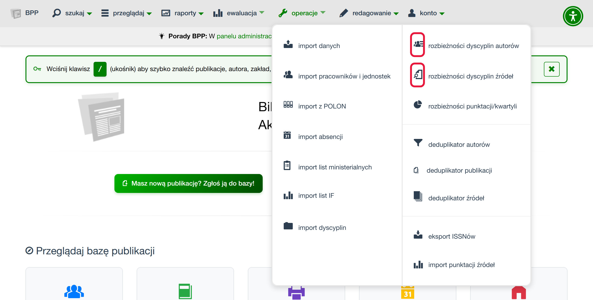
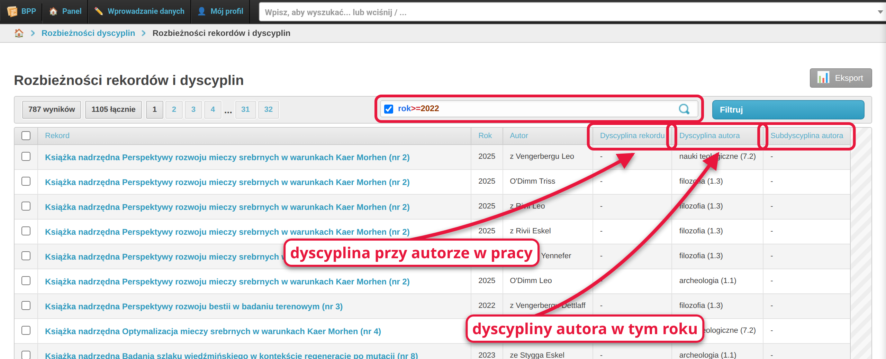
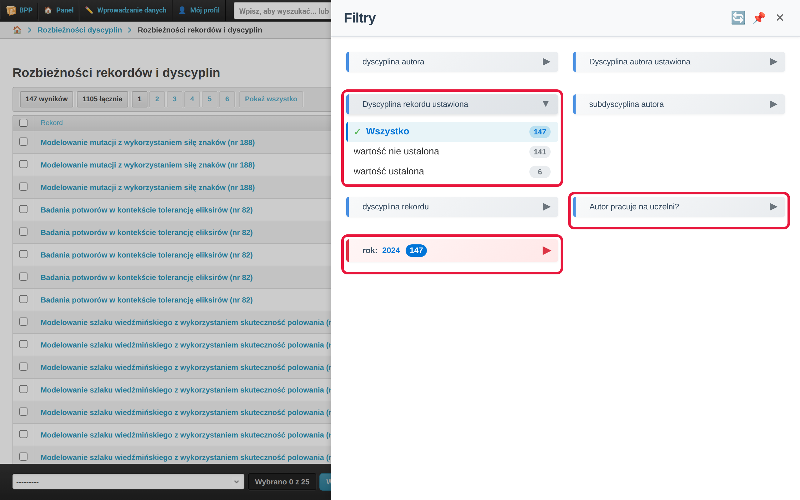
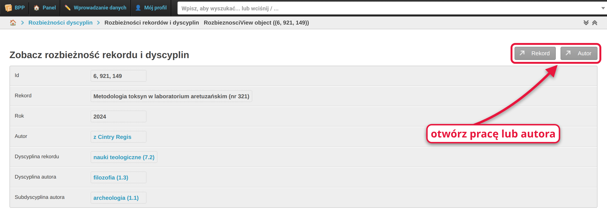
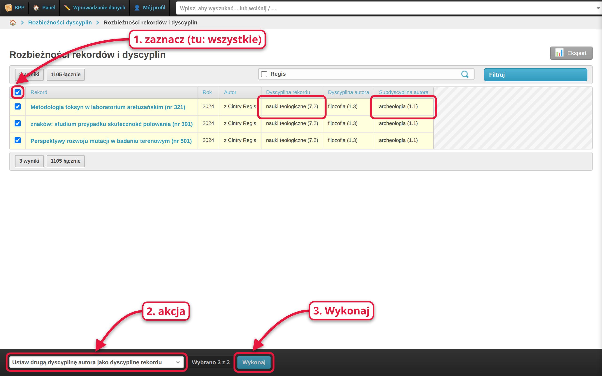
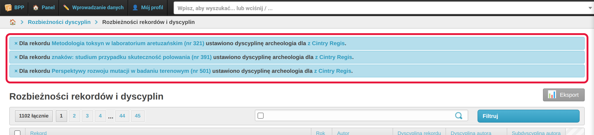
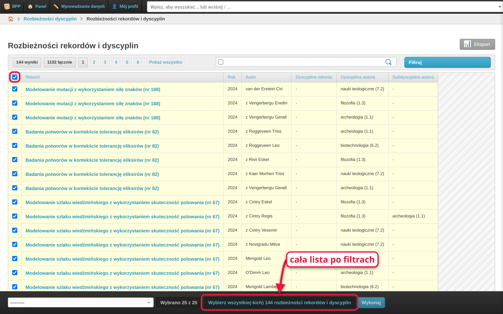
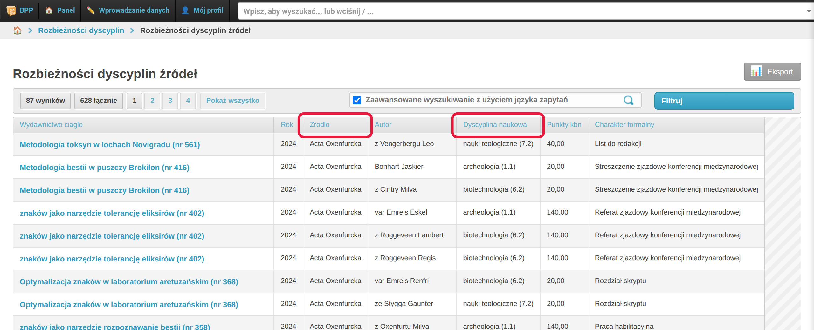
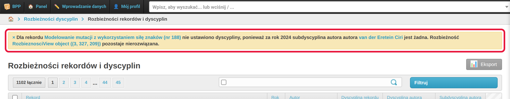

# Rozbieżności dyscyplin — jak je znaleźć i poprawić

W każdej pracy przy każdym autorze zapisana jest **dyscyplina naukowa**.
Powinna to być jedna z dyscyplin, które autor ma przypisane **na rok
pracy** (w sekcji „Powiązania autor-dyscyplina” u autora). Gdy te dwie
informacje się rozjadą, praca nie liczy się w ewaluacji tak, jak powinna:
nie ma slotów albo trafia do niewłaściwej dyscypliny.

BPP ma dwa raporty, które takie przypadki wyszukują:

- [**rozbieżności dyscyplin autorów**](#rozbieznosci-autorow) — dyscyplina
  przy autorze w pracy nie zgadza się z dyscyplinami autora w tym roku;
  tu można je poprawiać hurtem,
- [**rozbieżności dyscyplin źródeł**](#rozbieznosci-zrodel) — dyscyplina
  autora w artykule nie należy do dyscyplin czasopisma w tym roku; ten
  raport tylko pokazuje.

!!! note "To nie są „rozbieżności punktacji/kwartyli”"
    Menu **operacje** ma też pozycję **rozbieżności punktacji/kwartyli**.
    To zupełnie inne narzędzie: porównuje Impact Factor, punkty MNiSW
    i kwartyle **pracy** z wartościami **czasopisma** i nie dotyczy
    dyscyplin. Opisuje je strona
    [Impact Factor, kwartyle i punktacja źródeł](impact-factor-i-punktacja.md#krok-4b).

## Zanim zaczniesz {#zanim-zaczniesz}

**Dostęp.** Oba raporty wymagają konta w grupie **„wprowadzanie danych”**
(albo konta superużytkownika). Grupę nadaje administrator BPP.

**Najpierw dane autorów.** Raport porównuje prace z dyscyplinami autorów,
więc te muszą być aktualne. Zanim zaczniesz poprawiać prace, zaimportuj
dane z POL-on albo uzupełnij dyscypliny autorów na dany rok — patrz
[Import danych z POL-on i liczba N](import-polon-liczba-n.md) i
[Nowy rok w BPP](nowy-rok.md). Inaczej „poprawisz” prace według
nieaktualnych dyscyplin.

**Skąd biorą się rozbieżności.** Gdy zmieniasz autorowi dyscyplinę na
dany rok w BPP (u autora albo przez import z POL-on), BPP **sam**
przepisuje tę dyscyplinę w jego pracach z tego roku, a gdy kasujesz
przypisanie — czyści ją w pracach. Rozbieżności powstają więc głównie,
gdy:

- praca została wpisana, **zanim** autor dostał dyscyplinę na ten rok
  (dyscyplina przy autorze w pracy jest pusta),
- zmieniono **rok** pracy — dyscyplina przy autorze została z poprzedniego
  roku,
- dane przyszły z importu lub ze starszej wersji systemu.

Raport obejmuje prace od roku **2017**.

## Rozbieżności dyscyplin autorów {#rozbieznosci-autorow}

### Gdzie to jest {#gdzie}

W górnym menu **operacje** kliknij **rozbieżności dyscyplin autorów**.
Tę samą listę otwiera pozycja **Rozbieżności dyscyplin** w menu
**Wprowadzanie danych** w module redagowania — ale bez gotowych filtrów.

Lista otwarta z menu **operacje** jest od razu zawężona do prac **od
2022 roku** (zapytanie `rok>=2022` w polu wyszukiwania) i do autorów,
którzy **pracują na uczelni**. Licznik „N wyników” pokazuje, ile
rozbieżności zostało po filtrach, a „N łącznie” — ile jest wszystkich.

Jeden wiersz to **jeden autor w jednej pracy**. Praca z trzema autorami
z rozbieżnością pojawi się trzy razy. Kolumny:

| Kolumna | Co znaczy |
|---|---|
| **Rekord** | tytuł pracy; kliknięcie otwiera [szczegóły rozbieżności](#szczegoly) |
| **Rok** | rok pracy |
| **Autor** | autor, którego dotyczy rozbieżność |
| **Dyscyplina rekordu** | dyscyplina zapisana **przy tym autorze w tej pracy** („-” = pusta) |
| **Dyscyplina autora** | pierwsza dyscyplina autora **w roku pracy** |
| **Subdyscyplina autora** | druga dyscyplina autora w tym roku („-” = autor ma tylko jedną) |

### Trzy rodzaje rozbieżności {#rodzaje}

1. **Praca bez dyscypliny** — „Dyscyplina rekordu” to „-”, a autor ma
   dyscyplinę na ten rok. Najczęstszy przypadek: praca wpisana przed
   uzupełnieniem dyscyplin autorów. Zwykle wystarczy przepisać dyscyplinę
   autora do pracy [akcją](#popraw-wiele).
2. **Inna dyscyplina** — w pracy jest dyscyplina, ale **żadna** z dyscyplin
   autora w tym roku. Tu trzeba zdecydować, która jest właściwa: czy
   poprawić pracę, czy dane autora.
3. **Autor bez dyscypliny w tym roku** — w pracy jest dyscyplina, ale autor
   nie ma na ten rok żadnego przypisania. Akcje nie pomogą (nie ma czego
   przepisać). Dodaj autorowi dyscyplinę na ten rok (patrz
   [Nowy rok w BPP](nowy-rok.md)) albo — jeśli autor naprawdę nie ma
   dyscypliny — usuń ją z pracy w formularzu pracy.

!!! warning "Rozbieżności trzeciego rodzaju mogą nie być widoczne na liście"
    W obecnej wersji BPP wiersze, w których autor **nie ma** dyscypliny
    w roku pracy, są liczone w „N wyników”, ale **nie pojawiają się**
    w tabeli. Jeśli licznik pokazuje więcej wierszy, niż widzisz na
    liście, chodzi właśnie o takie przypadki. Znajdziesz je w raporcie
    [kompletności danych POL-on](#kompletnosc-polon) (od 2026 roku) albo
    sprawdzając dyscypliny autora na dany rok.

### Filtrowanie {#filtrowanie}

Kliknij **Filtruj** (prawy górny róg listy). Otworzy się panel filtrów:

Najbardziej przydatne:

- **rok** — jeden rok; najlepiej porządkować rok po roku,
- **Dyscyplina rekordu ustawiona** — „wartość nie ustalona” to prace bez
  dyscypliny przy autorze (rodzaj 1), „wartość ustalona” — prace
  z dyscypliną inną niż autora (rodzaje 2 i 3),
- **Autor pracuje na uczelni?** — „pracuje (ma aktualna, nie-obca
  jednostke)” pomija autorów obcych i byłych pracowników,
- **dyscyplina autora**, **subdyscyplina autora**, **dyscyplina rekordu**
  — konkretna dyscyplina, np. żeby przekazać listę osobie odpowiedzialnej
  za daną dyscyplinę.

Pole wyszukiwania szuka w tytule pracy oraz nazwisku i imieniu autora.
Po zaznaczeniu pola wyboru po jego lewej stronie przyjmuje zapytania
w języku zapytań (jak `rok>=2022` z menu). Aby zobaczyć wszystkie lata,
wyczyść pole wyszukiwania i kliknij lupę.

**Eksport** (prawy górny róg) zapisuje bieżącą listę do pliku XLSX:
tytuł pracy, nazwisko i imiona autora, jego dyscypliny i link do pracy.
Działa, gdy lista ma mniej niż 10 000 wierszy — przy większej najpierw
zawęź ją filtrami.

### Szczegóły jednej rozbieżności {#szczegoly}

Kliknij tytuł pracy na liście. Strona pokazuje te same dane co wiersz
i dwa przyciski: **Rekord** otwiera formularz pracy, a **Autor** —
formularz autora (oba w nowej karcie).

Tak poprawiasz pojedyncze przypadki: w formularzu pracy wybierz przy
autorze właściwą dyscyplinę i zapisz. Lista dyscyplin w formularzu
podpowiada tylko te, które autor ma na rok pracy.

### Poprawianie wielu prac naraz {#popraw-wiele}

Na dole listy jest pasek akcji z dwiema akcjami:

- **„Ustaw pierwszą dyscyplinę autora jako dyscyplinę rekordu”** —
  przepisuje do pracy wartość z kolumny „Dyscyplina autora”,
- **„Ustaw drugą dyscyplinę autora jako dyscyplinę rekordu”** —
  przepisuje wartość z kolumny „Subdyscyplina autora”.

1. Zawęź listę filtrami tak, żeby zostały tylko wiersze, dla których
   chcesz tej samej akcji (np. jeden rok i „Dyscyplina rekordu ustawiona:
   wartość nie ustalona”).
2. Zaznacz wiersze — pojedynczo albo wszystkie na stronie polem w nagłówku
   tabeli.
3. Wybierz akcję i kliknij **Wykonaj**.

Na zrzucie autor ma w 2024 roku dwie dyscypliny (filozofia i archeologia),
a w pracach zapisano trzecią. Redakcja ustaliła, że prace należą do
archeologii, czyli drugiej dyscypliny autora — stąd akcja „Ustaw drugą…”.

BPP pokaże komunikat dla każdej poprawionej pracy, a poprawione wiersze
znikną z listy:

Po akcji lista wraca **bez filtrów** — ustaw je ponownie, zanim
przejdziesz do następnej partii. Punkty i sloty poprawionych prac BPP
przelicza sam, w tle; nie trzeba otwierać i zapisywać każdej pracy.

**Cała lista naraz.** Gdy zaznaczysz wszystkie wiersze na stronie, na
pasku pojawi się przycisk **„Wybierz wszystkie(-kich) N rozbieżności
rekordów i dyscyplin”**. Po jego kliknięciu akcja obejmie **wszystkie
wiersze pasujące do filtrów**, ze wszystkich stron listy.

Przy **20 i więcej** zaznaczonych wierszach (także gdy zaznaczysz całą
25-wierszową stronę) operacja idzie w tle. Zamiast listy
komunikatów zobaczysz: „Rozpoczęto przetwarzanie w tle. ID zadania: …”.
Odśwież listę po chwili — poprawione wiersze znikną. (Link z ID zadania
prowadzi do panelu zadań, który zwykle widzi tylko administrator.)

!!! warning "Akcja nie sprawdza, czy dyscyplina jest właściwa"
    Akcja przepisuje dyscyplinę autora do pracy bez pytania. Jeśli w pracy
    była już inna dyscyplina (rodzaj 2), zostanie nadpisana. Przy dwóch
    dyscyplinach autora wybór „pierwsza czy druga” należy do Ciebie —
    nie stosuj akcji do całej listy, jeśli nie wiesz, czego dotyczą prace.

## Rozbieżności dyscyplin źródeł {#rozbieznosci-zrodel}

W górnym menu **operacje** kliknij **rozbieżności dyscyplin źródeł** (albo
**Wprowadzanie danych → Rozbieżności dyscyplin źródeł** w module
redagowania). Lista pokazuje **artykuły** (wydawnictwa ciągłe), w których
dyscyplina autora **nie należy** do dyscyplin czasopisma przypisanych na
rok artykułu. Tak jak lista autorów, z menu **operacje** otwiera się
zawężona do lat od 2022 i autorów pracujących na uczelni.

Kolumny: tytuł artykułu, **Rok**, **Zrodlo** (czasopismo), **Autor**,
**Dyscyplina naukowa** (dyscyplina autora w tym artykule), **Punkty kbn**
(punkty MNiSW artykułu) i **Charakter formalny**. W panelu **Filtruj**
są m.in. filtry **rok**, **dyscyplina naukowa**, **Autor pracuje na
uczelni?**, **punkty MNISW/MEIN** (np. „większe niż 20”) i **charakter
formalny**.

Ten raport **nie ma akcji** — nic nie poprawia. Kliknij tytuł, a na stronie
szczegółów użyj przycisków **Rekord**, **Autor** albo **Źródło**. Typowe
przyczyny:

- **Czasopismo nie ma dyscyplin na ten rok.** Wtedy w raporcie są
  **wszystkie** artykuły z tego czasopisma i roku. Uzupełnij dyscypliny
  czasopism (import wykazu ministerialnego albo ręcznie przy źródle — patrz
  [Nowy rok w BPP](nowy-rok.md)). Czasopisma, które nie mają żadnych
  dyscyplin w żadnym roku, w raporcie się nie pojawiają.
- **Autor naprawdę publikuje poza dyscypliną czasopisma.** To nie musi być
  błąd. Sprawdź z osobą odpowiedzialną za ewaluację, czy dyscyplina przy
  autorze jest właściwa.
- **Błędna dyscyplina przy autorze w pracy** — popraw ją w formularzu
  pracy albo w [raporcie dyscyplin autorów](#rozbieznosci-autorow).

**Eksport** daje plik XLSX z dodatkową kolumną: listą dyscyplin
czasopisma w roku artykułu.

## Kompletność danych POL-on {#kompletnosc-polon}

Brak dyscypliny przy autorze w pracy wykazuje też raport **ewaluacja →
kompletność danych POL-on** (ta sama grupa „wprowadzanie danych”). Obejmuje
on prace od **2026** roku i sprawdza wszystkie dane wymagane w POL-on
(m.in. dyscyplinę, upoważnienie, ORCID), autor po autorze, z przyciskami
do formularza każdej pracy. Brak dyscypliny opisuje tam jako „Autorowi nie
przypisano dyscypliny naukowej dla tej pracy albo dyscyplina została
odpięta.” — czyli liczy też dyscypliny **odpięte**, których raport
rozbieżności nie traktuje jako błąd.

## Co może pójść nie tak {#co-moze-pojsc-nie-tak}

**„Dla rekordu … nie ustawiono dyscypliny, ponieważ za rok … subdyscyplina
autora autora … jest żadna. Rozbieżność … pozostaje nierozwiązana.”**
Wybrano akcję „Ustaw drugą…”, a autor ma w tym roku tylko jedną dyscyplinę
(albo „Ustaw pierwszą…” dla autora bez dyscypliny w tym roku — wtedy
w komunikacie jest „dyscyplina autora”). Ta praca nie została zmieniona,
pozostałe zaznaczone — tak. Użyj drugiej akcji albo uzupełnij dane autora.

**„Lista rekordów zmieniła się podczas operacji. Zakończono przetwarzanie,
zalecane ponowne uruchomienie.”** W trakcie akcji ktoś inny (albo import)
zmienił dane i jedna z zaznaczonych rozbieżności zniknęła. Część prac mogła
zostać poprawiona — odśwież listę i powtórz akcję dla pozostałych.

**Licznik „N wyników” większy niż liczba wierszy.** Na liście są
rozbieżności „autor bez dyscypliny w tym roku”, których tabela nie
wyświetla — patrz [ostrzeżenie wyżej](#rodzaje).

**Po akcji rozbieżność wraca.** Najczęściej po imporcie z POL-on, który
zmienił autorowi dyscyplinę — BPP przepisał ją w pracach. Sprawdź dane
autora na dany rok; to one są wzorcem dla raportu.

**Praca, w której autor występuje dwa razy** (np. jako autor i redaktor).
Akcja poprawia tylko jedno z tych powiązań. Drugie popraw w formularzu
pracy.

**Brak menu „operacje” albo brak pozycji w menu.** Konto nie jest w grupie
„wprowadzanie danych” — poproś administratora BPP.

## Zobacz też

- [Import danych z POL-on i liczba N](import-polon-liczba-n.md) — skąd
  biorą się dyscypliny autorów
- [Nowy rok w BPP](nowy-rok.md) — dyscypliny autorów i czasopism na nowy
  rok
- [Impact Factor, kwartyle i punktacja źródeł](impact-factor-i-punktacja.md)
  — **inne** „rozbieżności”: punktacja i kwartyle prac a czasopism
- [Obliczanie slotów](sloty.md) — dlaczego dyscyplina przy autorze w pracy
  jest ważna
- [Autorzy](autorzy.md) — formularz autora
