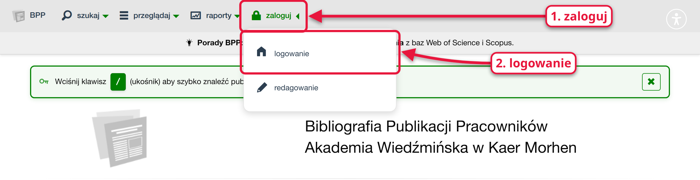
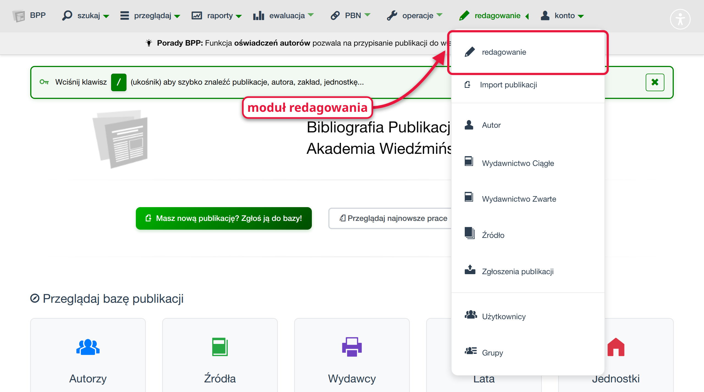
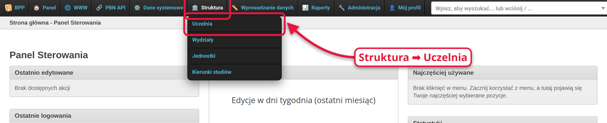
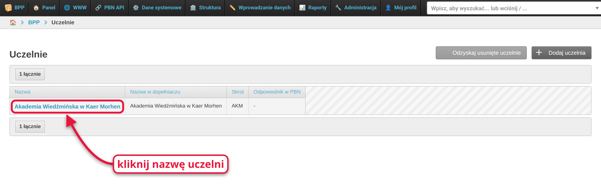
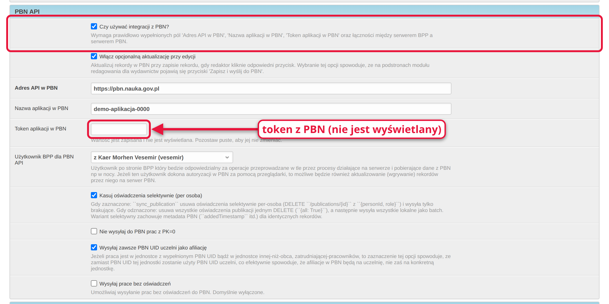
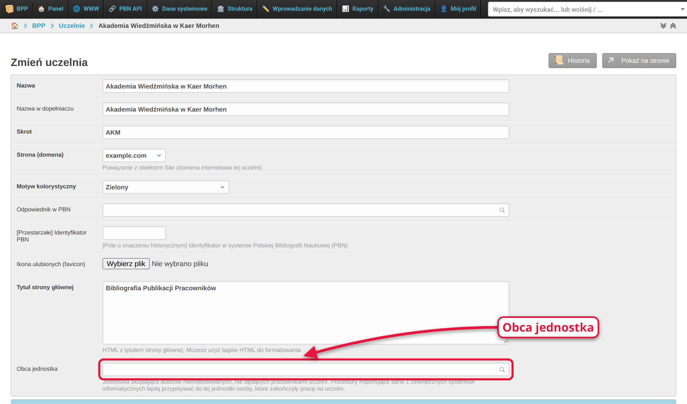

# Edycja danych uczelni

## Wejście do ustawień Uczelni

1. Zaloguj się do systemu: na górnej belce nawigacji kliknij **„zaloguj”**,
   a następnie **„logowanie”** (szczegóły: [Logowanie](../uzytkownik/logowanie.md)).

    

2. Po zalogowaniu na górnej belce pojawi się menu **„redagowanie”**. Wybierz
   z niego pozycję **„redagowanie”** — moduł redagowania otworzy się w nowej
   karcie przeglądarki.

    

3. W module redagowania z górnej belki wybierz **„Struktura”**, a następnie
   **„Uczelnia”**.

    

4. W systemie powinien być jeden rekord określający dane uczelni. Kliknij
   nazwę uczelni.

    

Otworzy się formularz ustawień uczelni. Jest długi i podzielony na zwijane
sekcje (np. „Strona wizualna”, „Profil autora (podstrona)”, „Wydruki”) —
kliknij nagłówek sekcji, aby ją rozwinąć lub zwinąć. Użytkownicy końcowi, a
nawet administratorzy, nie będą tu zaglądać zbyt często, ale mimo to doradzamy
rozwagę w edycji ustawień obiektu uczelnia.

!!! note "Sekcje integracji widzi tylko superużytkownik"
    Sekcje **„PBN API”**, **„Clarivate Analytics API”**, **„ORCID”**
    i **„DSpace”** są widoczne w formularzu wyłącznie dla superużytkownika.
    Inni użytkownicy edytujący rekord uczelni ich nie widzą, a zapis
    formularza nie zmienia tych ustawień.

## Integracja z Web Of Science

Po rozwinięciu sekcji „Clarivate Analytics API” możemy uzupełnić nazwę
użytkownika i hasło do Clarivate Analytics API. W ten sposób będziemy mogli
zaciągać liczbę cytowań dla rekordów i autorów.

## Integracja z PBN

Jeżeli w PBN uzyskaliśmy rolę „Menedżer aplikacji”, możemy utworzyć token
aplikacji i wpisać te dane do BPP w sekcji **„PBN API”**: zaznacz „Czy używać
integracji z PBN?”, uzupełnij „Adres API w PBN”, „Nazwa aplikacji w PBN”
i „Token aplikacji w PBN”, wskaż „Użytkownik BPP dla PBN API” i zapisz rekord.
Umożliwi to autoryzowanie użytkownika loginem w PBN (na głównej stronie, menu
**PBN ➡ autoryzuj PBN API**), a następnie wysyłanie prac do PBN przy ich zapisywaniu.
W ten sposób dane publikacji wpisujemy tylko raz (do BPP), a ręczne ich
wysyłanie do PBN nie jest potrzebne. Więcej: [Konfiguracja PBN](../administrator/konfiguracja-pbn.md).

Zapisany token nie jest później wyświetlany w formularzu. Aby go nie zmieniać,
zostaw pole „Token aplikacji w PBN” puste.

## Obca jednostka

W systemie BPP powinna znajdować się jedna i wyłącznie jedna *Obca jednostka*.

Jest to taka jednostka, do której trafiają autorzy, którzy afiliują na jednostkę nie będącą w strukturach uczelni.

Autor przypisany wyłącznie do *Obcej jednostki* jest w publicznej części
serwisu traktowany jako **autor spoza uczelni**: zamiast pełnej strony autora
widać prostą stronę informacyjną z listą jego prac współautorskich (patrz
[Autor spoza uczelni](../uzytkownik/przegladanie-i-wyszukiwanie.md#autor-spoza-uczelni)).
Wystarczy jedno przypisanie (także zakończone) do innej jednostki uczelni, by
autor miał pełną stronę. Bez wskazanej *Obcej jednostki* ten mechanizm nie
działa — wszyscy autorzy mają pełne strony jak dotąd.

Aby określić *Obcą jednostkę*, otwórz rekord uczelni (Redagowanie ➡ Struktura ➡ Uczelnia, jak opisano
wyżej), wybierz jednostkę w polu *Obca jednostka* (na końcu pierwszej części formularza) i zapisz rekord.

!!! note

    warto, aby *Obca jednostka* miała odznaczone [Pole *Skupia pracowników*](jednostki.md#pole-skupia-pracowników) oraz [Pole *Zarządzaj automatycznie*](jednostki.md#pole-zarządzaj-automatycznie)
