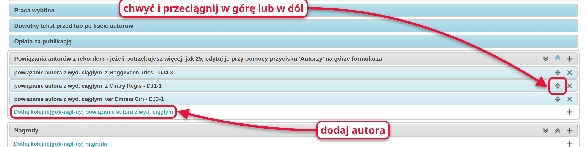

# Edycja danych rekordów - wydawnictwa zwarte, ciągłe, patenty, itp

## Dodawanie autorów do rekordów

Aby dodać autora do rekordu, podczas dodawania lub edycji rekordu kliknij
„Dodaj kolejne(go)(-ną)(-ny) powiązanie autora z wyd. ciągłym” (w wydawnictwie
zwartym — „…z wyd. zwartym”, w patencie — „…z patentem”) pod listą autorów.

W formularzu rekordu można w ten sposób wpisać do 25 autorów. Przy dłuższej
liście autorów skorzystaj z przycisku **Autorzy** u góry formularza rekordu.

## Zmiana kolejności autorów

Kolejność autorów zmienia się techniką „przeciągnij i upuść”:

1. Zwiń powiązania autorów — ikoną ⇑ („zwiń wszystkie”) na pasku
   „Powiązania autorów z rekordem” albo klikając nagłówek pojedynczego
   powiązania. Zwinięta lista mieści się na ekranie, co ma znaczenie
   zwłaszcza na mniejszych monitorach.
2. Chwyć lewym przyciskiem myszy przycisk przeciągania (ikona ⇕ po prawej
   stronie nagłówka powiązania) i przeciągnij powiązanie w górę lub w dół.
3. Zapisz rekord.

Działania te również prezentuje film [Zmiana kolejności autorów](https://www.youtube.com/embed/oruEX3CykH8) .

<iframe width="560" height="315" src="https://www.youtube.com/embed/oruEX3CykH8" frameborder="0" allow="autoplay; encrypted-media" allowfullscreen></iframe>

## Data udostępnienia w otwartym dostępie {#data-udostepnienia-oa}

W formularzu artykułu (wydawnictwa ciągłego) oraz książki i rozdziału
(wydawnictwa zwartego), w zwijanej sekcji **OpenAccess**, jest pole
**OpenAccess: data udostępnienia (dzień lub miesiąc i rok)**. Wpisz w nim:

- **pełną datę**, gdy znasz dzień udostępnienia — np. `30.12.2025`,
  `2025-12-30` albo `2025.12.30`,
- **sam miesiąc i rok**, gdy dnia nie znasz — np. `12.2025`, `2025-12`
  albo `2025.12`.

**Sam rok (np. `2025`) nie wystarczy** — formularz go nie przyjmie, bo PBN
wymaga co najmniej miesiąca i roku udostępnienia. Po zapisie pole pokazuje
wartość w jednym formacie: `30.12.2025` albo `12.2025`. Rok musi mieścić się
w zakresie od 1900 do bieżącego roku powiększonego o 10 lat.

Przy wysyłce do PBN:

- pełna data trafia do PBN jako data udostępnienia,
- miesiąc i rok trafiają do PBN jako miesiąc i rok udostępnienia — BPP
  **nie dopisuje** żadnego dnia,
- gdy pole jest puste, BPP użyje daty dostępu do strony WWW
  („Dostęp dnia (wolny dostęp)”, a potem „Dostęp dnia (płatny dostęp)”),
  o ile ją podano; inaczej data udostępnienia nie jest wysyłana.
  Data wpisana w sekcji OpenAccess ma zawsze pierwszeństwo przed tymi
  datami.

Prace pobierane z PBN, dla których PBN podaje miesiąc i rok udostępnienia,
mają w tym polu wpisany miesiąc i rok (bez zmyślonego dnia). Jeśli PBN
podaje sam rok, BPP nie wpisuje daty — uzupełnij ją ręcznie przed wysyłką
do PBN (raport kompletności danych POL-on pokaże taki brak).

## Patenty — pola i opis bibliograficzny {#patenty}

Formularz patentu (**Redagowanie → Patenty**) ma, obok pól wspólnych
z innymi rekordami, pola właściwe tylko patentom:

| Pole | Do czego służy |
|---|---|
| „Numer zgłoszenia”, „Data zgłoszenia” | dane zgłoszenia patentowego |
| „Numer prawa wyłącznego” | numer patentu (np. `PL123456`) |
| „Data decyzji” | data decyzji o udzieleniu prawa |
| „Data opublikowania” | data ogłoszenia o udzieleniu prawa, np. w „Wiadomościach Urzędu Patentowego”; niezależna od daty decyzji |
| „Rodzaj prawa” | słownik: patent, wzór użytkowy, wzór przemysłowy… |
| „Typ patentu” | `polski` albo `zagraniczny` — klasyfikacja niezależna od rodzaju prawa |
| „Kraj” | kraj udzielenia prawa; pojawia się w formularzu po wybraniu typu `zagraniczny` |
| „Wydzial” | jednostka uczelni, z którą patent jest powiązany (m.in. do raportów) |
| „Uprawnieni” | podmioty uprawnione z patentu, także spoza uczelni — wpisane tak, jak mają się pojawić w opisie |
| „Strony” | zakres stron w publikatorze |

Wszystkie pola patentowe są opcjonalne. „Kraj” można wypełnić wyłącznie
przy typie `zagraniczny` — w innym wypadku formularz zgłosi błąd przy tym polu.

### Opis bibliograficzny patentu

Opis bibliograficzny patentu składa się z pól w takiej kolejności:

1. „Numer prawa wyłącznego”,
2. tytuł,
3. „Uprawnieni”,
4. twórcy,
5. „Informacje”, „Szczegóły”, „Uwagi” — jak w pozostałych rekordach,
6. „Strony” (z przedrostkiem `s.`), „Numer zgłoszenia”, „Data zgłoszenia”,
   „Data decyzji”, „Data opublikowania”,
7. adres WWW, poprzedzony słowami `Opublikowano w:` (jeśli wypełniono
   zarówno „Adres WWW (płatny dostęp)”, jak i „Adres WWW (wolny dostęp)”,
   w opisie jest ten drugi).

Przykład:

> PL123456. **Sposób otrzymywania związku chemicznego.** Uniwersytet X,
> Warszawa, PL. [AUT.] ANNA KOWALSKA,
> JAN NOWAK. W: WUP 06/25. Nr zgłoszenia: P.654321, Data zgłoszenia:
> 14.06.2022, Data decyzji: 13.11.2024, Data opublikowania: 10.02.2025.
> Opublikowano w: https://example.com/wup06_2025.pdf

Pole niewypełnione nie zostawia w opisie żadnego śladu — ani etykiety, ani
przecinka. Patent, w którym nie wypełniono żadnego z pól patentowych ani
adresu WWW, ma opis taki jak dotąd (tytuł, twórcy, „Informacje”,
„Szczegóły”, „Uwagi”). Jeśli zakres stron jest już wpisany w „Szczegółach”,
nie jest powtarzany z pola „Strony”.

„Typ patentu”, „Kraj” i „Rodzaj prawa” nie wchodzą do opisu
bibliograficznego — są widoczne na stronie rekordu, w ramce „Patent” karty
„Informacje dodatkowe”, razem z pozostałymi danymi patentowymi.

Uczelnia, która ma własny szablon opisu bibliograficznego przypisany do
patentów (albo do wszystkich rekordów), zachowuje swój szablon — opisana
wyżej zmiana dotyczy szablonu domyślnego.

## Historia zmian i przywracanie poprzedniej wersji {#historia-zmian}

Każda zmiana rekordu publikacji (wydawnictwa ciągłego, zwartego, patentu,
pracy doktorskiej i habilitacyjnej) jest zapisywana jako **wersja**. Tak
samo każdy inny rekord edytowany w module redagowania: zgłoszenia
publikacji, źródła, wydawcy, konferencje, serie wydawnicze, jednostki,
wszystkie słowniki (charaktery formalne, języki, typy, dyscypliny…),
użytkownicy, grupy i ustawienia. Wersja publikacji obejmuje także **listę
autorów** (z jednostką, dyscypliną, afiliacją i kolejnością), streszczenia,
dodatkowe tytuły, zewnętrzne bazy danych, granty, nagrody, pliki
w repozytorium i słowa kluczowe.

Historię otwiera przycisk **„Historia”** w prawym górnym rogu formularza.
Przy każdej wersji widać **kto i kiedy** wprowadził zmianę, **skąd**
przyszła (moduł redagowania, strona — np. edycja profilu, import lub
narzędzie, API / MCP z nazwą aplikacji, system) i co zmieniono (np.
„Zmodyfikowano Tytuł oryginalny”, „Przeniesiono do kosza (powód: …)”,
„Ustawiono status korekty: po korekcie (akcja masowa)”).

- **Porównanie wersji** — zaznacz wersję starszą (lewe kółko, kolumna
  „starsza”) i nowszą (prawe kółko, kolumna „nowsza”), a potem kliknij
  **„Porównaj zaznaczone wersje”**. Tabela pokazuje tylko pola, które się
  zmieniły, w czterech kolumnach: nazwa pola, **wersja starsza**,
  **zmiana** i **wersja nowsza**. Kolumny boczne zawierają pełne wartości
  z obu wersji, a środkowa samą różnicę: usunięte słowa przekreślone na
  czerwono, dodane podświetlone na zielono, w pozostałych polach „stare →
  nowe”. Dla list (autorzy, granty, pliki…) po bokach są pełne listy, a
  w środku pozycje usunięte (−), dodane (+) i zmienione, np. „Afiliuje:
  tak → nie”. Plakietki „wersja aktualna” i „wersja najstarsza” pokazują,
  gdzie w historii leży wersja. W ostatnim wierszu tabeli, pod każdą
  wersją, jest przycisk „♻️ Przywróć…” — otwiera podgląd tej wersji
  z przyciskiem przywracania (pod wersją aktualną go nie ma). Pod tabelą
  „← Poprzednia zmiana” / „Następna zmiana →” przechodzą po kolejnych
  parach wersji, a „✏️ Edytuj rekord” i „📜 Historia” prowadzą do
  formularza i listy wersji.
- **Przywrócenie wersji** — kliknięcie daty pokazuje rekord w stanie z tej
  wersji (tylko do podglądu, bez edycji). Przycisk **„♻️ Przywróć tę
  wersję”** na dole strony przywraca rekord do tego stanu (samo
  przywrócenie też trafia do historii, więc da się je cofnąć). Przy wersji
  aktualnej przycisku nie ma — nie ma czego przywracać. Przywrócenie wersji
  publikacji przywraca też listy powiązane — nad formularzem wypisane są
  pozycje, które **zostaną usunięte** (np. autorzy dopisani po tej wersji)
  i które **zostaną przywrócone**.

Uwagi:

- Wersje są zapisywane od chwili aktualizacji systemu. Rekord, który nie
  był od tego czasu edytowany, dostaje pierwszą wersję automatycznie tuż
  przed pierwszą zmianą (komentarz „Stan sprzed pierwszej zarejestrowanej
  zmiany”) — dzięki temu i tę zmianę można cofnąć. Starsze zmiany widać
  w tabeli **„Wcześniejsza historia”** (kto i kiedy, bez przywracania).
- Przywrócenie wersji **nie wyjmuje niczego z kosza**. Pliki repozytorium
  usunięte po tej wersji zostają w koszu — podgląd wersji wymienia je
  osobno („Nie zostaną przywrócone — są w koszu”), a przywraca się je
  w formularzu rekordu (patrz [Pliki w repozytorium](#pliki-repozytorium)).
- Wersji nie da się przywrócić, gdy jej stan nie pasuje do dzisiejszych
  danych — np. pozycja z listy należy teraz do innego rekordu albo dawna
  jednostka nadrzędna jest dziś podjednostką przywracanej jednostki.
  Podgląd wersji wyjaśnia wtedy, co poprawić, i nie pokazuje przycisku
  przywracania.
- Historia jest przechowywana bez limitu czasu.
- Historię i porównanie wersji rekordu z kosza można oglądać, ale
  przywrócić wersję da się dopiero po wyjęciu rekordu z kosza — strona
  „Historia” pokazuje wtedy ramkę z przyciskiem **„♻️ Przywróć z kosza”**.
- Najnowsza wersja (obecny stan rekordu) ma w historii zieloną plakietkę
  **„wersja aktualna”**. Podgląd wersji o tej samej treści co aktualna
  (np. tej, do której rekord właśnie przywrócono) mówi wprost, że zapis
  niczego nie zmieni.
- Po przywróceniu wersji opis bibliograficzny i punktacja są przeliczane
  tak jak po zwykłym zapisie formularza.
- Przywrócenie wersji jednego rekordu nigdy nie zmienia innych rekordów —
  także po akcji masowej (np. zmianie statusu korekty wielu prac) każdy
  rekord ma własną wersję.

## Pliki w repozytorium — kosz i archiwum plików {#pliki-repozytorium}

Pliki dodane do rekordu (sekcja **„elementy repozytorium”** w formularzu
publikacji), pliki i załączniki zgłoszeń publikacji **nigdy nie są
kasowane z serwera**.

- **Usunięcie pliku w formularzu** (pole „Usunąć?” przy pliku i zapis
  rekordu) przenosi go do kosza. Pliki z kosza są widoczne w tym samym
  formularzu, w sekcji **„pliki repozytorium w koszu”**. Aby przywrócić
  plik, zaznacz przy nim **„♻️ Przywróć z kosza”** i zapisz rekord.
- **Archiwum plików** (moduł redagowania → **Historia zmian → Archiwum
  plików**) zbiera pliki, które straciły powiązanie z rekordem: rekord
  usunięty trwale z kosza (razem z jego plikami), usunięty załącznik
  zgłoszenia, plik podmieniony na inny albo usunięty z pola. Przy każdym
  wpisie widać, do czego plik należał, kto i kiedy go odpiął, a plik
  można pobrać (⬇️). Archiwum widzą członkowie grup „wprowadzanie
  danych” i „zgłoszenia publikacji” (oraz superużytkownik), ale każdy
  tylko pliki z rekordów, do których ma dostęp — np. załączniki zgłoszeń
  wyłącznie osoby z uprawnieniami do zgłoszeń.
- Pliki leżą w chronionym katalogu serwera — nie da się ich pobrać
  bezpośrednim adresem, tylko przez BPP po zalogowaniu.
- Przywrócić plik z kosza może osoba z uprawnieniem do usuwania plików
  repozytorium (jak w przypadku kosza rekordów).

## Dlaczego nie można usunąć pracy z wpisanym „Odpowiednikiem w PBN"

Przy próbie skasowania wydawnictwa ciągłego lub zwartego może się okazać, że
system nie udostępnia przycisku **Usuń**, a przy próbie usunięcia pojawia się
komunikat **„Brak uprawnień do usuwania"** — nawet jeśli masz uprawnienia
redaktora.

Jest to **działanie celowe, a nie błąd**. Rekordu **nie da się usunąć tak długo,
jak długo ma wypełnione pole „Odpowiednik w PBN"** — czyli dopóki jest powiązany
z konkretną publikacją po stronie PBN. Dotyczy to zarówno wydawnictw ciągłych,
jak i zwartych.

### Dlaczego tak jest

Jeżeli praca została wysłana do PBN, BPP zapamiętuje powiązanie z nią w polu
„Odpowiednik w PBN". Gdyby można było skasować taki rekord wyłącznie w BPP,
praca **nadal pozostałaby w PBN**, a BPP straciłoby jedyną informację o tym, gdzie
w PBN się ona znajduje. Powstałby „osierocony" wpis w PBN, którego z poziomu BPP
nie dałoby się już ani usunąć, ani poprawić. Blokada chroni więc przed
rozjechaniem się danych między BPP a PBN.

### Jak prawidłowo usunąć taką pracę

1. **Najpierw usuń pracę po stronie PBN** — z **profilu Twojej instytucji**
   w PBN (a nie z samego repozytorium). Otwórz ją w PBN korzystając z odnośnika
   przy polu „Odpowiednik w PBN", **zanim** je wyczyścisz. Ten krok wykonujesz
   bezpośrednio w PBN — leży on po stronie redaktora / instytucji.
2. **Wyczyść pole „Odpowiednik w PBN"** w rekordzie w BPP i zapisz rekord. W ten
   sposób zdejmujesz powiązanie z PBN.
3. Po zapisaniu przycisk **Usuń** stanie się ponownie dostępny i będziesz mógł
   skasować rekord w BPP.

!!! warning "Zachowaj kolejność kroków"
    Pole „Odpowiednik w PBN" to jedyny ślad łączący rekord BPP z konkretną
    publikacją w PBN. Jeśli wyczyścisz je, zanim usuniesz pracę z PBN, stracisz
    informację, którą publikację w PBN należy skasować. Dlatego najpierw zajmij
    się PBN, a dopiero potem czyść pole i kasuj rekord w BPP.
