# Wyszukiwanie i filtrowanie rekordów w module Redagowanie

## Wyszukiwanie globalne

Na górze każdej strony modułu Redagowanie znajduje się pole wyszukiwania
globalnego. Kliknij je (albo naciśnij klawisz `/`) i wpisz co najmniej
3 znaki — system przeszuka jednocześnie wydawnictwa ciągłe i zwarte, patenty,
prace doktorskie i habilitacyjne, autorów, jednostki, źródła, konferencje,
a także nazwy tabel modułu Redagowanie. W ten sposób wygodnie przejdziesz do
potrzebnego rekordu albo tabeli.

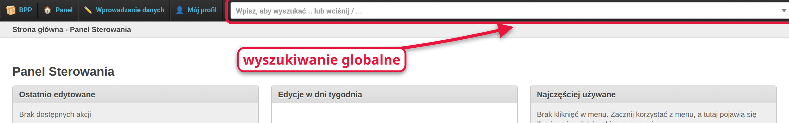

Po wpisaniu tekstu pojawia się rozwijana lista wyników pogrupowanych według
rodzaju rekordu. Publikacje są wyszukiwane po tytule, ale też po nazwiskach
autorów — możesz wpisać jednocześnie słowo z tytułu i nazwisko.

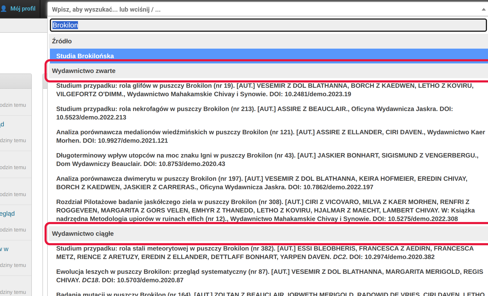

!!! note

    W to pole możesz też wpisać numer ID rekordu, DOI, ISBN albo PBN UID
    publikacji, aby od razu znaleźć konkretny rekord.


## Filtrowanie konkretnych tabel

### Filtr tekstowy

Większość tabel w module Redagowanie ma nad listą rekordów pole filtru
tekstowego. Wpisz w nie dowolny ciąg znaków (także numer ID) i naciśnij
ENTER albo kliknij lupę — lista pokaże tylko rekordy zawierające ten ciąg,
a obok numeracji stron pojawi się liczba wyników. Dla wydawnictw ciągłych
przeszukiwane są m.in. pola „tytuł oryginalny”, „tytuł”, „szczegóły”,
„uwagi”, „informacje”, „słowa kluczowe”, „rok”, ISSN, nazwa źródła,
„adnotacje”, konferencja, DOI i PBN UID; w innych tabelach przeszukiwane pola
są odpowiednio inne.

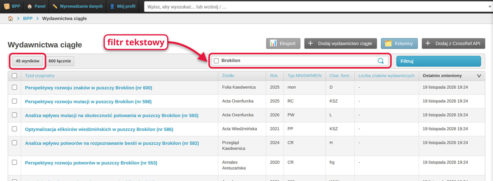

### Filtr precyzyjny

Filtrowanie precyzyjne pozwala wybrać rekordy na podstawie wartości
konkretnych pól. Kliknij przycisk **Filtruj** po prawej stronie pola filtru
tekstowego — z prawej strony ekranu wysunie się panel **Filtry**. Na rysunku
poniżej przedstawione są filtry dostępne dla tabeli „Wydawnictwa ciągłe”.

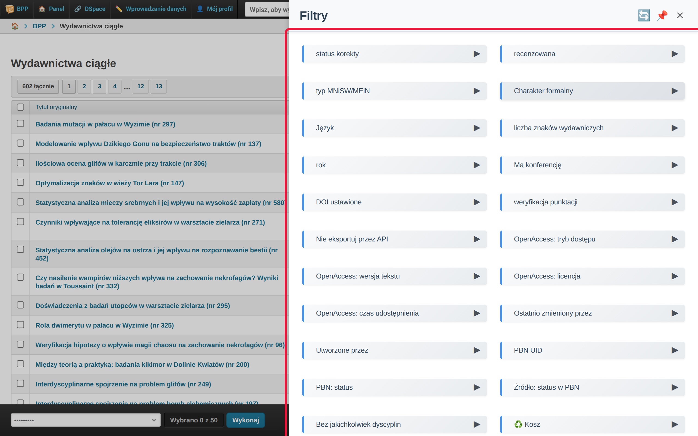

Kliknięcie nazwy filtru rozwija listę jego wartości, przy każdej z liczbą
pasujących rekordów. Na przykład dla filtru „Język”:

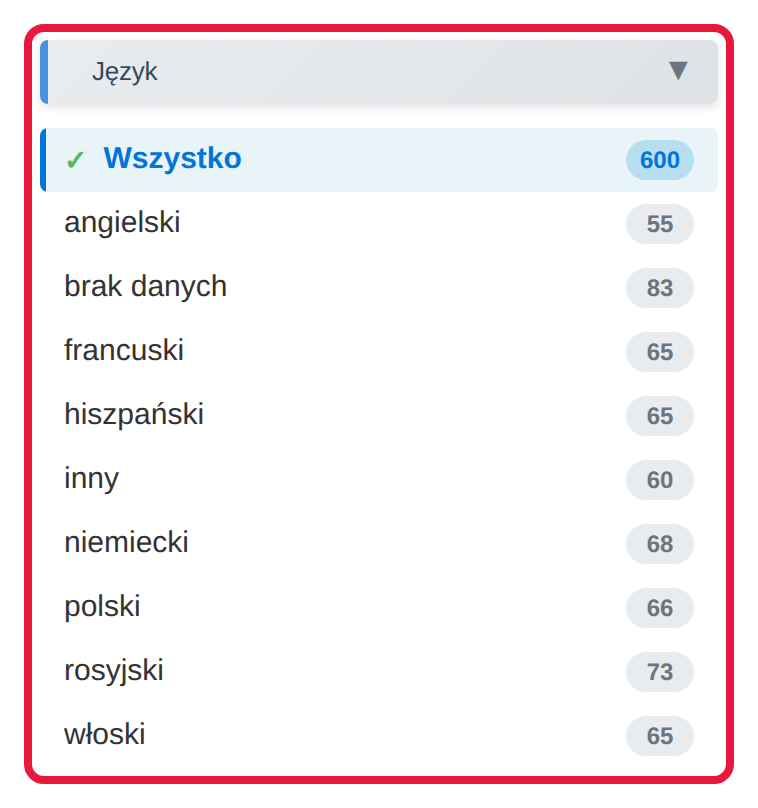

### Filtrowanie przy pomocy języka zapytań

Część tabel w module Redagowanie (m.in. wydawnictwa ciągłe i zwarte, patenty,
prace doktorskie i habilitacyjne, autorzy, jednostki, źródła i wydawcy)
umożliwia wyszukiwanie rekordów przy pomocy języka zapytań
[DjangoQL](https://github.com/ivelum/djangoql#language-reference). Można to
poznać po tym, że na początku pola filtru tekstowego znajduje się — domyślnie
odznaczone — pole wyboru:

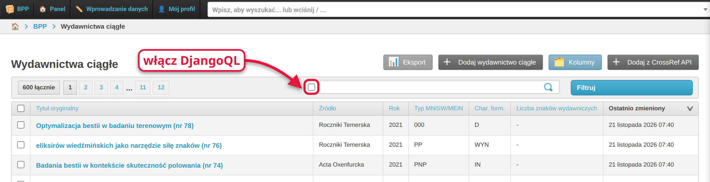

Gdy pole jest odznaczone, wyszukiwanie działa tak, jak opisano w sekcji
[Filtr tekstowy](#filtr-tekstowy).

Po zaznaczeniu pola wpisujesz nie tekst do wyszukania, ale zapytanie w języku
DjangoQL. Przykładowo, aby w tabeli wydawnictw ciągłych wyszukać rekordy
opublikowane w roku 2022 lub 2024, wpisz:

``` python
rok = 2022 or rok = 2024
```

Zapytanie zatwierdzasz klawiszem ENTER lub kliknięciem w lupę. W rezultacie
otrzymujesz wynik wyszukiwania:

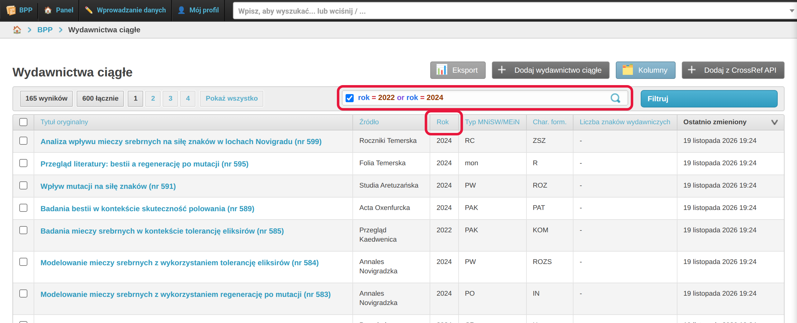

Spróbujmy czegoś trudniejszego: wyszukajmy prace o charakterze formalnym
„KSP” lub „AC”, które mają co najmniej 100 punktów MNiSW. Podczas
pisania zapytania system podpowiada nazwy pól:

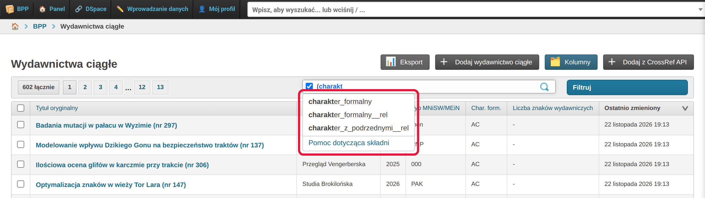

Po dopisaniu pełnej nazwy pola i kropki system podpowiada wszystkie pola
obiektu „Charakter formalny”, po których można wyszukiwać:

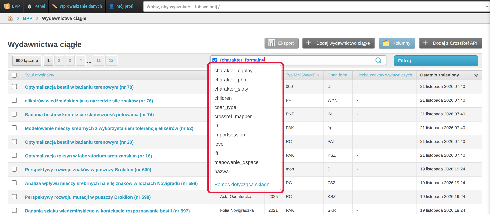

Dokończmy zapytanie:

``` python
(charakter_formalny.skrot = "KSP" or charakter_formalny.skrot = "AC") and punkty_kbn >= 100
```

!!! note "`punkty_kbn` czy `punkty_mnisw`?"
    Punkty MNiSW i typ MNiSW mają w zapytaniach po dwie nazwy:
    dawną (`punkty_kbn`, `typ_kbn`) i nową (`punkty_mnisw`, `typ_mnisw`).
    Obie znaczą dokładnie to samo i można je mieszać —
    `punkty_mnisw >= 100` daje ten sam wynik co `punkty_kbn >= 100`,
    a `typ_mnisw.skrot = "PO"` ten sam co `typ_kbn.skrot = "PO"`.
    Zapytania zapisane wcześniej działają bez zmian.

Jak widać na zrzucie ekranu poniżej, zadziałało ono:

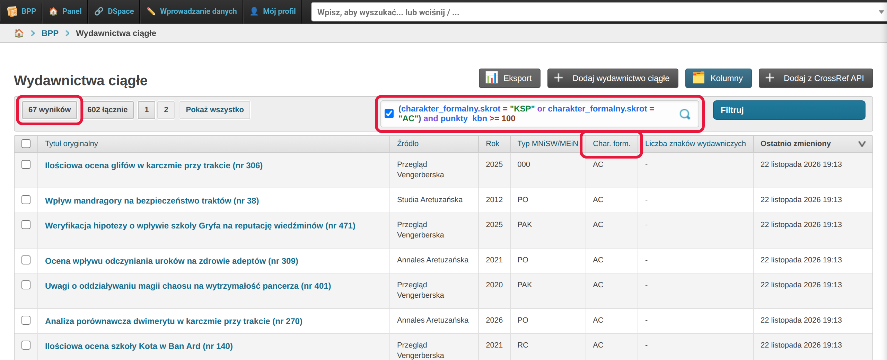

Jeżeli wpiszesz zapytanie niepoprawnie, system go nie wykona, tylko pokaże
komunikat o błędzie składniowym (z numerem linii i kolumny), a błędny
fragment zapytania podkreśli na czerwono. Przykładowo, gdy zamiast operatora
`or` użyjesz polskiego słowa `lub`, zobaczysz:

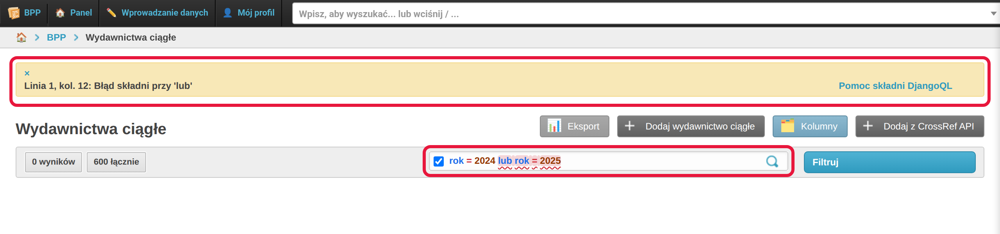

Link **Pomoc składni DjangoQL** w komunikacie (oraz **Pomoc dotycząca
składni** na dole listy podpowiedzi) prowadzi do opisu języka zapytań.

### Przykładowe zapytania w DjangoQL

#### Rekordy z dyscyplinami

Załóżmy, że chcemy odfiltrować wszystkie rekordy z uzupełnionymi
dyscyplinami — rekordy, w których przynajmniej jedna dyscyplina jest
uzupełniona.

Z uwagi na sposób, w jaki budowane są zapytania po stronie bazy danych,
zapytanie takie jak poniżej nie da pożądanych efektów:

``` python
autorzy_set.dyscyplina_naukowa != None
```

To zapytanie znajdzie rekordy, w których **wszystkie** dyscypliny są
wypełnione — czyli każdy podpięty do rekordu autor ma określoną dyscyplinę;
jeżeli przynajmniej jeden autor nie ma dyscypliny, rekord nie pojawi się na
liście wyników.

Aby wyszukać rekordy, w których przynajmniej jeden autor ma dyscyplinę,
sformułuj zapytanie tak:

``` python
autorzy_set.dyscyplina_naukowa.id > 0
```

#### Rekordy w źródłach bez odpowiedników w PBN

Aby znaleźć wszystkie wydawnictwa ciągłe, w których wpisana jest jakaś
dyscyplina, **ich źródło** nie ma odpowiednika w PBN, a rok jest większy lub
równy 2017, w tabeli wydawnictw ciągłych wpisz:

``` python
autorzy_set.dyscyplina_naukowa.id > 0
and rok >= 2017
and zrodlo.pbn_uid = None
```

#### Autorzy ukryci, z aktualnym miejscem pracy określonym, innym niż „Obca jednostka”

Aby znaleźć autorów z ukrytą stroną autora (odznaczone pole „Pokazuj stronę
autora”), z aktualnym miejscem pracy niepustym, ale innym niż „Obca
jednostka”, w tabeli autorów wpisz następujące zapytanie:

``` python
pokazuj_strone_autora = False and aktualna_jednostka.nazwa != "Obca jednostka"
and aktualna_jednostka != None
```

Analogicznie możesz wyszukiwać po pozostałych polach widoczności autora:
`pokazuj_w_wyszukiwaniu`, `pokazuj_w_indeksie`, `pokazuj_na_stronie_jednostki`,
`pokazuj_w_rankingu` i `pokazuj_w_api`.

#### Źródła bez odpowiednika w PBN, które mają publikacje w roku 2022

Po wejściu w Redagowanie → Źródła:

``` python
pbn_uid = None and wydawnictwo_ciagle.rok = 2022
```

#### Publikacje za lata 2020–2021 z określonym odpowiednikiem PBN oraz nieokreśloną informacją o płatności

Po wejściu w Redagowanie → Wydawnictwa ciągłe (albo zwarte):

``` python
pbn_uid != None and opl_pub_cost_free = None and rok >= 2020 and rok <= 2021
```

Aby znaleźć odwrotnie — publikacje, w których informacja o płatności **jest**
określona — zamień `opl_pub_cost_free = None` na `opl_pub_cost_free != None`.

#### Autorzy z kół naukowych (SKN) z ukrytymi profilami

Wyszukiwanie autorów z ukrytymi profilami, którzy są przypisani do jednostki
zawierającej „SKN” w nazwie. Przydatne do znalezienia studentów z kół
naukowych, którzy mają ukryte profile.

Po wejściu w Redagowanie → Autorzy możesz użyć następujących zapytań.

Wyszukiwanie po ciągu znaków „SKN” w nazwie jednostki (dowolna jednostka
wśród jednostek autora):

``` python
autor_jednostka.jednostka.nazwa ~ "SKN" and pokazuj_strone_autora = False
```

Wyszukiwanie po rodzaju jednostki — koło naukowe (nazwa rodzaju jednostki
taka, jak w Redagowanie → Rodzaje jednostek):

``` python
autor_jednostka.jednostka.rodzaj.nazwa = "Koło naukowe" and pokazuj_strone_autora = False
```

Wyszukiwanie po aktualnej jednostce autora:

``` python
aktualna_jednostka.rodzaj.nazwa = "Koło naukowe" and pokazuj_strone_autora = False
```

Przykład w kontekście publikacji — publikacje ciągłe, w których autor
z ukrytym profilem jest przy tej pracy przypisany do jednostki „SKN”. Po
wejściu w Redagowanie → Wydawnictwa ciągłe:

``` python
autorzy_set.jednostka.nazwa ~ "SKN" and autorzy_set.autor.pokazuj_strone_autora = False
```

Z kolei zapytanie poniżej znajdzie **wszystkie** publikacje autorów, którzy
kiedykolwiek należeli do jednostki „SKN” i mają ukryty profil — niezależnie
od tego, jaką jednostkę wpisano przy konkretnej pracy:

``` python
autorzy.autor_jednostka.jednostka.nazwa ~ "SKN" and autorzy.pokazuj_strone_autora = False
```

#### Operatory logiczne a ich kolejność

Operator logiczny `and` (po polsku „i”) oraz operator logiczny `or` (po
polsku „lub”) zachowują się podobnie jak mnożenie i dodawanie. Odpowiednikiem
mnożenia jest operator `and`, zaś odpowiednikiem dodawania — operator `or`.
Oznacza to, że ciąg warunków połączonych `and` jest traktowany jak jedna
całość:

``` python
rok = 2024 and charakter_formalny.skrot = "KSP" and punkty_kbn >= 100
```

To zapytanie wyszuka prace z 2024 roku, z charakterem formalnym „KSP”, czyli
„książka polska”, i z co najmniej 100 punktami.

Dołożenie operatora `or` do takiego ciągu warunków może nie dać dobrych
efektów:

``` python
rok = 2024 or rok = 2025 and charakter_formalny.skrot = "KSP" and punkty_kbn >= 100
```

Takie zapytanie znajdzie **wszystkie** rekordy z 2024 roku oraz prace z 2025
roku z charakterem formalnym „KSP” i z co najmniej 100 punktami. Rekordy
z 2024 roku pojawią się wszystkie, ponieważ operator `or` działa jak
dodawanie. Porównajmy pierwsze zapytanie:

``` python
10 * 20 * 30  # <-- tak możemy przedstawić pierwsze przykładowe zapytanie
# wynik to 6000
```

… a tak drugie:

``` python
10 + 20 * 30 * 40  # <-- tak możemy przedstawić drugie przykładowe zapytanie
# wynik działań to nie 36000, a 24010...
```

Na pierwszy rzut oka widać, co trzeba zrobić — dodać nawiasy:

``` python
(rok = 2024 or rok = 2025) and charakter_formalny.skrot = "KSP" and punkty_kbn >= 100
```

Analogicznie w przykładzie matematycznym:

``` python
(10 + 20) * 30 * 40  # wynik to 36000
```

## Samodzielna strona „Szukaj zapytaniem” (`/bpp/zapytanie/`)

Oprócz filtru DjangoQL wbudowanego w listy modułu Redagowanie, dla
redaktorów (grupa „wprowadzanie danych”) dostępna jest osobna strona pod
adresem `/bpp/zapytanie/`. Otwierasz ją z menu **szukaj → zapytaniem** na
górnym pasku strony głównej BPP:

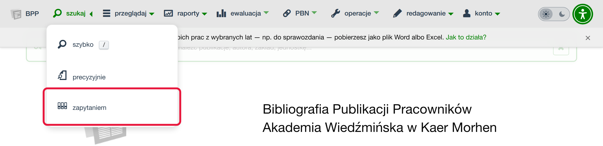

Na stronie wybierasz model (**Rekord** albo **Autor**), wpisujesz zapytanie
w polu **Zapytanie DjangoQL**, wybierasz **Postać wyniku** i klikasz
**Szukaj**:

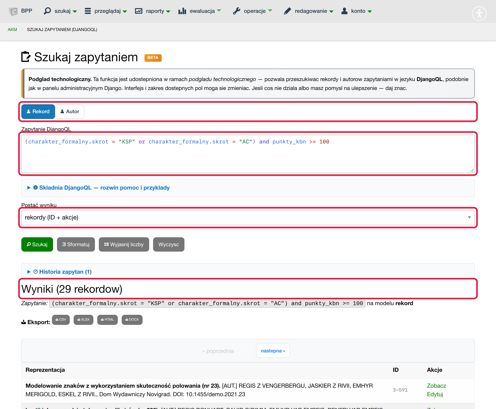

Strona różni się od filtru listy tym, że:

- zapytanie wpisuje się raz, niezależnie od konkretnej tabeli — wybiera
  się tylko model (**rekord** albo **autor**), a samo zapytanie DjangoQL
  działa tak samo jak opisano wyżej,
- wynik można pokazać w kilku **postaciach**, wyeksportować w kilku
  formatach oraz zestawić jako **tabelę krzyżową** — czego filtr listy
  w Redagowaniu nie oferuje.

### Postać wyniku

Nad wynikami znajduje się rozwijana lista **Postać wyniku**. Wybór jedzie
razem z zapytaniem — po kliknięciu „Szukaj” URL zawiera parametr
`postac`, więc wynik da się też przesłać jako link czy zapisać w
zakładkach.

Dla modelu **rekord** dostępne są:

- **rekordy (ID + akcje)** — domyślna, dzisiejsza tabela z ID rekordu
  i linkami "Zobacz" / "Edytuj",
- **lista** — numerowana lista opisów bibliograficznych,
- **tabela** — tabela z sumami (impact factor, liczba cytowań, punkty
  MNiSW, punktacja wewnętrzna),
- **punktacja z wewnętrzną** / **punktacja sumaryczna** — warianty
  tabeli z innym zestawem kolumn punktowych,
- **BibTeX** — lista opisów jako brama do eksportu pliku `.bib`,
- **tabela krzyżowa** — patrz niżej.

Dla modelu **autor** dostępne są tylko **autorzy (ID + akcje)**
(domyślna) i **tabela krzyżowa**.

### Eksport wyników

Pod nagłówkiem wyników pojawia się pasek **Eksport** z linkami do
formatów sensownych dla wybranej postaci i modelu:

- **rekord**: CSV i XLSX zawsze; HTML i DOCX dla postaci innych niż
  tabela krzyżowa; BibTeX (`.bib`) tylko przy postaci **BibTeX**,
- **autor**: CSV i XLSX — kartoteka kadrowa (jednostka, tytuł, stopień,
  ORCID, PBN UID i inne) wraz z metrykami dorobku (liczba prac, Σ
  slotów, Σ pkdaut).

Eksport zawsze obejmuje **cały** wynik zapytania, nie tylko widoczną
stronę wyników. Ze względu na to jest ograniczony limitami: eksport
danych (CSV/XLSX) — maksymalnie 25 000 rekordów, eksport dokumentu
(HTML/DOCX) — maksymalnie 5 000 rekordów. Po przekroczeniu limitu
strona pokazuje komunikat z liczbą trafień i prośbą o zawężenie
zapytania.

### Tabela krzyżowa

Wybranie postaci **tabela krzyżowa** odsłania dodatkowe pola wyboru
wiersza, kolumny i miary macierzy — działa to tak samo, jak tabela
krzyżowa znana z wyszukiwania precyzyjnego (formularzowego), ale liczy
się na wyniku zapytania DjangoQL. Dostępna jest zarówno dla rekordów
(np. rok × charakter formalny, liczba prac albo suma punktów), jak i
dla autorów — w dwóch rodzinach wymiarów:

- **kadrowej** — jednostka, tytuł, stopień, funkcja, płeć, kompletność
  ORCID/PBN/e-mail,
- **bibliometrycznej** — liczba prac, Σ slotów, Σ pkdaut wg roku
  publikacji, dyscypliny, jednostki przy pracy, typu odpowiedzialności
  i charakteru formalnego.

W sekcji pomocy nad formularzem znajdują się gotowe **presety** —
linki, które od razu dokładają wiersz/kolumnę/miarę do bieżącego
zapytania i przełączają postać wyniku na tabelę krzyżową. Samą macierz
(bez surowych wyników) można wyeksportować do CSV i XLSX.

Jak budować i czytać tabelę krzyżową w wyszukiwaniu precyzyjnym,
z przykładami, opisuje strona
[Tabela krzyżowa](../uzytkownik/tabela-krzyzowa.md).
