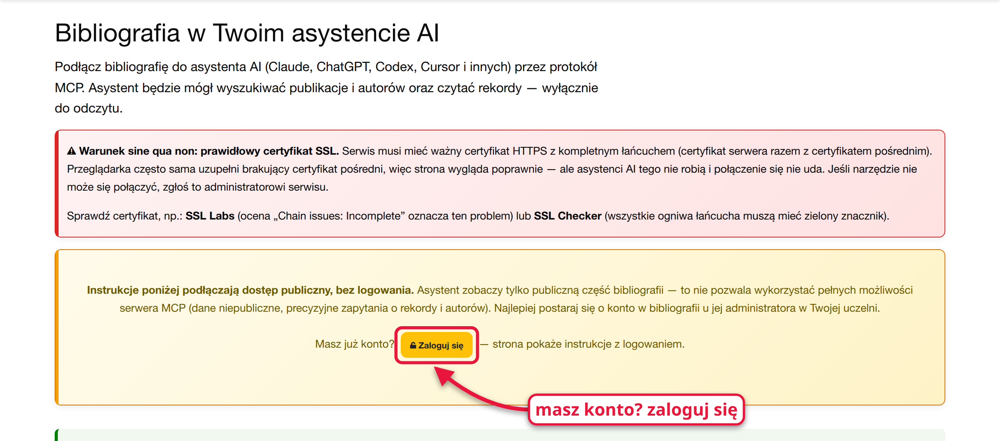
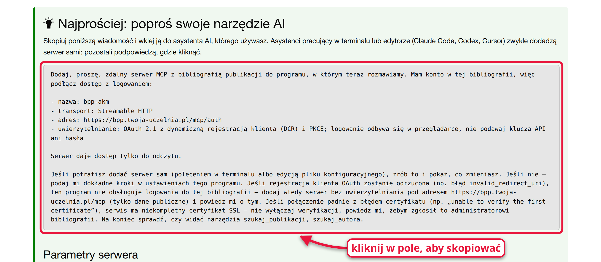
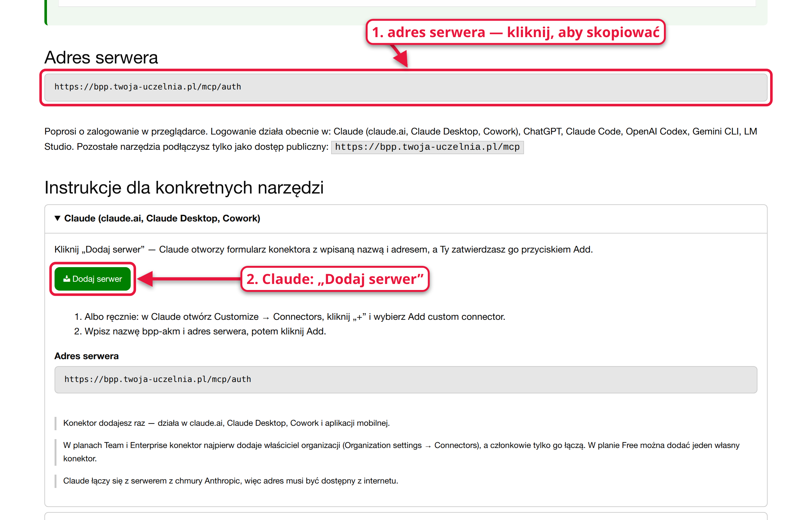
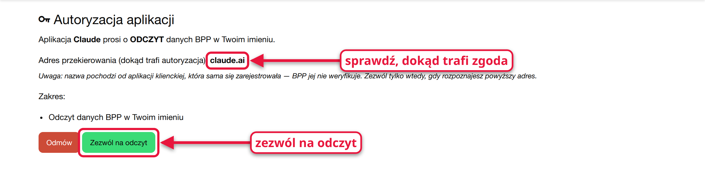
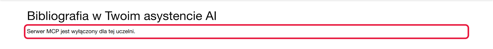
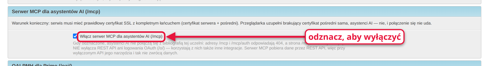

# Bibliografia w asystencie AI (serwer MCP)

Bibliografię możesz podłączyć do swojego asystenta AI — Claude, ChatGPT
albo innego programu, który obsługuje **serwery MCP** (to standardowy
sposób podłączania źródeł danych do asystentów AI). Asystent sam wyszuka
wtedy publikacje i autorów w BPP i odpowie na pytanie zadane zwykłym
językiem, zamiast odsyłać Cię do formularza wyszukiwania.

Przykładowe pytania, które można zadać asystentowi po podłączeniu:

- „Ile artykułów opublikowała Klinika Szlaku Wiedźmińskiego w 2024 roku
  i ile mają łącznie punktów?”
- „Znajdź moje publikacje z lat 2022–2024 i ułóż je w listę do
  sprawozdania.”
- „Pokaż szczegóły pracy o DOI 10.1965/demo.2024.163: autorów, źródło
  i punkty.”
- „W jakich czasopismach publikowała Yennefer Merigold w ostatnich
  trzech latach?”

!!! note "Asystent tylko czyta"
    Połączenie działa **wyłącznie do odczytu**. Asystent może szukać
    i czytać dane, ale **nie może niczego w bibliografii dodać, zmienić ani
    usunąć** — nawet gdy podłączysz go na swoim koncie redaktora.

## Krok 1: otwórz stronę z instrukcją

W menu BPP nie ma odnośnika do tej strony — wpisz w przeglądarce adres
swojej bibliografii z dopiskiem **`/mcp/`**, np.
`https://bpp.twoja-uczelnia.pl/mcp/`. Otworzy się strona
**„Bibliografia w Twoim asystencie AI”**.

Strona pokazuje instrukcje dla **jednego** rodzaju dostępu, zależnie od
tego, czy jesteś zalogowany:

- **bez logowania** — żółta ramka „Instrukcje poniżej podłączają dostęp
  publiczny, bez logowania”. Jeśli masz konto w BPP, kliknij w niej
  **„Zaloguj się”** — po zalogowaniu strona pokaże instrukcje z logowaniem;
- **po zalogowaniu** — napis „Masz konto w bibliografii, więc instrukcje
  poniżej podłączają dostęp z logowaniem”.

Różnicę między tymi dostępami opisuje sekcja [Dostęp publiczny i dostęp
z logowaniem](#dostep-publiczny-i-z-logowaniem).

## Krok 2: skopiuj wiadomość albo adres

Strona daje dwie drogi — wybierz jedną.

**Najprościej: wiadomość dla asystenta.** W zielonej sekcji **„Najprościej:
poproś swoje narzędzie AI”** jest gotowa wiadomość. Kliknij w szare pole —
treść trafi do schowka (pojawi się napis „Skopiowano do schowka.”). Wklej
ją w rozmowie z asystentem. Asystenci pracujący w terminalu lub edytorze
zwykle dodadzą serwer sami, pozostali podpowiedzą, gdzie kliknąć.

**Samodzielnie: adres serwera.** Niżej, w sekcji **„Adres serwera”**,
jest sam adres (1) — kliknij w pole, żeby go skopiować. W sekcji
**„Instrukcje dla konkretnych narzędzi”** rozwiń nazwę swojego programu:
znajdziesz tam kroki, gotowe polecenia, a przy niektórych programach
przycisk **„Dodaj serwer”** (2), który otwiera program z już wpisaną
nazwą i adresem.

Nazwy menu w programach AI często się zmieniają. Jeśli nie widzisz opcji
opisanej na stronie, poszukaj w ustawieniach swojego programu pozycji
dotyczącej **konektorów**, **wtyczek** albo **serwerów MCP**.

## Krok 3: dodaj serwer w programie AI

Ogólny przebieg jest podobny w każdym programie:

1. W ustawieniach programu znajdź miejsce na własne konektory lub serwery
   MCP i wybierz dodanie nowego.
2. Wpisz nazwę (strona podaje ją w tabeli **„Parametry serwera”**, np.
   `bpp-akm`) i wklej skopiowany adres serwera.
3. Zatwierdź. Jeśli to dostęp z logowaniem, program otworzy okno
   przeglądarki z logowaniem do BPP (krok 4).
4. Sprawdź, czy asystent widzi narzędzia bibliografii — np. zapytaj go
   o publikacje znanego Ci autora.

W przypadku **Claude** (claude.ai, Claude Desktop) najprościej kliknąć
**„Dodaj serwer”** na stronie BPP: Claude otworzy formularz konektora z już
wpisaną nazwą i adresem, a Ty go tylko zatwierdzasz. Konektor dodajesz raz
i działa on we wszystkich aplikacjach Claude na tym koncie. W planach
firmowych konektor może najpierw musieć dodać właściciel organizacji —
strona BPP pisze o tym przy instrukcji dla Claude.

## Krok 4: zezwól na odczyt (tylko dostęp z logowaniem)

Przy dostępie z logowaniem program AI otworzy w przeglądarce stronę BPP.
Zaloguj się (jeśli trzeba) i na ekranie **„Autoryzacja aplikacji”**
sprawdź **adres przekierowania** — to adres programu, któremu dajesz
dostęp (np. `claude.ai`). Jeśli go rozpoznajesz, kliknij **„Zezwól na
odczyt”**; w przeciwnym razie kliknij **„Odmów”**.

Nazwę aplikacji na tym ekranie podaje sam program, BPP jej nie sprawdza —
dlatego liczy się adres przekierowania. Asystent nigdy nie poznaje Twojego
hasła: logujesz się w przeglądarce, na stronie BPP.

Dostęp nie trwa w nieskończoność — po pewnym czasie bez używania program
poprosi o ponowne zalogowanie. **Zmiana hasła** albo zablokowanie konta
od razu odbiera dostęp wszystkim podłączonym programom.

## Dostęp publiczny i dostęp z logowaniem {#dostep-publiczny-i-z-logowaniem}

| | Dostęp publiczny | Dostęp z logowaniem |
|---|---|---|
| Adres | kończy się na `/mcp` | kończy się na `/mcp/auth` |
| Logowanie | żadne | w przeglądarce, przy dodawaniu serwera |
| Działa w | każdym programie obsługującym zdalne serwery MCP | tylko w programach wymienionych na stronie pod adresem serwera (m.in. Claude, ChatGPT) |
| Asystent widzi | to samo, co każdy odwiedzający stronę BPP | to, co widzi Twoje konto |

**Bez logowania** asystent może: wyszukiwać publikacje (po słowach
z tytułu, w wybranych latach), wyszukiwać autorów, pobierać listy publikacji
autora i jednostki, czytać pełny opis pracy (autorzy, źródło, punkty,
streszczenia) i przeglądać słowniki (np. typy publikacji, dyscypliny).

**Po zalogowaniu** asystent działa z uprawnieniami Twojego konta. Dla
zwykłego konta oznacza to w praktyce te same dane co bez logowania. Więcej
daje konto **redaktora** (grupa „wprowadzanie danych”): asystent może
wtedy zadawać precyzyjne zapytania o publikacje, autorów i wpisy
autorstwa (np. „prace z 2024 roku, w których autor afiliuje na
uczelnię, w dyscyplinie X”) i widzi dane autorów niewidoczne publicznie.

Jeśli administrator udostępnił API bibliografii tylko zalogowanym,
dostęp publiczny nie zwróci danych — wtedy potrzebny jest dostęp
z logowaniem.

## Prywatność: co widzi asystent

- Asystent widzi **tylko dane bibliograficzne**, które BPP udostępnia
  Twojemu kontu (albo, bez logowania, wszystkim odwiedzającym). Przez to
  połączenie nie widzi Twojego hasła ani niczego spoza bibliografii.
- To, co asystent odczyta z BPP, **trafia do usługi AI**, z której
  korzystasz (np. Claude łączy się z bibliografią z chmury Anthropic),
  i podlega jej zasadom przechowywania rozmów. Jeśli podłączasz konto
  redaktora, pamiętaj, że asystent może wtedy odczytać także dane autorów
  niewidoczne publicznie.
- Każdy dostęp z logowaniem możesz zakończyć, zmieniając hasło w BPP —
  wszystkie podłączone programy stracą wtedy dostęp.

## Przykłady

**Autorka bez konta w BPP, Claude w przeglądarce.** Otwiera stronę
`/mcp/`, w instrukcji dla Claude klika **„Dodaj serwer”** i zatwierdza
konektor. W nowej rozmowie pyta: „Znajdź moje publikacje z lat 2022–2024
w bibliografii i ułóż je w listę do sprawozdania”. Asystent znajduje ją po
nazwisku, pobiera listę jej prac i formatuje odpowiedź.

**Bibliotekarka z kontem redaktora, program w terminalu.** Loguje się
w BPP, otwiera `/mcp/` (strona pokazuje teraz dostęp z logowaniem),
kopiuje wiadomość z sekcji **„Najprościej”** i wkleja ją asystentowi.
Asystent sam dodaje serwer, otwiera przeglądarkę, a ona klika **„Zezwól na
odczyt”**. Teraz może zapytać: „Ile artykułów z 2024 roku ma Klinika
Szlaku Wiedźmińskiego i ile łącznie mają punktów?”.

**Strona mówi, że serwer jest wyłączony.** Zamiast instrukcji widać
tylko zdanie „Serwer MCP jest wyłączony dla tej uczelni.” — instytucja
nie udostępnia bibliografii asystentom AI. Nie da się tego obejść
ustawieniami po swojej stronie; zapytaj administratora bibliografii.

## Gdy coś nie działa

- **Program nie może się połączyć, błąd certyfikatu** (np. „unable to
  verify the first certificate”) — serwis musi mieć prawidłowy certyfikat
  SSL z kompletnym łańcuchem. Przeglądarka często sama uzupełnia brakujący
  element, więc strona BPP wygląda poprawnie, ale programy AI tego nie
  robią. Nie wyłączaj sprawdzania certyfikatu — zgłoś to administratorowi
  serwisu (czerwona ramka na stronie `/mcp/` podaje narzędzia do
  sprawdzenia certyfikatu).
- **Logowanie zostaje odrzucone** — Twój program nie obsługuje logowania
  do tej bibliografii. Podłącz go jako dostęp publiczny (adres kończący się
  na `/mcp`).
- **Program w ogóle nie obsługuje zdalnych serwerów MCP** — na dole strony
  `/mcp/` jest odnośnik do programu **bpp-mcp**, który uruchamia się
  lokalnie na komputerze.

## Dla administratora: włączanie i wyłączanie

Serwer MCP jest domyślnie **włączony**. Wyłącza się go dla całej uczelni:

1. Przejdź do **Redagowanie → Struktura → Uczelnia** i kliknij nazwę swojej
   uczelni.
2. Rozwiń sekcję **„Serwer MCP dla asystentów AI (/mcp)”**.
3. Odznacz **„Włącz serwer MCP dla asystentów AI (/mcp)”** i kliknij
   **Zapisz**.

Po wyłączeniu asystenci nie połączą się z bibliografią, a strona `/mcp/`
pokazuje komunikat o wyłączeniu. Przełącznik **nie** wyłącza REST API ani
logowania aplikacji — korzystają z nich także inne integracje. Serwer MCP
czyta dane przez REST API, więc gdy API jest wyłączone, asystent i tak nie
dostanie danych — zobacz [REST API (/api/v1/)](../administrator/rest-api.md).
Warunkiem działania jest też prawidłowy certyfikat SSL z kompletnym
łańcuchem.
