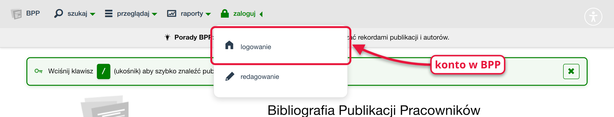
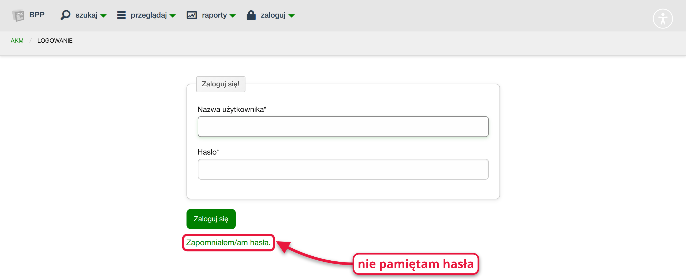
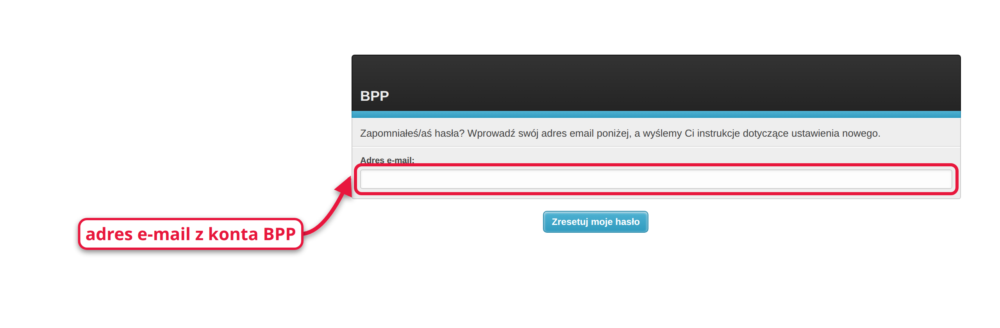
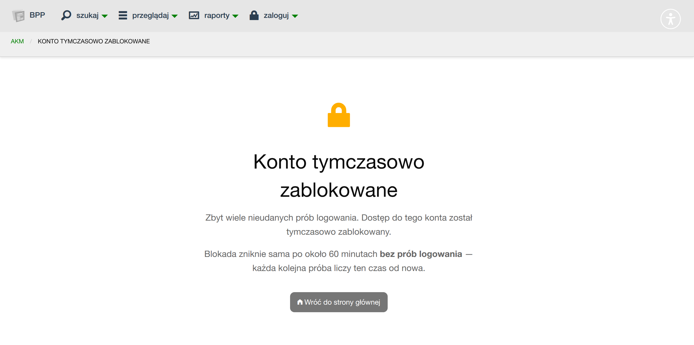
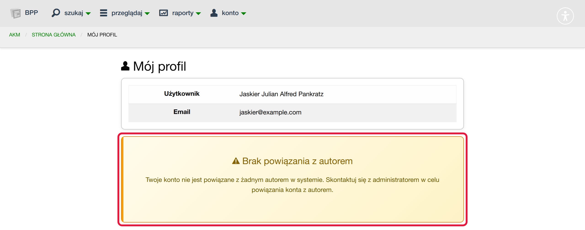

# Nie mogę się zalogować

Do przeglądania i wyszukiwania w BPP konto nie jest potrzebne. Logowanie
przydaje się do edycji swojej strony autora, pobierania list publikacji
w Wordzie/Excelu i — jeśli uczelnia tak ustawiła — do raportów.

## Gdzie się logować

W górnym menu kliknij **zaloguj → logowanie** (konto w BPP).

- Jeśli w menu jest **„logowanie instytucjonalne”**, Twoja uczelnia
  używa wspólnego konta (tego samego co do poczty czy systemu uczelnianego).
  Wtedy loguj się nim, a hasło zmieniasz **w systemie uczelni, nie w BPP**.
- **„redagowanie”** to wejście dla redaktorów BPP — autorzy i czytelnicy
  go nie potrzebują.

Konto w BPP zakłada redaktor albo administrator BPP na Twojej uczelni
(zwykle w bibliotece) — samodzielnej rejestracji nie ma.

## Logowanie przez ORCID / konto uczelniane (SSO) {#orcid-sso}

- **„logowanie instytucjonalne”** przenosi Cię na uczelnianą stronę
  logowania (to samo konto co np. do poczty). Po zalogowaniu wracasz do BPP.
- **„logowanie ORCID”** (albo zielony przycisk **„Zaloguj się przez
  ORCID”** pod formularzem) loguje przez Twoje konto ORCID — ale tylko
  wtedy, gdy wcześniej połączyłeś ORCID ze swoim kontem BPP.

**Konto nie jest połączone?** Jeśli masz hasło do BPP, zaloguj się przez
**zaloguj → logowanie BPP**, otwórz **konto → mój profil** i na dole strony
kliknij **„Połącz konto z SSO”** albo **„Połącz konto z ORCID”**. Potwierdź
hasło BPP i zaloguj się na stronie uczelni lub ORCID — od tej pory przycisk
działa. Jeśli hasła do BPP nie masz albo logowanie uczelniane „przechodzi”,
a mimo to zostajesz niezalogowany, napisz do administratora BPP — szczegóły
dla administratora: [Metody logowania](../administrator/metody-logowania.md).

## Nie pamiętam hasła {#nie-pamietam-hasla}

1. Na stronie logowania kliknij **„Zapomniałem/am hasła.”**

    

2. Wpisz **adres e-mail zapisany w Twoim koncie BPP** i kliknij
   **„Zresetuj moje hasło”**.

    

3. Otwórz wiadomość z BPP i kliknij link — ustawisz nowe hasło.

!!! tip "Mail nie przychodzi?"
    Sprawdź folder **spam**. Jeśli i tam go nie ma, konto ma zapisany inny
    adres albo nie ma go wcale — napisz do redaktora BPP. Ze względów
    bezpieczeństwa strona nie mówi, czy podany adres istnieje w bazie.

Nowe hasło musi być **długie** (domyślnie co najmniej 15 znaków), nie może
powtarzać poprzednich haseł ani pochodzić z list haseł, które wyciekły
z innych serwisów. Najłatwiej: kilka przypadkowych słów, np.
`kawa-rower-zegar-sosna`.

## „Konto tymczasowo zablokowane”

Po **10 nieudanych próbach** logowania BPP blokuje logowanie na to konto
z Twojego komputera.

- Blokada znika sama po **godzinie bez prób logowania** — każda kolejna
  próba liczy ten czas od nowa, więc po prostu odczekaj.
- W tym czasie możesz [zresetować hasło](#nie-pamietam-hasla) — po
  ustawieniu nowego zaloguj się, gdy minie godzina.
- Pilna sprawa? Administrator BPP może zdjąć blokadę od razu.

## „Brak powiązania z autorem”

Zalogowałeś się, ale w **konto → mój profil** widzisz ten komunikat:

Twoje konto nie jest połączone z Twoim rekordem autora w bazie, więc nie
możesz edytować swojej strony autora. Napisz do redaktora BPP i podaj swoje
**imię, nazwisko i jednostkę** (albo link do swojej strony autora w BPP)
— powiązanie ustawia redaktor.

Co możesz zrobić po powiązaniu: [Mój profil autora](moj-profil-autora.md).
