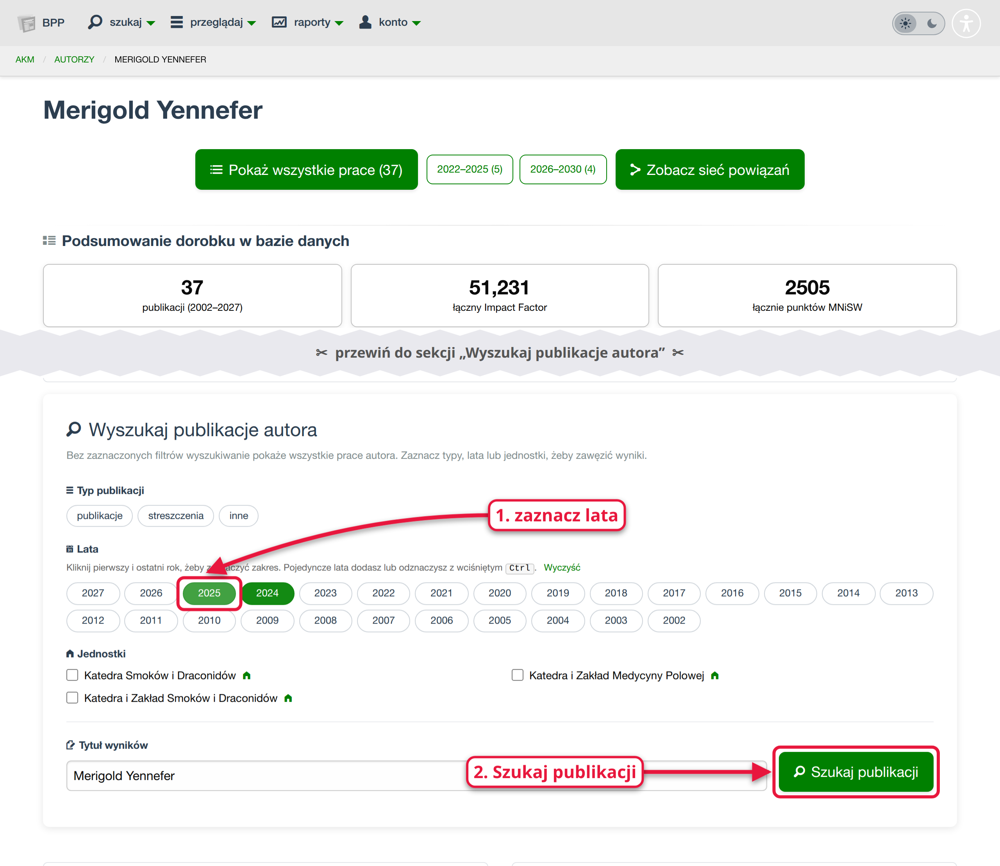
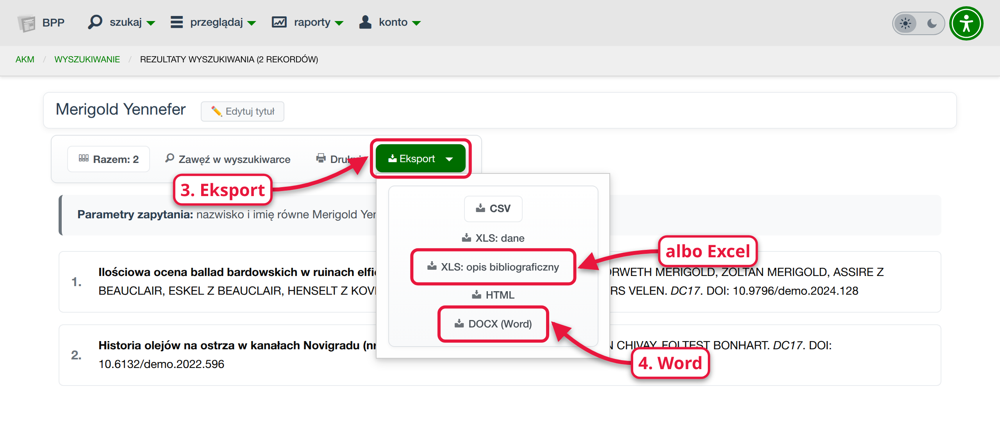
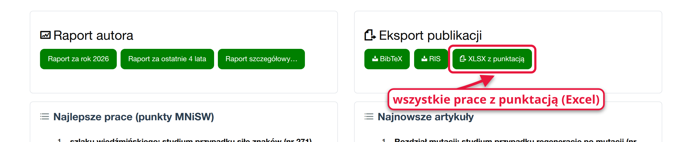

# Jak pobrać listę swoich publikacji (np. do sprawozdania)

Listę swoich prac — np. do sprawozdania rocznego, wniosku o grant albo
awans — pobierzesz z BPP jako plik **Word** albo **Excel**. Są dwie drogi:

| Potrzebuję… | Sposób | Logowanie |
|---|---|---|
| prac **z wybranych lat** (albo typów, jednostek) w Wordzie lub Excelu | [wyszukiwanie ze strony autora](#wybrane-lata-word-lub-excel) | wymagane |
| **wszystkich** prac z punktacją w Excelu, albo pliku dla Zotero / Mendeley | [eksport ze strony autora](#wszystkie-prace-excel-bibtex-ris) | niepotrzebne |

Najpierw wejdź na swoją **stronę autora**: wpisz swoje nazwisko w
wyszukiwarce (**szukaj → szybko**, klawisz `/`) albo wybierz je z listy
**przeglądaj → autorzy**.

## Wybrane lata: Word lub Excel {#wybrane-lata-word-lub-excel}

1. Zaloguj się do BPP — pobieranie wyników wyszukiwania wymaga konta.
2. Na stronie autora przewiń do sekcji **„Wyszukaj publikacje autora”**.
   **Zaznacz lata**, które Cię interesują — kliknij pierwszy i ostatni rok
   zakresu. W razie potrzeby zaznacz też typ publikacji albo jednostkę.
   Kliknij **„Szukaj publikacji”**.

    

3. Otworzy się formularz wyszukiwania z już wpisanymi warunkami — kliknij
   **„Wyświetl wyniki”**.
4. Nad listą wyników rozwiń **„Eksport”** i wybierz format:
    - **MS Word (portret)** / **MS Word (pejzaż)** — gotowa lista opisów
      bibliograficznych na kartce A4 pionowej albo poziomej,
    - **XLS: opis bibliograficzny** — to samo w Excelu,
    - **XLS: dane** / **CSV** — tabela z poszczególnymi polami (rok,
      źródło, punkty…), do własnych zestawień.

    

!!! tip "Jeśli nie widzisz przycisku „Eksport”"
    Nie jesteś zalogowany. Bez logowania wyniki można tylko obejrzeć
    i wydrukować (**„Drukuj”**).

Jednorazowo można pobrać do 5000 prac.

## Wszystkie prace: Excel, BibTeX, RIS {#wszystkie-prace-excel-bibtex-ris}

Na stronie autora, w sekcji **„Eksport publikacji”**:

- **„XLSX z punktacją”** — arkusz Excel ze wszystkimi pracami i ich
  punktacją,
- **„BibTeX”**, **„RIS”** — pliki do zaimportowania w Zotero, Mendeley,
  EndNote albo LaTeX-u.

Po kliknięciu kliknij jeszcze **„Generuj plik”** — plik przygotowuje się
w tle, a po chwili pojawi się odnośnik do pobrania. Bez logowania
przeglądarka najpierw przez kilka sekund przejdzie automatyczną weryfikację
„czy nie jesteś robotem” — nie trzeba niczego przepisywać.

Szczegóły tego eksportu: [Przeglądanie i wyszukiwanie — eksport
publikacji autora](przegladanie-i-wyszukiwanie.md#eksport-publikacji-autora-bibtex-i-ris).

## Brakuje jakiejś pracy albo dane są błędne?

Lista pochodzi z bazy prowadzonej przez redaktorów BPP na Twojej uczelni.
Brakującą pracę możesz zgłosić sam, jeśli uczelnia udostępnia formularz
**„Zgłoś publikację”** (przycisk na stronie głównej BPP). Błędy w opisach,
punktacji czy przypisaniu do jednostki zgłoś redaktorowi BPP — zwykle
w bibliotece.
