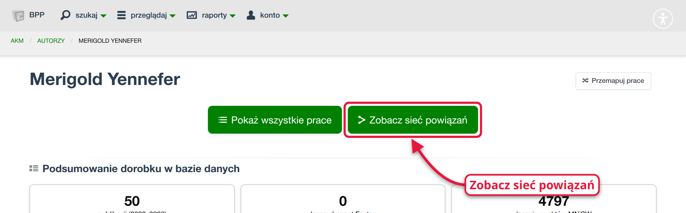
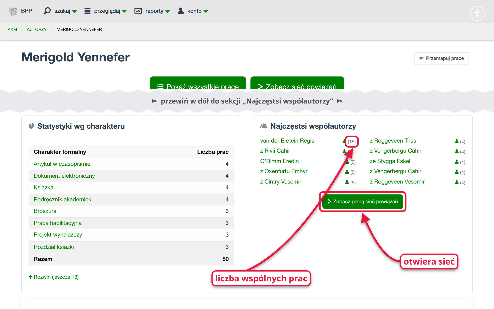
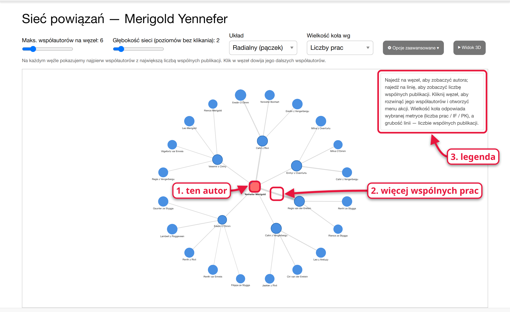
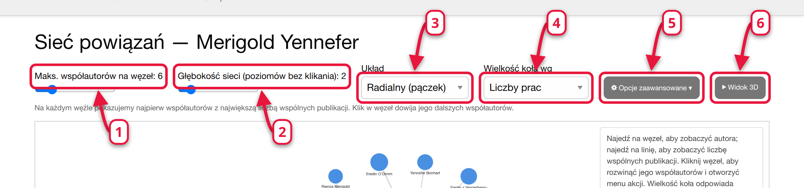
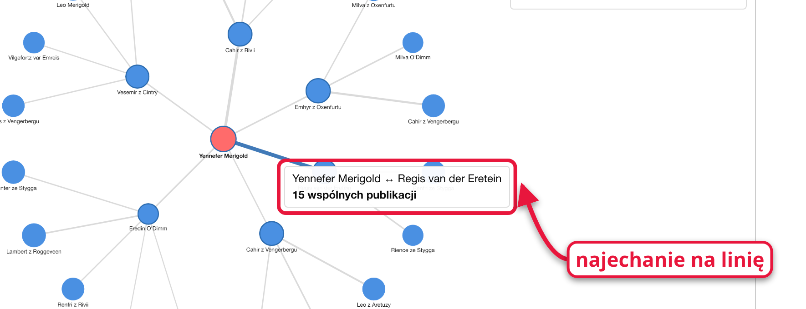
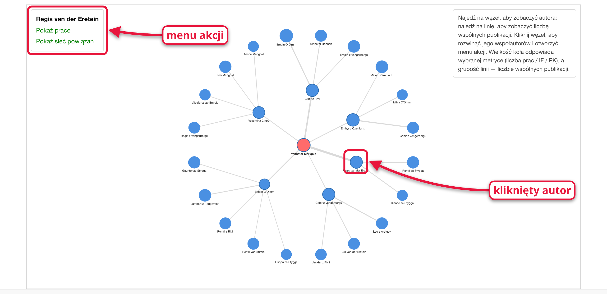
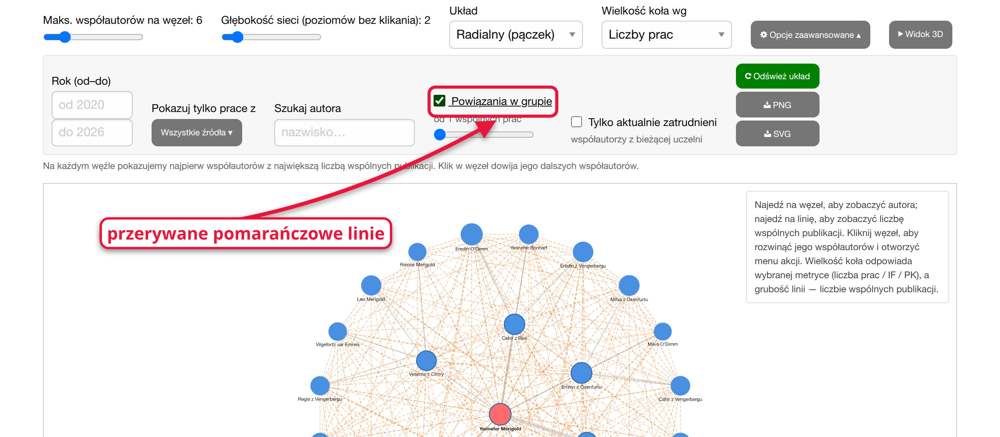
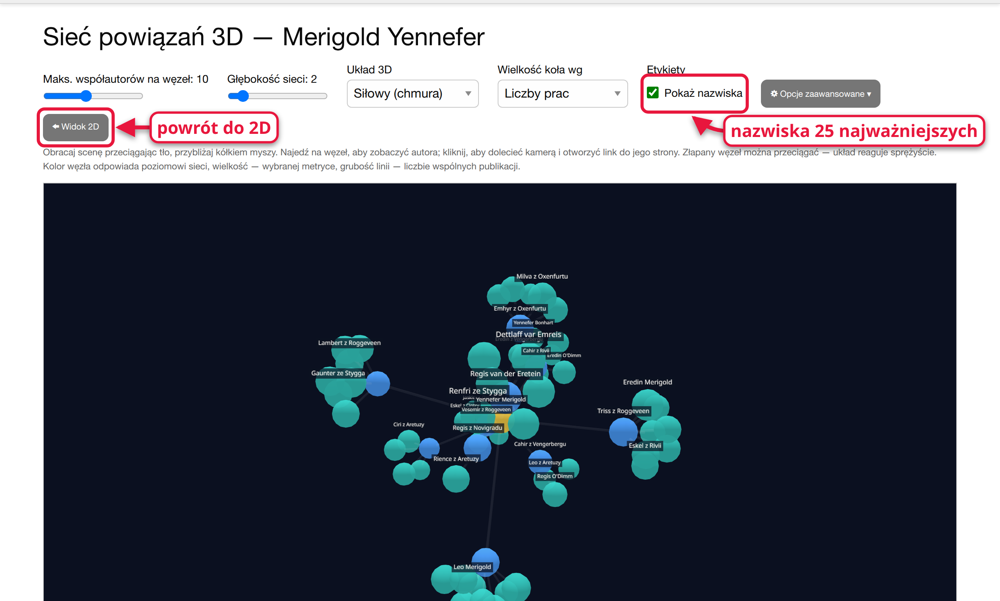
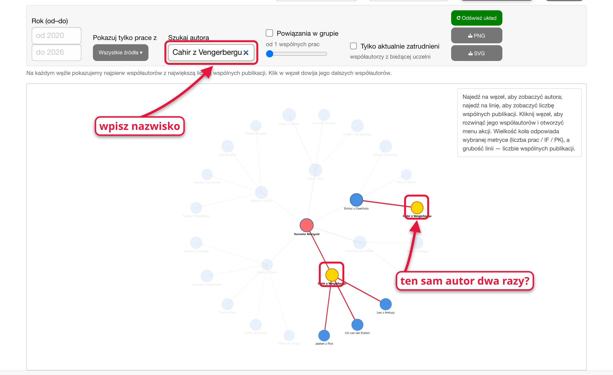

# Sieć powiązań autorów (współautorzy)

Sieć powiązań to interaktywny rysunek, który pokazuje, **z kim dany autor
publikuje** i jak często. Każde kółko to autor, każda linia — wspólne prace
dwóch osób. Sieć otwiera się ze strony autora i nie wymaga logowania.

## Gdzie ją znaleźć

1. Otwórz stronę autora — wyszukaj nazwisko albo wybierz
   **przeglądaj → autorzy** (patrz
   [Przeglądanie i wyszukiwanie](przegladanie-i-wyszukiwanie.md#strona-autora)).
2. Kliknij zielony przycisk **„Zobacz sieć powiązań”** — stoi u góry
   strony, obok „Pokaż wszystkie prace”.

    

3. Ten sam rysunek otworzysz niżej na stronie, z sekcji **„Najczęstsi
   współautorzy”**: liczba w nawiasie przy nazwisku to liczba wspólnych
   prac, a przycisk **„Zobacz pełną sieć powiązań”** pod listą otwiera
   sieć.

    

    Kliknięcie nazwiska współautora na tej liście wyszukuje **wspólne prace**
    obojga autorów, a ikona ludzika obok — otwiera stronę współautora.

Jeśli przycisku nie ma, przeczytaj
[Dlaczego autor nie ma sieci powiązań](#dlaczego-brak-sieci).

## Jak czytać rysunek

1. **Czerwone kółko w środku** to autor, od którego zaczynasz. Wokół niego
   stoją jego współautorzy, a wokół każdego z nich — ich współautorzy
   (drugi poziom).
2. **Linia** łączy dwie osoby, które mają wspólne prace. **Im grubsza
   linia, tym więcej wspólnych prac.**
3. **Legenda** w prawym górnym rogu przypomina, co oznaczają kształty
   i jak obsługiwać rysunek.

Pozostałe elementy:

- **Wielkość kółka** zależy od wybranego miernika (pole „Wielkość koła wg”):
  liczby prac autora, jego sumarycznego Impact Factor albo sumy punktów
  MNiSW (PK). Największy autor na rysunku ma największe kółko, reszta jest
  do niego dopasowana.
- Wokół każdej osoby pokazujemy najpierw współautorów z **największą
  liczbą wspólnych publikacji** — reszta jest pomijana, żeby rysunek był
  czytelny.
- Na rysunek trafiają tylko autorzy, którzy mają publiczną stronę w BPP.

## Ustawienia nad rysunkiem

1. **„Maks. współautorów na węzeł”** (suwak, od 3 do 20; domyślnie 6) — ilu
   najczęstszych współautorów pokazać wokół każdej osoby.
2. **„Głębokość sieci (poziomów bez klikania)”** (od 1 do 10; domyślnie 2)
   — ile poziomów „współautorów współautorów” rysować od razu. Przy dużej
   głębokości sieć może zostać przycięta — pojawi się wtedy żółta notka
   „Pokazano część sieci…”.
3. **„Układ”** — sposób rozmieszczenia kółek: **„Radialny (pączek)”**
   (domyślny), **„Koncentryczny”** (poziomy na kolejnych okręgach) albo
   **„Siłowy (organiczny)”** (bliscy współpracownicy przyciągają się).
4. **„Wielkość koła wg”** — **„Liczby prac”**, **„Sumarycznego IF”** albo
   **„Sumarycznego PK”**.
5. **„Opcje zaawansowane”** — filtry, wyszukiwanie i eksport (niżej).
6. **„Widok 3D”** — ta sama sieć jako obracana przestrzenna scena.

## Co można zrobić na rysunku

- **Najechanie myszą na kółko** pokazuje nazwisko autora (z tytułem
  naukowym i numerem ORCID, jeśli są w bazie).
- **Najechanie na linię** pokazuje, kogo łączy i ile mają wspólnych
  publikacji.

    

- **Kliknięcie kółka** dorysowuje wokół niego dalszych współautorów tej
  osoby i otwiera w lewym górnym rogu **menu akcji**:
  **„Pokaż prace”** (strona autora), **„Pokaż sieć powiązań”** (sieć z tą
  osobą w środku), a gdy autor ma identyfikatory — **„Zobacz w PBN”**
  i **„Zobacz w ORCID”**.

    

- **Kółko myszy** przybliża i oddala, a **przeciąganie tła** przesuwa
  rysunek.
- **Przeciąganie kółka** przenosi autora razem z jego „gałęzią”
  (współautorami dorysowanymi wokół niego).

## Opcje zaawansowane

Kliknij **„Opcje zaawansowane”**, aby rozwinąć dodatkowy pasek:

- **„Rok (od–do)”** — licz tylko prace z podanych lat.
- **„Pokazuj tylko prace z”** — wybór czasopism i wydawców (lista pokazuje
  te, w których osoby z rysunku mają co najmniej 4 prace, z liczbą prac
  w nawiasie). Bez wyboru liczą się wszystkie źródła.
- **„Szukaj autora”** — wpisz nazwisko, a pasujące osoby podświetlą się na
  żółto, ich linie na czerwono, a reszta rysunku przygaśnie.
- **„Powiązania w grupie”** — dorysowuje **przerywane pomarańczowe linie**
  między osobami, które już są na rysunku, a publikują także ze sobą
  (zwykły rysunek pokazuje tylko połączenia „od środka na zewnątrz”).
  Suwak **„od … wspólnych prac”** ukrywa słabsze z tych połączeń.
- **„Tylko aktualnie zatrudnieni”** — zostawia tylko współautorów, którzy
  pracują teraz w Twojej uczelni.
- **„Odśwież układ”** — rysuje sieć od nowa (cofa ręczne przesunięcia
  i dorysowania kliknięciem).
- **„PNG”** / **„SVG”** — zapisuje bieżący rysunek jako obrazek, np. do
  prezentacji.

Przy filtrach roku i źródeł bardzo rozległa sieć może się liczyć za długo —
wtedy pojawi się komunikat z prośbą o zawężenie lat albo listy źródeł.

## Widok 3D

Przycisk **„Widok 3D”** pokazuje tę samą sieć jako przestrzenną chmurę kul.
Powrót do zwykłego rysunku — przycisk **„Widok 2D”**.

- **Kolor kuli** oznacza poziom sieci: autor, od którego zaczynasz, jest
  **złoty**, jego współautorzy **niebiescy**, ich współautorzy
  **turkusowi**, dalsze poziomy — zielone, fioletowe itd.
- **Wielkość kuli** — jak w 2D, według pola „Wielkość koła wg”;
  **grubość linii** — według liczby wspólnych publikacji.
- **Przeciąganie tła** obraca scenę, **kółko myszy** przybliża.
- **Najechanie na kulę** pokazuje nazwisko i liczbę prac,
  **kliknięcie** — przybliża kamerę do autora i otwiera menu akcji
  (z odnośnikiem „Pokaż sieć powiązań (3D)”).
- **„Pokaż nazwiska”** wypisuje nazwiska 25 najważniejszych autorów (według
  wybranego miernika).
- **„Układ 3D”**: „Siłowy (chmura)”, „Drzewo (radialne)”, „Warstwy (poziomy)”
  albo „Sferyczne powłoki”. W „Opcjach zaawansowanych” są lata,
  „Tylko aktualnie zatrudnieni” i „Powiązania w grupie” (tu jako
  bursztynowe linie).

Widok 3D wymaga w przeglądarce grafiki **WebGL**. Jeśli komputer jej nie
obsługuje (np. wyłączona akceleracja sprzętowa, praca przez zdalny pulpit),
zobaczysz komunikat „Widok 3D jest niedostępny w tej przeglądarce”
i przycisk „Przejdź do widoku 2D”.

## Dlaczego autor nie ma sieci powiązań {#dlaczego-brak-sieci}

Przycisków „Zobacz sieć powiązań” nie ma, gdy:

- **autor nie ma jeszcze współautorów w bazie** — np. publikuje sam albo
  jego prace mają tylko jednego autora z BPP;
- **powiązania nie zostały jeszcze przeliczone** — BPP liczy sieć **raz na
  dobę, w nocy**. Nowo dodana praca pojawi się w sieci (i w sekcji
  „Najczęstsi współautorzy”) następnego dnia;
- **uczelnia wyłączyła sieć powiązań** — dla wszystkich autorów albo tylko
  dla tego jednego (ustawienie administratora, patrz niżej);
- **strona autora jest ukryta** — wtedy nie widać ani strony, ani sieci
  (redaktorzy BPP widzą obie).

!!! note "Dla administratora: gdzie się to włącza"
    Dla całej uczelni — pole **„Pokazuj sieć powiązań autorów”** w sekcji
    „Strona wizualna” rekordu uczelni (domyślnie włączone). Dla jednego
    autora — pole **„Pokazuj sieć powiązań”** w formularzu autora:
    puste = jak w ustawieniu uczelni, „Tak”/„Nie” = nadpisuje je dla tej
    osoby. Wyłączona sieć jest niedostępna dla wszystkich, także pod
    bezpośrednim adresem.

## Przykłady

### Z kim najczęściej publikuje nowy pracownik — w ostatnich latach

1. Otwórz stronę autora i kliknij **„Zobacz sieć powiązań”**.
2. Rozwiń **„Opcje zaawansowane”** i wpisz **„Rok (od–do)”**, np.
   2022–2025.
3. Zaznacz **„Tylko aktualnie zatrudnieni”** — zostaną współautorzy
   z Twojej uczelni.
4. Linie najgrubsze prowadzą do najbliższych współpracowników; najechanie na
   linię podaje dokładną liczbę wspólnych prac. Kliknij kółko i wybierz
   **„Pokaż sieć powiązań”**, żeby zobaczyć zespół tej osoby.

To szybki sposób, żeby zobaczyć **typowy zespół autorów jednostki** —
osoby z jednej jednostki zwykle tworzą gęstą grupę; zaznacz dodatkowo
**„Powiązania w grupie”**, żeby zobaczyć, kto z kim publikuje wewnątrz niej.

### Czy to nie jest ten sam autor dwa razy?

Jeśli na rysunku widzisz **dwa kółka z tym samym nazwiskiem**, mogą to być
dwie osoby — albo ten sam człowiek wprowadzony do bazy dwa razy (duplikat).

1. Rozwiń **„Opcje zaawansowane”** i w polu **„Szukaj autora”** wpisz
   nazwisko.
2. Obie pasujące osoby podświetlą się na żółto.

    

3. Kliknij każde z kółek i wybierz **„Pokaż prace”** — porównaj jednostki,
   lata i tematy prac.
4. Jeśli to ta sama osoba, zgłoś to redaktorowi BPP: duplikaty scala się
   w module redagowania (patrz
   [Duplikaty autorów i źródeł](../redaktor/duplikaty.md)).

### Rysunek do prezentacji

Ustaw układ i filtry, rozwiń **„Opcje zaawansowane”** i kliknij **„PNG”**
(obrazek) albo **„SVG”** (grafika, którą można powiększać bez utraty
jakości). Plik zapisze się w folderze pobranych plików.
