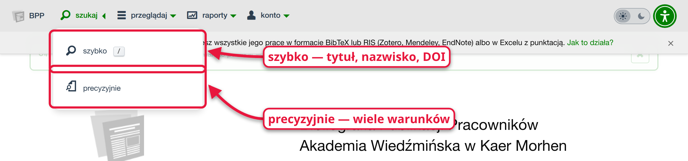
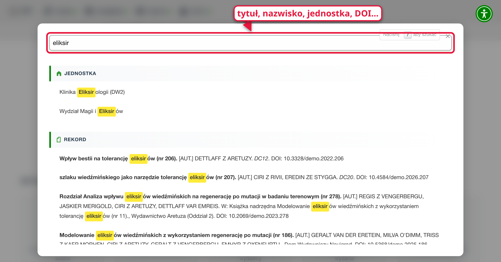
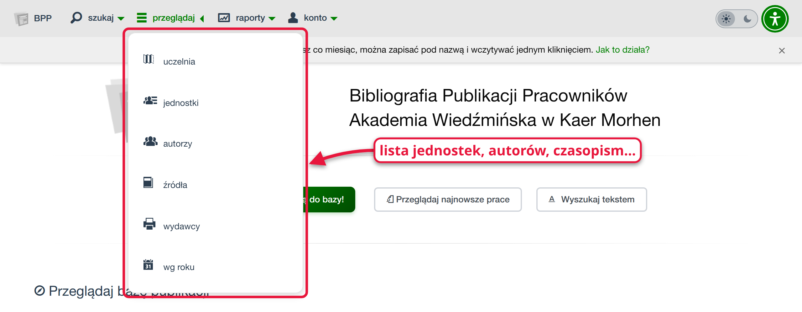
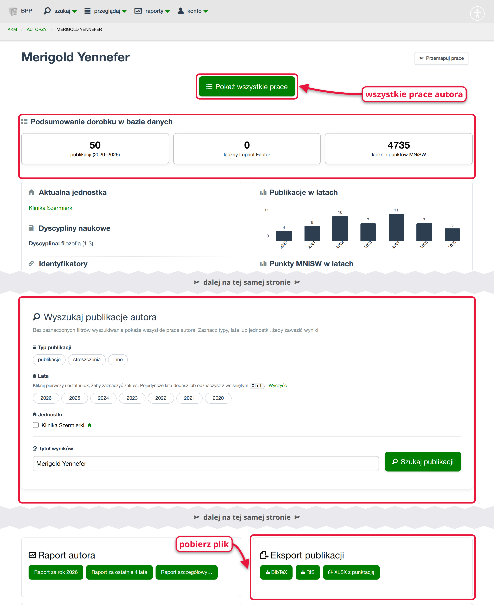
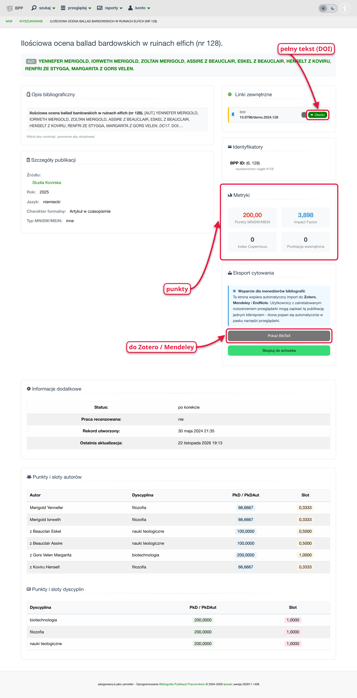

# Przeglądanie i wyszukiwanie publikacji

Ten rozdział opisuje to, co widzi **każdy odwiedzający** stronę BPP — bez
logowania. Dane można wyszukiwać na dwa sposoby oraz przeglądać według
autorów, jednostek, źródeł i lat. Czynności redakcyjne (dodawanie i edycja
rekordów) opisuje osobna [Instrukcja redaktora](../redaktor/uczelnia.md).

## Gdzie szukać jakich danych

| Chcę znaleźć… | Gdzie |
|---|---|
| konkretną pracę — znam fragment tytułu, DOI albo ISBN | **szukaj → szybko** (albo klawisz `/`) |
| dorobek konkretnej osoby | **szukaj → szybko** i nazwisko, albo **przeglądaj → autorzy** — otworzy się [strona autora](#strona-autora) |
| prace spełniające kilka warunków naraz (autor + lata + typ…) | **szukaj → precyzyjnie** |
| publikacje wydziału, katedry, zakładu | **przeglądaj → jednostki** |
| prace opublikowane w danym czasopiśmie | **przeglądaj → źródła** |
| książki danego wydawnictwa | **przeglądaj → wydawcy** |
| wszystkie prace z danego roku | **przeglądaj → wg roku** |
| DOI, punkty, licencję, dane bibliograficzne jednej pracy | [strona publikacji](#strona-publikacji) |
| listę swoich prac do sprawozdania lub wniosku (Word, Excel) | [Jak pobrać listę publikacji](pobieranie-listy-publikacji.md) |
| zestawienia, rankingi, punkty i sloty | menu **raporty** i **ewaluacja** — patrz [Raporty krok po kroku](raporty-krok-po-kroku.md) |

## Dwa tryby wyszukiwania

Menu **szukaj** na górnej belce udostępnia dwa tryby. Różnią się one tym,
*jak precyzyjnie* formułujemy zapytanie.

### Wyszukiwanie szybkie (klawisz `/`)

Pozycja **szukaj → szybko** otwiera okno błyskawicznej wyszukiwarki. To samo
okno otworzysz z dowolnego miejsca na stronie, naciskając klawisz `/`
(ukośnik).

Wyszukiwanie szybkie jest *jednopolowe* — wpisujesz co najmniej 3 znaki,
a system od razu podpowiada wyniki, pogrupowane według rodzaju:

- **publikacje** — po fragmencie tytułu, a także po pełnym **DOI**,
  **ISBN** albo identyfikatorze PBN,
- **autorów** — po nazwisku,
- **jednostki** — po nazwie,
- **źródła** (czasopisma) — po nazwie.

W tytułach działa kilka prostych operatorów:

- **Od początku wyrazu** — `preane` znajdzie „preanestetyczny", ale
  `anestetyczny` już nie (dopasowanie jest od początku słowa).
- **Wykluczanie słów** — poprzedzenie wyrazu minusem, np. `-onkologia`,
  zwróci prace, które danego słowa **nie** zawierają.
- **Całe frazy** — ujęcie w cudzysłów, np. `"Uniwersytet Medyczny"`,
  wyszuka dokładnie tę frazę.

Po wynikach poruszasz się strzałkami `↑` `↓`, `ENTER` przechodzi do
wybranej pozycji, a `ESC` zamyka okno.

!!! tip "Kiedy używać"
    Wyszukiwanie szybkie sprawdza się, gdy znasz fragment tytułu, DOI albo
    nazwisko i chcesz w jednej chwili trafić do konkretnej pracy lub osoby.

### Wyszukiwanie precyzyjne (formularz)

Pozycja **szukaj → precyzyjnie** otwiera formularz, w którym budujesz
zapytanie z wielu warunków jednocześnie — np. autor *i* lata *i* typ pracy —
łącząc je spójnikami i / lub / i nie oraz grupując w ramki. Najprościej
zacząć od strony autora albo jednostki: przycisk **„Szukaj publikacji”**
otwiera formularz z już wpisanymi warunkami.

Szczegóły w pięciu artykułach:
[podstawy](wyszukiwanie-precyzyjne.md),
[przykłady zapytań](wyszukiwanie-precyzyjne-przyklady.md),
[praca z wynikami](wyszukiwanie-precyzyjne-wyniki.md),
[zapisane formularze](wyszukiwanie-precyzyjne-zapisane.md) oraz
[tabela krzyżowa](tabela-krzyzowa.md) — zestawienie wyników w tabeli,
np. punkty według jednostki i charakteru formalnego.

!!! note "Wyszukiwanie zapytaniem"
    W menu może pojawić się dodatkowo pozycja **zapytaniem** — to tryb dla
    zalogowanych redaktorów, pozwalający wpisać zapytanie w języku BPP-QL.
    Dla zwykłego odwiedzającego nie jest widoczny.

!!! tip "Wyszukiwanie przez asystenta AI"
    Bibliografię można też przeszukiwać, rozmawiając z asystentem AI
    (np. Claude, ChatGPT) — zobacz [Bibliografia w asystencie
    AI](asystent-ai.md).

## Przeglądanie

Menu **przeglądaj** pozwala wędrować po bazie bez wpisywania zapytania —
od listy do listy aż do konkretnego rekordu.

Dostępne są widoki:

- **Uczelnia** — strona główna z danymi i logo uczelni oraz jej strukturą.
- **Jednostki** — alfabetyczna lista wydziałów i jednostek; po wejściu
  w jednostkę zobaczysz przypisane do niej publikacje i pracowników.
  Na stronie głównej niektórych uczelni zamiast kafla „Jednostki” jest
  kafel **„Wydziały”** — prowadzi do listy samych wydziałów tej uczelni.
- **Autorzy** — alfabetyczna lista autorów; strona pojedynczego autora to
  jego pełna bibliografia (patrz niżej).
- **Źródła** — wydawnictwa ciągłe (czasopisma) i inne źródła; po wejściu
  w źródło zobaczysz opublikowane w nim prace.
- **Wydawcy** — wydawnictwa książek; po wejściu zobaczysz wydane przez
  nie publikacje.
- **Wg roku** — prace pogrupowane według roku wydania.

## Strona autora („raport autora") {#strona-autora}

Po wejściu w nazwisko na liście autorów otwiera się **strona autora** —
zestawienie wszystkich jego publikacji w bazie wraz z podstawowymi danymi
(aktualne miejsce pracy, identyfikatory takie jak ORCID, jeśli uzupełnione).
To najprostszy sposób, by zobaczyć dorobek jednej osoby bez budowania
zapytania.

Strona autora pokazuje **pełny dorobek autora** — także w instalacjach,
w których jedna baza BPP obsługuje kilka uczelni: znajdziesz na niej również
prace autora powstałe w innej uczelni tej samej instalacji (szczegóły
w [instrukcji administratora](../administrator/ogolna.md#układ-podstrony-autora-profil-autora)).
Ten sam zakres obejmuje [eksport do BibTeX i RIS](#eksport-publikacji-autora-bibtex-i-ris).

### Autor spoza uczelni {#autor-spoza-uczelni}

Pełną stronę autora (podsumowanie dorobku, biogram, statystyki, wykresy,
metryki) mają wyłącznie **autorzy uczelni — obecni i byli**, czyli osoby,
które mają lub miały przypisanie do jakiejkolwiek jednostki uczelni innej niż
[*Obca jednostka*](../redaktor/uczelnia.md#obca-jednostka) (liczą się też
jednostki typu „Doktoranci”, „Studenci”, „Pracownicy emerytowani” i
zatrudnienia już zakończone).

Współautor spoza uczelni — osoba przypisana wyłącznie do *Obcej jednostki* —
pod tym samym adresem dostaje **prostą stronę informacyjną**: imię i nazwisko,
komunikat „Autor spoza uczelni” oraz przycisk **Pokaż prace współautorskie**,
który otwiera listę jego prac w bibliografii. Dotychczasowe linki do takiego
autora (z opisów prac, wyników wyszukiwania, zakładek) nadal działają.
Taka strona nie trafia do mapy strony (sitemap) i jest oznaczona dla
wyszukiwarek internetowych jako nieindeksowana.

Autor spoza uczelni pozostaje **wyszukiwalny**, a jego prace dostępne
(wyszukiwarka, wyniki „autor = …”, eksport listy prac), ale w publicznej
części serwisu **nie liczymy mu podsumowań dorobku** — kilka prac
współautorskich w naszej bibliografii nie oddaje dorobku osoby z innej
instytucji:

- **raport slotów autora** i **raporty autora** (menu *Raporty*) nie
  przyjmują autora spoza uczelni — formularz wyświetla komunikat, że takich
  raportów dla autorów spoza uczelni nie przygotowujemy (dotyczy także
  zalogowanych redaktorów; panel redagowania bez zmian),
- **ranking autorów** pomija autorów spoza uczelni — na stronie i w eksporcie,
- w **sieci powiązań** autor spoza uczelni nadal jest węzłem grafu (z liczbą
  wspólnych prac), ale bez sum IF i punktów — przy rozmiarze kółek wg IF lub
  punktów jego kółko jest najmniejsze,
- w **eksporcie XLSX** prac takiego autora arkusz „Podsumowanie” zawiera
  tylko liczbę prac w latach, bez sum punktów, IF i slotów.

W instalacjach, w których jedna baza BPP obsługuje kilka uczelni, przynależność
sprawdzana jest względem uczelni, której stronę oglądasz: pracownik innej
uczelni tej samej instalacji jest tu autorem spoza uczelni. Jeżeli w ustawieniach
uczelni nie wskazano *Obcej jednostki*, strony autorów działają jak dotąd.

Strona autora składa się z **pasów**: sekcja zajmuje całą szerokość strony
albo dwie sekcje stoją obok siebie. Sekcje bez danych (np. autor bez
zdjęcia i biogramu) po prostu się nie pokazują, a sąsiednia sekcja zajmuje
wtedy całą szerokość. Na wąskich ekranach (telefon, tablet) sekcje układają
się jedna pod drugą. **Które sekcje są widoczne, w jakiej kolejności i jak
szerokie**, ustala uczelnia (patrz
[instrukcja administratora — układ podstrony autora](../administrator/ogolna.md#układ-podstrony-autora-profil-autora)).

### Sekcje strony autora

W układzie domyślnym, od góry:

- **Podsumowanie dorobku w bazie danych** — łączna liczba publikacji
  (z zakresem lat), łączny Impact Factor oraz łączna suma punktów MNiSW.
- **Zdjęcie i biogram** — zdjęcie jest klikalne (powiększenie w osobnym
  okienku). Zdjęcie i biogram uzupełnia sam autor (patrz
  [Mój profil autora](moj-profil-autora.md)) albo redaktor.
- **Afiliacja i identyfikatory** — aktualna jednostka, historia zatrudnienia,
  dyscypliny naukowe, stopnie naukowe (doktorat, habilitacja) oraz kafle
  identyfikatorów (patrz niżej).
- **Wykresy w latach** — liczba publikacji, suma punktów MNiSW oraz suma
  Impact Factor; domyślnie obejmują ostatnie 10 lat. Gdy autor nie ma
  zdjęcia ani biogramu, wykresy stają obok afiliacji, jeden pod drugim.
- **Statystyki wg charakteru formalnego** (np. ile artykułów, ile
  rozdziałów) oraz **najczęstsi współautorzy** — z odnośnikiem do
  wizualnej sieci powiązań. Jak czytać tę sieć i co można w niej
  sprawdzić, opisuje strona
  [Sieć powiązań autorów](powiazania-autorow.md).
- **Liczba cytowań** (o ile uczelnia pobiera takie dane) oraz **metryki
  ewaluacyjne** — te ostatnie widzi tylko zalogowany autor na własnej
  stronie i osoby uprawnione do metryk.
- **Osiągnięcia naukowe** pobierane z systemu RAD-on (dla autorów z ORCID).
- Formularz **„Wyszukaj publikacje autora”** — zawężenie listy prac
  m.in. po typie, jednostce, roku.
- Odnośniki do **raportu autora** oraz **eksport (BibTeX / RIS / XLSX
  z punktacją)** — patrz
  [Eksport publikacji autora](#eksport-publikacji-autora-bibtex-i-ris).
- Listy prac: **najlepsze prace** wg punktacji i wg Impact Factor,
  **najnowsze artykuły**, **najnowsze książki i rozdziały** oraz **ostatnio
  edytowane** rekordy (domyślnie po 5 pozycji), a jeśli uczelnia włączyła
  tę sekcję — **wyróżnione publikacje** wskazane przez samego autora.

### Kafle identyfikatorów

W sekcji afiliacji każdy identyfikator autora ma swój kafel: ORCID, PBN
(odnośnik „Profil w PBN”, z oznaczeniem „POL-on”, gdy autor jest w systemie
POL-on), Web of Science, Scopus, Google Scholar, profil w portalu uczelni
(np. PPM) oraz wewnętrzny identyfikator BPP. Numer w systemie kadrowym
widzą tylko zalogowani.

- **Kliknięcie w odnośnik** na kaflu (np. numer ORCID) otwiera profil
  w danym serwisie.
- **Kliknięcie w pozostałą część kafla** kopiuje identyfikator do schowka
  (dla PBN — adres profilu); kafel na chwilę podświetla się na zielono.
  Kopiować można też z klawiatury — ikoną w rogu kafla.

### Interakcje na stronie autora

- Kliknięcie w pozycję na liście prac prowadzi do **szczegółów publikacji**.
- Kliknięcie w **nazwę charakteru formalnego** w tabeli statystyk otwiera
  wyszukiwarkę precyzyjną (multiseek) z gotowym zapytaniem „ten autor +
  ten charakter" — od razu zobaczysz wszystkie prace danego rodzaju.

## Strona publikacji {#strona-publikacji}

Kliknięcie w dowolną pracę — na liście wyników, na stronie autora,
jednostki czy źródła — otwiera **stronę publikacji** ze wszystkimi danymi
o niej: opisem bibliograficznym, autorami (każde nazwisko prowadzi do strony
autora), źródłem, rokiem, charakterem formalnym, danymi Open Access
(licencja, wersja tekstu) oraz **punktami MNiSW/MEiN** i Impact Factor.

- **„Otwórz”** przy DOI (i przy innych linkach zewnętrznych, np. PubMed,
  PBN) prowadzi do pełnego tekstu lub rekordu w danym serwisie; ikona obok
  kopiuje identyfikator do schowka.
- **Kliknięcie w opis bibliograficzny** kopiuje go do schowka — gotowy do
  wklejenia np. do wniosku.
- **„Pokaż BibTeX”** / **„Skopiuj do schowka”** — cytowanie dla LaTeX-a
  i menedżerów bibliografii (Zotero, Mendeley, EndNote). Z zainstalowanym
  dodatkiem do przeglądarki Zotero/Mendeley pracę zapiszesz też jednym
  kliknięciem w ikonę dodatku.

## Eksport publikacji autora (BibTeX i RIS) {#eksport-publikacji-autora-bibtex-i-ris}

Na stronie autora, w sekcji **„Eksport publikacji”**, znajdują się przyciski
**„BibTeX"**, **„RIS"** i **„XLSX z punktacją"**. Przygotowują one plik
zawierający **wszystkie publikacje autora**: `.bib` i `.ris` — gotowe do
zaimportowania w menedżerach bibliografii (np. Zotero, Mendeley, EndNote,
a w przypadku BibTeX-a także w środowisku LaTeX), `.xlsx` — arkusz Excel
z punktacją, wygodny do sprawozdań.

Po kliknięciu przycisku otwiera się strona eksportu:

1. **Niezalogowany użytkownik** przechodzi najpierw automatyczną weryfikację
   „czy nie jesteś robotem” (ALTCHA) — trwa zwykle kilka sekund i nie
   wymaga przepisywania kodów. Do jej zakończenia widoczny jest tylko
   przycisk powrotu na stronę autora. Zalogowani pomijają ten krok.
2. Kliknij **„Generuj plik …”** — plik przygotowuje się w tle; strona
   pokazuje postęp, a po zakończeniu odnośnik do pobrania.

Plik jest zawsze generowany w tle — także dla zalogowanych — żeby eksport
dużego dorobku nie spowalniał serwisu. Dawne adresy
`/bpp/autor/<id>/eksport.bib` i `/bpp/autor/<id>/eksport.ris` (gdzie `<id>`
to identyfikator autora) nadal działają: przekierowują na stronę eksportu
w odpowiednim formacie.

Osoby z uprawnieniami redakcyjnymi (wprowadzanie danych) dostają **pełny
dorobek** autora, łącznie z pracami o statusach korekty ukrytych przed
odwiedzającymi. Taki plik — oraz strona jego postępu — jest dostępny
wyłącznie dla redakcji; pozostali użytkownicy otrzymują osobny plik
z zakresem publicznym.

!!! note
    Eksport obejmuje do 5000 prac jednego autora.

## Ranking autorów

Menu **raporty → ranking autorów** otwiera formularz, w którym wybierasz
zakres (np. lata, jednostkę) i otrzymujesz uszeregowaną listę autorów wraz
z sumami punktów i liczbą prac. Reguły decydujące o tym, które prace wchodzą
do rankingu, opisuje rozdział [Raporty i rankingi](raporty-rankingi.md).
