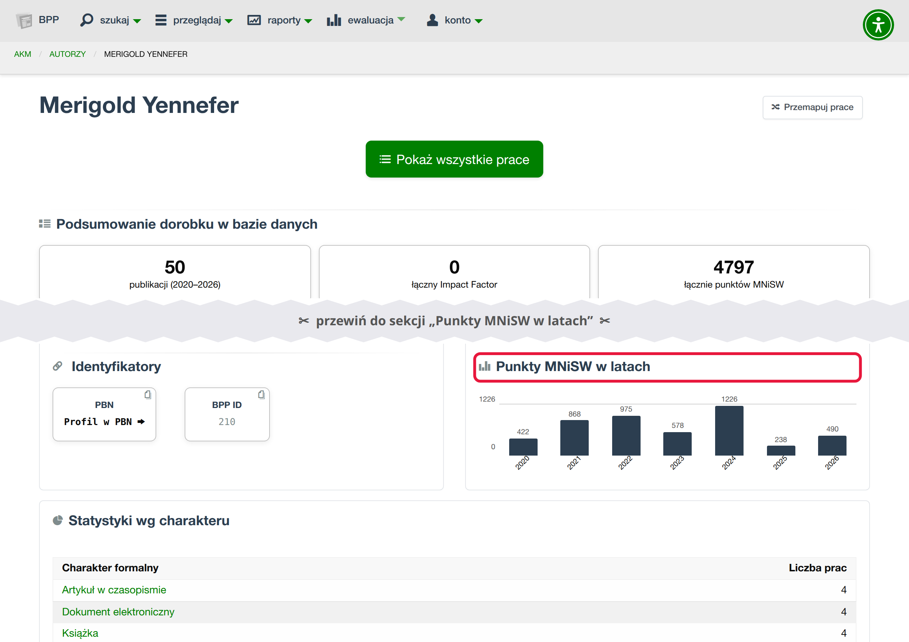
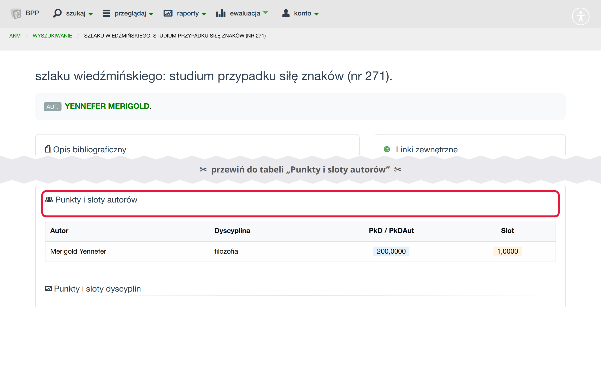
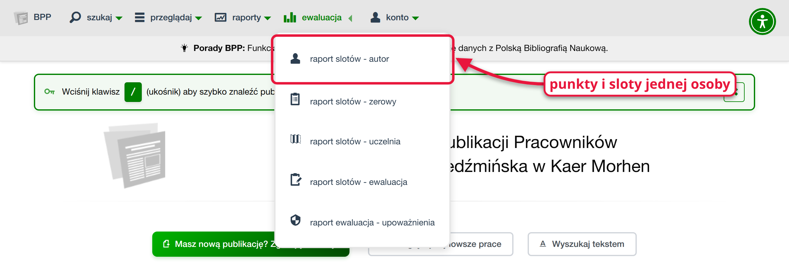
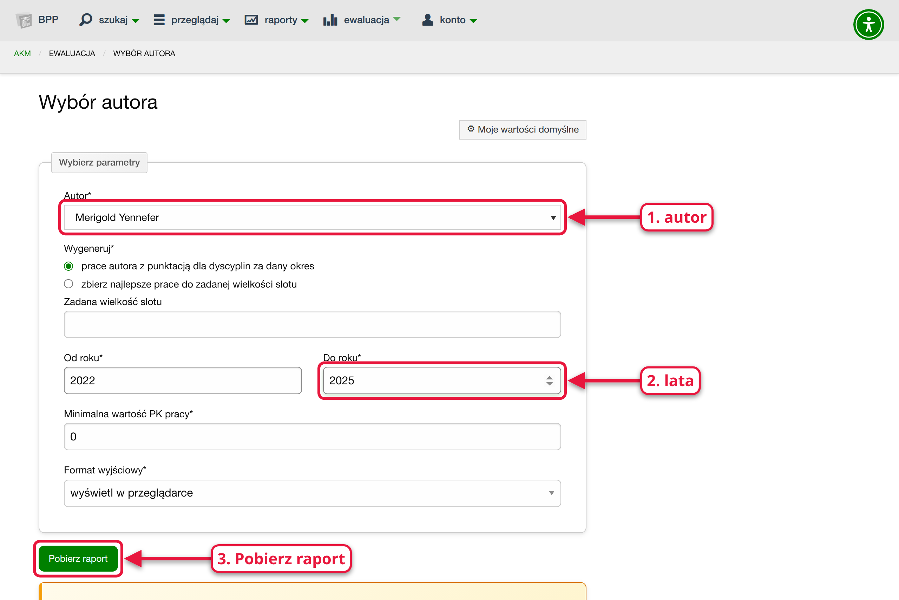
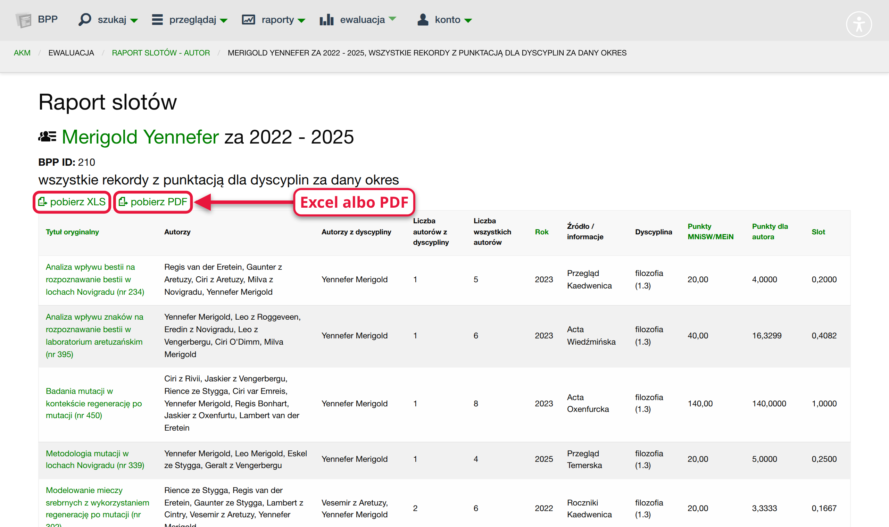

# Gdzie sprawdzić punkty i sloty

## Trzy liczby, które warto rozróżniać

| Nazwa w BPP | Co znaczy |
|---|---|
| **Punkty MNiSW** (PK) | punkty za całą pracę — z wykazu czasopism albo wydawnictw |
| **PkDAut** (punkty dla autora) | część tych punktów przypadająca na Ciebie w danej dyscyplinie — zależy od liczby współautorów |
| **Slot** | Twój udział w pracy przeliczony na „jednostki ewaluacyjne”: 1 = cała praca, 0,5 = połowa itd. |

Punkty MNiSW widać od razu przy każdej pracy. PkDAut i sloty BPP liczy
tylko dla prac, w których masz **przypisaną dyscyplinę**.

## Na stronie autora — punkty w latach

Na swojej stronie autora (wyszukaj swoje nazwisko albo **przeglądaj →
autorzy**) znajdziesz:

- u góry **„łącznie punktów MNiSW”** w podsumowaniu dorobku,
- niżej wykres **„Punkty MNiSW w latach”**,
- listę **„Najlepsze prace (punkty MNiSW)”**.

Uczelnia może też włączyć na stronie autora tabelkę **„Punkty / sloty
w latach”** — pokazuje ją tylko osobom, które mają dostęp do raportów
slotów.

## Na stronie pracy — kto ile dostał

Otwórz pracę (kliknij jej tytuł) i przewiń do tabeli **„Punkty i sloty
autorów”**. Dla każdego autora z dyscypliną widać dyscyplinę, punkty
(PkDAut) i slot. Tabela jest widoczna po **zalogowaniu**.

## Wszystkie prace jednej osoby — raport slotów {#wszystkie-prace-jednej-osoby-raport-slotow}

Zestawienie wszystkich prac z punktami i slotami za wybrane lata daje
**raport slotów — autor**. Jest w menu **ewaluacja**; to menu widzą osoby,
którym uczelnia przyznała dostęp do raportów (jeśli go nie masz, a
potrzebujesz — poproś redaktora BPP).

1. **ewaluacja → raport slotów - autor**

    

2. Wybierz **autora**, wpisz **lata** (np. 2022–2025 — okres ewaluacji)
   i kliknij **„Pobierz raport”**.

    

    Opcja **„zbierz najlepsze prace do zadanej wielkości slotu”** wybiera
    najlepiej punktowane prace, aż ich sloty zsumują się do podanej liczby
    (np. 4).

3. Raport ma osobną tabelę dla każdej dyscypliny. Pod nagłówkiem tabeli
   są odnośniki **„pobierz XLS”** i **„pobierz PDF”**.

    

## Praca ma punkty, ale nie ma slotu? {#praca-ma-punkty-ale-nie-ma-slotu}

Najczęstsze powody:

- w danym roku **nie masz zadeklarowanej dyscypliny** albo przy tej
  pracy nie wpisano Ci dyscypliny,
- praca **nie jest afiliowana** na uczelnię (np. powstała w innej
  instytucji),
- to rodzaj pracy, który nie wchodzi do ewaluacji (np. patent),
- świeżo poprawiona praca — BPP przelicza sloty w tle, zwykle w ciągu
  kilku minut.

Gdy to nie to — napisz do redaktora BPP i podaj link do pracy.

Pełny przegląd raportów (rankingi, raporty jednostek, ewaluacja):
[Raporty krok po kroku](raporty-krok-po-kroku.md).
