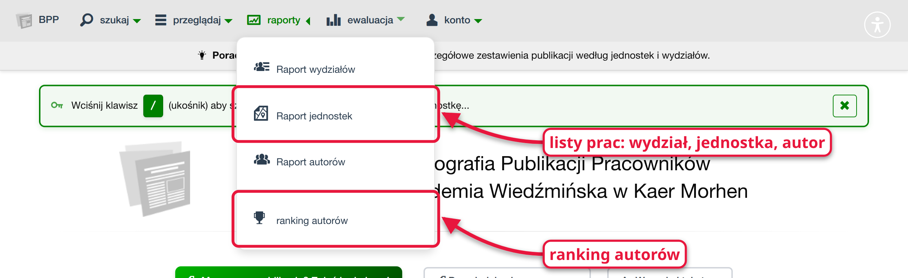
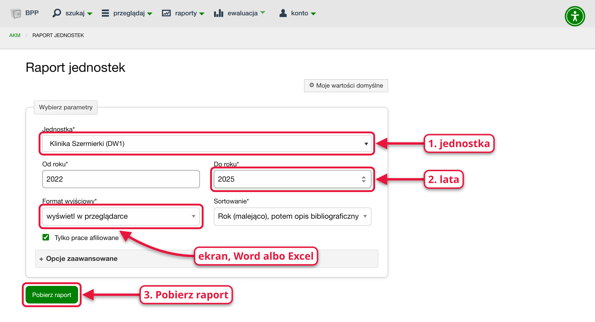
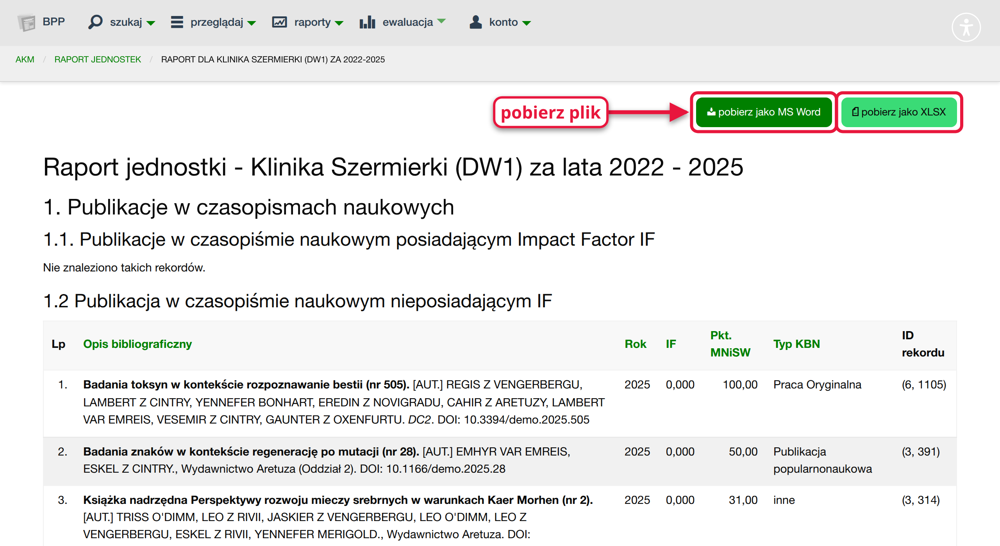
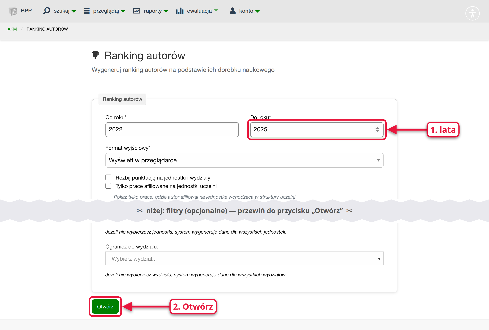
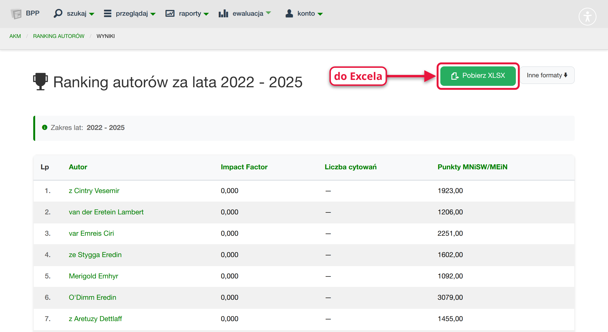
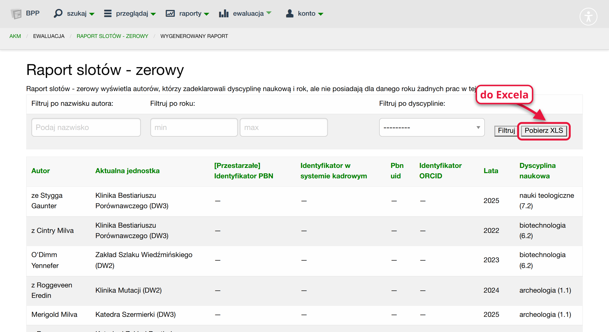
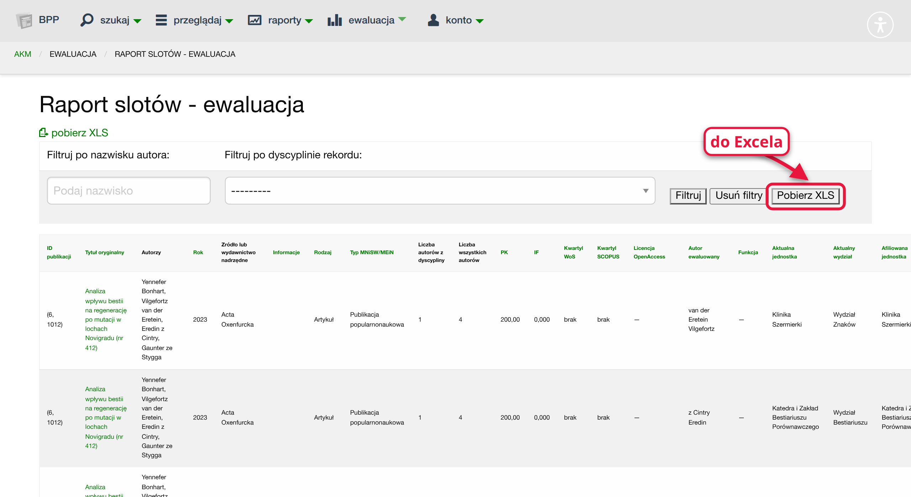

# Raporty krok po kroku — przewodnik dla przygotowujących zestawienia

Przewodnik dla osób, które przygotowują zestawienia dorobku — w dziekanacie,
bibliotece, zespole ds. ewaluacji. Po kolei: **który raport wybrać, gdzie
go znaleźć i jak pobrać wynik do Worda albo Excela.**

## Zanim zaczniesz {#zanim-zaczniesz}

**Dostęp.** Raporty widać w górnym menu **raporty** i **ewaluacja**. Część
z nich uczelnia udostępnia wszystkim, ale większość wymaga konta w grupie
**„generowanie raportów”** — nadaje ją administrator BPP. Jeśli nie widzisz
menu albo dostajesz „Brak uprawnień (403)”, poproś o tę grupę. Moduły
ewaluacji (liczba N, optymalizacja, oświadczenia) wymagają grupy
**„wprowadzanie danych”**.

**Lata.** Prawie każdy formularz zaczyna się od pól **Od roku / Do roku**.
Domyślnie stoi tam bieżący rok — dla ewaluacji wpisz cały okres
(np. 2022–2025).

**Swoje ustawienia.** Przycisk **⚙ Moje wartości domyślne** nad formularzem
zapamiętuje to, co wpisałeś — przy następnym raporcie nie trzeba wpisywać
lat od nowa.

## Który raport wybrać

| Potrzebuję… | Raport | Menu |
|---|---|---|
| listy prac wydziału, jednostki albo osoby (Word / Excel) | [Raport wydziałów / jednostek / autorów](#listy-prac-raport-wydzialow-jednostek-autorow) | raporty |
| kto ma najwięcej punktów | [Ranking autorów](#ranking-autorow) | raporty |
| punktów i slotów jednej osoby | [Raport slotów - autor](#punkty-i-sloty-jednej-osoby) | ewaluacja |
| kto zadeklarował dyscyplinę, a nie ma żadnej pracy | [Raport slotów - zerowy](#kto-nie-ma-slotow-raport-zerowy) | ewaluacja |
| wszystkich prac uczelni z punktami i slotami, do własnych analiz | [Raport slotów - ewaluacja](#wszystkie-prace-z-punktami-i-slotami-raport-ewaluacja) | ewaluacja |
| najlepszych prac każdej osoby do zadanej liczby slotów | [Raport slotów - uczelnia](#najlepsze-prace-do-slotow-raport-uczelnia) | ewaluacja |
| listy według własnych warunków (typ, źródło, słowa w tytule…) | [wyszukiwanie + eksport](#wlasne-zestawienie-wyszukiwanie-i-eksport) | szukaj |

## Listy prac: Raport wydziałów / jednostek / autorów {#listy-prac-raport-wydzialow-jednostek-autorow}

Gotowe zestawienie prac podzielone na rozdziały (artykuły z IF, bez IF,
monografie, rozdziały, patenty, konferencje…) — typowe do sprawozdania
rocznego.

1. Menu **raporty** → **Raport wydziałów**, **Raport jednostek** albo
   **Raport autorów**.

    

2. Wybierz **jednostkę** (albo wydział / autora), wpisz **lata**, wybierz
   **format** — „wyświetl w przeglądarce”, Word albo Excel — i kliknij
   **„Pobierz raport”**.

    

    - **Tylko prace afiliowane** (domyślnie zaznaczone) — tylko prace,
      w których autor podał afiliację uczelni.
    - **Opcje zaawansowane** — próg punktów MNiSW, Impact Factor, „tylko
      prace punktowane”.

3. Raport wyświetlony w przeglądarce ma u góry przyciski **„pobierz jako MS
   Word”** i **„pobierz jako XLSX”** — nie trzeba wracać do formularza.

    

!!! tip "Raport jednej osoby — szybciej ze strony autora"
    Na stronie autora, w sekcji **„Raport autora”**, są gotowe odnośniki:
    **raport za bieżący rok**, **za ostatnie 4 lata** i **raport
    szczegółowy**.

## Ranking autorów {#ranking-autorow}

Lista autorów uczelni uszeregowana według sumy punktów (oraz Impact Factor
i cytowań).

1. **raporty → ranking autorów**, wpisz **lata**. Niżej są filtry
   (opcjonalne): tylko wybrany wydział lub jednostka, tylko prace
   afiliowane, rodzaje prac. Kliknij **„Otwórz”**.

    

2. Na wyniku **„Pobierz XLSX”** zapisze ranking w Excelu; **„Inne
   formaty”** — CSV, ODS, stary XLS. Kliknięcie w nagłówek kolumny
   sortuje tabelę.

    

Co nie wchodzi do rankingu: autorzy oznaczeni „nie pokazuj w rankingu”,
koła naukowe (jeśli uczelnia tak ustawiła), jednostki i wydziały wyłączone
z rankingu oraz rodzaje prac, którym redakcja wyłączyła liczenie do
rankingu.

## Punkty i sloty jednej osoby {#punkty-i-sloty-jednej-osoby}

**ewaluacja → raport slotów - autor**: wybierz autora i lata, **„Pobierz
raport”**. Wynik — osobna tabela dla każdej dyscypliny, z odnośnikami
**„pobierz XLS”** i **„pobierz PDF”**. Opisane z obrazkami w
[Gdzie sprawdzić punkty i sloty](punkty-i-sloty.md#wszystkie-prace-jednej-osoby-raport-slotow).

!!! warning "Excel prosto z formularza — tylko pierwsza dyscyplina"
    Jeśli w formularzu od razu wybierzesz format **Excel**, a autor ma dwie
    dyscypliny, plik będzie zawierał tylko pierwszą. Wybierz „wyświetl
    w przeglądarce” i pobierz plik osobno pod każdą tabelą.

## Kto nie ma slotów: raport zerowy {#kto-nie-ma-slotow-raport-zerowy}

**ewaluacja → raport slotów - zerowy**: osoby, które **zadeklarowały
dyscyplinę na dany rok, a nie mają w niej żadnej pracy**. To lista
kontrolna przed ewaluacją — często to brakujące prace albo brak dyscypliny
wpisanej przy pracy.

Wpisz lata, wybierz **rodzaj raportu** (każdy rok osobno albo tylko osoby
„zerowe” we wszystkich latach) i kliknij **„Wyślij formularz”**. Wynik
możesz zawęzić filtrami (nazwisko, rok, dyscyplina) i pobrać przyciskiem
**„Pobierz XLS”**.

## Wszystkie prace z punktami i slotami: raport ewaluacja {#wszystkie-prace-z-punktami-i-slotami-raport-ewaluacja}

**ewaluacja → raport slotów - ewaluacja**: jeden wiersz na każdą parę
praca–autor–dyscyplina, z punktami (PK), udziałem autora, slotem,
jednostką i wydziałem. Najlepszy materiał do własnych tabel przestawnych
w Excelu.

Wpisz lata, kliknij **„Pobierz raport”**, potem **„Pobierz XLS”** (cała
tabela albo po zawężeniu filtrami).

Obok jest **raport ewaluacja - upoważnienia** — prace z dyscypliną,
w których autor **nie** afiliował na uczelnię; przydatny do sprawdzenia
upoważnień do wykazania pracy.

## Najlepsze prace do slotów: raport uczelnia {#najlepsze-prace-do-slotow-raport-uczelnia}

**ewaluacja → raport slotów - uczelnia** zbiera dla **każdej osoby**
najkorzystniejsze prace do zadanej wielkości slotu (np. 4) — albo eksportuje
wszystkie prace. Raport liczy się **w tle** (to może potrwać kilka minut):
po kliknięciu **„Utwórz raport”** zobaczysz pasek postępu, a na końcu
**„Zobacz wyniki”** i **„Pobierz w formacie XLSX”**. Gotowe raporty
zostają na liście **„Ostatnio wygenerowane raporty”** — możesz do nich
wrócić później albo kliknąć **„Wygeneruj ponownie”** po zmianach w danych.

!!! note
    Zamówienie tego raportu wymaga obecnie konta w grupie **„wprowadzanie
    danych”** — sama grupa „generowanie raportów” kończy się komunikatem
    „Brak uprawnień (403)”.

## Własne zestawienie: wyszukiwanie i eksport {#wlasne-zestawienie-wyszukiwanie-i-eksport}

Gdy żaden gotowy raport nie pasuje: **szukaj → precyzyjnie**, ustaw
warunki (lata, jednostka, typ, źródło, punkty…), **„Wyświetl wyniki
wyszukiwania”**, a nad listą **„Eksport”** → Word, Excel, CSV (do 5000
prac naraz). Krok po kroku: [Jak pobrać listę publikacji](pobieranie-listy-publikacji.md).

## Gdy wynik się nie zgadza

- **Brak prac, które powinny być** — sprawdź lata, zaznaczone „tylko prace
  afiliowane” i filtry. Prace oczekujące na korektę mogą być celowo
  ukryte w raportach (ustawienie uczelni).
- **Punkty są, slotów brak** — praca nie ma dyscypliny przy autorze albo
  autor nie zadeklarował dyscypliny na ten rok; listę takich osób daje
  [raport zerowy](#kto-nie-ma-slotow-raport-zerowy). Szczegóły:
  [Punkty i sloty](punkty-i-sloty.md#praca-ma-punkty-ale-nie-ma-slotu).
- **Świeże poprawki nie widać** — BPP przelicza punkty i sloty w tle,
  zwykle w ciągu kilku minut. Wygeneruj raport ponownie.
- **„Brak uprawnień (403)” albo brak menu** — zobacz
  [Zanim zaczniesz](#zanim-zaczniesz).
