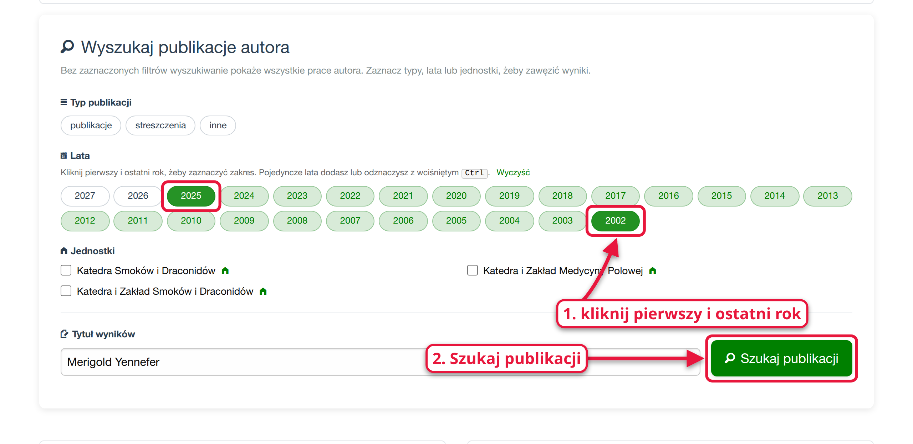
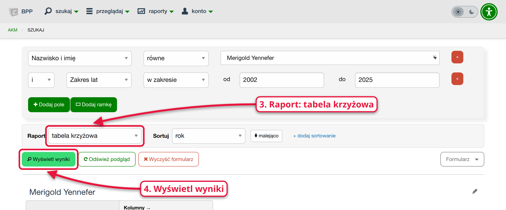
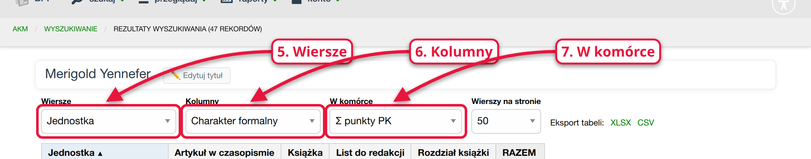
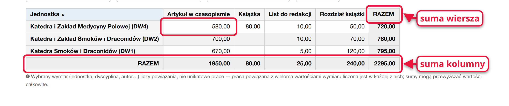
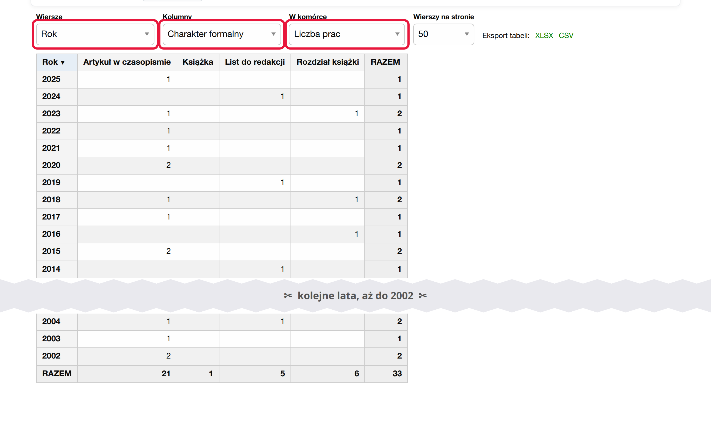
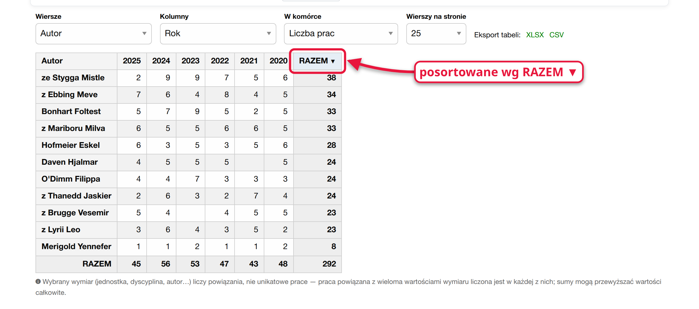
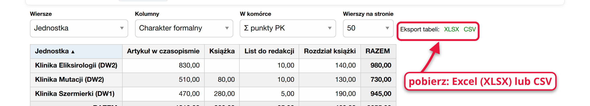

# Tabela krzyżowa — zestawienia w wyszukiwaniu precyzyjnym

**Tabela krzyżowa** zamienia listę znalezionych prac w zestawienie. Zamiast
przewijać kilkadziesiąt pozycji, widzisz jedną tabelę: w wierszach na
przykład jednostki, w kolumnach rodzaje prac, a w każdej komórce liczbę prac
albo sumę punktów z ich przecięcia. Działa tak samo jak tabela przestawna
w Excelu, ale na wyniku wyszukiwania w BPP.

Tabela krzyżowa jest jednym z rodzajów raportu w **szukaj → precyzyjnie**
(zob. [Wyszukiwanie precyzyjne](przegladanie-i-wyszukiwanie.md#wyszukiwanie-precyzyjne-formularz)).
Może z niej korzystać każdy, także bez logowania. Pobrać tabelę do pliku
mogą tylko zalogowani użytkownicy.

## Krok po kroku

Poniżej odpowiadamy na pytanie: **w jakiej jednostce autorka publikowała za
najwięcej punktów w latach 2002–2025, z podziałem na charakter formalny
prac?**

### 1. Zbuduj warunki wyszukiwania

Najprościej zacząć od strony autora (albo jednostki): w sekcji **„Wyszukaj
publikacje autora”** zaznacz lata — kliknij pierwszy, a potem ostatni rok
zakresu — i kliknij **„Szukaj publikacji”**.

Otworzy się formularz wyszukiwania precyzyjnego z gotowymi warunkami
(tu: **Nazwisko i imię** równe autorce **i** **Zakres lat** od 2002 do
2025). Warunki możesz dalej zmieniać, dodawać (**„Dodaj pole”**) albo
zbudować całe zapytanie od zera w **szukaj → precyzyjnie**.

### 2. Wybierz raport „tabela krzyżowa”

1. Pod warunkami, na liście **„Raport”**, wybierz **tabela krzyżowa**.
2. Kliknij **„Wyświetl wyniki”**.

!!! note "Podgląd pod formularzem"
    Tabela krzyżowa pokazuje się też w podglądzie pod formularzem. Każda
    zmiana w formularzu odświeża podgląd i przywraca w nim ustawienia
    domyślne tabeli (wiersze: rok, bez kolumn, liczba prac). Wygodniej
    pracować na pełnej stronie wyników.

### 3. Wybierz wiersze, kolumny i wartość

Nad tabelą są cztery listy. Każda zmiana od razu przelicza tabelę:

- **Wiersze** — według czego dzielić wyniki w pionie (tu: **Jednostka**),
- **Kolumny** — według czego dzielić je w poziomie (tu: **Charakter
  formalny**); **(brak)** daje prostą tabelę z jedną kolumną wartości,
- **W komórce** — co liczyć (tu: **Σ punkty PK**),
- **Wierszy na stronie** — 25, 50, 100 albo 250.

Do wyboru są:

| Lista | Dostępne wartości |
|---|---|
| **Wiersze** | Rok, Charakter formalny, Charakter ogólny (rodzaj), Typ MNiSW, Koszyk punktów PK, Język, Źródło, Jednostka, Dyscyplina naukowa, Autor |
| **Kolumny** | (brak), Rok, Charakter formalny, Charakter ogólny (rodzaj), Typ MNiSW, Koszyk punktów PK, Język, Dyscyplina naukowa |
| **W komórce** | Liczba prac, Σ punkty PK, Σ Impact Factor, Σ liczba cytowań, Σ punktacja wewnętrzna |

**Źródło**, **Jednostka** i **Autor** mogą być tylko wierszami — mają tak
wiele wartości, że jako kolumny tabela byłaby nieczytelnie szeroka. Gdy
w kolumnach wybierzesz to samo co w wierszach, kolumny wracają do
**(brak)**. **Koszyk punktów PK** grupuje prace według liczby punktów
(np. 20, 40, 70, 100…); prace bez punktów trafiają do **„brak (0)”**.
Prace bez źródła, dyscypliny itp. trafiają do wiersza lub kolumny
**„brak”**.

### 4. Odczytaj wynik

- Każda **komórka** to wartość dla przecięcia wiersza i kolumny — tu
  (zaznaczona na obrazku): 580 punktów za artykuły w czasopismach, które
  autorka opublikowała, pracując w Katedrze i Zakładzie Medycyny Polowej.
  Pusta komórka oznacza, że takich prac nie ma.
- Kolumna **RAZEM** to suma wiersza — tu odpowiedź na pytanie: najwięcej
  punktów (795) autorka zebrała w Katedrze Smoków i Draconidów.
- Wiersz **RAZEM** na dole to suma kolumny, a jego ostatnia komórka — suma
  całej tabeli.
- Kliknięcie nagłówka pierwszej kolumny (tu: **Jednostka**) sortuje wiersze
  po ich nazwie (lata — od najnowszego, pozostałe alfabetycznie);
  kliknięcie **RAZEM** — od największej sumy. Drugie
  kliknięcie odwraca kolejność (strzałka ▲/▼ pokazuje kierunek).
- Gdy wierszy jest więcej niż mieści strona, pod tabelą pojawiają się
  numery stron. **RAZEM** zawsze podsumowuje **cały** wynik, nie tylko
  widoczną stronę — tabela przypomina o tym pod spodem.

## Inne przykłady

### Ile prac rocznie, w podziale na charakter formalny

Na tym samym wyszukiwaniu zmień **Wiersze** na **Rok**, a **W komórce** na
**Liczba prac** (kolumny zostają: **Charakter formalny**). Widać, ile prac
każdego rodzaju autorka publikowała w kolejnych latach; wiersz **RAZEM**
mówi, ile było wszystkich artykułów, książek, rozdziałów itd.

### Kto w jednostce publikował najwięcej, rok po roku

1. Na stronie jednostki (**przeglądaj → jednostki**) zaznacz lata, np.
   2020–2025, i kliknij **„Szukaj publikacji”**.
2. Wybierz **Raport: tabela krzyżowa** i kliknij **„Wyświetl wyniki”**.
3. Ustaw **Wiersze: Autor**, **Kolumny: Rok**, **W komórce: Liczba prac**.
4. Kliknij nagłówek **RAZEM** — autorzy ułożą się od tego z największą
   liczbą prac.

## Na co uważać

!!! warning "Jedna praca może być policzona w kilku wierszach"
    Gdy w wierszach albo kolumnach jest **Jednostka**, **Dyscyplina
    naukowa** lub **Autor**, tabela liczy **powiązania**, a nie unikatowe
    prace. Praca trzech autorów z jednej jednostki pojawi się w wierszu
    każdego z nich; praca z autorami z dwóch jednostek — w obu
    jednostkach, z pełną liczbą punktów w każdej. Dlatego **RAZEM** może
    być większe niż liczba znalezionych prac (podana w nagłówku strony
    wyników) — w przykładzie z autorami jednostki tak właśnie jest. Tabela
    przypomina o tym notką pod spodem.

    W obrębie jednego wiersza praca liczy się raz: praca trzech autorów
    z tej samej jednostki to w wierszu tej jednostki **1** praca, a jej
    punkty są dodane raz.

- **Punkty to punkty całej pracy**, nie punkty przeliczone na autora czy
  dyscyplinę. Do podziału punktów między autorów i dyscypliny służą
  raporty slotów (zob. [Gdzie sprawdzić punkty i sloty](punkty-i-sloty.md)).
- **Jednostka w tabeli to jednostka przypisana autorowi przy danej pracy**
  — ta, którą wpisano w opisie pracy, a nie jego obecne miejsce pracy.
- **Za duża tabela.** Gdy wynik dałby bardzo dużą tabelę (ponad 50 000
  niepustych komórek albo ponad 200 000 powiązań przy wymiarach
  Jednostka/Dyscyplina/Autor), zamiast tabeli zobaczysz komunikat
  „Wynik dałby zbyt dużą tabelę krzyżową do wyświetlenia…”. Zawęź
  warunki (np. lata, jednostkę) albo wybierz mniej liczny wymiar.

## Pobieranie tabeli (XLSX, CSV)

Po zalogowaniu obok list wyboru pojawia się **„Eksport tabeli: XLSX CSV”**.
Plik zawiera **całą** tabelę — wszystkie wiersze, bez dzielenia na strony —
w kolejności, którą ustawiłeś na ekranie. XLSX otworzysz w Excelu lub
LibreOffice, CSV nada się do dalszej obróbki.

Bez logowania tabelę można obejrzeć, ale odnośników do pobrania nie ma.
Menu **„Eksport”** (Word, Excel) widoczne przy zwykłej liście wyników
dotyczy listy prac i przy tabeli krzyżowej się nie pokazuje — opisuje je
[Jak pobrać listę publikacji](pobieranie-listy-publikacji.md).
