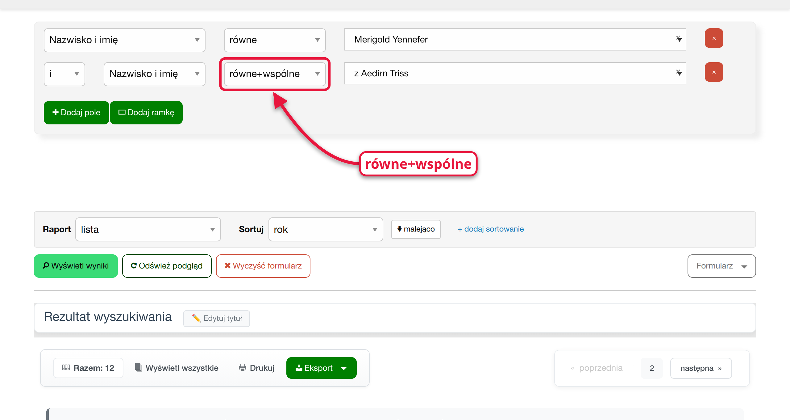
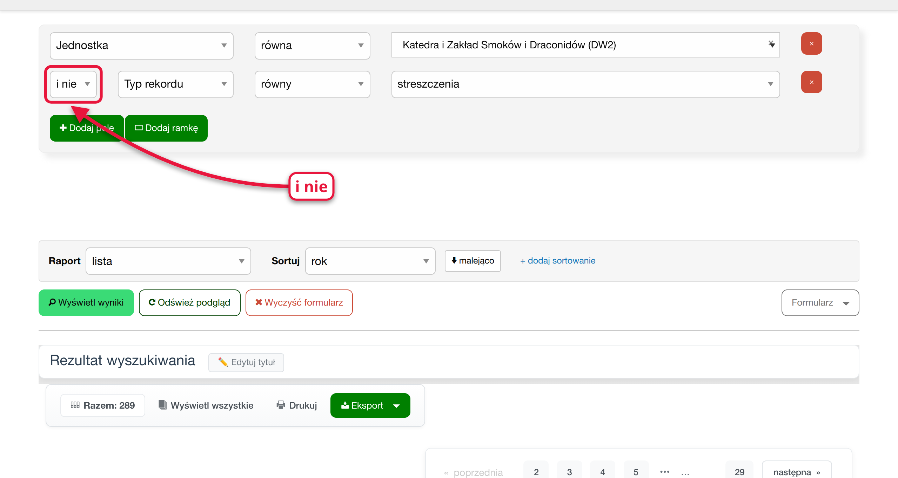
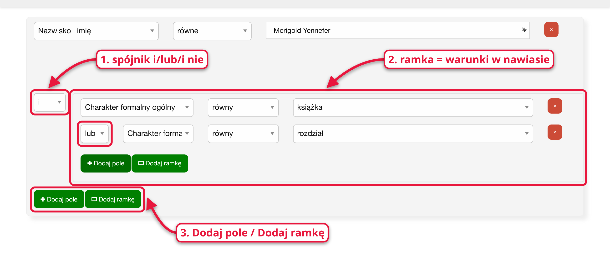
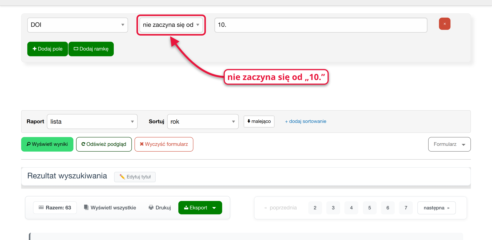

# Wyszukiwanie precyzyjne — przykłady zapytań

Gotowe przepisy na zapytania, które najczęściej przydają się w bibliotece
i przy sprawozdaniach. Każdy zapisujemy jako listę warunków w formacie
**pole — operator — wartość**; spójnik (i / lub / i nie) wybierasz na
początku wiersza. Jak dodać warunek, spójnik i ramkę — opisuje
[Wyszukiwanie precyzyjne — podstawy](wyszukiwanie-precyzyjne.md).

We wszystkich przykładach:

1. Otwórz **szukaj → precyzyjnie** i kliknij **„Wyczyść formularz”**, żeby
   zacząć od czystego formularza.
2. Ustaw pierwszy warunek w istniejącym wierszu, każdy następny dodaj
   przyciskiem **„Dodaj pole”**.
3. Kliknij **„Odśwież podgląd”** (wyniki pod formularzem) albo
   **„Wyświetl wyniki”** (osobna strona).

Nazwy autorów i jednostek w przykładach pochodzą z danych demonstracyjnych —
wpisz w ich miejsce swoje.

## 1. Artykuły autora z lat 2020–2024

| Spójnik | Pole | Operator | Wartość |
|---|---|---|---|
| | Nazwisko i imię | równe | Merigold Yennefer |
| i | Zakres lat | w zakresie | od 2020 do 2024 |
| i | Charakter formalny ogólny | równy | artykuł |

Zamiast „Charakter formalny ogólny” możesz wybrać konkretny **Charakter
formalny** (np. „Artykuł w czasopiśmie”). Bez trzeciego warunku dostaniesz
wszystkie prace autora z tych lat.

## 2. Prace jednostki za co najmniej 100 punktów

| Spójnik | Pole | Operator | Wartość |
|---|---|---|---|
| | Jednostka | równa | Katedra i Zakład Smoków i Draconidów |
| i | Punkty MNiSW | większy lub równy | 100 |

Dla całego wydziału z katedrami wybierz wydział i operator
**„równa+podrzędne”**. Do sprawdzenia sum punktów przełącz **Raport**
na „punktacja sumaryczna”.

## 3. Prace w danej dyscyplinie

| Spójnik | Pole | Operator | Wartość |
|---|---|---|---|
| | Dyscyplina naukowa autora | równe | archeologia |
| i | Rok | równy | 2024 |

Liczy się dyscyplina, którą autor ma przypisaną **w danej pracy** (nie
w swoim profilu). Prace, w których żaden autor nie ma przypisanej
dyscypliny, nie pojawią się w wynikach.

## 4. Prace jednostki w otwartym dostępie

| Spójnik | Pole | Operator | Wartość |
|---|---|---|---|
| | Jednostka | równa+podrzędne | Wydział Alchemii |
| i | OpenAccess: wersja tekstu | równy | Ostateczna wersja opublikowana |

Zamiast wersji tekstu możesz użyć **„OpenAccess: licencja”** (np. CC-BY).
Po zalogowaniu wygodniejsze jest pole **„OpenAccess: licencja ustawiona”**
z wartością **tak** — znajdzie prace z dowolną licencją otwartą. Ogranicz
wyniki do artykułów, dodając „Charakter formalny ogólny — równy — artykuł”.

## 5. Prace z Impact Factor w danym roku

| Spójnik | Pole | Operator | Wartość |
|---|---|---|---|
| | Impact factor | większy, niż | 0 |
| i | Rok | równy | 2024 |

Ustaw **Raport: tabela** — zobaczysz IF każdej pracy w osobnej
kolumnie, a na ostatniej stronie wyników wiersz **„Suma:”**.

## 6. Wspólne prace dwóch współautorów {#dwoch-wspolautorow}

| Spójnik | Pole | Operator | Wartość |
|---|---|---|---|
| | Nazwisko i imię | równe | Merigold Yennefer |
| i | Nazwisko i imię | **równe+wspólne** | z Aedirn Triss |

!!! warning "Dlaczego nie dwa razy „równe”?"
    Dwa warunki „równe” na autorach odnoszą się do **tej samej** osoby
    w pracy — nikt nie jest jednocześnie Merigold i z Aedirn, więc
    wynik byłby pusty. Operator **„równe+wspólne”** sprawdza drugiego
    autora niezależnie. Dla trzeciej osoby dodaj kolejny warunek
    „równe+wspólne”.

To samo zapytanie powstaje samo, gdy na stronie autora klikniesz nazwisko
w sekcji najczęstszych współautorów.

## 7. Prace jednostki bez streszczeń zjazdowych

| Spójnik | Pole | Operator | Wartość |
|---|---|---|---|
| | Jednostka | równa | Katedra i Zakład Smoków i Draconidów |
| **i nie** | Typ rekordu | równy | streszczenia |

„Typ rekordu” dzieli prace na **publikacje**, **streszczenia** i **inne**
według ustawień charakterów formalnych w Twojej uczelni. Ten sam efekt da
warunek „Typ rekordu — różny — streszczenia” połączony spójnikiem „i”.
Żeby zostawić tylko publikacje, użyj „Typ rekordu — równy — publikacje”.

## 8. Książki i rozdziały autora

| Spójnik | Pole | Operator | Wartość |
|---|---|---|---|
| | Nazwisko i imię | równe | Merigold Yennefer |
| i | *ramka:* | | |
| | ↳ Charakter formalny ogólny | równy | książka |
| | ↳ **lub** Charakter formalny ogólny | równy | rozdział |

Drugi i trzeci warunek muszą być **w ramce** (przycisk „Dodaj ramkę”, potem
„Dodaj pole” wewnątrz ramki):

Bez ramki warunki liczą się po kolei — „(autor i książka) lub rozdział” —
i do wyników trafią **wszystkie rozdziały w bazie**, także innych autorów.
W danych demonstracyjnych to 73 prace zamiast 17.

## 9. Prace bez DOI (po zalogowaniu)

| Spójnik | Pole | Operator | Wartość |
|---|---|---|---|
| | DOI | nie zaczyna się od | 10. |

Każdy DOI zaczyna się od „10.”, więc ten warunek znajduje prace z pustym
polem DOI (oraz z DOI wpisanym błędnie). Pole **DOI** widzą tylko
zalogowani. Warunek „DOI — równy” z pustą wartością **nie** zadziała —
puste pole DOI nie jest traktowane jak pusty tekst.

Dodaj „Jednostka” albo „Zakres lat”, żeby sprawdzić braki tylko we własnym
fragmencie bazy.

## 10. Słowa w tytule

| Spójnik | Pole | Operator | Wartość |
|---|---|---|---|
| | Tytuł pracy | zawiera | srebrnych mieczy |
| i | Rok | większy lub równy | 2023 |

„Zawiera” w tytule szuka **całych słów w tej formie, w jakiej je wpiszesz**
(„mieczy” znajdzie „mieczy”, ale nie „miecz”); wszystkie słowa muszą
wystąpić w tytule, w dowolnej kolejności. Gdy znasz początek tytułu, użyj
„zaczyna się od”.

## Zobacz też

- [Wyszukiwanie precyzyjne — podstawy](wyszukiwanie-precyzyjne.md)
- [Wyszukiwanie precyzyjne — praca z wynikami](wyszukiwanie-precyzyjne-wyniki.md)
- [Wyszukiwanie precyzyjne — zapisane formularze](wyszukiwanie-precyzyjne-zapisane.md)
- [Tabela krzyżowa (zestawienia)](tabela-krzyzowa.md)
