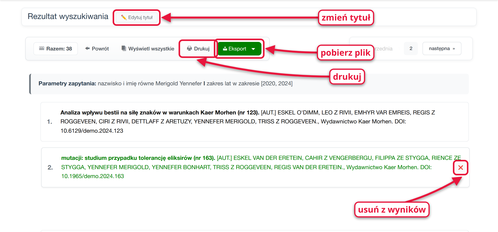
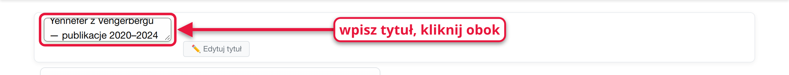
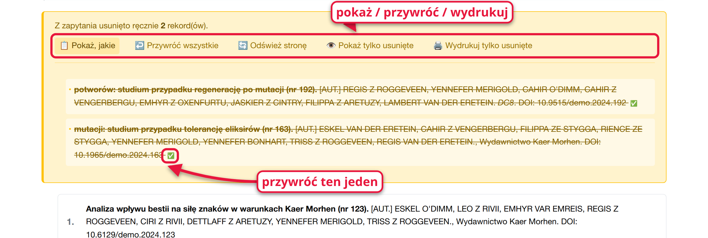

# Wyszukiwanie precyzyjne — praca z wynikami

Gdy zapytanie jest gotowe (patrz
[Wyszukiwanie precyzyjne — podstawy](wyszukiwanie-precyzyjne.md)), kliknij
**„Wyświetl wyniki”**. Otworzy się strona wyników — ten
artykuł opisuje, co można na niej zrobić: nadać tytuł, przejrzeć,
wydrukować, ręcznie wyrzucić pojedyncze rekordy i pobrać plik.

Te same elementy (licznik, „Drukuj”, „Eksport”, usuwanie rekordów) ma też
podgląd pod formularzem, otwierany przyciskiem „Odśwież podgląd”.

## Pasek nad wynikami

- **Razem: N** — liczba znalezionych prac.
- **Powrót** — wraca do formularza (z zachowanymi warunkami).
- **Wyświetl wszystkie** — wszystkie wyniki na jednej stronie zamiast po
  20.
- **Drukuj** — otwiera wszystkie wyniki w wersji do druku i od razu okno
  drukowania przeglądarki (patrz [Drukowanie](#drukowanie)).
- **Eksport** — pobieranie pliku; widoczny tylko po zalogowaniu (patrz
  [Eksport](#eksport)).
- po prawej — numery stron wyników.

Pod paskiem widać **„Parametry zapytania”** — Twoje warunki zapisane
zdaniem.

## Sortowanie

Kolejność wyników ustawiasz **w formularzu**, polem **„Sortuj”**
i — po kliknięciu **„+ dodaj sortowanie”** — drugim kryterium **„potem”**
(najwyżej dwa poziomy, każdy z przełącznikiem **„rosnąco”** /
**„malejąco”**). Do wyboru są m.in. rok, tytuł oryginalny, impact factor,
liczba cytowań, liczba autorów, punkty MNiSW/MEiN, charakter formalny,
typ MNiSW/MEiN i źródło. Domyślnie: rok, malejąco.

Aby zmienić kolejność już wyświetlonych wyników, kliknij **„Powrót”**,
zmień sortowanie i ponownie **„Wyświetl wyniki”**. W podglądzie
pod formularzem zmiana sortowania działa od razu.

## Tytuł zestawienia

Nad wynikami stoi tytuł — domyślnie „Rezultat wyszukiwania”, a gdy
zaczynasz ze strony autora czy jednostki — jej nazwa (albo to, co wpisano
w polu „Tytuł wyników”). Tytuł trafia na wydruk i do pobieranych plików,
więc warto go ustawić przed drukowaniem.

1. Kliknij **„✏️ Edytuj tytuł”** — tytuł zamieni się w pole tekstowe.
2. Wpisz nowy tytuł.
3. Kliknij w dowolne miejsce **obok** pola — tytuł zostanie zapisany.

Tytuł jest pamiętany do końca sesji przeglądarki. „Wyczyść formularz”
przywraca tytuł domyślny.

## Ręczne usuwanie rekordów z wyników {#reczne-usuwanie}

Czasem zapytanie znajduje kilka prac, których nie chcesz w zestawieniu
(np. pracę, którą autor oznaczył jako niedotyczącą sprawozdania). Nie
trzeba wtedy przebudowywać zapytania — można je wyrzucić ręcznie.

1. Najedź myszą na pracę na liście — po prawej stronie pojawi się
   przycisk **❌**.
2. Kliknij go. Opis pracy zostanie przekreślony.
3. Gdy skończysz, odśwież stronę (lub przejdź na inną stronę wyników) —
   przekreślone prace znikną z listy, a licznik „Razem” się zmniejszy.

Ponowne kliknięcie ❌ przy przekreślonej pracy (przed odświeżeniem)
cofa usunięcie.

Po odświeżeniu nad listą pojawi się panel **„Z zapytania usunięto ręcznie
N rekord(ów).”** z przyciskami:

- **📋 Pokaż, jakie** — rozwija listę usuniętych prac; przycisk **✅** przy
  pracy przywraca ją do wyników,
- **↩️ Przywróć wszystkie** — po potwierdzeniu przywraca wszystkie usunięte
  prace,
- **🔄 Odśwież stronę** — przelicza wyniki po kolejnych usunięciach,
- **👁️ Pokaż tylko usunięte** — wyświetla wyłącznie usunięte prace (powrót:
  „↩️ Pokaż wszystkie rekordy”),
- **🖨️ Wydrukuj tylko usunięte** — drukuje listę usuniętych prac, np. jako
  załącznik „czego nie uwzględniono”.

Ręczne usunięcia obowiązują **tylko w Twojej sesji przeglądarki** — nie
zmieniają niczego w bazie i inni użytkownicy ich nie widzą. Lista usuniętych
jest czyszczona przy „Wyczyść formularz” i gdy zaczynasz nowe wyszukiwanie
ze strony autora, jednostki czy źródła. Zmiana samych warunków w formularzu
jej nie czyści. Wydruk i eksport uwzględniają usunięcia.

## Drukowanie {#drukowanie}

Przycisk **„Drukuj”** otwiera wszystkie wyniki (bez podziału na strony)
w układzie do druku i od razu okno drukowania przeglądarki — możesz
wybrać drukarkę albo „Zapisz jako PDF”. Wydruk zawiera tytuł zestawienia
i — jeśli tak ustawiła uczelnia — parametry zapytania; przyciski i panele
są pomijane. Wielkość czcionki, marginesy i (opcjonalnie) orientację kartki
ustawia administrator w danych uczelni (patrz
[Wydruki](../redaktor/uczelnia.md#wydruki)). Jeśli uczelnia nie narzuca
orientacji, możesz w oknie drukowania wybrać układ poziomy — w raporcie
w formie tabeli daje on wyraźnie szersze wiersze.

„Drukuj” i „Wyświetl wszystkie” znikają, gdy wyników jest bardzo dużo.
Próg ustawia uczelnia, osobno dla niezalogowanych (domyślnie 2000 prac)
i zalogowanych (domyślnie 10 000). Ponad 25 000 wyników strona w ogóle ich
nie wyświetla i prosi o zawężenie zapytania.

## Eksport {#eksport}

Po zalogowaniu na pasku wyników jest przycisk **„Eksport”** z formatami:
**CSV**, **XLS: dane**, **XLS: opis bibliograficzny**, **HTML**, **MS Word
(portret)** i **MS Word (pejzaż)** — plik Word na kartce A4 pionowej albo
poziomej (w raporcie BibTeX — **BibTeX (.bib)**). Jednorazowo można pobrać
do 5000 prac. Krok po kroku: [Jak pobrać listę
publikacji](pobieranie-listy-publikacji.md).

## Kto co widzi

| | Niezalogowany | Zalogowany |
|---|---|---|
| Pola w formularzu | podstawowe | więcej pól (m.in. DOI, Adnotacje, daty utworzenia i zmiany) |
| Rodzaje raportu | lista, tabela, punktacja sumaryczna, BibTeX, tabela krzyżowa | dodatkowo m.in. numerowana lista z uwagami i warianty z liczbą cytowań |
| Prace o ukrytych statusach korekty | niewidoczne (jeśli uczelnia je ukryła) | widoczne |
| Drukowanie, ręczne usuwanie | tak | tak |
| Eksport do pliku | nie | tak |
| Zapisywanie formularzy | nie | tylko redaktorzy — patrz [Zapisane formularze](wyszukiwanie-precyzyjne-zapisane.md) |

Dokładny zakres pól dla każdej grupy ustala uczelnia.

## Zobacz też

- [Wyszukiwanie precyzyjne — podstawy](wyszukiwanie-precyzyjne.md)
- [Wyszukiwanie precyzyjne — przykłady zapytań](wyszukiwanie-precyzyjne-przyklady.md)
- [Wyszukiwanie precyzyjne — zapisane formularze](wyszukiwanie-precyzyjne-zapisane.md)
- [Tabela krzyżowa (zestawienia)](tabela-krzyzowa.md)
