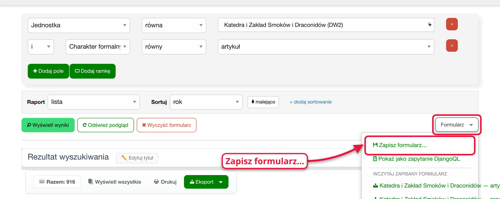
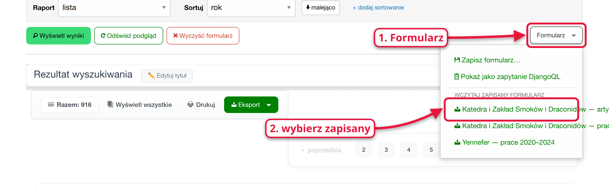
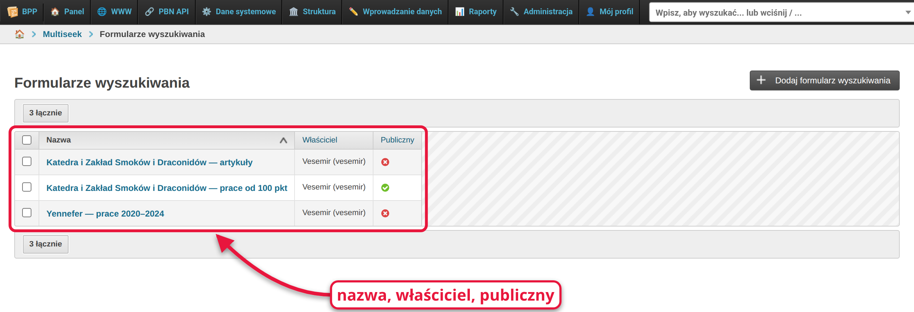

# Wyszukiwanie precyzyjne — zapisane formularze

Zapytanie, które powtarzasz co miesiąc czy co roku (np. „prace kliniki od
100 punktów”), można **zapisać pod nazwą** i potem wczytać jednym
kliknięciem, zamiast za każdym razem budować warunki od nowa. Formularz
zapisany jako publiczny jest dostępny dla wszystkich odwiedzających —
także niezalogowanych — więc biblioteka może w ten sposób udostępniać
gotowe zestawienia.

## Kto może zapisywać

Pozycję **„Zapisz formularz…”** w menu **„Formularz”** widzą tylko osoby
z dostępem do modułu redagowania (konta z uprawnieniami redaktora w panelu
administracyjnym, zwykle pracownicy biblioteki). Zwykły zalogowany użytkownik i odwiedzający
bez logowania mogą zapisane formularze **wczytywać**, ale nie zapisywać.

## Zapisywanie formularza

1. Zbuduj zapytanie w formularzu **szukaj → precyzyjnie** (patrz
   [Wyszukiwanie precyzyjne — podstawy](wyszukiwanie-precyzyjne.md)).
   Zapisywane są warunki, a także rodzaj raportu i sortowanie.
2. Kliknij **„Formularz”** (pod warunkami, po prawej) i wybierz
   **„Zapisz formularz…”**.

    

3. W okienku **„Nazwa formularza?”** wpisz nazwę, pod którą formularz
   będzie widoczny na liście, np. „Katedra i Zakład Smoków i Draconidów —
   artykuły”.
   Nazwa nie może być pusta.
4. Odpowiedz na pytanie **„Czy ten formularz powinien być dostępny dla
   wszystkich użytkowników tego serwisu?”**:
    - **OK** — formularz **publiczny**: zobaczy go i wczyta każdy,
      także bez logowania,
    - **Anuluj** — formularz **prywatny**: widzisz go tylko Ty.
5. Pojawi się komunikat **„Formularz został zapisany.”**

!!! note "Zapisywane jest zapytanie, nie wyniki"
    Po wczytaniu formularz wyszukuje na nowo, w aktualnej bazie — więc
    „prace kliniki od 100 punktów” wczytane za rok pokażą także prace
    dodane w międzyczasie. Tytuł zestawienia ani ręcznie usunięte rekordy
    nie są zapisywane.

## Nadpisywanie formularza

Aby poprawić zapisany formularz, wczytaj go, zmień warunki i zapisz
**pod tą samą nazwą**. System zapyta: **„W bazie danych już znajduje się
formularz o takiej nazwie. Nadpisać?”** — **OK** zastępuje stary formularz
nowym (łącznie z ustawieniem publiczny/prywatny, o które pytanie pada
ponownie).

Nadpisać możesz tylko **własny** formularz. Jeśli nazwa należy do innej
osoby, zobaczysz komunikat **„Formularz o tej nazwie należy do innego
użytkownika — wybierz inną nazwę.”**

## Wczytywanie formularza

1. Otwórz **szukaj → precyzyjnie**.
2. Kliknij **„Formularz”** i wybierz nazwę z listy **„Wczytaj zapisany
   formularz”**.

Formularz zastąpi bieżące warunki. Możesz od razu kliknąć „Wyświetl wyniki
wyszukiwania” albo najpierw zmienić warunki — np. rok — bez wpływu na
zapisaną wersję (dopóki jej nie nadpiszesz).

Lista pokazuje:

- niezalogowanym — formularze publiczne,
- zalogowanym — formularze publiczne oraz własne prywatne.

Lista „Wczytaj zapisany formularz” pojawia się w menu tylko wtedy, gdy
jest co najmniej jeden formularz.

## Udostępnianie współpracownikom

Osobnego udostępniania wybranym osobom nie ma — formularz jest albo
prywatny, albo publiczny dla wszystkich. Aby udostępnić zapytanie
koledze, zapisz je jako **publiczne** i podaj mu nazwę: znajdzie je na
liście „Wczytaj formularz”.

## Usuwanie i porządkowanie

Formularza nie da się usunąć ani przemianować z poziomu wyszukiwarki. Robi
to administrator BPP w panelu administracyjnym: **Administracja →
Formularze wyszukiwania**. Lista pokazuje nazwę, właściciela i to, czy
formularz jest publiczny; tam też można zmienić nazwę, właściciela, ustawienie
„Publiczny” albo usunąć formularz.

Jeśli chcesz usunąć swój formularz albo zmienić go z publicznego na
prywatny bez ponownego zapisywania — poproś administratora.

## Zobacz też

- [Wyszukiwanie precyzyjne — podstawy](wyszukiwanie-precyzyjne.md)
- [Wyszukiwanie precyzyjne — przykłady zapytań](wyszukiwanie-precyzyjne-przyklady.md)
- [Wyszukiwanie precyzyjne — praca z wynikami](wyszukiwanie-precyzyjne-wyniki.md)
- [Tabela krzyżowa (zestawienia)](tabela-krzyzowa.md)
