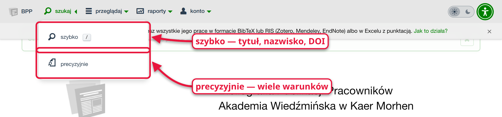
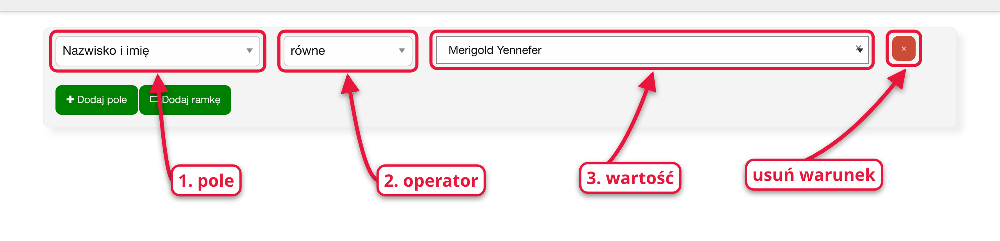
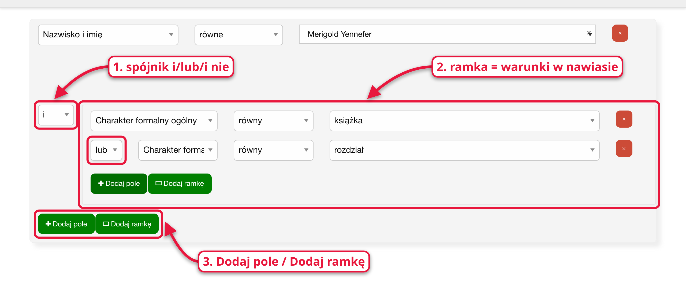
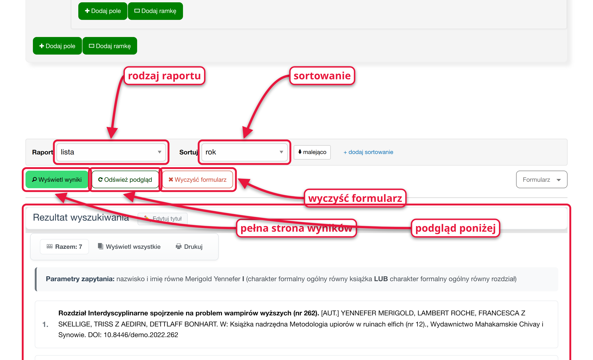
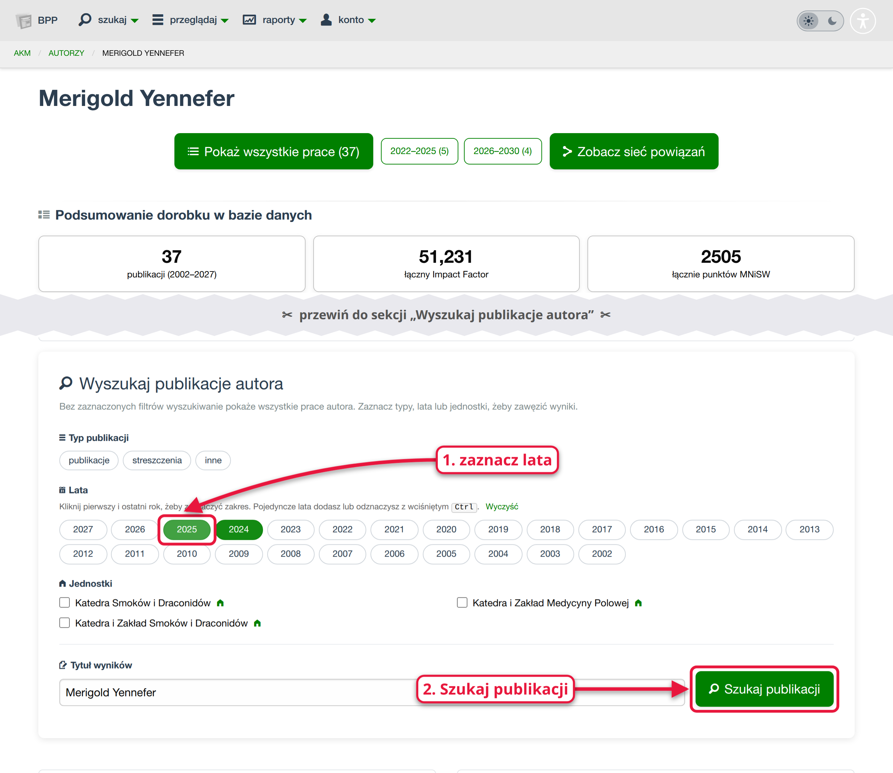
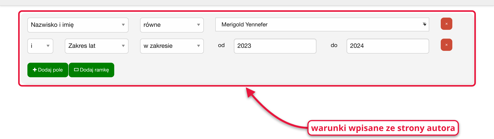

# Wyszukiwanie precyzyjne — podstawy

**Wyszukiwanie precyzyjne** to formularz, w którym budujesz zapytanie z wielu
warunków naraz — np. „prace tego autora **i** z lat 2020–2024 **i** będące
artykułami”. Działa bez logowania; po zalogowaniu dostępnych jest więcej pól
i rodzajów raportu.

To pierwszy z pięciu artykułów o wyszukiwaniu precyzyjnym:

- podstawy formularza — ten artykuł,
- [przykłady zapytań](wyszukiwanie-precyzyjne-przyklady.md) — gotowe przepisy,
- [praca z wynikami](wyszukiwanie-precyzyjne-wyniki.md) — tytuł, drukowanie,
  ręczne usuwanie rekordów, eksport,
- [zapisane formularze](wyszukiwanie-precyzyjne-zapisane.md) — zapisywanie
  i wczytywanie gotowych zapytań,
- [tabela krzyżowa](tabela-krzyzowa.md) — zestawienie wyników w tabeli
  (np. punkty według jednostki i roku).

## Jak otworzyć formularz

Na górnej belce wybierz **szukaj → precyzyjnie**.

Formularz otworzysz też ze strony autora, jednostki, źródła albo wydawcy —
przyciskiem **„Szukaj publikacji”** (patrz
[niżej](#start-ze-strony-autora-lub-jednostki)).

## Warunek: pole, operator, wartość

Każdy wiersz formularza to jeden **warunek**. Ustawiasz go w trzech krokach:

1. **Pole** — czego dotyczy warunek, np. „Nazwisko i imię”, „Rok”,
   „Charakter formalny”.
2. **Operator** — jak porównać, np. „równe”, „zawiera”, „większy lub równy”.
   Lista operatorów zależy od wybranego pola.
3. **Wartość** — czego szukasz. Zależnie od pola wpisujesz tekst lub liczbę,
   wybierasz z listy albo — przy autorach, jednostkach, źródłach — klikasz
   pole i zaczynasz pisać, a system podpowiada pasujące pozycje.

Czerwony przycisk **×** na końcu wiersza usuwa warunek (ostatniego,
jedynego warunku usunąć się nie da).

### Jakie pola są do wyboru

Pola są na liście w jednym ciągu; poniżej pogrupowaliśmy je według tematu.
Kolejność i widoczność pól ustala uczelnia, więc u Ciebie lista może się
nieco różnić.

| Temat | Pola |
|---|---|
| Autorzy | Nazwisko i imię, Autor, Redaktor, Tłumacz, Recenzent, Pierwsze nazwisko i imię, ORCID, Dyscyplina naukowa autora, Kierunek studiów |
| Jednostki | Jednostka, Wydział, Pierwsza jednostka, Pierwszy wydział, Aktualna jednostka dowolnego autora, Rodzaj jednostki |
| Rok | Rok, Zakres lat |
| Rodzaj pracy | Typ rekordu (publikacje / streszczenia / inne), Charakter formalny, Charakter formalny ogólny (artykuł / rozdział / książka / inne), Typ MNiSW, Praca recenzowana, Język |
| Gdzie wydano | Źródło, Wydawca, Wydawnictwo nadrzędne, Konferencja, Rodzaj konferencji, Konferencja w bazie Web of Science, Konferencja w bazie Scopus |
| Punkty i wskaźniki | Punkty MNiSW, Impact factor, Liczba cytowań, Index Copernicus, Punktacja SNIP, Punktacja wewnętrzna |
| Treść | Tytuł pracy, Słowa kluczowe, Informacje, Szczegóły, Uwagi, Liczba autorów, Liczba znaków wydawniczych |
| Open Access | OpenAccess: wersja tekstu, OpenAccess: licencja, OpenAccess: czas udostępnienia |
| Inne | Zewnętrzna baza danych, Status korekty |

Po zalogowaniu dochodzą m.in.: **Typ odpowiedzialności**, **Nazwisko i imię
(od 1 do 3)**, **Nazwisko i imię (od 1 do 5)**, **Ostatnie nazwisko i imię**,
**DOI**, **Adnotacje**, **Data utworzenia**, **Ostatnio zmieniony**,
**Afiliuje**, **Obca jednostka**, **Dyscyplina ustawiona**, **OpenAccess:
licencja ustawiona**, **Dostęp dnia ustawiony**, **Strona WWW ustawiona**.

### Operatory

| Rodzaj pola | Operatory |
|---|---|
| tekst (Tytuł pracy, Informacje, Uwagi, DOI…) | zawiera, nie zawiera, równy, różny, zaczyna się od, nie zaczyna się od |
| liczba (Rok, Punkty MNiSW, Impact factor…) | równy, różny, większy, niż, mniejszy, niż, większy lub równy, mniejszy lub równy |
| Zakres lat | w zakresie, poza zakresem (wpisujesz rok „od” i „do”) |
| data (Data utworzenia, Ostatnio zmieniony) | równa, różna, większa, niż, większa lub równa, mniejsza, niż, mniejsza lub równa, w zakresie, poza zakresem |
| wybór z listy (Charakter formalny, Język, Typ MNiSW…) | równy, różny |
| autor (Nazwisko i imię) | równe, różne, równe+wspólne |
| jednostka (Jednostka, Pierwsza jednostka) | równa, różna, równa+podrzędne, równa+wspólna, równa+podrzędne+wspólna |

Kilka operatorów wymaga wyjaśnienia:

- **„zawiera” w polu „Tytuł pracy”** szuka **całych słów** — wpisz słowo
  tak, jak występuje w tytule („eliksirów”, nie „eliksir”). Kilka słów
  oznacza, że tytuł musi zawierać je wszystkie, w dowolnej kolejności.
  Fragment początku tytułu znajdziesz operatorem „zaczyna się od”.
- **„równa+podrzędne”** (jednostka) — wybrana jednostka **razem z jej
  jednostkami podrzędnymi**, np. wydział ze wszystkimi katedrami.
- **„równe+wspólne”, „równa+wspólna”** — warunek dotyczy **dowolnego**
  autora pracy, niezależnie od pozostałych warunków. Przy zwykłym „równe”
  warunki dotyczące autorów odnoszą się do **tego samego** autora: „Nazwisko
  i imię równe Kowalski **i** Jednostka równa Katedra X” znajdzie prace,
  w których Kowalski podpisał się Katedrą X. Gdy szukasz pracy **dwóch
  różnych** osób, drugą osobę dodaj z operatorem „równe+wspólne” — patrz
  [przykład](wyszukiwanie-precyzyjne-przyklady.md#dwoch-wspolautorow).
- **„Charakter formalny” równy** obejmuje też charaktery mu podrzędne.

## Kilka warunków: i, lub, i nie

Przycisk **„Dodaj pole”** dodaje kolejny warunek. Na początku nowego wiersza
pojawia się spójnik:

- **i** — muszą być spełnione oba warunki (zawęża wyniki),
- **lub** — wystarczy jeden z nich (poszerza wyniki),
- **i nie** — poprzednie warunki spełnione, ten — **nie** (wyklucza).

Warunki są łączone **po kolei, od góry do dołu**: „A i B lub C” oznacza
„(A i B) lub C”. Gdy chcesz inaczej — użyj ramki.

## Ramki, czyli nawiasy

Przycisk **„Dodaj ramkę”** wstawia **ramkę** — grupę warunków, które są
sprawdzane razem, tak jak wyrażenie w nawiasie. Ramka ma własne przyciski
„Dodaj pole” i „Dodaj ramkę” (ramki można zagnieżdżać), a jej spójnik
(i / lub / i nie) łączy całą grupę z warunkami nad nią.

Przykład z obrazka: prace Yennefer Merigold, **i** (książka **lub**
rozdział):

Bez ramki „autor i książka lub rozdział” znalazłoby książki tej autorki
**oraz wszystkie rozdziały w bazie**, także cudze.

## Podgląd, pełne wyniki, raport i sortowanie

Pod warunkami znajdziesz:

- **Raport** — jak pokazać wyniki: **lista** (opisy
  bibliograficzne), **tabela** (z kolumnami IF, PK, charakter, typ),
  **punktacja sumaryczna** (tabela z sumami punktów), **BibTeX** (do
  skopiowania przyciskiem „Skopiuj wszystko do schowka”) oraz **tabela
  krzyżowa** — zestawienie liczb w wierszach i kolumnach (osobny artykuł:
  [Tabela krzyżowa](tabela-krzyzowa.md)). Zalogowani mają dodatkowo
  m.in. „numerowaną listę z uwagami” i warianty z liczbą cytowań.
- **Sortuj** — kryterium sortowania (rok, tytuł, punkty, impact factor,
  liczba cytowań, charakter formalny…). Przycisk **„+ dodaj sortowanie”**
  dokłada drugie kryterium (**„potem”**), **×** je usuwa — najwyżej dwa
  poziomy. Przełącznik obok pola (**„↑ rosnąco”** / **„↓ malejąco”**)
  zmienia kierunek. Domyślnie: rok, malejąco.
- **„Wyświetl wyniki”** — otwiera osobną stronę z pełnymi
  wynikami (patrz [Praca z wynikami](wyszukiwanie-precyzyjne-wyniki.md)).
- **„Odśwież podgląd”** — pokazuje wyniki **pod formularzem**, bez
  opuszczania strony. Podgląd nie odświeża się sam po zmianie warunku —
  kliknij ten przycisk. Zmiana raportu albo sortowania odświeża
  podgląd od razu.
- **„Wyczyść formularz”** — po potwierdzeniu czyści wszystkie warunki,
  przywraca domyślny tytuł i listę ręcznie usuniętych rekordów.

Nad podglądem i wynikami widać **„Parametry zapytania”** — Twoje warunki
zapisane zdaniem. To dobre miejsce, by sprawdzić, czy system zrozumiał
zapytanie tak, jak chciałeś.

!!! tip "Formularz pamięta Twoje zapytanie"
    Warunki są zapamiętywane do końca sesji przeglądarki. Po przejściu na
    stronę publikacji i powrocie do **szukaj → precyzyjnie** zastaniesz
    formularz w tym samym stanie.

## Start ze strony autora lub jednostki {#start-ze-strony-autora-lub-jednostki}

Najszybciej zacząć od gotowej strony. Na stronie autora (a także jednostki,
źródła czy wydawcy) jest sekcja wyszukiwania — zaznacz lata, typ, jednostkę
i kliknij **„Szukaj publikacji”**.

Otworzy się formularz wyszukiwania precyzyjnego z **już wpisanymi
warunkami** — możesz je zmieniać, dodawać kolejne albo od razu kliknąć
„Wyświetl wyniki”. Tytuł wyników przejmie wartość z pola
„Tytuł wyników” na stronie autora.

Każde takie przejście zaczyna nowe wyszukiwanie: poprzednie warunki
i lista ręcznie usuniętych rekordów są zastępowane.

!!! note "Dla redaktorów"
    Redaktorzy mają dodatkowo w menu **„Formularz”** (po prawej, pod
    warunkami) pozycję **„Pokaż jako zapytanie DjangoQL”**, która przekłada
    formularz na zapytanie tekstowe — patrz
    [Wyszukiwanie i redagowanie](../redaktor/wyszukiwanie-redagowanie.md).

## Zobacz też

- [Wyszukiwanie precyzyjne — przykłady zapytań](wyszukiwanie-precyzyjne-przyklady.md)
- [Wyszukiwanie precyzyjne — praca z wynikami](wyszukiwanie-precyzyjne-wyniki.md)
- [Wyszukiwanie precyzyjne — zapisane formularze](wyszukiwanie-precyzyjne-zapisane.md)
- [Tabela krzyżowa (zestawienia)](tabela-krzyzowa.md)
