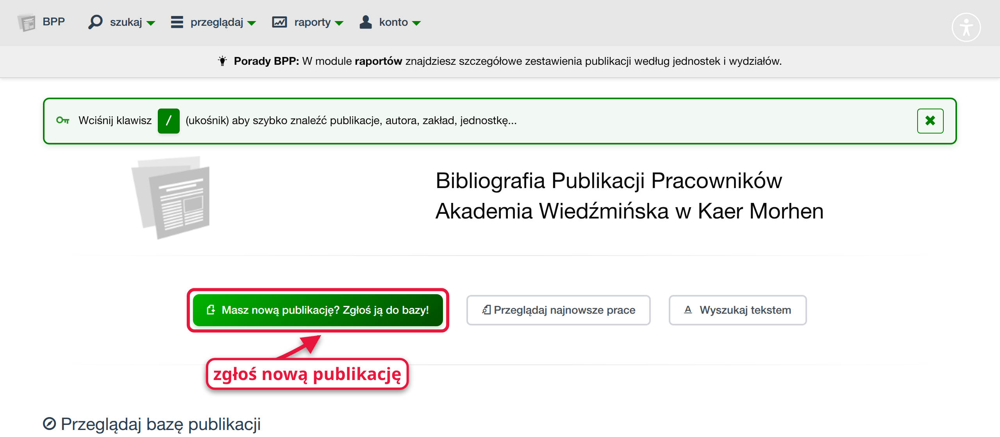
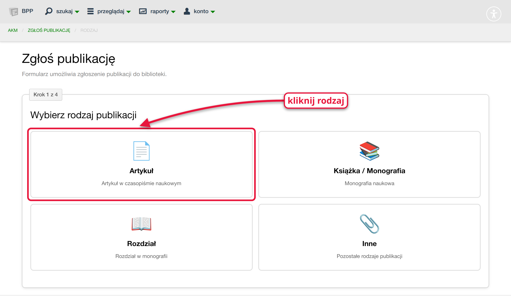
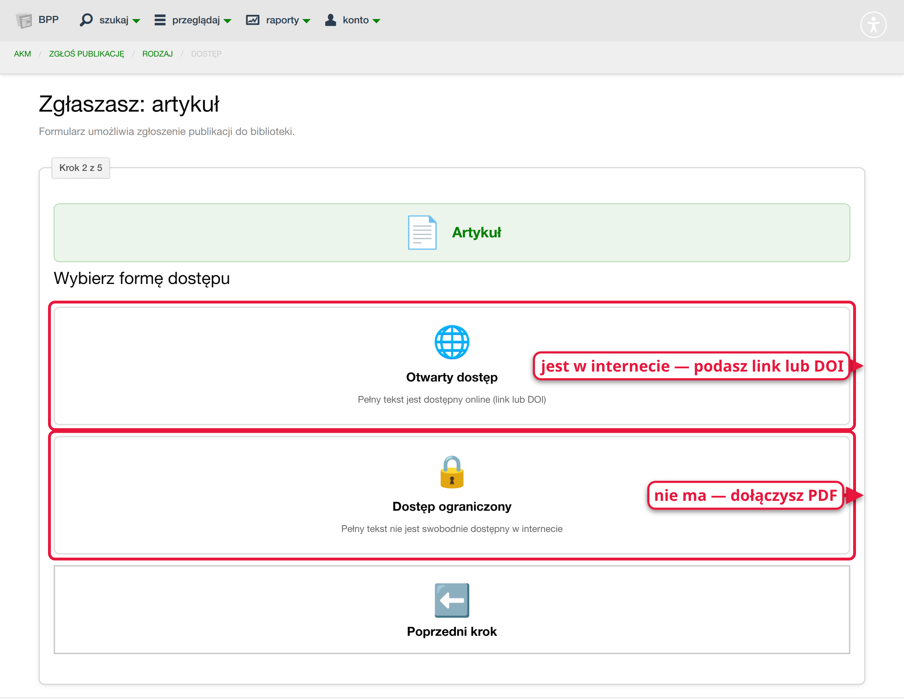
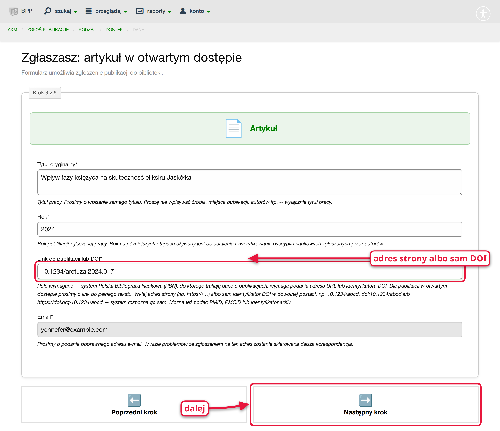
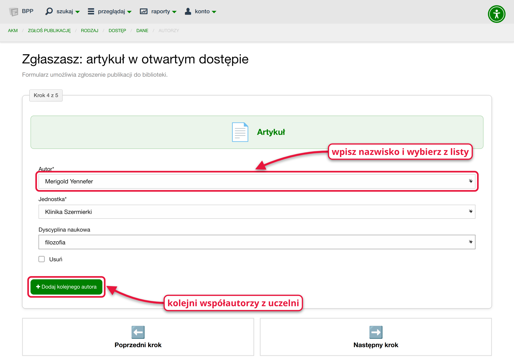
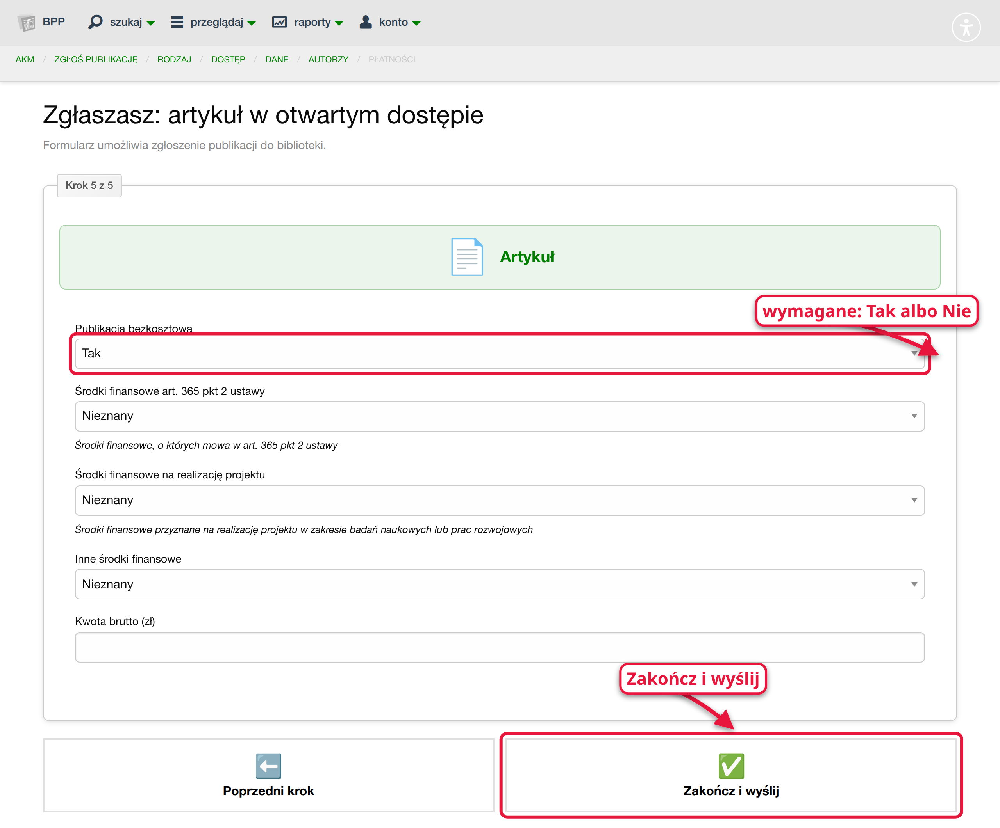
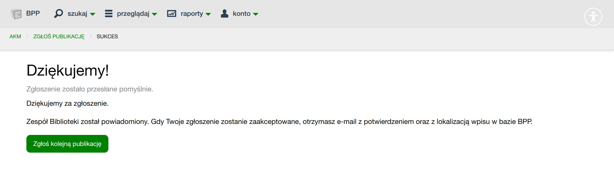

# Jak zgłosić nową publikację

Brakuje Twojej pracy w BPP? Możesz ją zgłosić sam przez formularz
**„Zgłoś publikację”**. Zgłoszenie trafia do redaktorów BPP (zwykle
w bibliotece) — sprawdzą je i dopiszą pracę do bazy. Nie musisz znać
punktacji ani opisu bibliograficznego: wystarczy tytuł, rok i link albo plik.

!!! note "Nie widzisz przycisku?"
    Formularz włącza uczelnia. Jeśli na stronie głównej nie ma przycisku
    „Zgłoś”, zaloguj się — część uczelni udostępnia go tylko zalogowanym.
    Gdy i wtedy go nie ma, Twoja uczelnia przyjmuje zgłoszenia inaczej
    (np. mailem do biblioteki).

## Krok po kroku

1. Na **stronie głównej** BPP kliknij **„Masz nową publikację? Zgłoś ją do
   bazy!”**.

    

2. **Rodzaj** — kliknij kafelek: **Artykuł**, **Książka / Monografia**,
   **Rozdział** albo **Inne**. Formularz od razu przejdzie dalej.

    

    Jeśli nie jesteś zalogowany, nad kafelkami pojawi się krótka
    automatyczna weryfikacja „czy nie jesteś robotem” — nie trzeba niczego
    przepisywać, wystarczy chwilę poczekać.

3. **Dostęp** — czy pełny tekst jest w internecie?
    - **Otwarty dostęp** — tak; w następnym kroku podasz link albo DOI,
    - **Dostęp ograniczony** — nie; w następnym kroku dołączysz plik PDF.

    

4. **Dane** — wpisz **sam tytuł** (bez autorów i nazwy czasopisma),
   **rok** oraz **link albo DOI**. DOI możesz wkleić w dowolnej postaci
   (`10.1234/abcd`, `doi:10.1234/abcd`, `https://doi.org/10.1234/abcd`).
   Przy rozdziale wskaż jeszcze książkę, w której się ukazał. Adres e-mail
   — jeśli jesteś zalogowany — podpowie się sam. Kliknij **„Następny
   krok”**.

    

5. **Autorzy** — w polu **Autor** zacznij pisać nazwisko i wybierz osobę
   z listy. **Jednostka** uzupełni się sama, a **Dyscyplina** podpowie
   dyscypliny przypisane autorowi w danym roku. Współautorów z uczelni
   dodasz przyciskiem **„Dodaj kolejnego autora”**.

    Jeśli autor **nie ma przypisanej dyscypliny na rok publikacji**, lista
    **Dyscyplina** ma nagłówek *„Autor nie ma dyscypliny na rok …”*
    i podpowiada jego dyscypliny z ubiegłego roku (albo z najbliższego
    wcześniejszego roku, w którym je miał — rok jest podany w nagłówku),
    a gdy autor nie miał dyscypliny nigdy — dyscypliny **typowe dla
    uczelni** (najczęściej przypisywane w pracach z ostatnich trzech lat).
    Można wybrać tylko dyscyplinę z podpowiedzi. Wybrana dyscyplina to
    **propozycja dla redakcji** — wysłanie zgłoszenia nie zmienia danych
    autora. Dyscyplina zostanie przypisana autorowi na rok publikacji
    dopiero wtedy, gdy redakcja zatwierdzi zgłoszenie (doda pracę do bazy).

    **Dyscyplinę i jednostkę uczelni podaje się tylko dla autorów
    uczelni** — osób, które są lub były przypisane do którejś z jednostek
    uczelni (także doktorantów, studentów czy emerytów). Po wybraniu
    autora spoza uczelni pole **Dyscyplina** znika z formularza, a pole
    **Jednostka** ustawia się na obcą jednostkę uczelni — lista jednostek
    podpowiada wtedy tylko ją. Zgłoszenie z dyscypliną albo z inną
    jednostką niż obca (także jednostką innej uczelni) przy takim autorze
    nie zostanie przyjęte (komunikat przy polu). Jeśli uczelnia nie ma
    ustawionej obcej jednostki, autora spoza uczelni nie da się zgłosić —
    formularz poprosi o kontakt z biblioteką lub redakcją. Wybrana przy
    autorze **Jednostka** trafia tylko do zgłoszenia — nie zmienia danych
    autora w bazie (jego aktualnej jednostki). Zgłoszenie, także poprawione
    po zwrocie, nie zmienia żadnych danych autorów.

    

6. **Płatności** (tylko przy niektórych rodzajach prac) — zaznacz, czy
   publikacja była **bezkosztowa** (to pole jest wymagane). Jeśli
   była płatna, podaj źródło finansowania i kwotę — jeśli ich nie znasz,
   zostaw „Nieznany”. Kliknij **„Zakończ i wyślij”**.

    

7. Gotowe — zobaczysz **„Dziękujemy!”**.

    

## Co dalej

- Redaktor BPP sprawdza zgłoszenie i dopisuje pracę do bazy. Gdy się pojawi,
  znajdziesz ją na swojej stronie autora albo w wyszukiwarce.
- Jeśli czegoś brakuje, redaktor **zwróci zgłoszenie** — w mailu będzie
  powód i link do poprawienia formularza. Po poprawce zgłoszenie wraca do
  redaktora samo.
- W ciągu godziny można wysłać ograniczoną liczbę zgłoszeń. Jeśli zobaczysz
  komunikat o przekroczonym limicie, spróbuj ponownie później.

Jak zgłoszenia obsługuje redakcja: [Obsługa zgłoszeń publikacji (dla redaktora)](../redaktor/obsluga-zgloszen.md); ustawienia formularza: [Zgłaszanie publikacji — administrator](../administrator/zglaszanie-publikacji.md).
